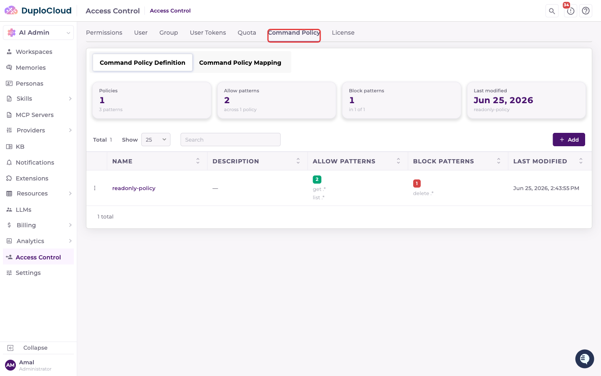
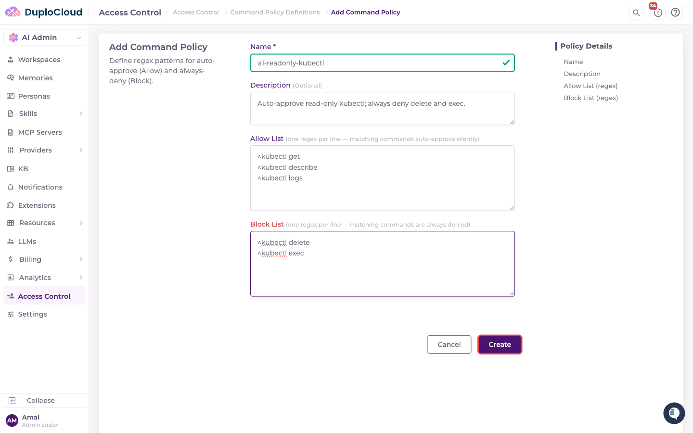
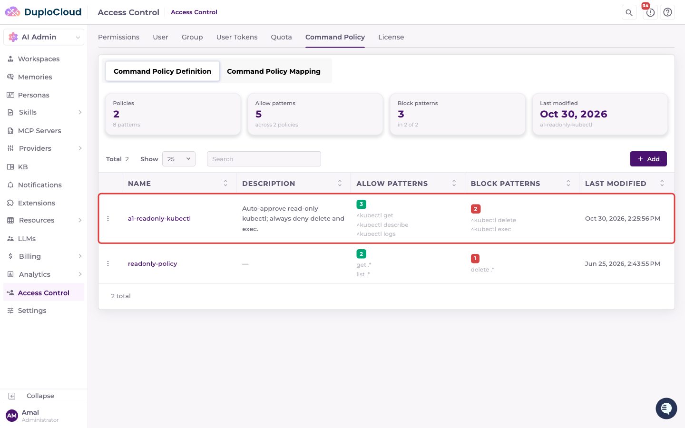
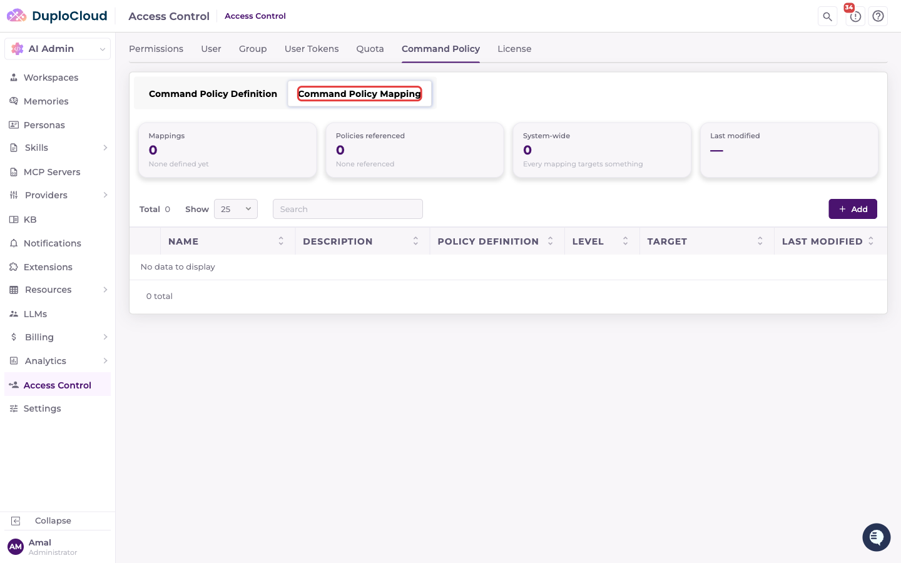
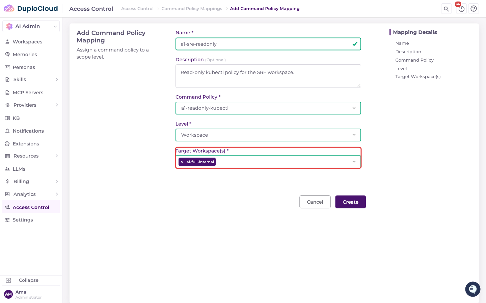
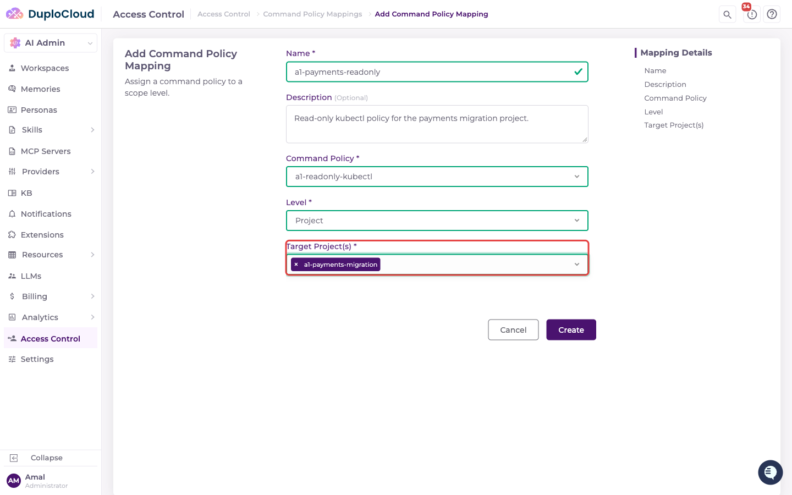
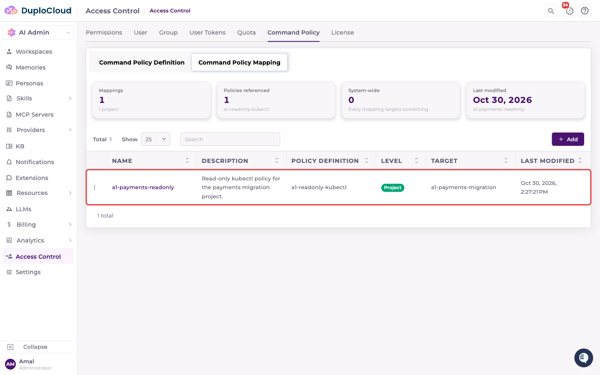
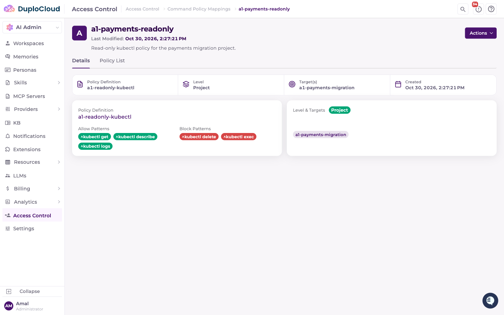

# Command Policy

Command Policies let administrators define, once, which shell commands an agent may run without asking and which it may never run — applied platform-wide, per workspace, or per project, rather than set up by hand on every ticket. A **Command Policy Definition** holds the regex rules, and a **Command Policy Mapping** applies a definition to a scope.

Go to **AI Admin → Access Control → Command Policy**.

***

## Command Policy Definitions

The **Command Policy Definition** tab lists every definition. The cards at the top summarize them: how many there are, the total allow and block patterns, and the most recently modified. The table shows each definition's description and a preview of its allow and block patterns.

A definition holds two lists of regular expressions, one per line:

* **Allow List** — commands matching any pattern here are auto-approved
* **Block List** — commands matching any pattern here are always denied

### Add a Command Policy Definition

Click **+ Add** and fill in:

* **Name\*** — a label for the policy. It must start with a letter, and can't be changed after the policy is created.
* **Description** — optional
* **Allow List** — one regex per line
* **Block List** — one regex per line

Click **Create**. Every pattern is checked when you save, and an invalid regex is rejected.


Patterns are matched case-insensitively, and anywhere in the command — `kubectl get` also matches `sudo kubectl get pods`. Start a pattern with `^` to match only from the beginning of the command, as in `^kubectl get `.


A definition does nothing on its own until a mapping applies it. A definition can't be deleted while an active mapping still references it — delete the mapping first.

***

## Command Policy Mappings

Click the **Command Policy Mapping** tab. A mapping binds a definition to a level and, for Workspace and Project levels, to one or more targets. The cards at the top show how many mappings there are, how many definitions they reference, and whether a System-wide mapping exists. The table shows each mapping's policy definition, level, and target.

### Add a Command Policy Mapping

Click **+ Add** and fill in:

* **Name\*** — a label for the mapping
* **Description** — optional
* **Command Policy\*** — the definition to apply
* **Level\*** — **System**, **Workspace**, or **Project**. The form opens with **System** selected, so change it before you click **Create** if you don't mean to apply the policy platform-wide.
* **Target Workspace(s)\*** / **Target Project(s)\*** — shown only for Workspace or Project level; select one or more

Click **Create**.

Only one active System mapping can exist, and each workspace or project can be covered by only one active mapping at its level. Adding a target that another mapping already covers fails with an error naming that mapping — remove the target from the existing mapping first.

Click a mapping's name to open it. The **Details** tab shows its definition, level, targets, and the allow and block patterns it applies.

***

## How commands are evaluated

Policies at different levels add up rather than override each other. When the agent asks to run commands on a ticket, the patterns that apply are:

* the ticket's own **Commands** patterns (see [Create a Ticket](../tickets.md#commands))
* the active **System** mapping's policy
* the policy mapped to the ticket's **workspace**
* the policy mapped to the ticket's **project**, if the ticket was started from a project

These are evaluated in two steps:

1. **Block** — if any command matches a block pattern from any of these sources, the whole request is rejected. Block always wins over allow.
2. **Allow** — the allow patterns from all sources are pooled. If every command matches at least one of them, the request is approved without asking.

Anything else waits for a person to approve it on the ticket, as described in [Approving commands as the agent works](../tickets.md#approving-commands-as-the-agent-works).
