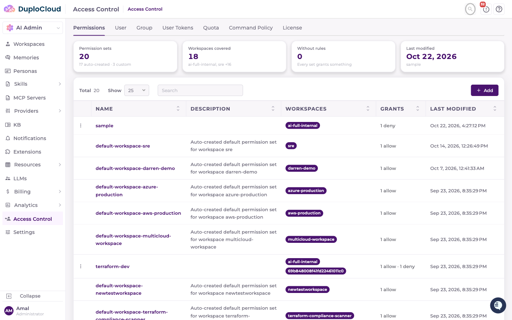
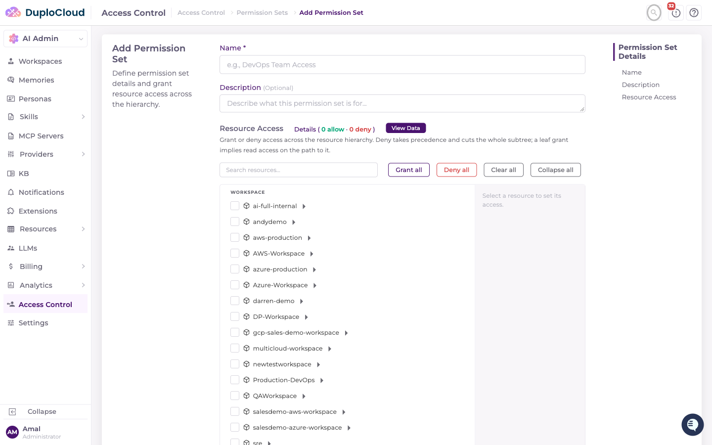
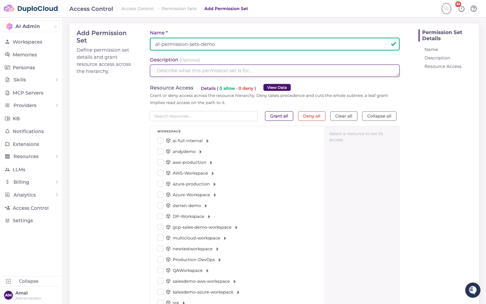
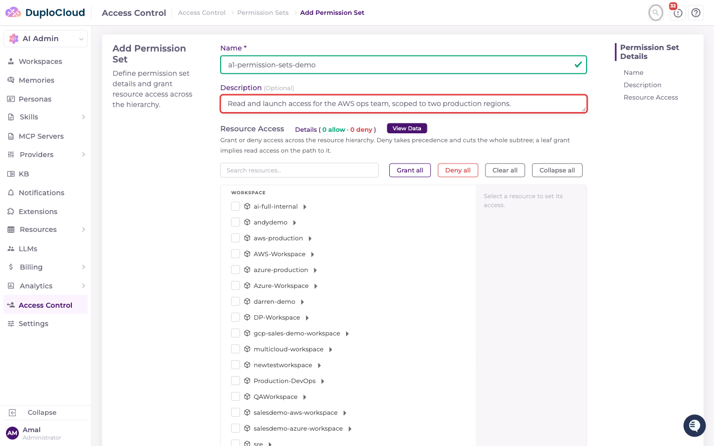
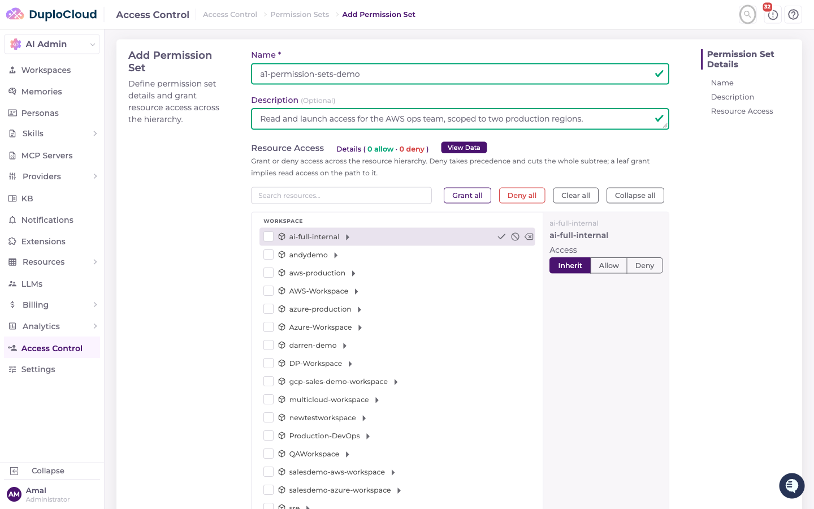
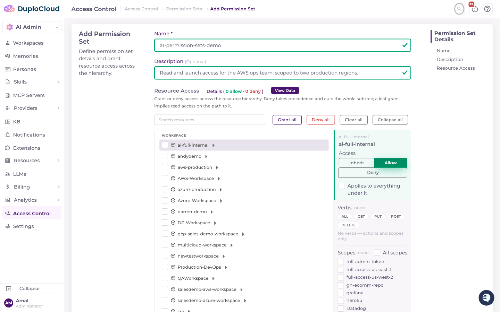
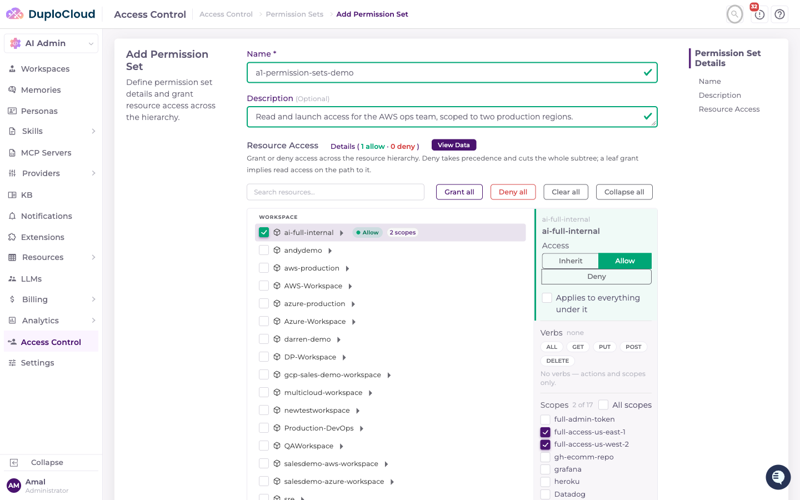
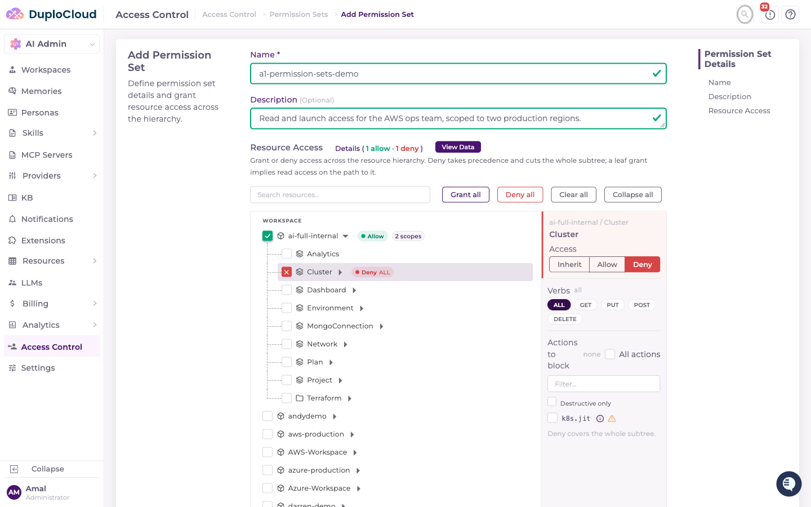
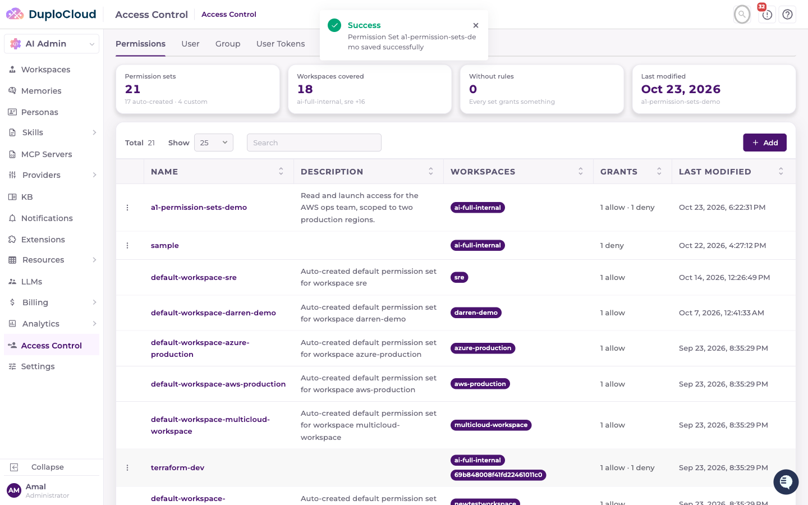
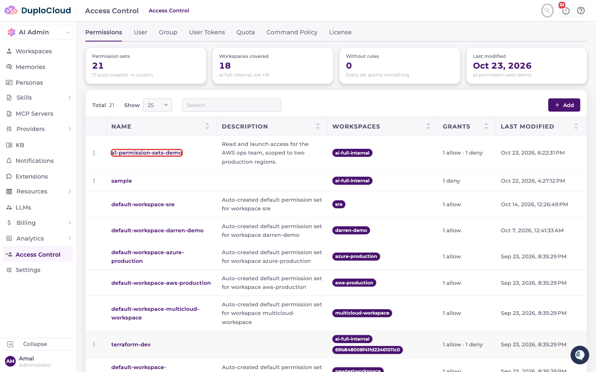

# Permission Sets

This document explains how to create a new Permission Set in the DuploCloud AI Suite Access Control panel.

A permission set is a reusable bundle of access rules. It isn't tied to a workspace by itself — you attach it to a user or a group (see [User Groups](user-groups.md)) and define, inside the set, which workspaces and resources it allows or denies.

***

## Prerequisites

* Access to the DuploCloud AI Suite admin panel
* Admin permissions on the Access Control section

***

## Step 1 — Navigate to Access Control

Go to **AI Admin → Access Control** in the left-hand navigation. The page opens on the **Permissions** tab by default, which lists all existing permission sets.

***

## Step 2 — Click "Add"

In the top-right corner, click the **+ Add** button. The Add Permission Set page opens with a **Name** field, a **Description** field, and a **Resource Access** panel — a tree of every workspace, and everything underneath each workspace (clusters, environments, networks, projects, and so on).

The toolbar above the tree has shortcuts for bulk edits — **Grant all**, **Deny all**, **Clear all** — plus **Collapse all** and a resource search box.

***

## Step 3 — Enter a Name

Click the **Name** field and type a name for the permission set.

***

## Step 4 — Enter a Description

Click the **Description** textarea and describe the purpose of this permission set.

***

## Step 5 — Select a Resource

Click a resource in the tree. In this example, a workspace. Selecting it opens a detail panel on the right with that resource's access settings — this panel is where scope and resource access are now configured (this replaced the old "Add Workspace Permission" modal).

By default a resource is set to **Inherit**, meaning it carries no rule of its own and falls back to whatever an ancestor resource (or the absence of one) decides.

***

## Step 6 — Set Access to Allow

Click **Allow** in the detail panel. Three sets of controls appear:

| Axis | Purpose |
|------|---------|
| Verbs | GET / PUT / POST / DELETE, or ALL |
| Scopes | Workspace-level only — which cloud/Kubernetes scopes in this workspace the rule covers |
| Actions | Named actions (e.g. `aws.jit`) grantable on this resource or its subtree |

**Scopes only appear on a workspace node** — a scope belongs to a workspace, so this control has no effect on a rule set lower in the tree (a cluster, a network, etc.).

***

## Step 7 — Choose Scopes

Check the individual scopes this rule should cover, or check **All scopes** to cover every scope in the workspace — including ones added to the workspace later.

***

## Step 8 — Deny Access to a Specific Resource

Allow and Deny rules can be combined in the same permission set at different points in the tree. Expand the workspace and select a resource type underneath it — in this example, **Cluster** — then click **Deny** and select **ALL** verbs.

A Deny rule always covers that resource's entire subtree, and **Deny takes precedence over Allow** wherever the two overlap. In this example the permission set grants the workspace's two scopes but blocks every cluster inside it — a common pattern for an "ops access, no cluster access" role.

***

## Step 9 — Submit the Form

Review the completed permission set — the **Resource Access** heading shows a running count of allow/deny rules — then click **Create Permission Set**. A green **Success** toast confirms it was saved.

***

## Step 10 — Verify in the List

The new permission set appears in the Permissions table with its workspace and grant counts.

***

## How Scopes Relate to Imported Clusters and Networks

A permission set's **Scopes** control decides which cloud/Kubernetes scopes a *user* is allowed to invoke — for example, to request just-in-time AWS credentials or look up cluster details. It's checked only against rules set directly on a Workspace node.

This is a different thing from a resource's own **scope binding** — the cloud credential a specific Cluster or Network was created or imported with (for example, a cluster's own `scopeId`, the credential it uses to talk to its cloud account). That binding lives on the resource itself, lives outside the permission-set tree, and isn't something a permission set grants or inherits. A cluster doesn't "inherit" a scope from a permission set, and a permission set doesn't change which scope a cluster or network was provisioned with — it only controls whether the signed-in user is allowed to use a given scope at all.

***

## Assigning This Permission Set to a User

Creating a permission set doesn't assign it to anyone. To attach it to a user or a group of users, see [User Groups](user-groups.md).
