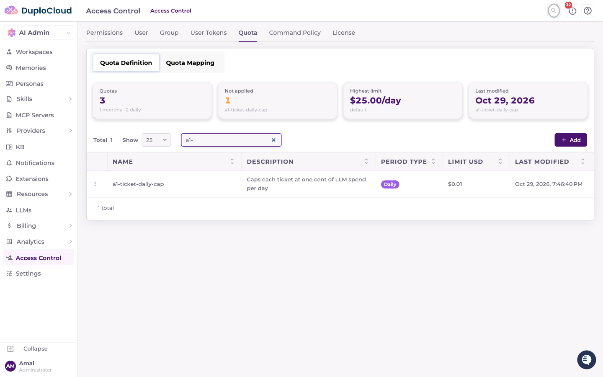
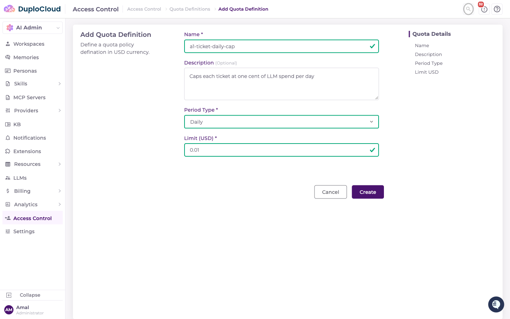
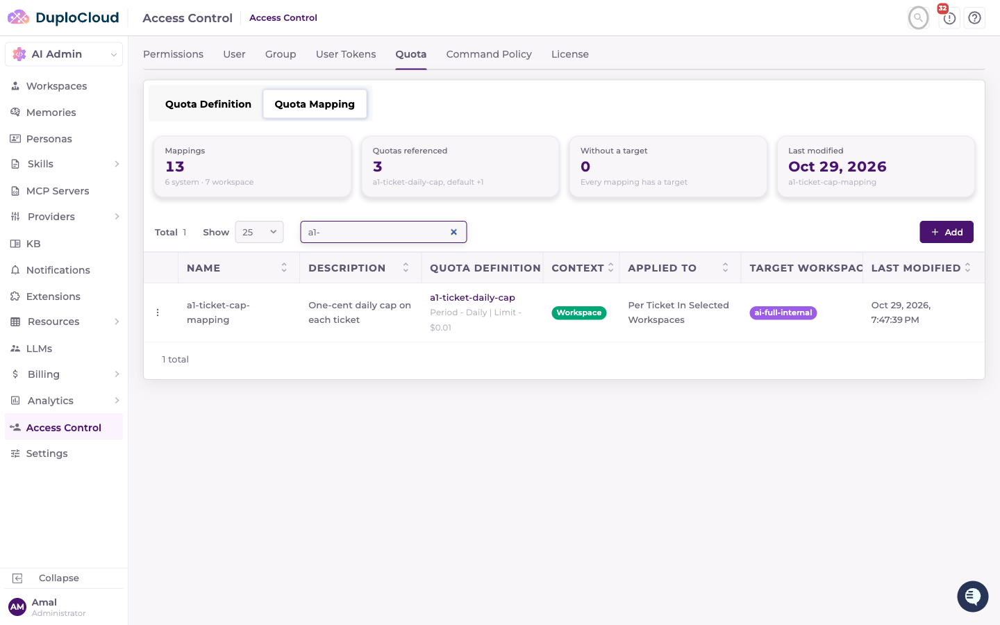
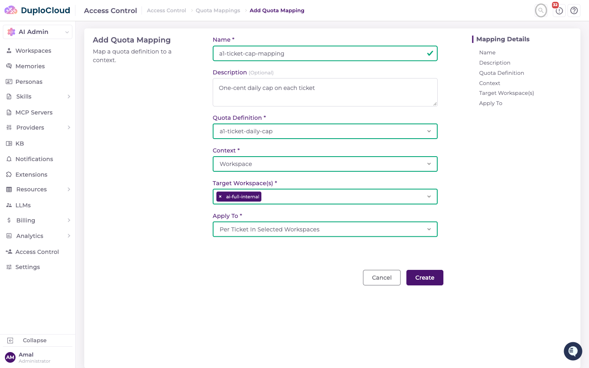
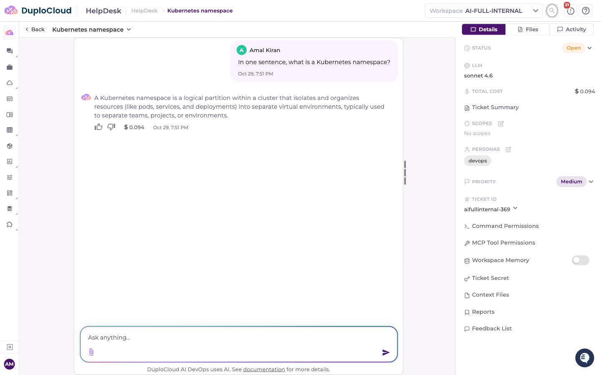
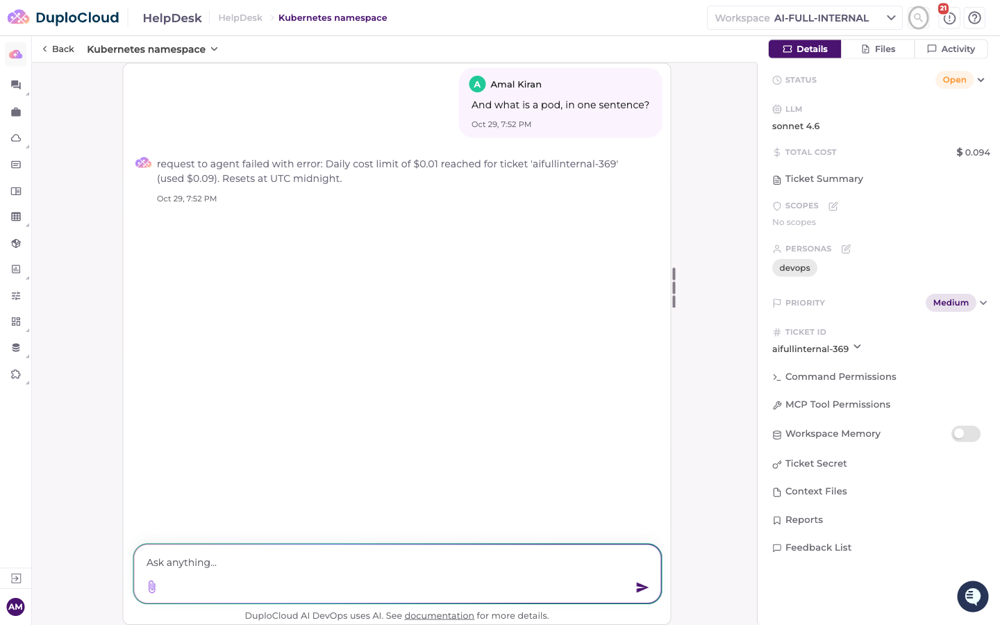
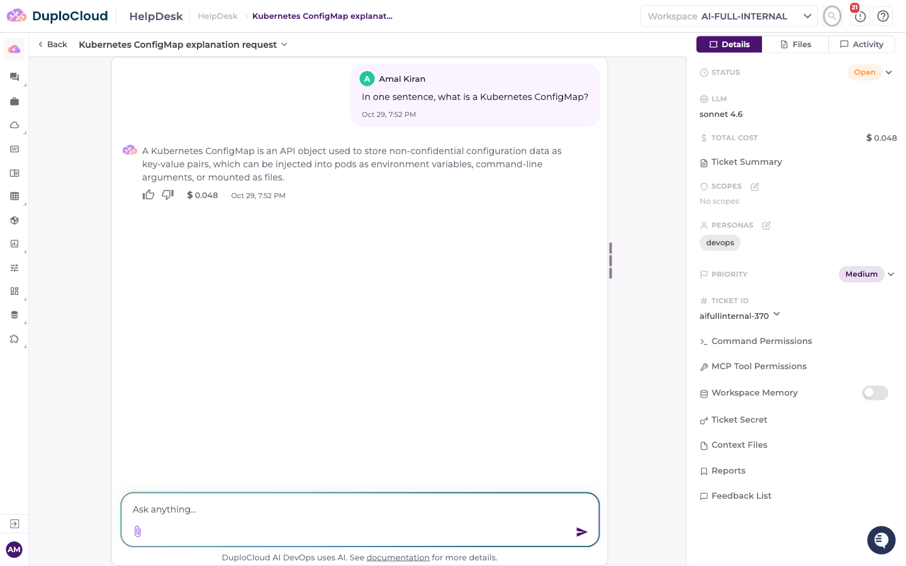
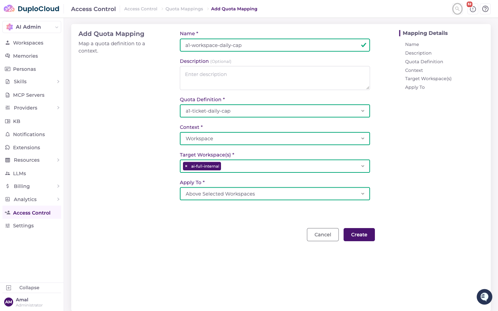
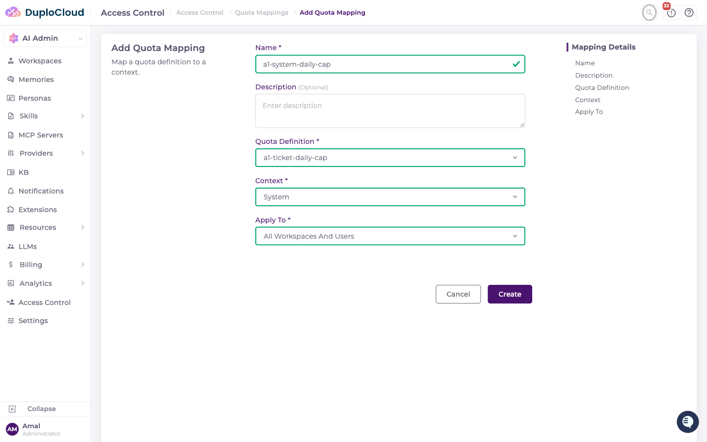

# Quotas

Quotas let administrators set cost limits on LLM usage. A quota definition sets the limit and the period it covers, and a quota mapping applies it to a context: each ticket, each user, a whole workspace, or the entire platform.

The limit is checked before each message is sent to the agent. Once spend for the period reaches the limit, the agent doesn't process the message and the ticket shows an error naming the limit, the amount used, and when it resets. The message that crosses the limit still completes, so recorded spend can end up slightly above the limit.

Daily limits reset at UTC midnight. Monthly limits reset on the first day of the next month (UTC).

***

## Quota Definitions

Go to **AI Admin → Access Control → Quota → Quota Definition**. The cards at the top summarize every definition: how many there are, how many no mapping uses yet (**Not applied**), the highest limit, and the most recently modified. The table lists each definition's name, description, period type, and USD limit.

### Add a Quota Definition

Click **+ Add**. Fill in the fields:

* **Name** — a unique name for the quota policy
* **Description** — optional
* **Period Type** — **Daily** or **Monthly**, the window the limit covers
* **Limit (USD)** — the maximum spend allowed within the period

Click **Create**.

A definition does nothing on its own until a mapping applies it. A definition can't be deleted while a mapping still references it — delete the mapping first.

***

## Quota Mappings

Click the **Quota Mapping** tab. A mapping binds a quota definition to a context and an **Apply To** value, which decide what activity the limit counts. The table shows each mapping's quota definition, context, what it applies to, and its target workspaces.

### Add a Quota Mapping

Click **+ Add**. Fill in the fields:

* **Name** — a label for this mapping
* **Description** — optional
* **Quota Definition** — the definition to apply
* **Context** — **Workspace** or **System**
* **Target Workspace(s)** — one or more workspaces the mapping applies to (shown only when Context is Workspace)
* **Apply To** — what the limit tracks. The options depend on Context:

| Context | Apply To | Meaning |
|---|---|---|
| System | All Workspaces And Users | One limit on all spend, platform-wide |
| System | All Workspaces | A separate limit for each workspace, platform-wide |
| System | All Users | A separate limit for each user, counted across all workspaces |
| Workspace | Above Selected Workspaces | A shared limit on all activity in each selected workspace |
| Workspace | Per User In Selected Workspaces | A separate limit for each user, within the selected workspace(s) |
| Workspace | Per Ticket In Selected Workspaces | A separate limit for each ticket, within the selected workspace(s) |

Click **Create**.

Only one active mapping is allowed for each combination of context, Apply To, and period type — per workspace for Workspace mappings, and platform-wide for System mappings.

### Ticket Quota

When **Apply To** is **Per Ticket In Selected Workspaces**, each ticket in the selected workspaces has its own spend counter. One ticket reaching the limit doesn't affect other tickets in the same workspace.

Create a ticket in a target workspace and send a request. The agent answers as usual, and each reply shows its cost.

Once the ticket's spend for the period reaches the limit, the next message is blocked. The error names the ticket, the amount used, and when the limit resets.

A new ticket in the same workspace starts with a fresh counter and works normally.

### Workspace Quota

When **Apply To** is **Above Selected Workspaces**, all activity in each selected workspace counts toward that workspace's shared limit, across every ticket and user. Once the limit is reached, new requests in that workspace are blocked, with an error naming the workspace, the amount used, and the reset time. Other workspaces are unaffected.

### User Quota

Set **Apply To** to **Per User In Selected Workspaces** (Context: Workspace) or **All Users** (Context: System) to give each user their own spend counter. One user hitting their limit doesn't affect other users, including others active in the same workspace or ticket. With **Per User In Selected Workspaces**, a user's spend is counted per workspace; with **All Users**, it's counted across all workspaces.

### System Quota

When **Context** is **System**, the quota applies across the whole platform rather than to chosen workspaces. Set **Apply To** to **All Workspaces And Users** to enforce a single limit on all spend, or to **All Workspaces** or **All Users** to give every workspace or every user its own limit platform-wide.

**All Workspaces** and **All Users** act as platform defaults. A workspace that has its own **Above Selected Workspaces** mapping uses that instead of **All Workspaces**, and a workspace with its own **Per User In Selected Workspaces** mapping uses that instead of **All Users**. **All Workspaces And Users** always applies in addition to any other limit.

Once a System limit is reached, every matching request is blocked, whichever workspace, user, or ticket it comes from.
