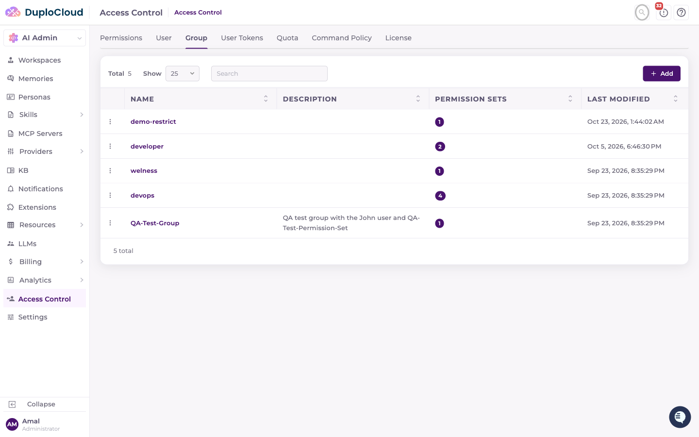
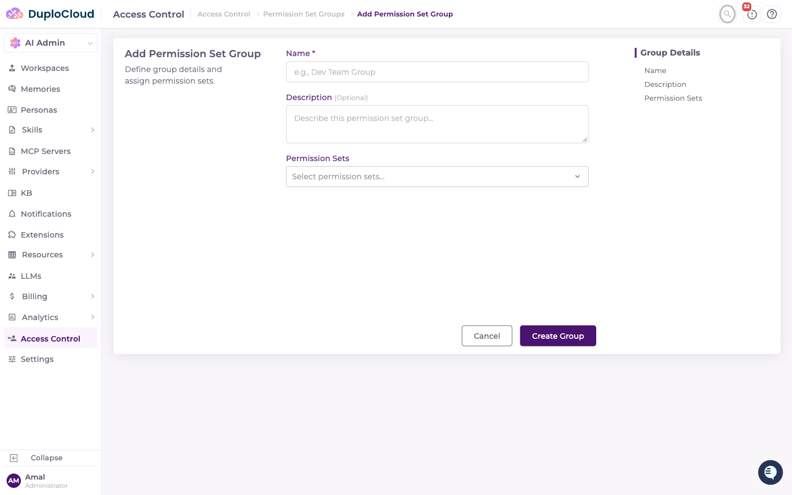
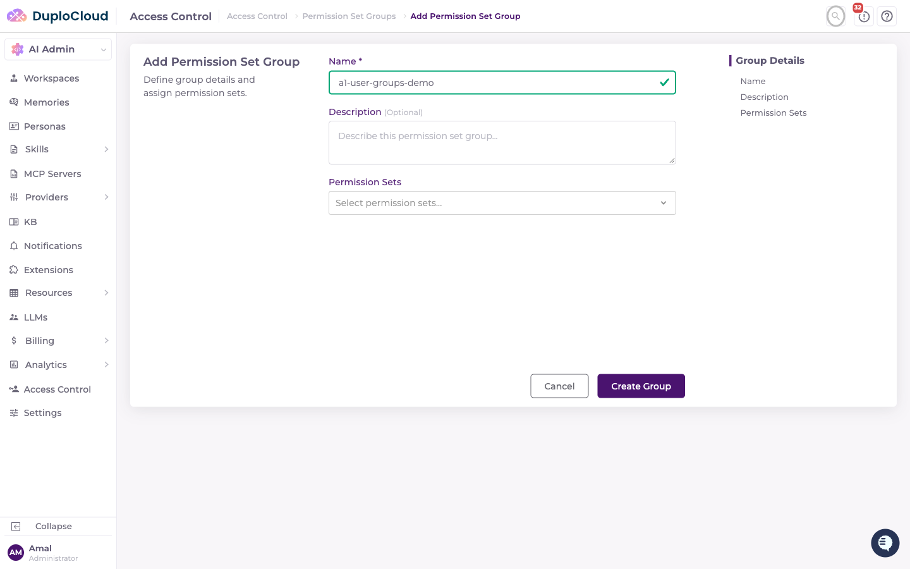
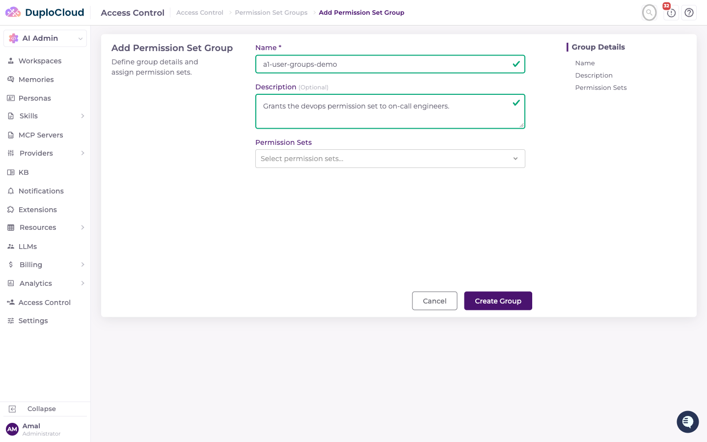
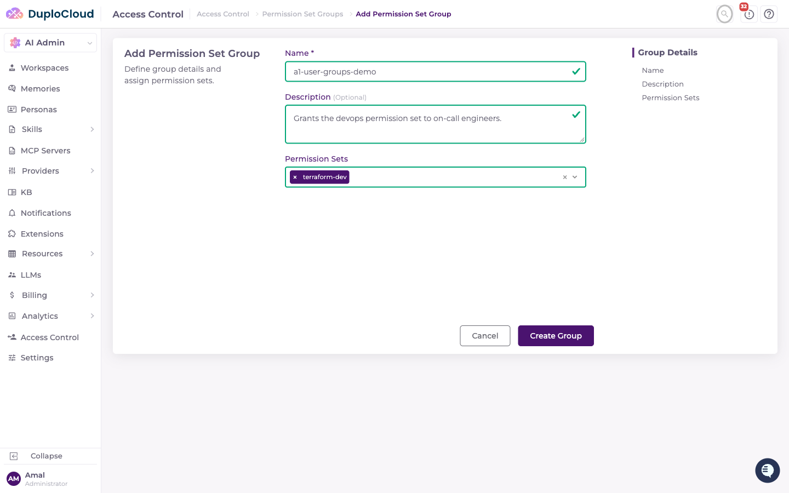
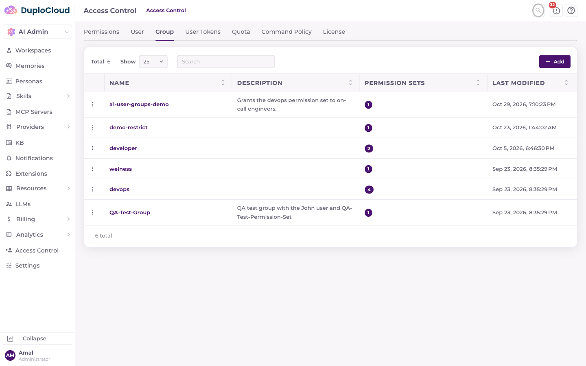
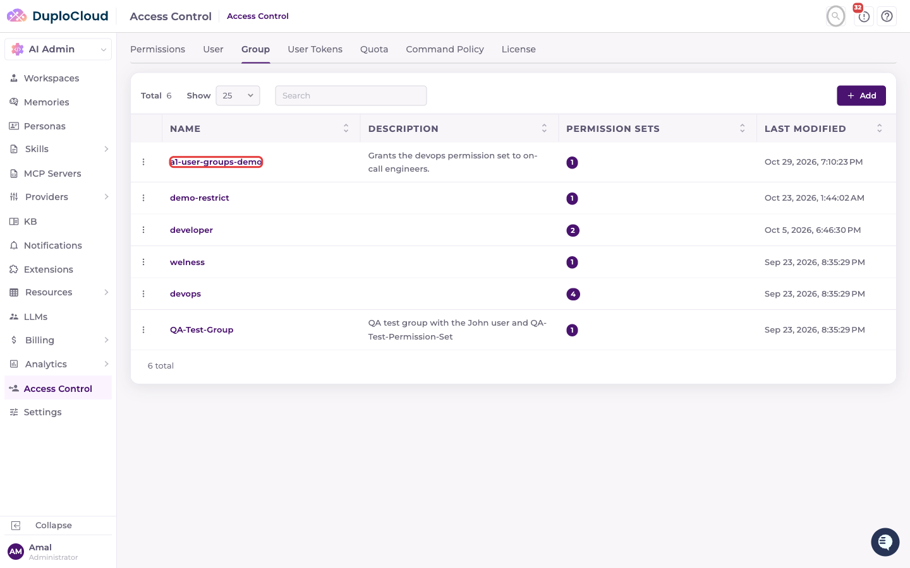

# User Groups

This document explains how to create a new Permission Set Group in the DuploCloud AI Suite Access Control panel. A group is a named, reusable bundle of permission sets — creating one does not, by itself, add any users to it.

***

## Prerequisites

* At least one permission set already created (e.g. `QA-Test-Permission-Set`) — see [Permission Sets](permission-sets.md)
* Admin permissions on the Access Control section

***

## Step 1 — Navigate to the Group Tab

Go to **AI Admin → Access Control** in the left-hand navigation, then click the **Group** tab. This lists all existing groups and how many permission sets each one carries.

***

## Step 2 — Click "Add"

In the top-right corner, click the **+ Add** button. The Add Permission Set Group page opens with **Name**, **Description**, and **Permission Sets** fields.

***

## Step 3 — Enter a Group Name

Click the **Name** field and type a name for the group.

***

## Step 4 — Enter a Description

Click the **Description** textarea and describe the group's purpose.

***

## Step 5 — Select One or More Permission Sets

Click the **Permission Sets** dropdown. Type to filter, then select every permission set this group should grant. You can select more than one.

***

## Step 6 — Submit the Form

Review the completed group, then click **Create Group**. A green **Success** toast confirms the group was saved.

***

## Step 7 — Verify the Group in the List

The new group appears in the Groups table with its permission-set count.

***

## Adding Users to a Group

A group is only a bundle of permission sets — it does not carry a user list of its own. To add a user to a group, go to the **User** tab, and on that user's Add or Edit form, select this group in its **Permission Set Groups** field. See [Users](users.md).

A user who is a member of an identity-provider-synced group (see [Azure AD & Okta User Sync](azure-ad-okta-user-sync.md)) has that membership managed by the sync job instead, and it will be overwritten on the next sync cycle if changed manually.
