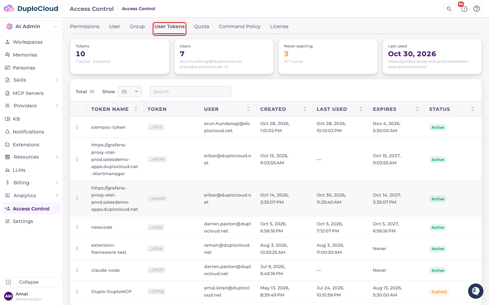
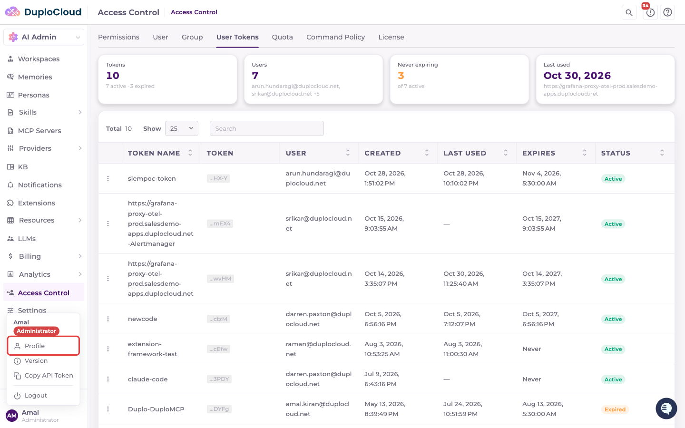
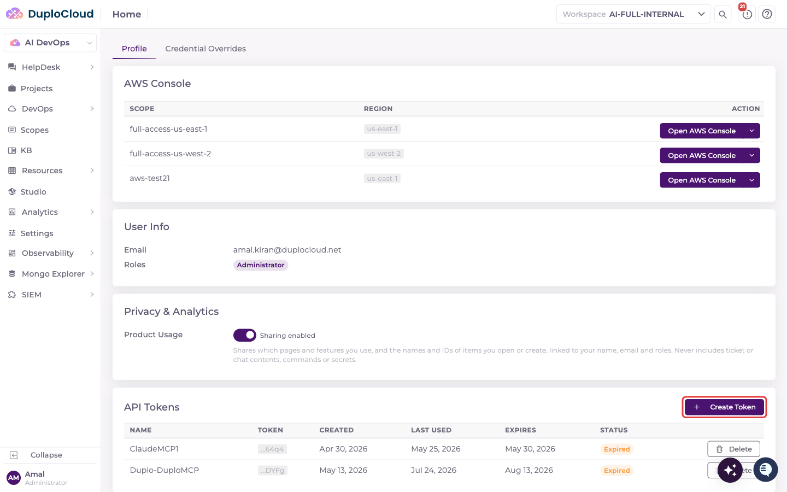
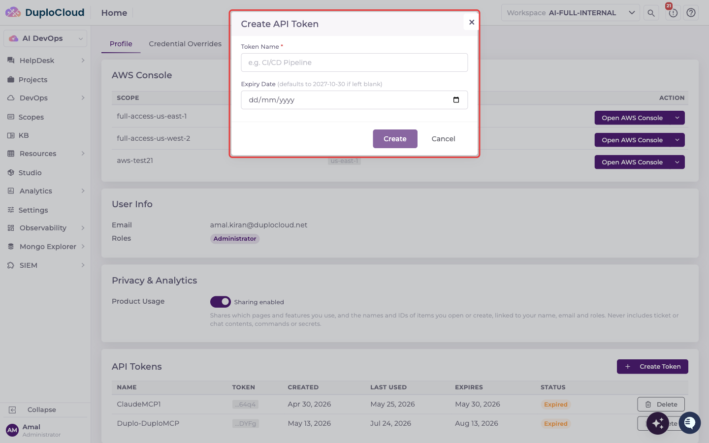
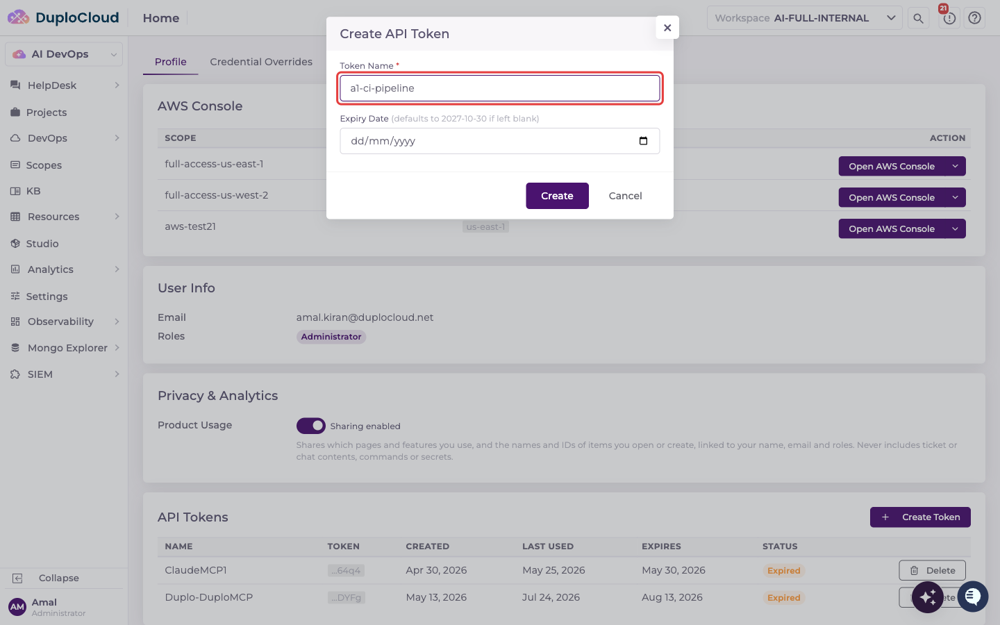
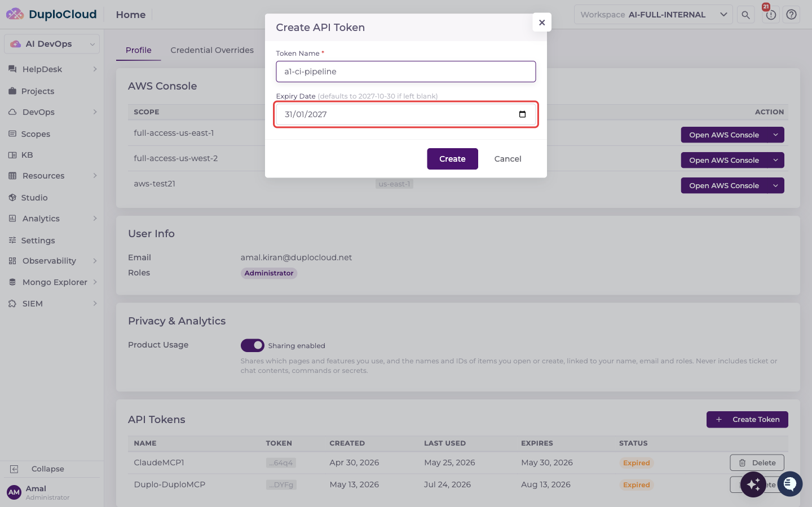
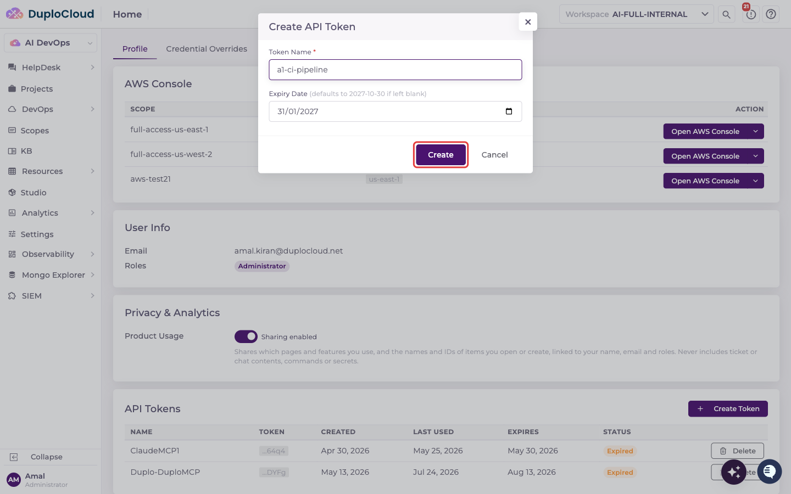
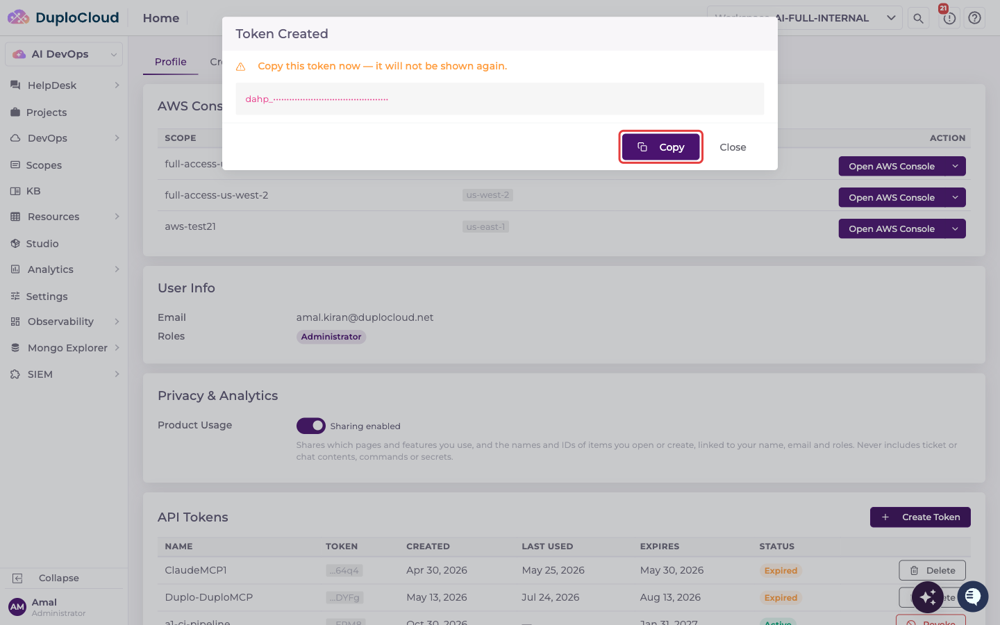
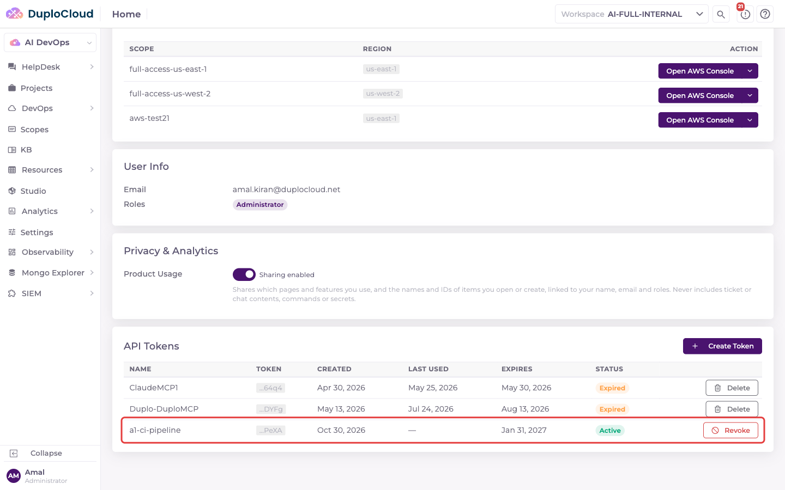

# User Tokens

An API token lets an external application, script, or CI/CD pipeline authenticate with the DuploCloud AI Suite as you. Each user creates and manages their own tokens on their **Profile** page. Administrators can see every user's tokens, and revoke or delete them, from the **User Tokens** tab in Access Control.

***

## Prerequisites

* An authenticated user account (any role can create its own tokens)
* The **Administrator** role to view all users' tokens under **AI Admin → Access Control → User Tokens**

***

## View All Tokens (Administrators)

Go to **AI Admin → Access Control** and click the **User Tokens** tab. The cards at the top summarize every issued token: how many there are and their status, which users own them, how many active tokens never expire, and when a token was last used. The table lists each token's name, the last four characters of its value, its owner, when it was created and last used, when it expires, and its status (**Active**, **Expired**, or **Revoked**).

Click the **⋮** menu on a row to **Revoke** an active token or **Delete** one that is revoked or expired. Tokens can't be created here: each user creates their own from their Profile page.


The **User Tokens** tab appears only in standalone AI Suite deployments. When the AI Suite runs integrated with the DuploCloud platform, the platform issues API tokens instead.


***

## Create an API Token

### Step 1 — Open your Profile

Click your name at the bottom of the left-hand sidebar, then click **Profile**.

The Profile page shows your user info and, at the bottom, the **API Tokens** table with your own tokens.

### Step 2 — Click Create Token

In the **API Tokens** section, click **Create Token**. The **Create API Token** dialog opens with two fields: **Token Name** and **Expiry Date**.

### Step 3 — Enter a Token Name

Enter a name that describes what the token is for, such as the pipeline or integration that will use it. The name is required and must be unique among your tokens.

### Step 4 — Set the Expiry Date

Pick an expiry date from the date picker. It must be later than today.

If you leave the date blank, the token expires after the default period (365 days unless your administrator has changed it). The dialog shows the resulting date next to the field label.

### Step 5 — Click Create

Review the name and expiry date, then click **Create**.

### Step 6 — Copy the Token

The **Token Created** dialog shows the full token value. **Copy it now**: it is shown only once and can't be retrieved later.

Click **Copy** to copy it to your clipboard, store it somewhere secure, then click **Close**.

The new token appears in your **API Tokens** table with **Active** status and the expiry date you set. The **Token** column shows only its last four characters.

***

## Revoke or Delete a Token

On your Profile page, click **Revoke** next to an active token to stop it working immediately. Once a token is revoked or has expired, its button changes to **Delete**, which removes it from the list permanently.


Each user can have up to 10 tokens at a time that haven't been revoked. Expired tokens count toward this limit until you delete them, so revoke or delete tokens you no longer use to free up a slot.

