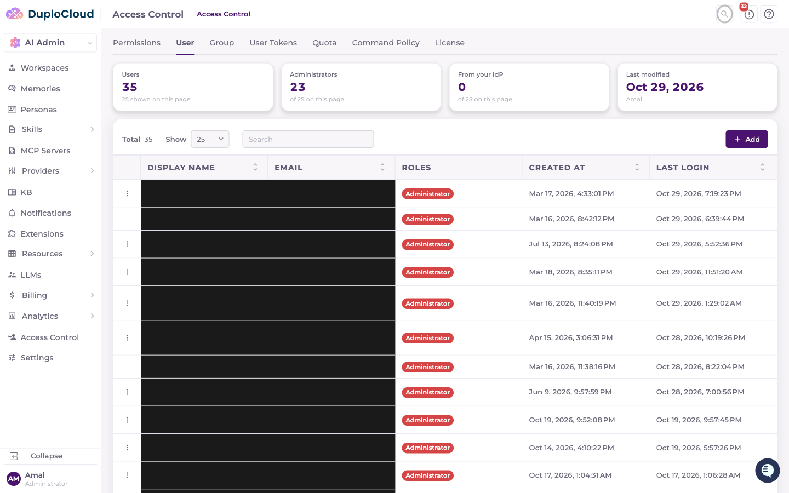
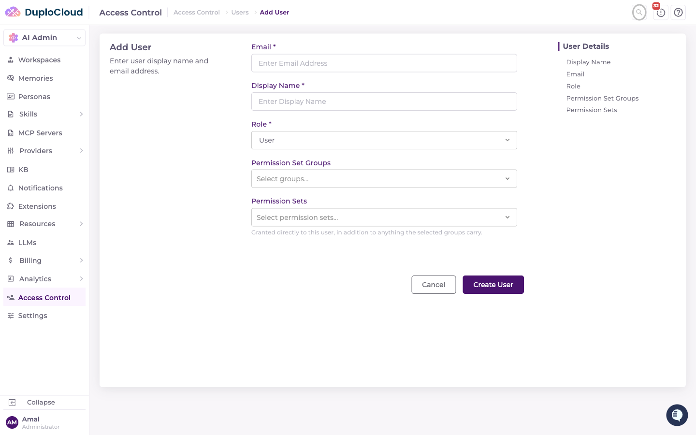
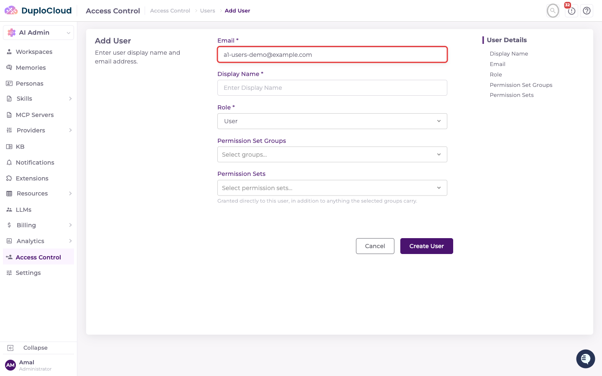
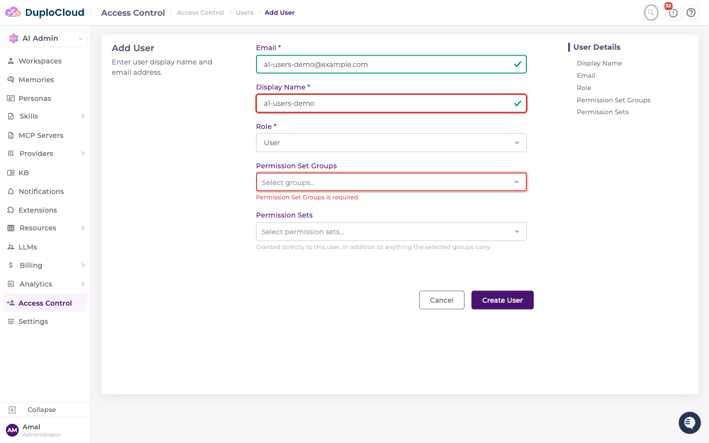
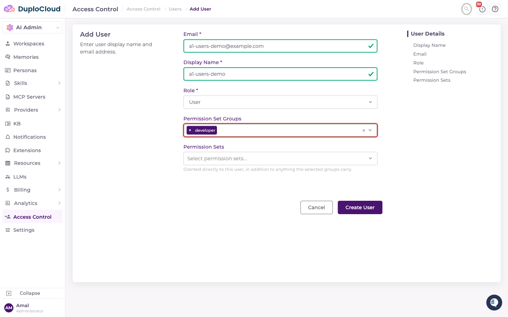
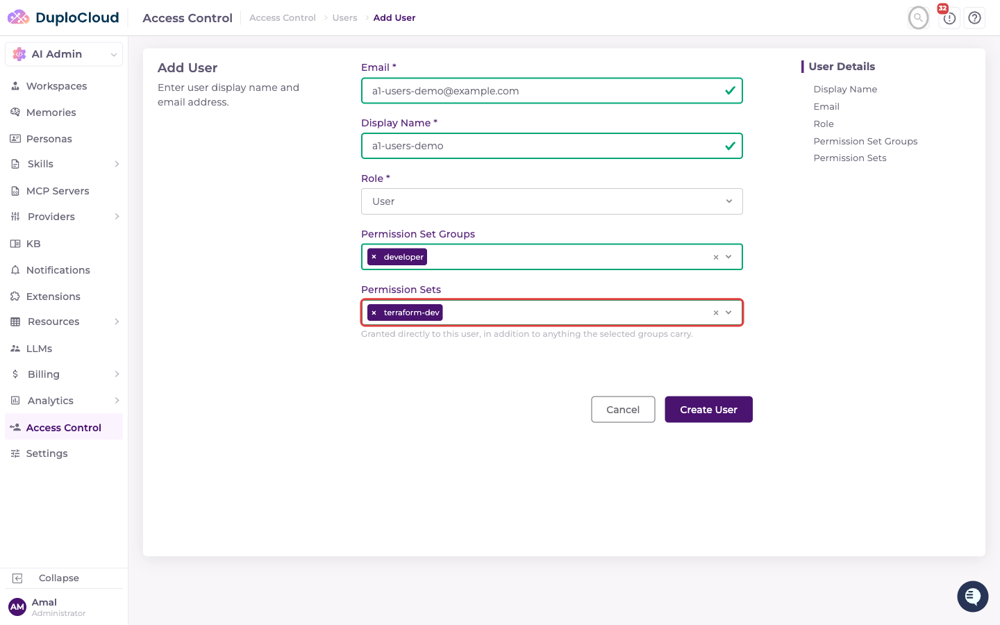
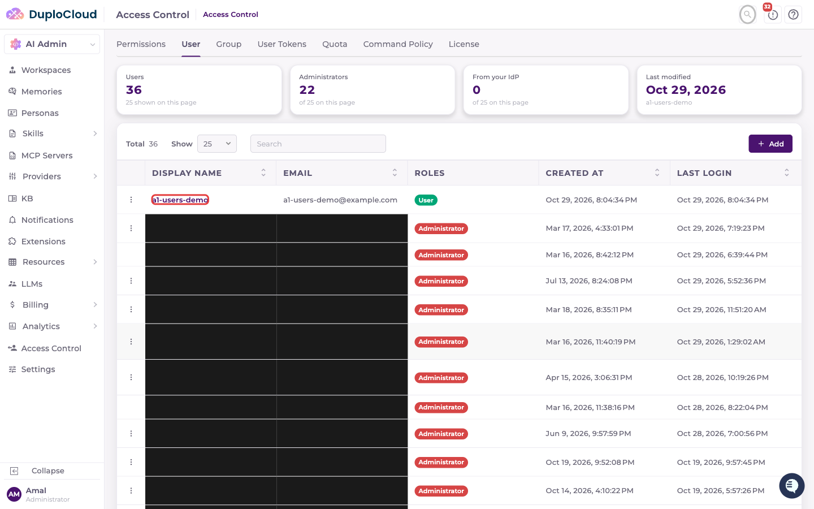

# Users

This document explains how to create a new user in the DuploCloud AI Suite Access Control panel.


A user provisioned via [Azure AD & Okta User Sync](azure-ad-okta-user-sync.md) shows a lock badge here and can't be edited or deleted manually — their access is managed from the directory instead.


***

## Prerequisites

* Access to the DuploCloud AI Suite admin panel
* Admin permissions on the Access Control section
* At least one [Permission Set](permission-sets.md) or [Permission Set Group](user-groups.md) to assign, unless the user will be an Administrator

***

## Step 1 — Navigate to Access Control

Go to **AI Admin → Access Control** in the left-hand navigation, then click the **User** tab. This shows a table of all existing users with their display name, email, role, and last login.

***

## Step 2 — Click "Add"

In the top-right corner, click the **+ Add** button. The Add User page opens with **Email**, **Display Name**, **Role**, **Permission Set Groups**, and **Permission Sets** fields.

***

## Step 3 — Enter the Email Address

Click the **Email** field and type the user's email address.

***

## Step 4 — Enter the Display Name

Click the **Display Name** field and type the user's name.

***

## Step 5 — Set the Role

The **Role** dropdown defaults to **User**. Choose **Administrator** only to grant full access — administrators get every permission implicitly, so the Permission Set Groups and Permission Sets fields are hidden once that role is selected.

***

## Step 6 — Select Permission Set Groups and/or Permission Sets

A non-administrator user needs at least one of these two fields filled:

* **Permission Set Groups** — bundles of permission sets this user inherits. See [User Groups](user-groups.md).
* **Permission Sets** — permission sets granted directly to this user, in addition to anything their groups carry.

A user who is a member of an identity-provider-synced group has that group membership managed by the sync job — editing it here will be overwritten on the next sync cycle. Permission sets granted directly are not touched by sync and stay editable either way.

***

## Step 7 — Submit the Form

Review the completed form, then click **Create User**. A green **Success** toast confirms the user was saved, and the new user appears at the top of the Users table with their role badge.

