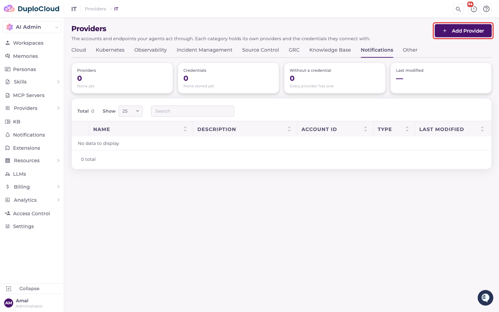
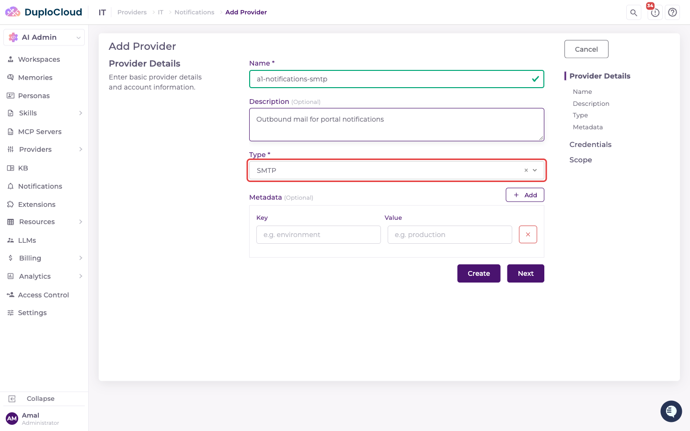
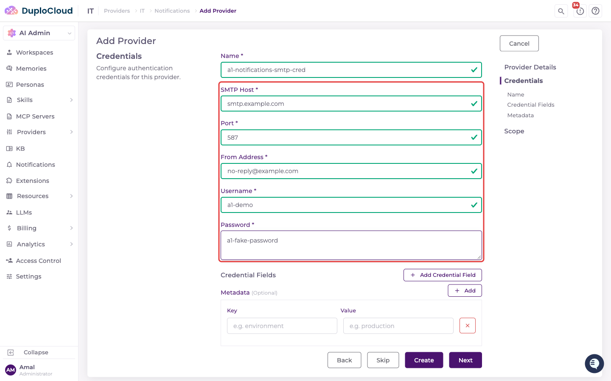
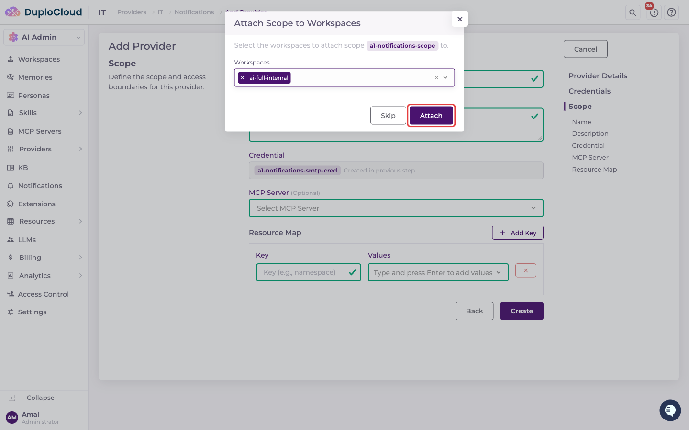
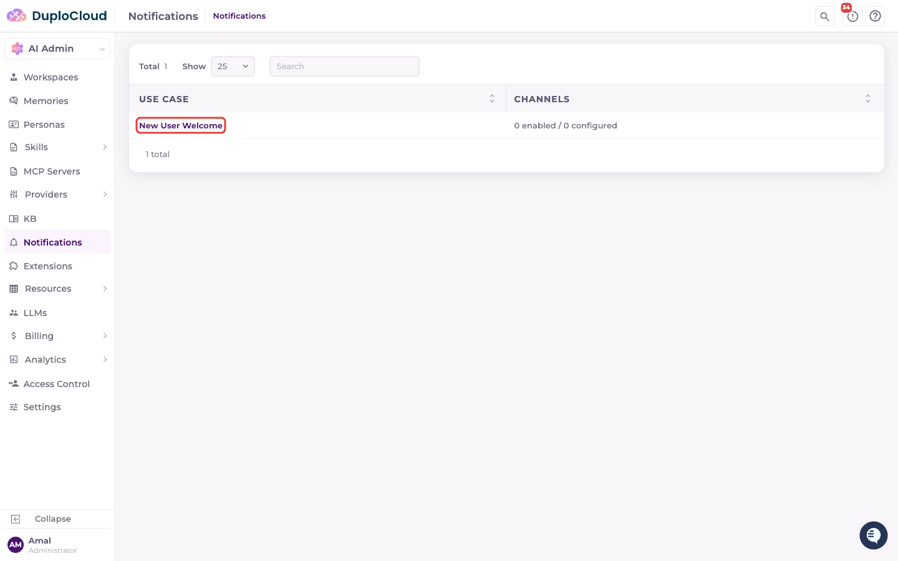
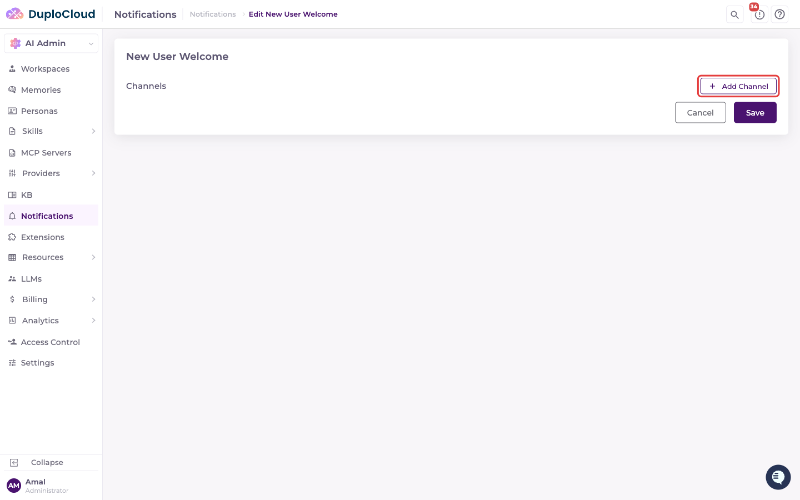
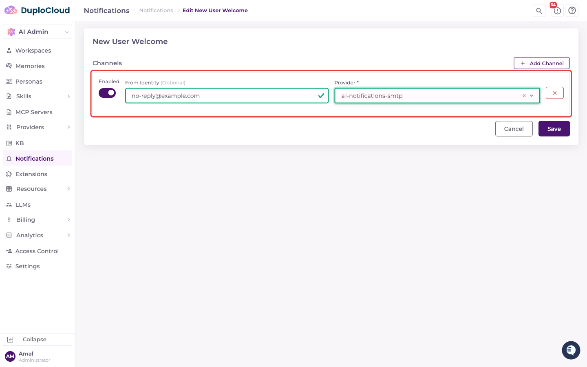

# Notifications

Portal notifications are configured in two places: an **SMTP provider** (the credentials for sending mail) under **Providers**, and **Notifications** (which use case gets routed to which provider) under its own top-level section.

## Adding an SMTP Notification Provider

Go to **Providers**, select the relevant Provider group, then open the **Notifications** tab — a category alongside Cloud, Kubernetes, Observability, Incident Management, Source Control, GRC, Knowledge Base, and Other.

Click **Add Provider** and follow the same **Provider Details → Credentials → Scope** flow described in [Providers](../providers/README.md#adding-providers-and-defining-scopes). On **Provider Details**, enter a **Name**, an optional **Description**, and set **Type** to **SMTP** — currently the only notification provider type. **Metadata** key/value pairs are optional.

On the **Credentials** step, fill in:

* **Name\*** — a label for this credential
* **SMTP Host\*** — the mail server hostname
* **Port\*** — the SMTP port (commonly `587`)
* **From Address\*** — the address mail is sent from
* **Username\*** and **Password\*** — SMTP auth credentials. When you later edit the credential, leave **Password** blank to keep the existing one.

Click **Next** to finish the **Scope** step as with any other Provider (or **Create** to save the provider and credential without a scope), then attach the scope to the relevant Workspace(s).

## Routing Notifications to a Provider

Go to **Notifications** in the sidebar. This page lists each notification **use case**, and its **Channels** column shows how many channels are enabled out of how many are configured (for example, `1 enabled / 2 configured`).

Click a use case to open it, then **+ Add Channel**.

For each channel, set:

* **Enabled** — toggle the channel on or off without removing it
* **From Identity** (optional) — overrides the SMTP provider's From Address for this use case
* **Provider\*** — the SMTP provider to send through. Each provider can be used by only one channel per use case.

Click **Save** to store the channels and return to the list, where the use case's **Channels** count updates. **Cancel** discards your changes.


A use case with no enabled channel simply doesn't send anything — there's no default or fallback provider. A channel whose provider is inactive or has no credential is skipped. Today there's a single use case, **New User Welcome**, sent automatically whenever a new user is created; more use cases will appear here as they're added, with no configuration needed to make them show up.

