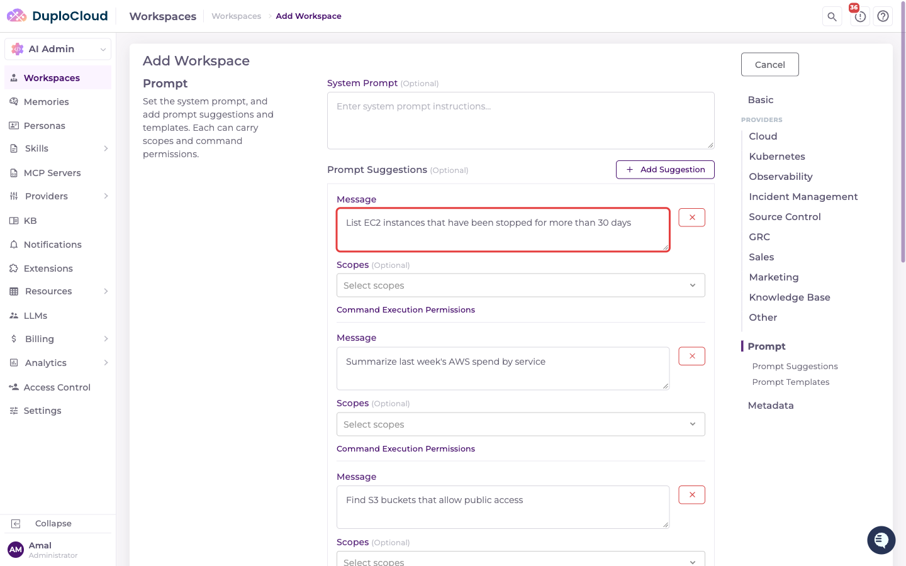
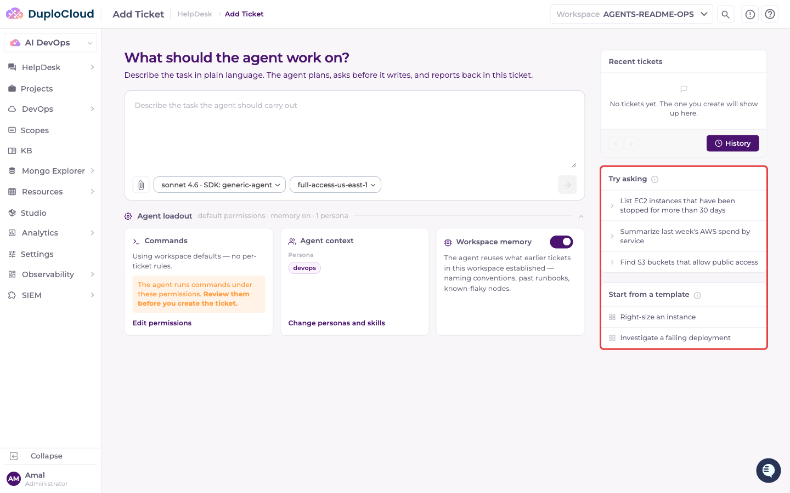
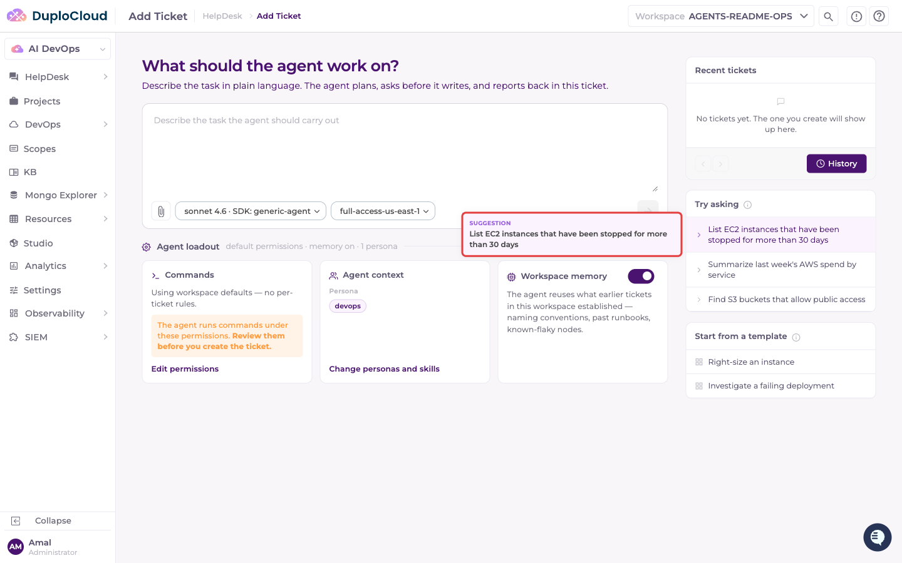
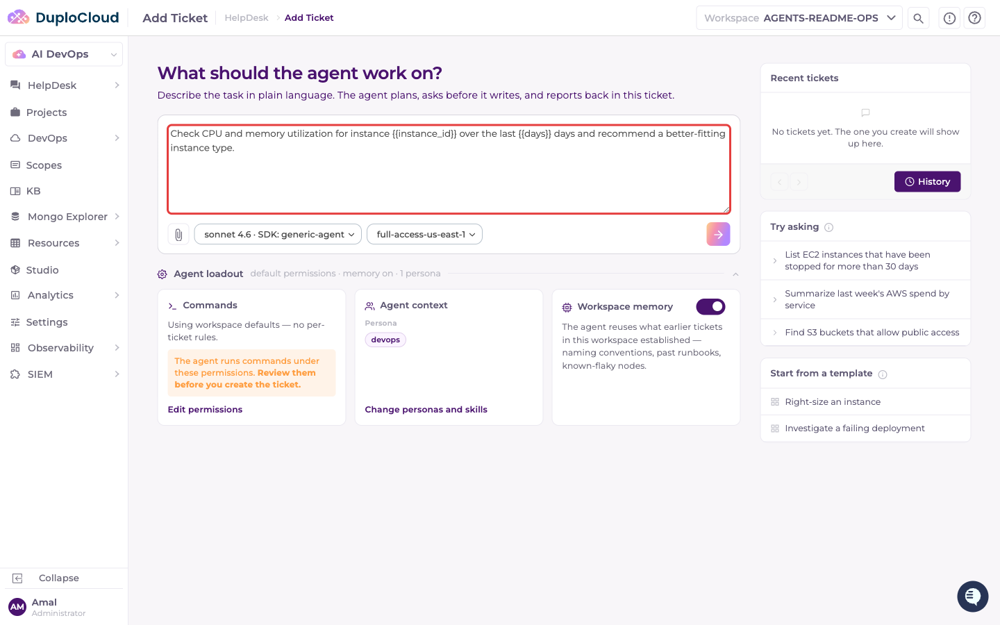

# Duplo DevOps Agent

The DuploCloud platform ships with the Duplo DevOps Agent out of the box. This is the Agent that carries out all the DevOps work inside the platform. The Agent integrates seamlessly with your existing infrastructure and can be deployed immediately to automate routine operations and troubleshooting workflows.

The Agent operates within the boundaries defined by Providers and Scopes. Providers store the credentials for your cloud accounts, Kubernetes clusters, observability tools, and other services. Scopes define exactly which resources within those Providers an Agent can access. Each [Workspace](../workspaces.md) is granted a set of Scopes, and a ticket in that Workspace can only use those Scopes — the ones selected on the ticket, out of the Workspace's set. Which model the Agent runs on is set by the Workspace's [LLM Mappings](llm-models.md#llm-mappings).

## Tickets and Projects

The Agent is used both for ad hoc tasks in [Tickets](../tickets.md) and as a part of Projects. Within a Project, the skill the platform loads for the Project's AI Planner guides the Agent through three phases: helping you write a spec, then a plan, then executing the resulting tasks. See [Platform Skills and Overrides](../skills/platform-skills-and-overrides.md) for the skills the platform loads and how to replace them.

## Adding Your Own Agent

You can also connect your own agent runtime to the platform and let it work alongside the Duplo DevOps Agent. Agents are registered as **Agent SDKs** under **AI Admin → LLMs**; see [Agent SDKs](llm-models.md#agent-sdks) for the form and its settings.

## Prompt Suggestions and Templates on the Ticket Screen

Prompt suggestions and templates help users start a ticket quickly. They're configured per Workspace, on the **Prompt** step of the Workspace form (see [Creating a Workspace](../workspaces.md#creating-a-workspace)):

* A **Prompt Suggestion** is a ready-made question.
* A **Prompt Template** has a **Name**, an optional **Description**, and **Content** that can include `{{variable}}` placeholders for the user to fill in.

Each suggestion and template can also carry its own Scopes and command execution permissions, which are applied to the ticket when it's used.

When a user opens **Add Ticket** in that Workspace, the suggestions appear on the right under **Try asking**, and the templates under **Start from a template**. When a Workspace has more than three of either, a **Show all** link reveals the rest.

Hover over a suggestion or template to see its full text, along with any Scopes and command permissions it carries.

Clicking a suggestion creates the ticket straight away with that question, so there's no chance to edit it first. Clicking a template instead fills the input with its content, including its `{{variable}}` placeholders; replace them with real values, then submit the ticket.

