# LLM Models

The **LLMs** page governs which models are available to agents, and which model a Workspace, Project, or the platform as a whole uses by default. Open it from **LLMs** in the AI Admin sidebar. It has three tabs: **Agent SDKs**, **LLMs**, and **LLM Mappings**. Each tab shows summary cards above its table, and the button in the page header adds whatever the open tab lists.

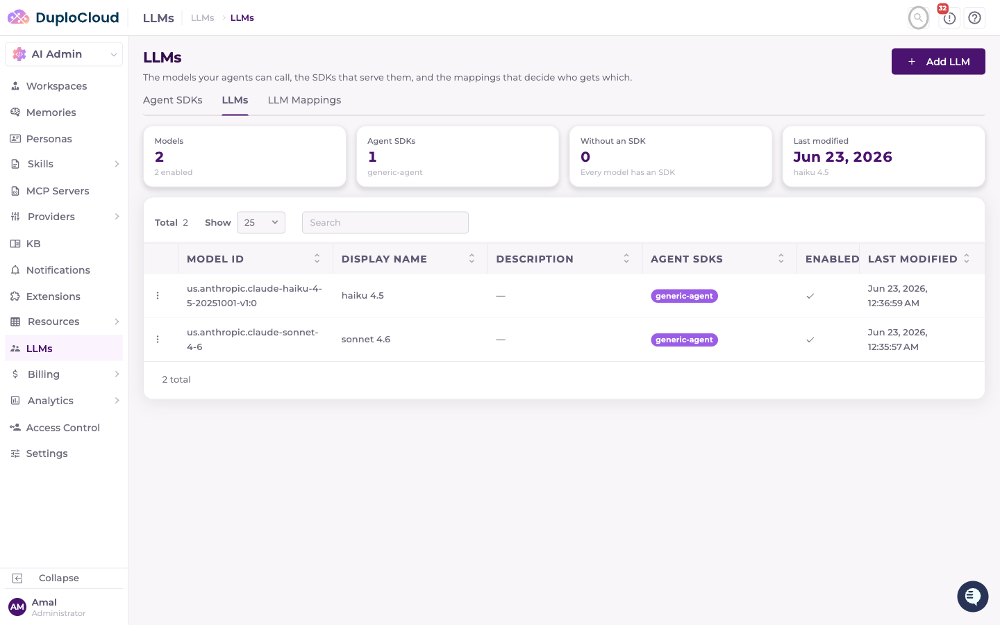

## Agent SDKs

An **Agent SDK** is a connection to a deployed agent runtime — the same entity described in [Adding a Custom Agent](README.md#adding-a-custom-agent): a Name, Description, Endpoint, and Path. It's listed here because every model in the registry is registered under one.

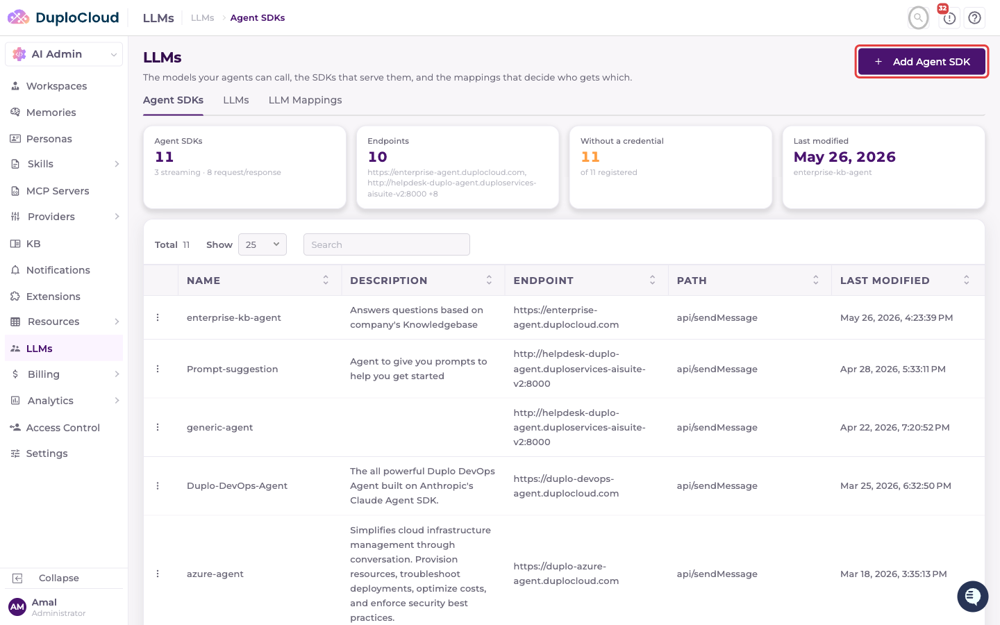

Click **Add Agent SDK** to register another one. Besides the Name, Description, Endpoint, and Path, the form has an optional **Metadata** section of key/value pairs. It starts with `STREAMING_ENABLED` set to `true`, which makes the agent stream its responses; set it to `false` for an agent that answers in a single request/response.

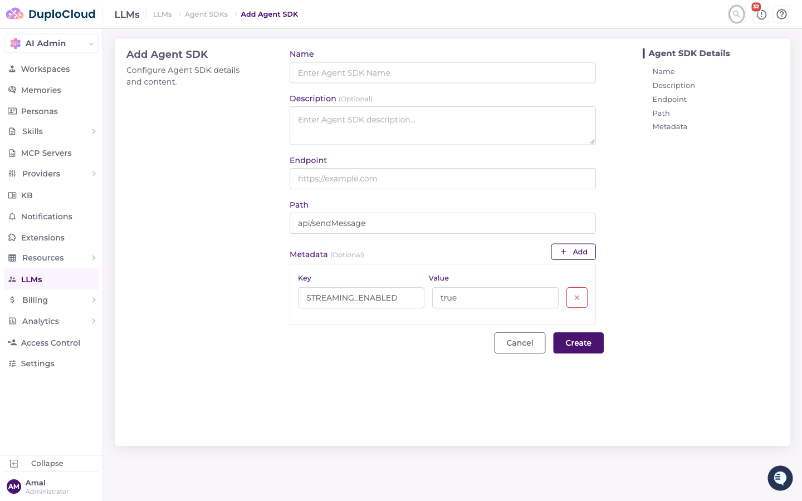

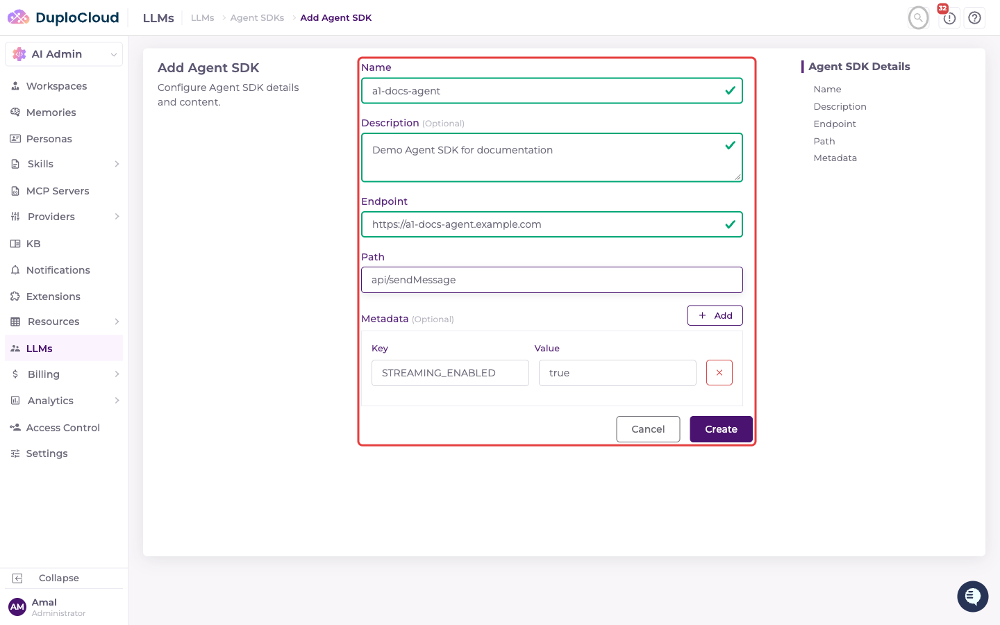

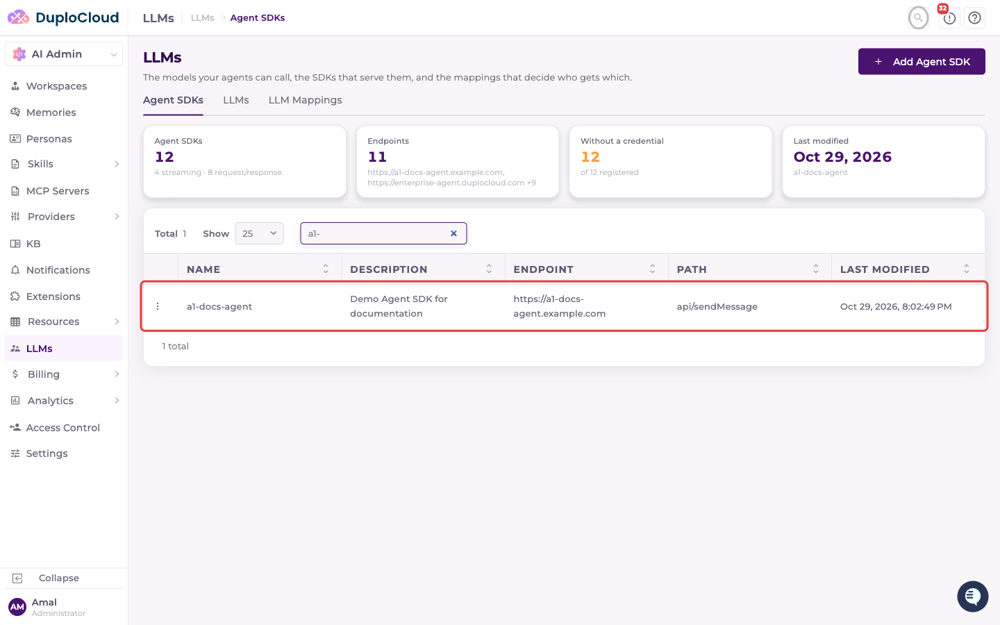

## LLMs

The **LLMs** tab is the model registry itself — every model an agent is allowed to use, paired with the Agent SDK(s) that can run it.

Click **Add LLM** and fill in:

* **Agent SDKs\*** — which SDK(s) this model can run under
* **Model ID\*** — the underlying model identifier, exactly as the Agent SDK's provider expects it (e.g. `claude-sonnet-4-6`, or `us.anthropic.claude-sonnet-4-6` on AWS Bedrock)
* **Display Name\*** — a human-readable name shown in ticket creation and elsewhere (e.g. `Sonnet 4.6`)
* **Description** — optional
* **Enabled** — toggle it off to keep a model registered but unavailable for selection

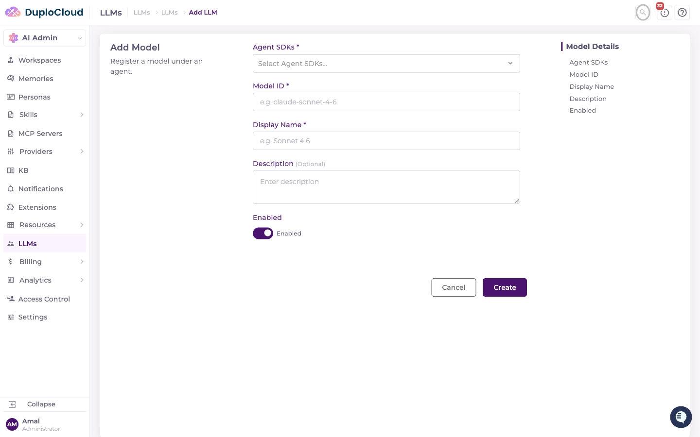

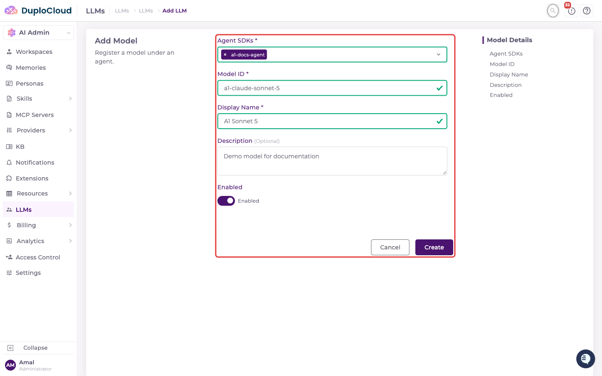

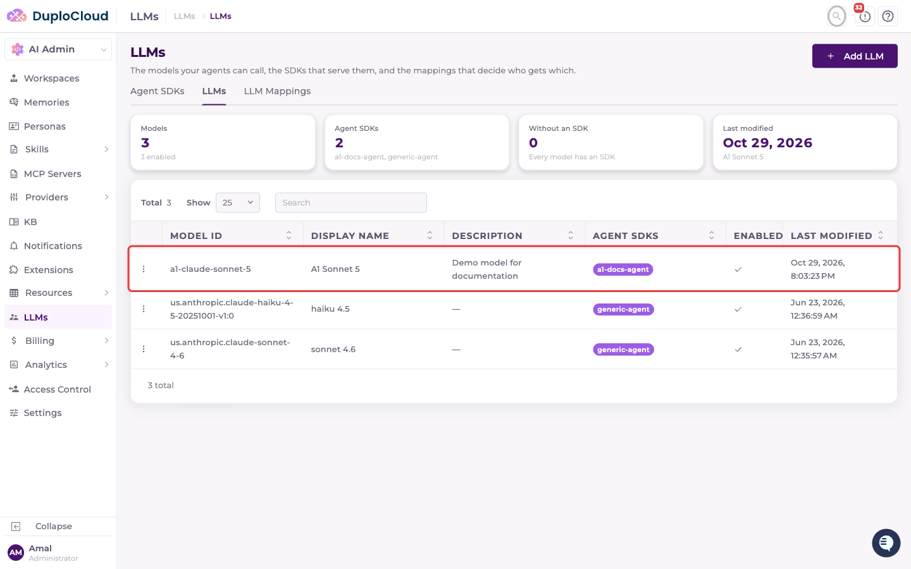


This registry doesn't have a "Provider" field — it doesn't matter here whether a model runs on AWS Bedrock, GCP Vertex AI, Azure AI Foundry, or directly against the Anthropic API. That's determined by environment variables on the Agent SDK's own deployment, not by anything you configure in this UI.


## LLM Mappings

A **Mapping** controls which registered models are actually usable — and which one is the default — for a given scope. This is what makes the registry an *allow-list*: if no mapping covers a workspace, no models are available to it at all.

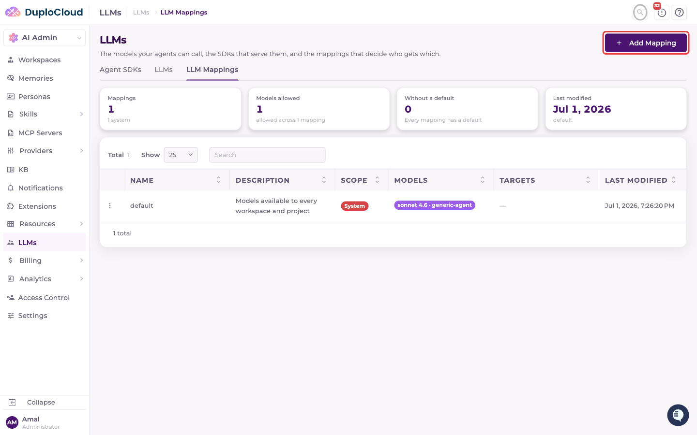

Click **Add Mapping** and fill in:

* **Name\*** and **Description** — a label for this mapping
* **Models\*** — the model + SDK pairs this mapping allows
* **Scope\*** — **System**, **Workspace**, or **Project**
* **Default model** — appears once the mapping allows more than one model; with a single model, that model is the default. Required for System scope. Optional for Workspace and Project scope; if you leave it empty, the first model in the mapping is used.
* **Target Workspace(s)\*** / **Target Project(s)\*** — shown only for Workspace/Project scope; select one or more. Each workspace or project can be covered by only one active mapping.

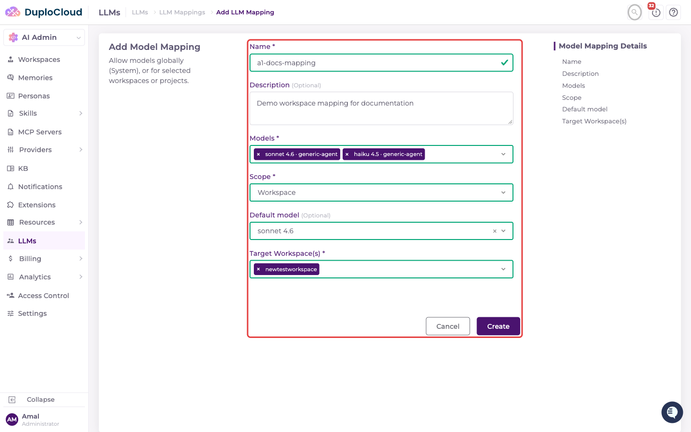

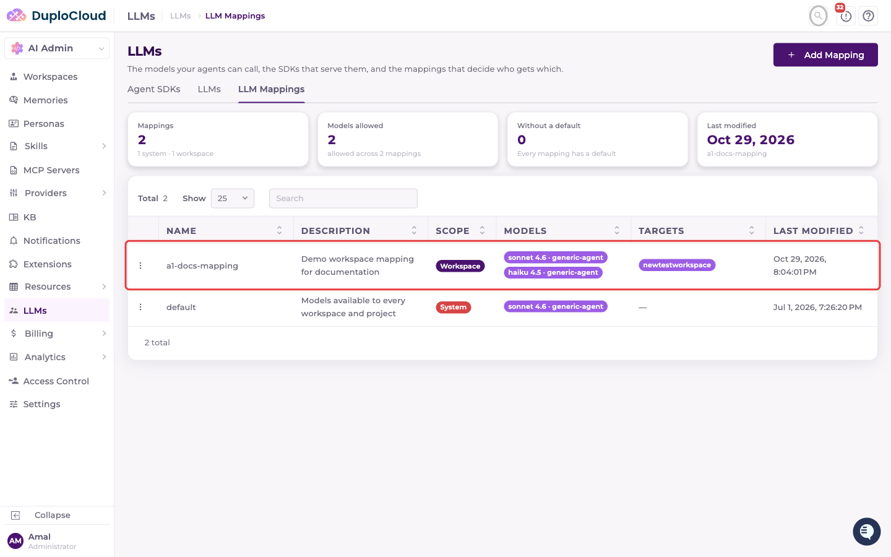


Resolution order is **Project → Workspace → System**: the most specific mapping that covers a ticket wins, and it replaces the broader ones entirely — mappings are never merged. A Workspace mapping can therefore allow more or fewer models than the System mapping. A model the user picks when creating the ticket takes precedence over the mapping's default, as long as it's still enabled and allowed.

There's only ever one **System** mapping, and it can be edited but not deleted. A fresh install seeds it automatically when exactly one Agent SDK is registered, so every workspace has a working default before you add mappings of your own. With more than one Agent SDK, create the System mapping yourself.

