# AI Dashboards

DuploCloud's agentic dashboarding lets you create purpose-built dashboards for any data source connected as a provider — cloud accounts, Kubernetes clusters, incident management systems, cost tracking platforms, and more. Dashboards are organized into categories — **Observability**, **Cost**, **Security**, and **Others** — and can be scoped to a single workspace or shared globally across your organization.

The workflow is template-driven. An AI agent builds a reusable **Dashboard Template** that defines the layout, panels, and data-fetching logic. Once a template is published it can be instantiated as many times as needed — each instance connected to a different scope (a different cloud account, cluster, or environment) — without rerunning the agent.

## Dashboard Primitives

Every dashboard is composed of four panel types:

| Panel type  | Description                                                              |
| ----------- | ------------------------------------------------------------------------ |
| **Stats**   | Single metrics displayed prominently, with a health status and trend     |
| **Tabular** | Tabular views of multi-row data such as service lists or cost breakdowns |
| **Alerts**  | Active alert feeds pulled from connected monitoring systems              |
| **Insight** | AI-generated analysis that correlates findings across the other panels   |

When building a template, the agent uses the built-in **Dashboarding skill** to choose the right panel type for each metric it discovers, based on the nature and volume of the data.

## Viewing Dashboards

Dashboards are accessible under **Analytics** in the left sidebar, grouped by category — **Observability**, **Cost**, or **Security**. Navigate to the relevant category and select **Dashboards**. Each dashboard appears as a tab at the top of the page; long names are shortened on the tab (hover to see the full name), and when there are more tabs than fit, the rest are listed under **More**.

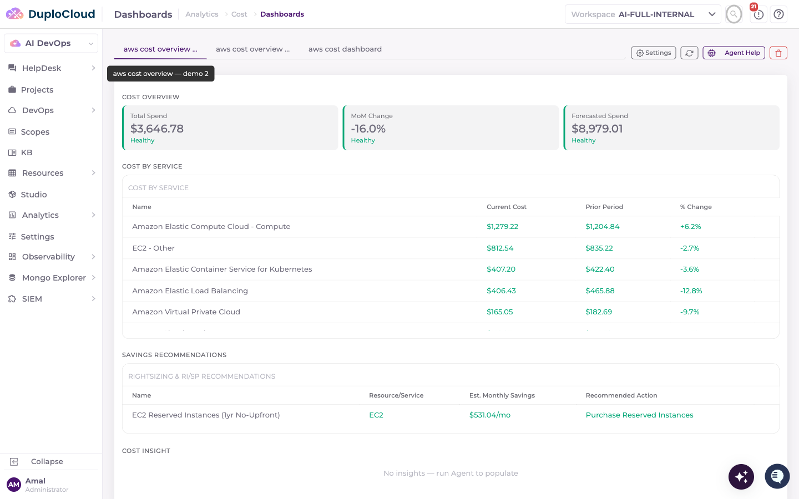

The buttons on the right of the tab bar act on the selected dashboard:

* **Settings** — change the dashboard's category, or how long panel results are cached (see [Dashboard Settings](ai-dashboards.md#dashboard-settings)).
* **Refresh** — re-run the dashboard's panels and fetch fresh data.
* **Agent Help** — open the dashboard's agent session to ask questions about the data or refine the dashboard.
* **Delete** — remove the dashboard. You confirm by typing the dashboard's name.

## Dashboard Templates

Templates define the panel structure, filters, and data-fetching script for a dashboard. Each category has its own template list — for example, navigate to **Analytics → Cost → Dashboard Templates**.

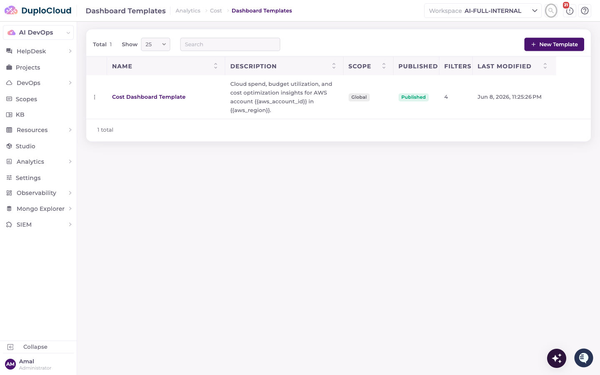

Each row shows the template's **Name**, **Description**, **Scope** (**Built-In**, **Global**, or **Workspace**), **Published** status (Published or Draft), the number of **Filters** it exposes, and when it was **Last Modified**. The **⋮** menu on each row offers **View**, **Edit**, **Delete**, and **Create Dashboard** (available once the template is published). Built-in and global templates are read-only in a workspace: you can view them and create dashboards from them, but not edit them.

## Creating a Dashboard Template

### 1. Open the New Template modal

Click **+ New Template** in the top-right corner of the Dashboard Templates page.

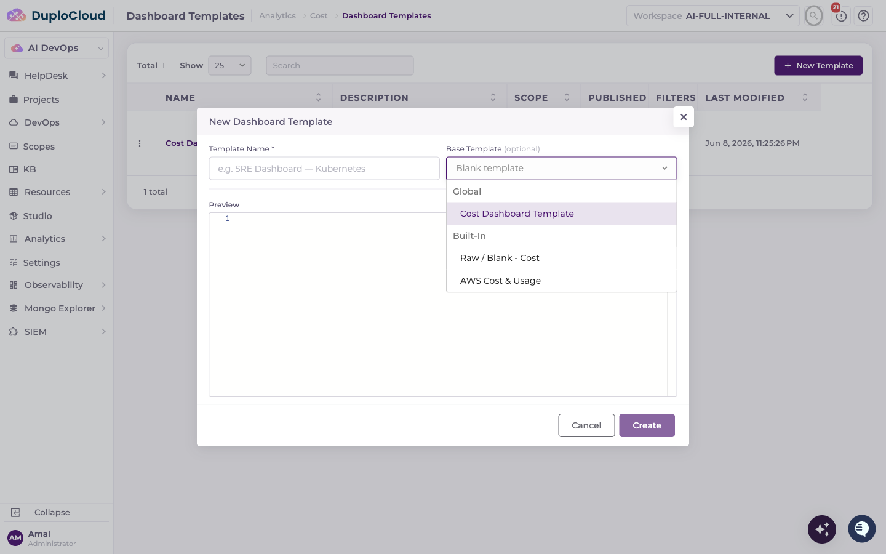

Enter a **Template Name**, then choose a **Base Template**. The base template sets the template's starting structure and its category, so pick one from the category you are working in — for example **Raw / Blank - Cost** to start an empty Cost template, or an existing template to copy its structure. The **Preview** shows the YAML the new template will start from. Click **Create**.

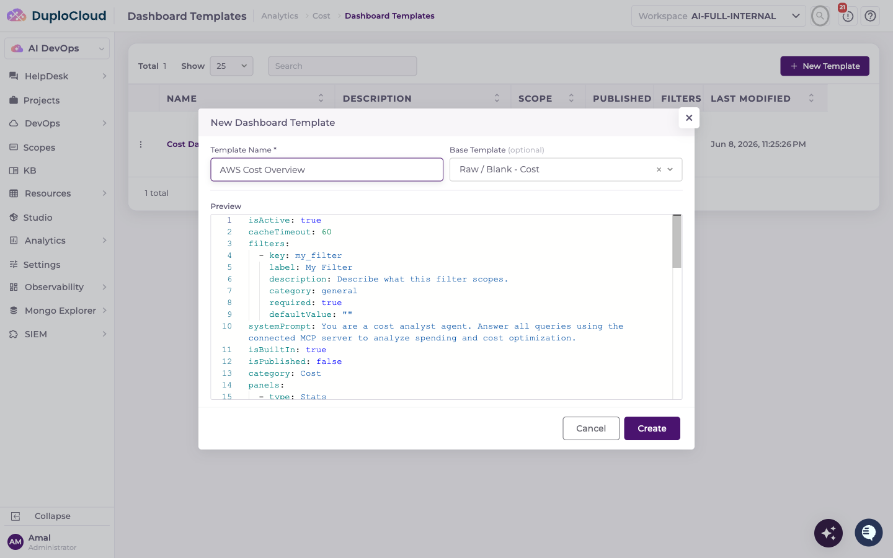

The template detail page opens. It shows the template's **Filters** and panel sections, which stay empty until the agent populates them.

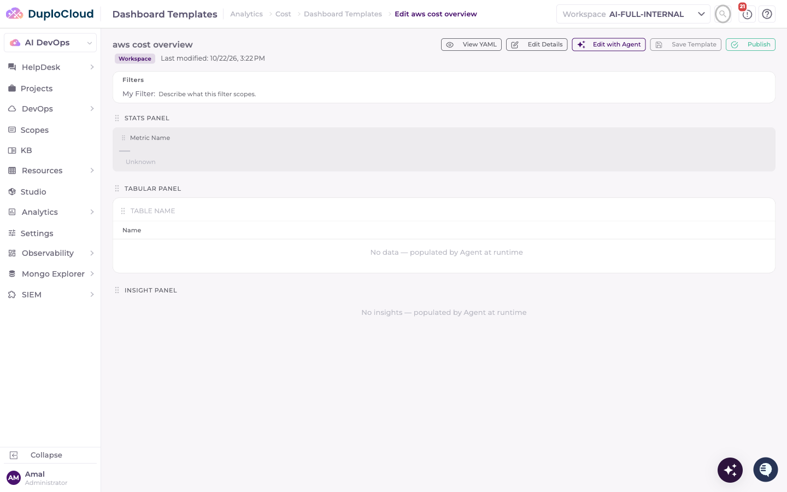

### 2. Open an agent session

Click **Edit with Agent** on the template detail page. Select the **LLM** the agent should use and, optionally, one or more **Scopes** that grant access to the data sources you want the dashboard to draw on. The agent can only query sources that a selected scope gives it credentials for.

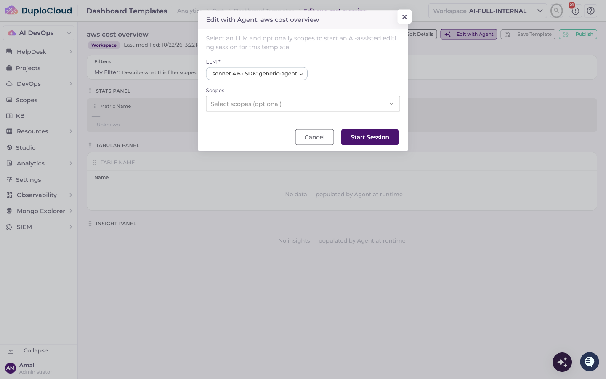

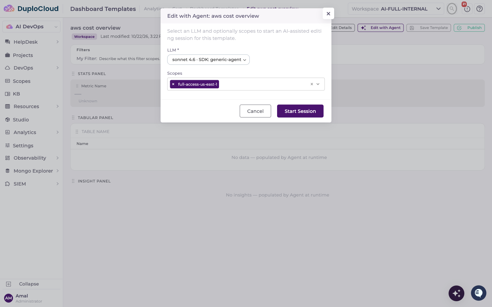

Click **Start Session**. If the template already has an agent session, **Edit with Agent** reopens it instead.

### 3. Describe the dashboard to the agent

In the chat, describe what the dashboard should show — the data sources to draw from, the metrics that matter, and any focus areas such as cost breakdown, reliability indicators, deployment frequency, or security posture. Be as specific or as broad as suits your needs.

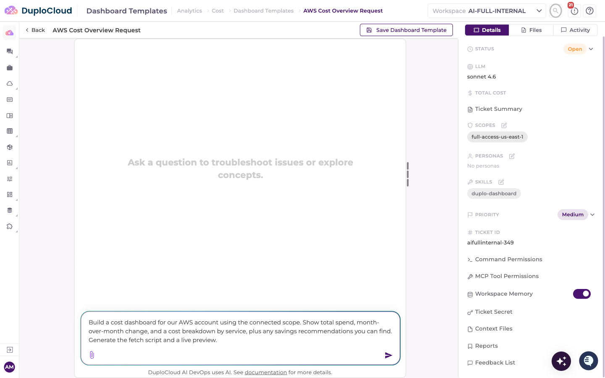

The agent reads the available providers, works out what data it can reach, and writes the template definition. The YAML files it produces appear in the right-hand pane as it works.

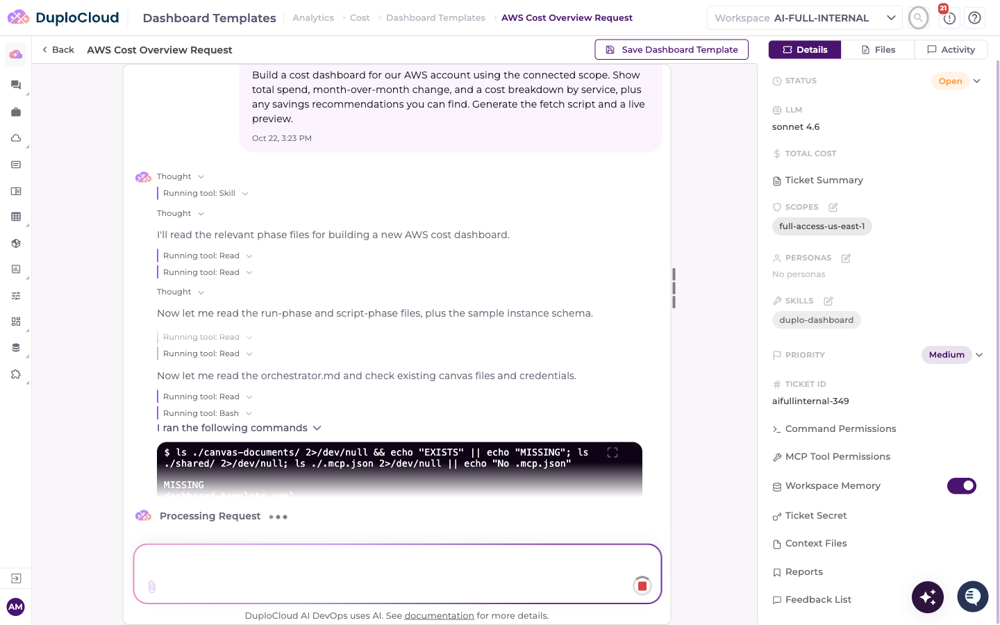


The agent may ask for your approval before running commands. Review the command and click **Approve** to let it continue.


### 4. Review the results with live data

The agent runs its data-fetching logic against your connected providers and reports the results in the chat — for example, current and prior-period cost per service and the savings opportunities it found. This lets you check that every panel is returning the right data before you save.

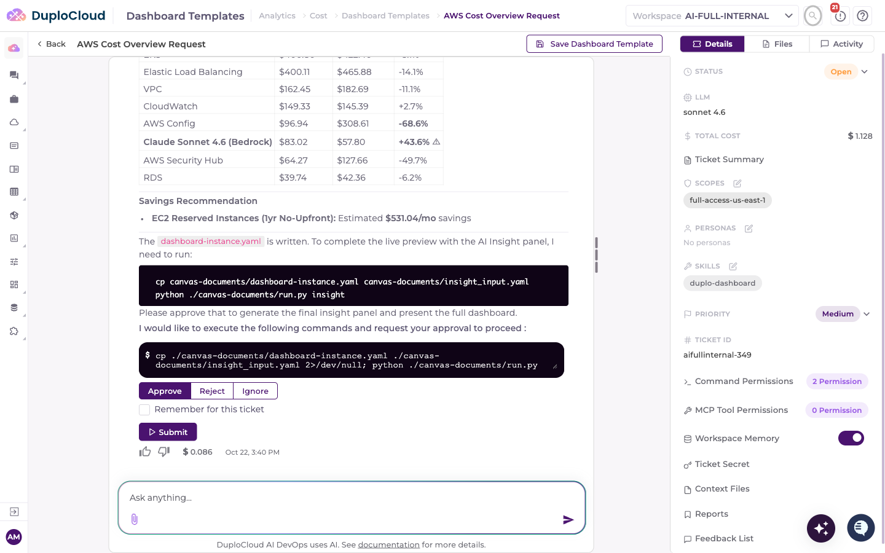

### 5. Persist the fetch script

The agent writes a reusable **fetch script** (`run.py`) alongside the template definition. The script runs whenever a dashboard built from the template loads or refreshes, so the agent does not need to be invoked again after the initial build.

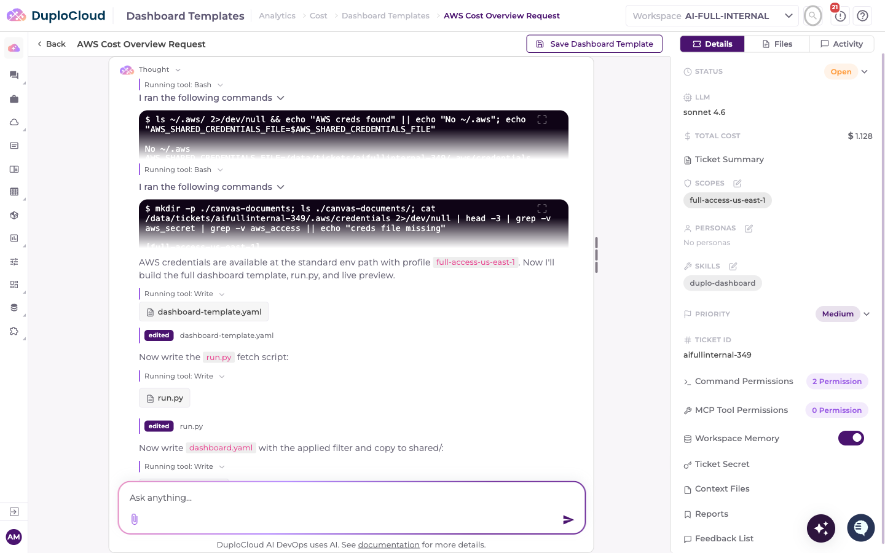

### 6. Save the template

Click **Save Dashboard Template**. A confirmation message confirms the template and its fetch script have been saved.

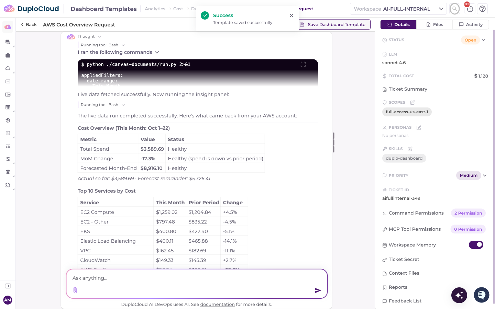

## Publishing a Template

Return to the template detail page and click **Publish**. **Publish** stays disabled until the template has a fetch script — if it is greyed out, continue the agent session until the script is generated and saved. Once published, the template shows a **Published** badge and becomes available for creating dashboards.

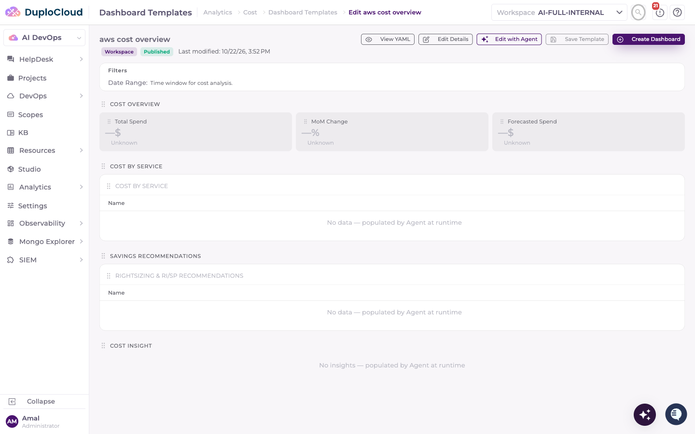

The detail page also has **Edit Details** for changing the template's description, category, system prompt, and filters, and **Save Template** for saving changes you make on the page itself.

## Creating a Dashboard from a Template

Open the template detail page and click **Create Dashboard**.

In the **Create Dashboard** modal:

* Enter a **Dashboard Name**.
* Select the **Scopes** the dashboard should use — a cloud account, cluster, or other environment. The fetch script runs with the credentials of the selected scopes, so select at least one if the panels need credentials. You can select more than one.
* Select the **LLM** used for the dashboard's agent features, such as **Agent Help**.
* Set any **Dashboard Filters** the template defines, such as a date range.

Click **Create Dashboard**.

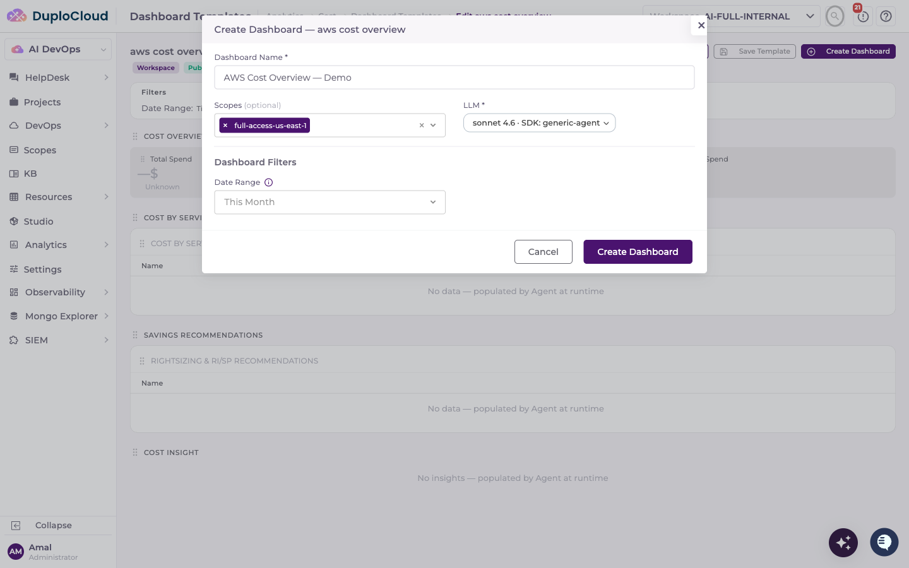

The dashboard appears as a new tab on the Dashboards page. Its panels show **Pending** while the fetch script runs, then fill in with live data from the selected scopes.

## Reusing a Template Across Multiple Scopes

Because the template and its fetch script are reusable, one template can back as many dashboards as you need without any additional agent work. There are two ways to combine scopes:

* **Several scopes on one dashboard** — select multiple scopes when creating the dashboard. The panels draw on all of them together, which suits an aggregate view across accounts or clusters.
* **One dashboard per scope** — repeat the **Create Dashboard** step, selecting a different scope each time. Each dashboard shows the same panel structure populated from its own environment, for example one tab for development and another for production.

This makes Dashboard Templates a scalable building block: define the structure once and connect it to as many environments as your organization needs.

## Dashboard Settings

Select a dashboard and click **Settings** to change:

* **Category** — the category the dashboard is listed under: **Observability**, **Security**, **Cost**, or **Others**.
* **Cache Timeout (seconds)** — how long panel results are reused before the fetch script runs again. The minimum is 30 seconds; leave it empty to use the default of 60 seconds.

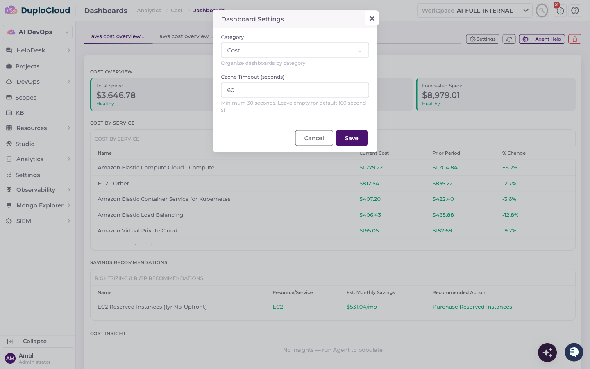

## Inspecting a Template's Definition

Everything a template holds — its filters, system prompt, panel layout, and the metric definitions behind each panel — is stored as a structured document you can read directly. Open the template and click **View YAML**.

The dialog shows the full saved definition, with a **YAML** / **JSON** toggle and buttons to copy or download it.

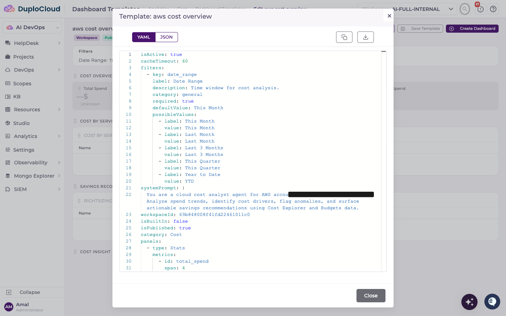

This is useful for reviewing exactly what the agent generated, for copying a panel definition between templates, or for keeping a copy of a template's structure outside the platform. Individual panels also have their own **Edit YAML** action for changing one panel without regenerating the whole template.
