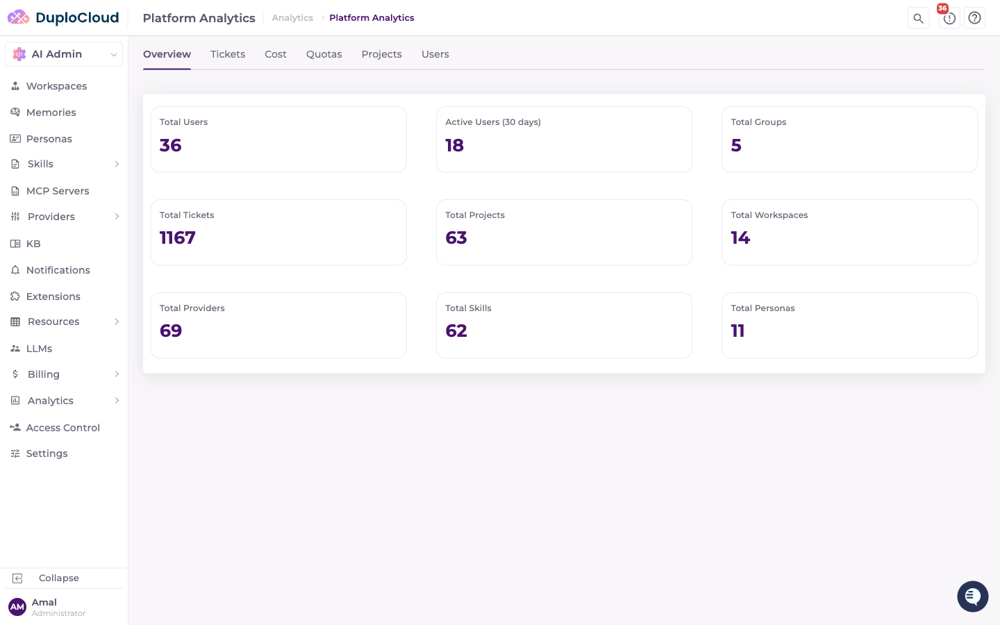
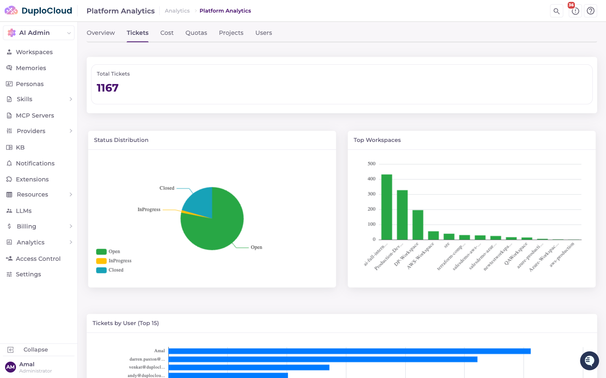
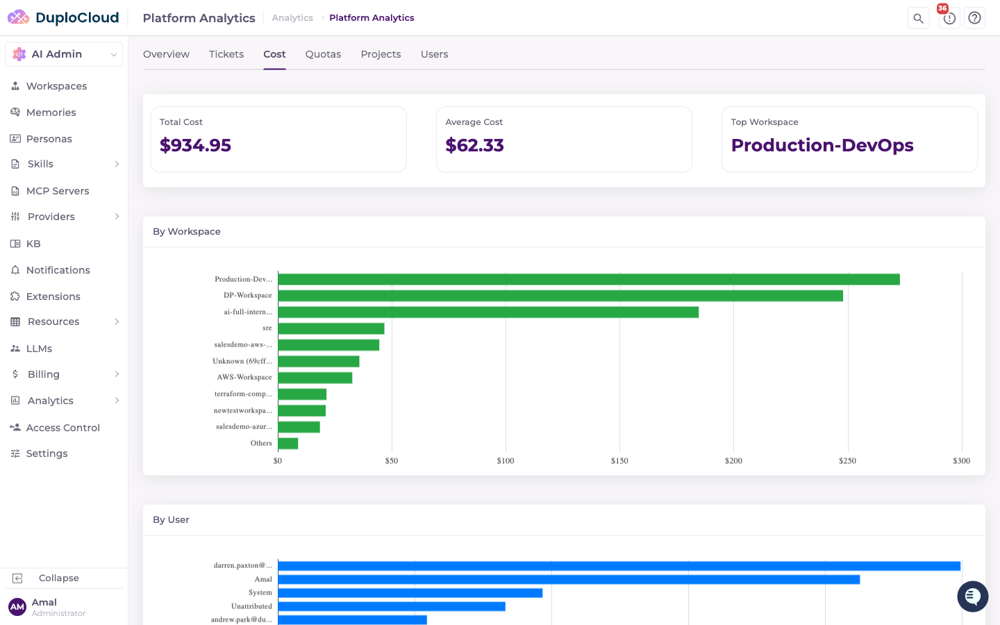
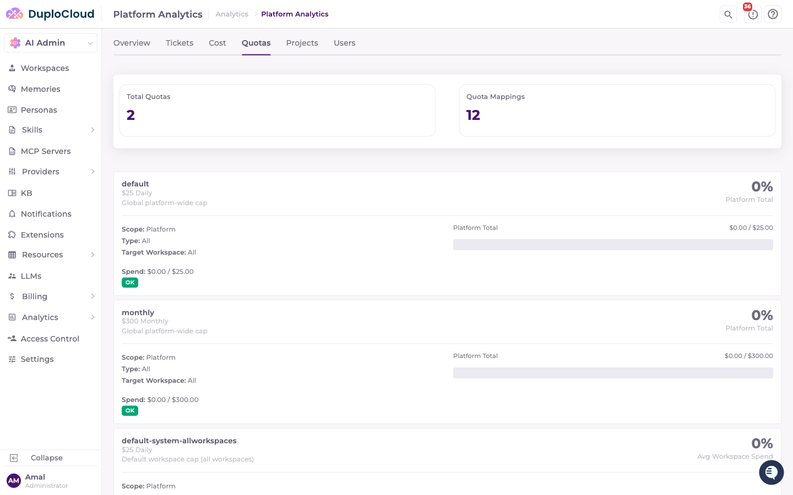
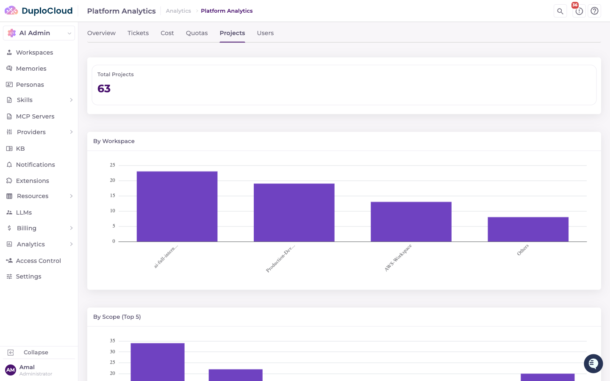
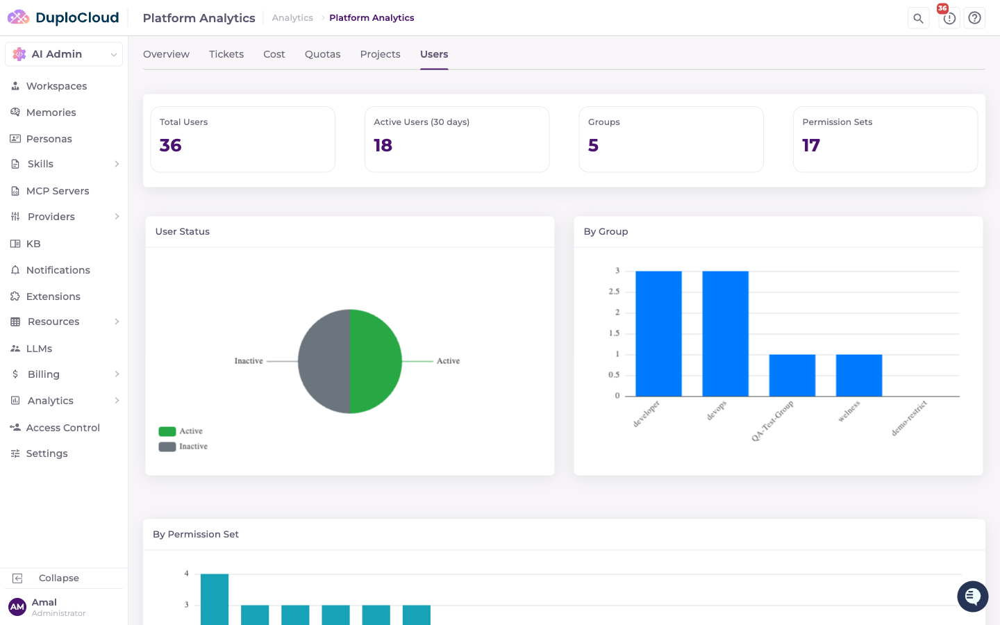
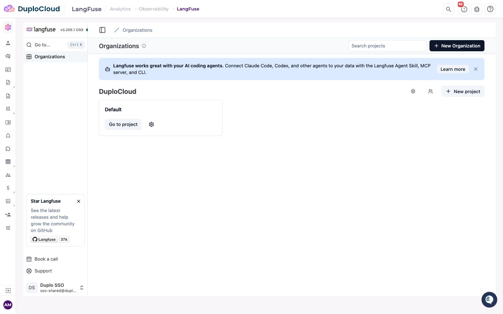
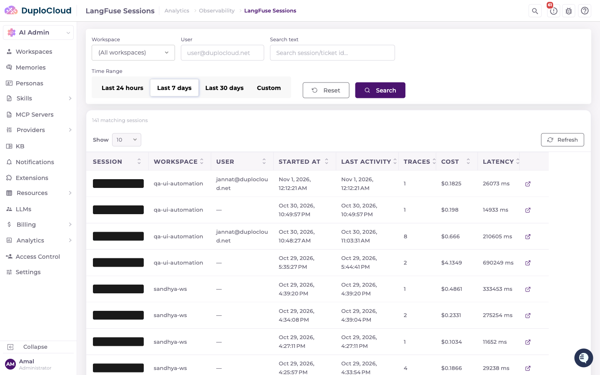

# Analytics

The **Analytics** section covers two admin-only screens: the **Platform Analytics** dashboard (usage/cost/ticket metrics across the whole platform) and **Observability** (LangFuse agent traces, embedded in the portal and searchable by session).


This is distinct from [AI Dashboards](ai-dashboards.md), which are agent-built dashboards over your connected cloud/infra providers. Platform Analytics is a fixed, built-in view over DuploCloud's own usage data — it isn't agent-generated and isn't scoped to a provider.


## Platform Analytics Dashboard

Go to **AI Admin → Analytics → Platform Analytics**. The **Overview** tab shows platform-wide totals — users, active users in the last 30 days, groups, tickets, projects, workspaces, providers, skills, and personas.

The remaining tabs break these totals down further:

* **Tickets** — status distribution (Open/In Progress/Closed), top workspaces by ticket volume, tickets by user, and tickets by scope

* **Cost** — total and average cost, the top workspace by spend, and cost broken down by workspace, by user, and by scope

* **Quotas** — how many quota definitions and mappings exist, then a card for each [quota mapping](access-control/quotas.md#quota-mappings) showing its limit and period, what it applies to, and current spend (or average spend per user, ticket, or workspace) against the limit, with a badge showing whether it's within the limit. The cards label a mapping's Context as **Scope** (System appears as **Platform**) and its Apply To as **Type**.

* **Projects** — project counts by workspace, by scope, and by user

* **Users** — active vs. inactive users (based on login in the last 30 days), plus breakdowns by group and by permission set


Nothing needs to be configured for this dashboard — it's computed from data that already exists (workspaces, tickets, users, quotas, and so on), so it populates automatically as your platform is used.


## Observability

The **Observability** pages show agent traces recorded in [LangFuse](https://langfuse.com), an open-source LLM observability tool. Each trace is tagged with the originating ticket, workspace, user, and model, so a trace can be followed back to the exact ticket that produced it.

### Set up LangFuse

DuploCloud can deploy LangFuse for you as part of the AI HelpDesk Helm chart. It's off by default; enabling it (`langfuse-stack.enabled`) deploys:

* LangFuse itself, on its own hostname, storing traces in the same ClickHouse database as [Audit Trail](helpdesk/audit-trail.md)
* A DuploCloud sign-in proxy in front of it, so admins open LangFuse with their portal session instead of a separate LangFuse login. By default only the **Administrator** role is let through, and everyone signs in to LangFuse as one shared account (**Duplo SSO**)
* The agent runtime's LangFuse credentials, so traces start flowing without further setup

This is a deployment-level step, done in the Helm values rather than from the portal.

You can also use a LangFuse instance you run yourself. It must allow the portal to embed it in an iframe (LangFuse Cloud does not), and the agent runtime needs that instance's API keys for traces to reach it.

### LangFuse

Go to **AI Admin → Analytics → Observability → LangFuse**. The page embeds the LangFuse UI, so you can browse projects, traces, and sessions without leaving the portal.

The page shows the URL saved in the `langfuse-url` [System Setting](settings.md#system-settings). Set it to your LangFuse hostname — enabling LangFuse in the Helm chart doesn't fill it in. Until it's set, the page shows an empty state with a **Configure LangFuse URL** button that opens the Add System Setting form with `langfuse-url` already selected.

### LangFuse Sessions

Go to **AI Admin → Analytics → Observability → LangFuse Sessions** to search agent sessions without opening LangFuse.

Filter by **Workspace**, **User**, and **Search text** (a session or ticket ID), choose a **Time Range** (**Last 24 hours**, **Last 7 days**, **Last 30 days**, or **Custom**), and click **Search**. Each row shows the session's workspace, user, start and last-activity times, number of traces, total cost, and total latency. The link icon at the end of a row opens that session in LangFuse; it appears only when `langfuse-url` is set.

This page reads session data straight from the ClickHouse database LangFuse writes to. If the backend has no connection to that database, the page says session search isn't enabled for the environment — that is not the same as no matching sessions.
