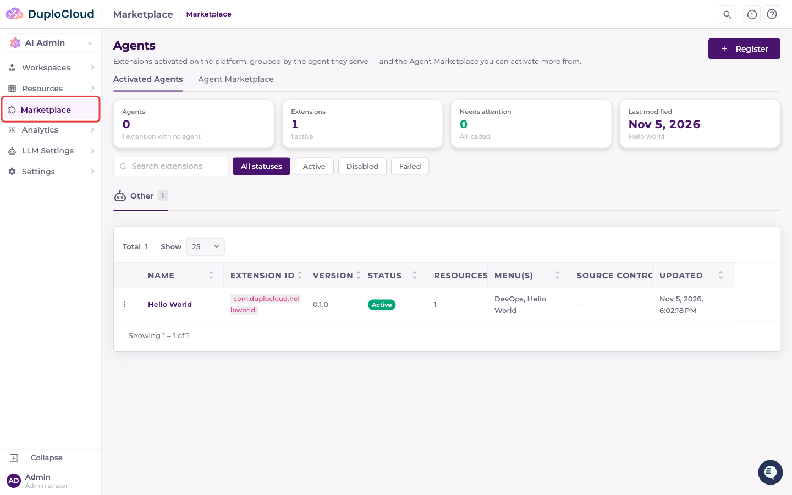
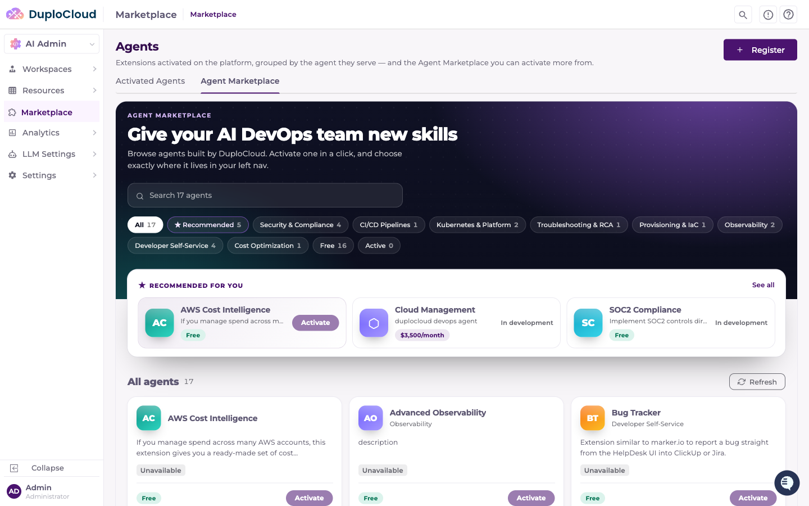
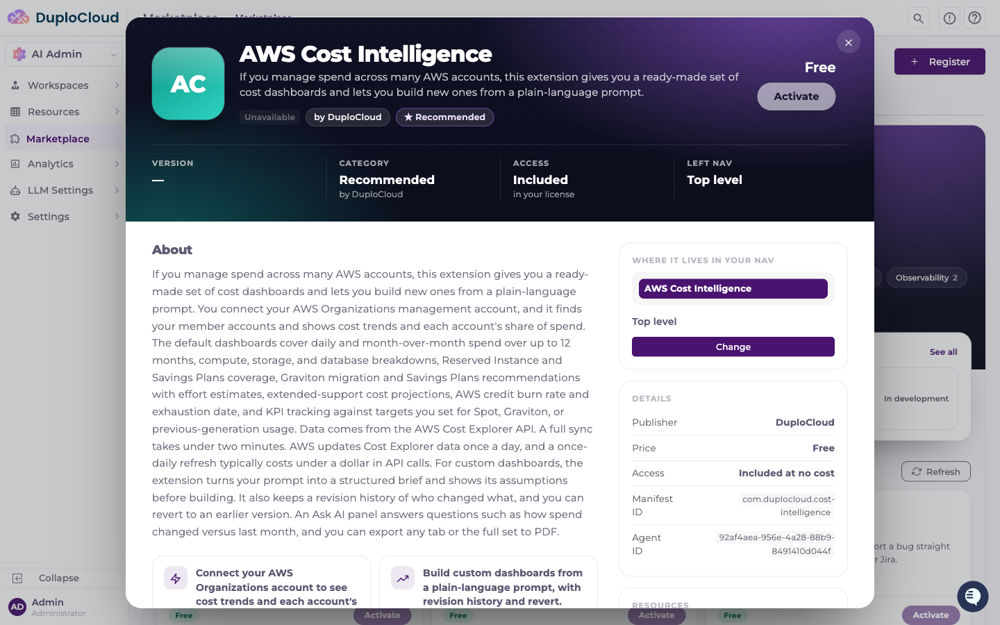
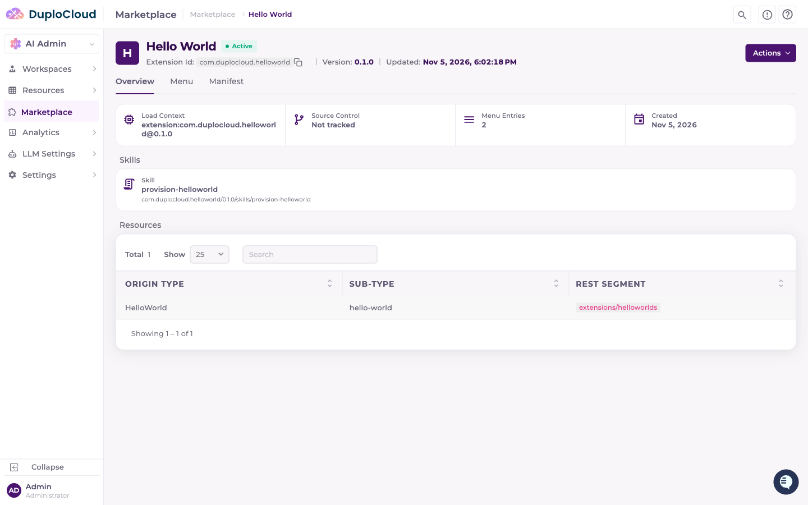
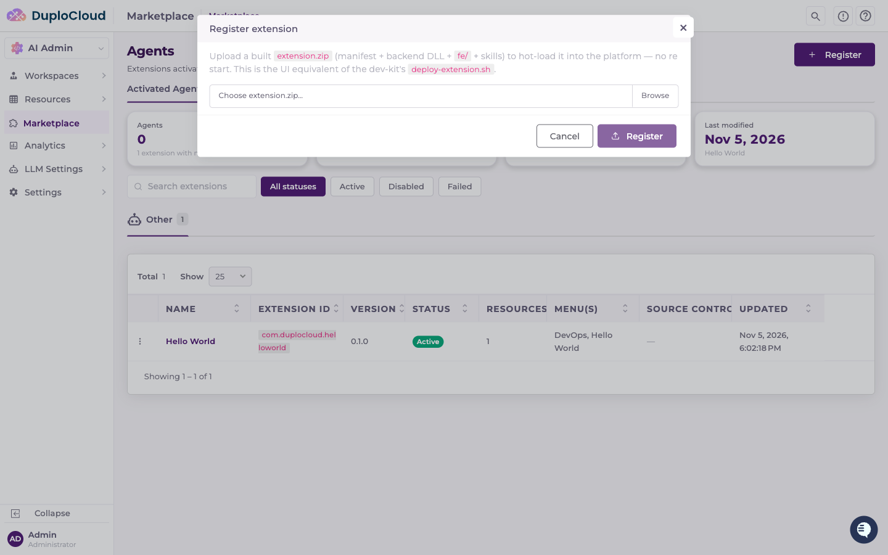
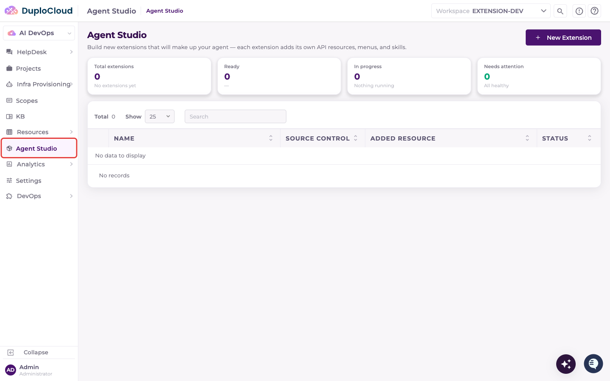
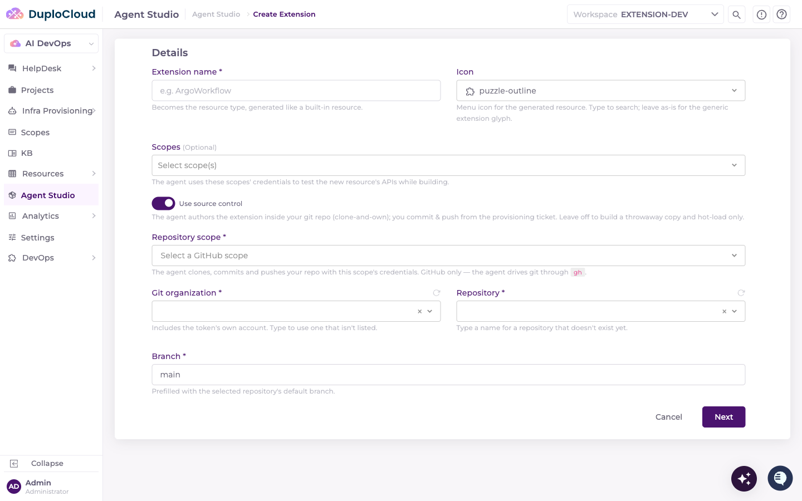

# Agents


This page reflects an in-progress rename: **Extensions** is becoming **Agents** in the portal. The change is merged but not yet in a release. If your sidebar still says **Extensions** and **Studio**, the same screens are there under the old names.


Agents add capabilities to the platform — API resources, menu entries, and skills — loaded at runtime without redeploying the portal. What you build and activate is called an **agent** in the portal; the file you package and upload is still called an **extension** (for example, `extension.zip`), and each agent is made up of one or more extensions.

There are two places to work with agents, and they do different jobs:

|                       | Where                               | What it's for                                                   |
| --------------------- | ----------------------------------- | --------------------------------------------------------------- |
| **Agent Marketplace** | **AI Admin → Marketplace**          | Activate published agents and manage what's running on the platform |
| **Agent Studio**      | **Agent Studio** within a workspace | Build a new extension from a description                        |

Start with the Marketplace — activating something that already exists needs no source control and no build.

***

## Activating an agent

Go to **AI Admin → Marketplace**. The **Agents** page has two tabs: **Activated Agents** and **Agent Marketplace**.

### Activated Agents

Summary tiles across the top show how many agents and extensions are activated, how many need attention, and when the set last changed. Extensions are grouped into a tab per agent; an extension that doesn't belong to any agent appears under **Other**. Each table lists the extension's name, extension ID, version, status, resource count, the menus it adds, and whether it is tracked in source control.

Use the search box and the **All statuses / Active / Disabled / Failed** filters to narrow the list — **Failed** is the one to check when an extension's resources or menus aren't appearing.

### Agent Marketplace

The **Agent Marketplace** tab is the catalog of agents you can activate. Search agents by name, or filter by category, and use **Refresh** to re-read the catalog. **Recommended for you** highlights a few agents at the top. Each card shows the agent's category, a short description, its status, and an **Activate** button.

Click an agent to open its details: what it does, its version and category, and **Where it lives in your nav** — the left-nav position it will take, which you can **Change** before activating. The details panel also lists the publisher, the **Manifest ID**, and the **Agent ID**.

Click **Activate** to add the agent. Once an agent is active, its details offer **Open** to go to it and **Deactivate** to turn it off, plus **Update** when a newer version is available.


If the catalog shows **No agents are published yet**, or a banner says the agent catalog is unreachable or no license is installed, the platform can't load the catalog — check the platform's license and its connection to DuploCloud.


### Inspecting an activated extension

Opening an extension from the **Activated Agents** table shows what it actually contributes to the platform.

The header carries its status, extension ID, version, and last-updated time. Below that:

* **Load Context** — the fully-qualified identifier and version the platform loaded
* **Source Control** — the repository it is tracked in, or **Not tracked** for a zip upload
* **Menu Entries** — how many navigation entries it adds
* **Skills** — the skills it registers, with their fully-qualified paths
* **Resources** — the API resources it registers, by origin type, sub-type, and REST segment

Three tabs give more detail: **Overview** (above), **Menu** (the navigation entries it adds), and **Manifest** (the raw declaration).

The **Actions** menu on the detail page lets you **Disable** an extension without removing it — its resources and menus stop loading, and the status changes to Disabled — or **Enable** one that is currently disabled. **Delete** unloads the extension and removes its record. Each asks for confirmation first. The same actions are on each row's menu in the table, where delete is labelled **Delete Extension**.

### Registering an extension from a file

If you have a built extension that isn't in the catalog, click **Register** and upload its `extension.zip`.

The extension is hot-loaded without a restart. Extensions registered this way show **Not tracked** under Source Control, since there's no repository behind them.

***

## Building an extension in Agent Studio

Agent Studio is the authoring side, scoped to a workspace rather than the platform. Go to **Agent Studio** in the workspace navigation. It lists the extensions being built in the workspace, with tiles for how many are ready, in progress, or need attention.

Click **New Extension**. The form has two steps.

**Details:**

* **Extension name** — becomes the resource type, generated like a built-in resource
* **Icon** — the menu icon for the generated resource
* **Scopes** _(optional)_ — credentials the agent uses to test the new resource's APIs while building
* **Use source control** — off by default. Off, the agent builds a throwaway copy and hot-loads it. On, the agent authors the extension inside your Git repository, and you also provide:
  * **Repository scope** — a GitHub scope; the agent clones, commits, and pushes with its credentials
  * **Git organization**, **Repository** (type a name to use one that doesn't exist yet), and **Branch**

**Requirements:** describe what the extension should do, in Markdown, and optionally attach requirement files. Click **Next** to move from Details to Requirements, and **Back** to revise.

Clicking **Create & Build** starts an agent that writes the extension against your requirements and loads it into the platform. You can refine the details with the agent in the provisioning ticket, where an **Extension Preview** shows the result once it's loaded.

Once built, an extension's detail page in Agent Studio has:

* **Spec / Result** — switch between what you asked for and what was built
* **Ask the Agent** — reopen the provisioning ticket to keep working with the agent
* **Source control** tab — review changes, then **Commit…**, **Push changes**, or **Resync** with the remote (when source control is on)
* **Deprovision** — tears the extension back down, removing what it contributed


Source control is optional. Turn it on when you want the extension's code kept in your own GitHub repository; leave it off to build and hot-load a copy without one. If you only want to use an agent someone else has published, activate it from the **Agent Marketplace** instead.


***

## Which one should I use?

* **Activate from the Agent Marketplace** when the capability already exists. No build, no repository, no scope.
* **Register a zip** when you have a built extension that isn't published to the catalog.
* **Build in Agent Studio** when you need something that doesn't exist yet — with source control on if you want to maintain it in your own repository.

For the concepts behind agents — the plugin architecture, manifests, storage, and lifecycle — see the [Agent Framework](../extension-framework/extension-framework.md).
