# HelpDesk

The AI HelpDesk is where your AI-assisted DevOps work lives. It is the backend service that tracks and manages all of your tickets — whether standalone tasks or tickets that belong to a larger project — and acts as the central system of intelligence.

Tickets are the core unit of work in the HelpDesk. Each ticket represents a discrete task or request that the AI Agent works on alongside you. Through an intuitive interface, you can open tickets, interact with the Agent, visualize operations through a shared browser, and maintain oversight of AI-executed commands in production environments.

Because everything is ticket-based, the HelpDesk also serves as a collaboration layer — team members can work in parallel, hand off context between sessions, and maintain a complete audit trail. The result is a platform that enhances productivity, reduces operational overhead, and maintains the security and compliance standards intrinsic to DuploCloud.

Open the HelpDesk from the **HelpDesk** item in the left navigation sidebar. It expands to two options: **Add Ticket** and **History**.

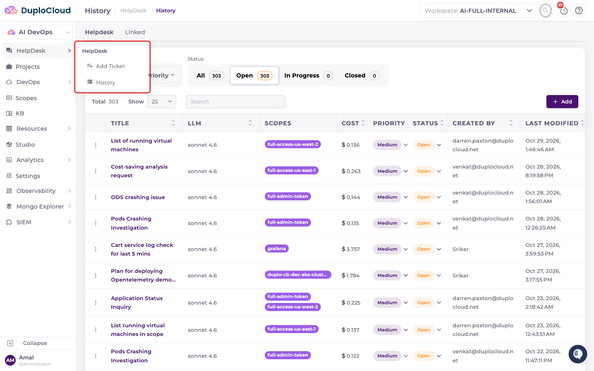

---

## Add Ticket

Click **Add Ticket** to open a new ticket. The page asks *What should the agent work on?* Describe the task, optionally pick a model and scopes, review the **Agent loadout**, and submit.

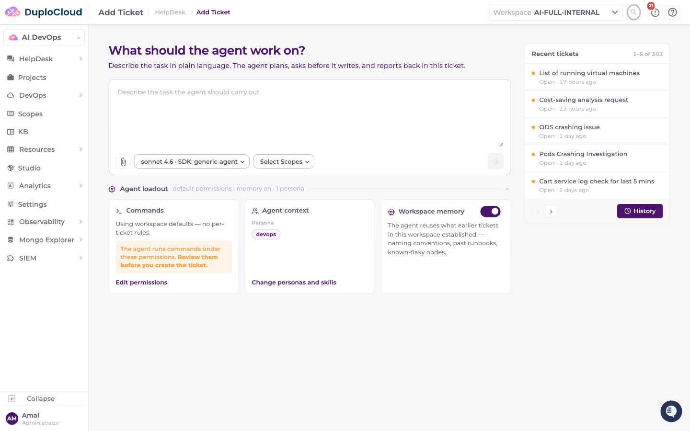

For a step-by-step walkthrough of every control on this page and of the ticket page that opens afterwards, see [Create a Ticket](../tickets.md).

The **Recent tickets** panel on the right lists the latest tickets in the workspace. Its **History** button opens the full ticket list.

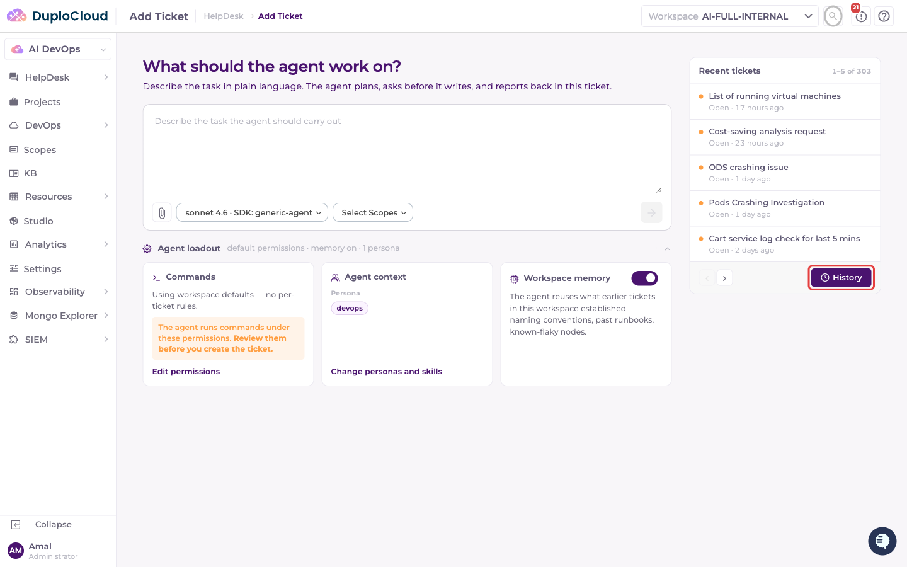

---

## History

Click **History** in the sidebar to see the tickets in the current workspace. The list opens on the **Helpdesk** tab, filtered to **Open** tickets and sorted by most recently modified.

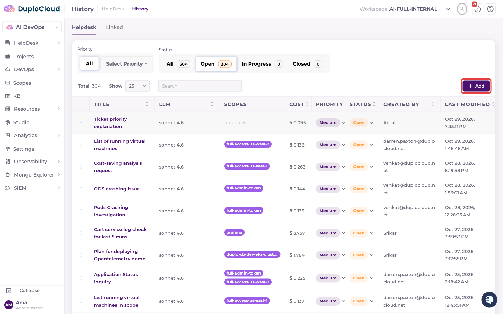

The table has the following columns:

- **Title** — the task or question submitted to the agent
- **LLM** — the model handling the ticket
- **Scopes** — the credential scopes attached to the ticket, or *No scopes*
- **Cost** — total cost the agent has accumulated on this ticket
- **Priority** — `Low`, `Medium`, `High`, or `Critical`
- **Status** — `Open`, `In Progress`, or `Closed`
- **Created By** — the user (or *System*) that opened the ticket
- **Last Modified** — when the ticket was last updated

**Priority** and **Status** are editable in place: click the badge in a row to change it without opening the ticket.

The **Add** button above the table opens the [Add Ticket](#add-ticket) page.

### Helpdesk and Linked tabs

- **Helpdesk** shows tickets opened directly in the HelpDesk.
- **Linked** shows tickets that were started from somewhere else — a Project, a Dashboard, a Dashboard Template, an external integration, or another source. This tab adds an **Origin** filter and an **Origin** column so you can see where each ticket came from.

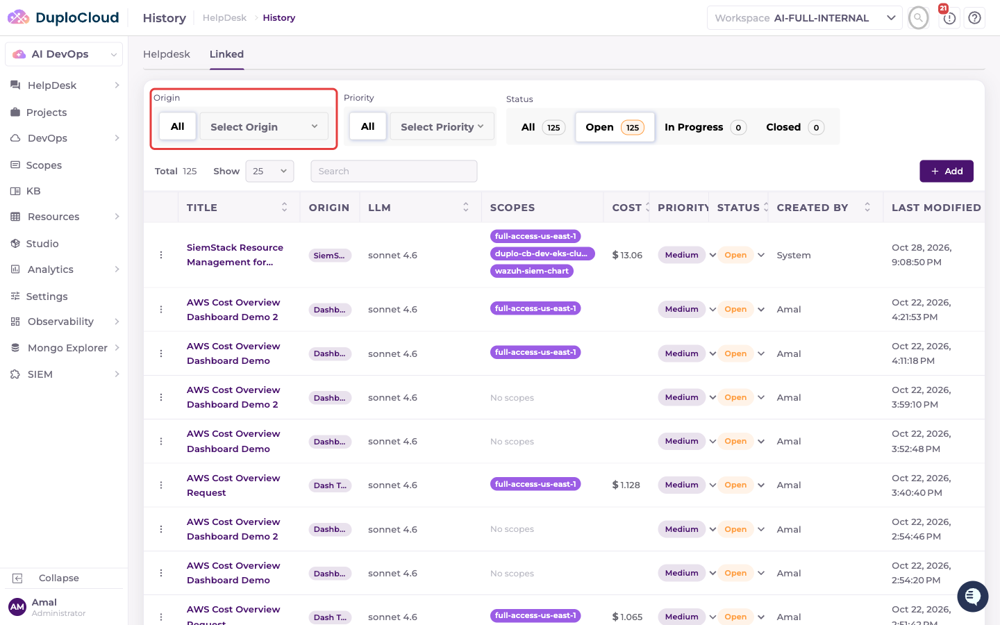

### Filtering and searching

Use the filters above the table to narrow the list:

- **Priority** — show only tickets of one priority.
- **Status** — **All**, **Open**, **In Progress**, or **Closed**. Each option shows how many tickets it holds.

The **Search** box matches ticket names, titles, models, scopes, creators, and cost.

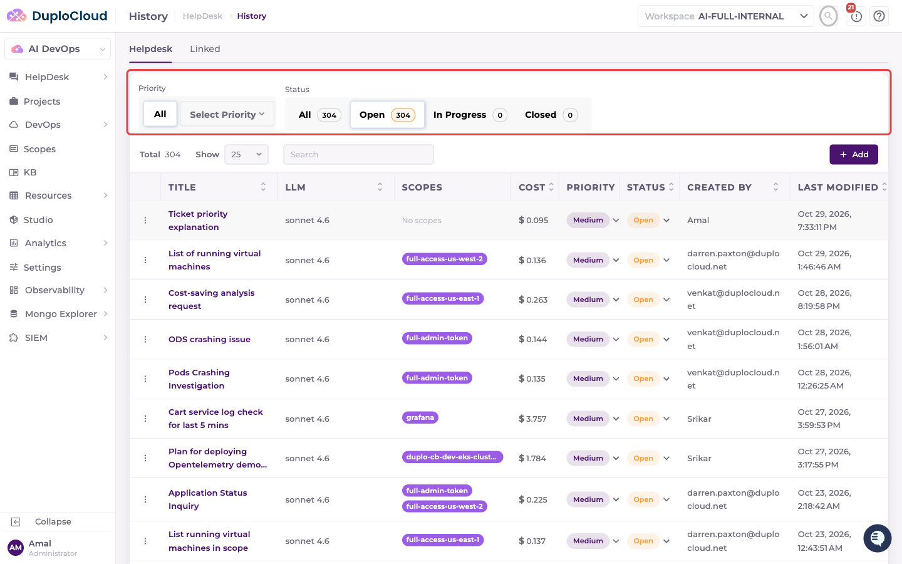

### Row actions

The **⋮** menu at the start of each row offers:

- **Copy Ticket ID** and **Copy Ticket Name** — copy the identifier to the clipboard, to reference the ticket elsewhere
- **Delete** — permanently remove the ticket, after a confirmation prompt

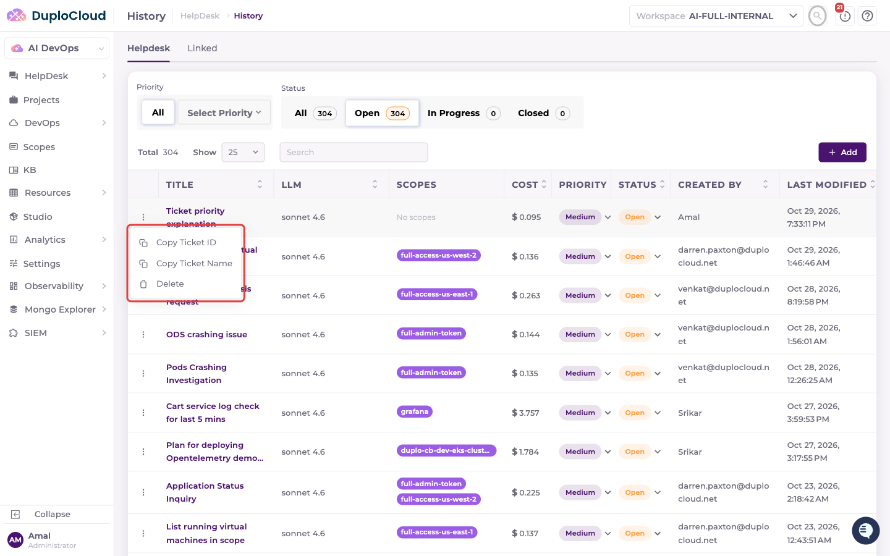

### Resuming a ticket

Click a ticket title to open it and continue where you left off.

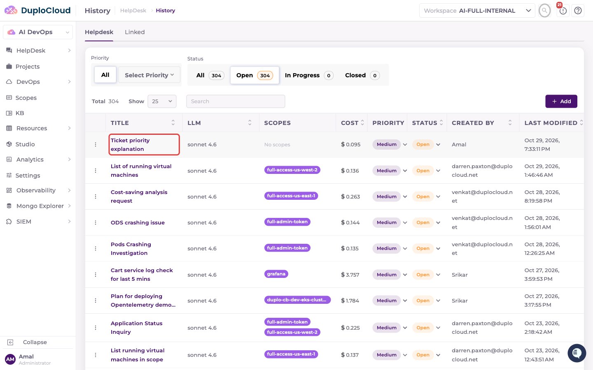

The full conversation with the agent is preserved. Type in the **Ask anything...** box to ask a follow-up question or direct the agent to its next task.

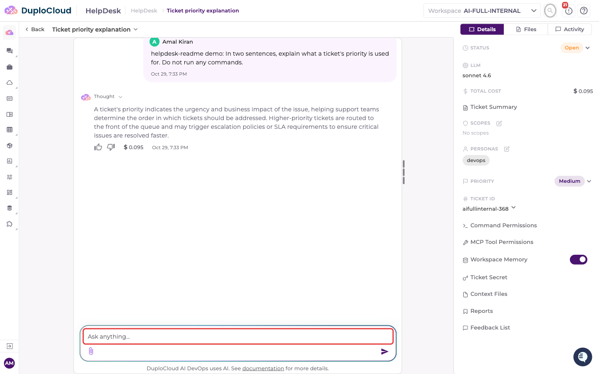

### Closing a ticket

Set a ticket's **Status** to **Closed** to close it. A dialog asks whether the ticket was resolved. You can rate the experience and leave feedback before choosing **Yes, Resolved** or **No, Unresolved**.

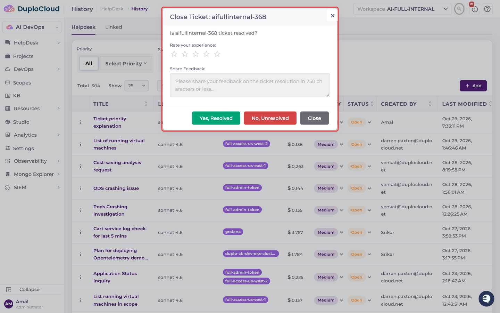

The answer is recorded as the ticket's **disposition** and shown next to its status. When the **Closed** status filter is selected, a **Disposition** filter appears.

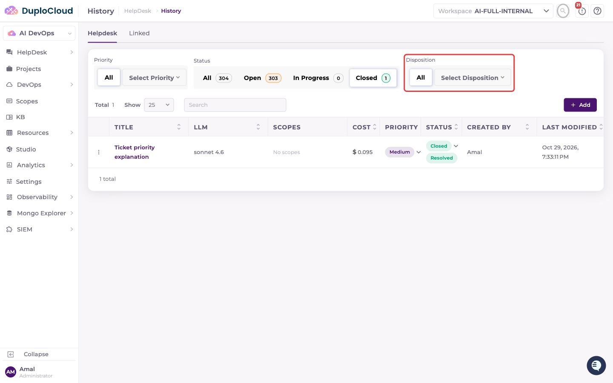

Use it to show only **Resolved** or only **Unresolved** tickets.

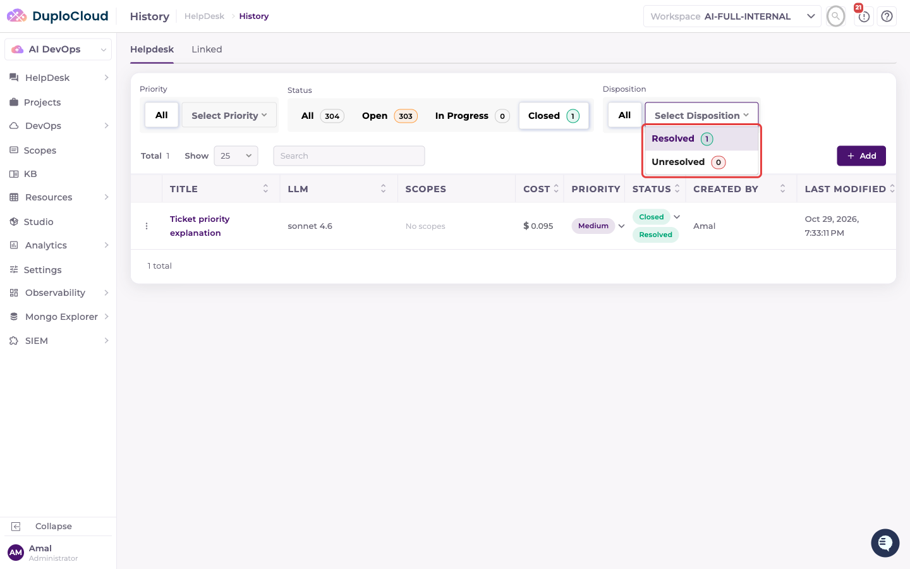

### Switching workspaces

Tickets belong to a workspace. To see another workspace's tickets, open the **Workspace** selector in the page header and pick a workspace, or type to search the list. The History table reloads with that workspace's tickets.

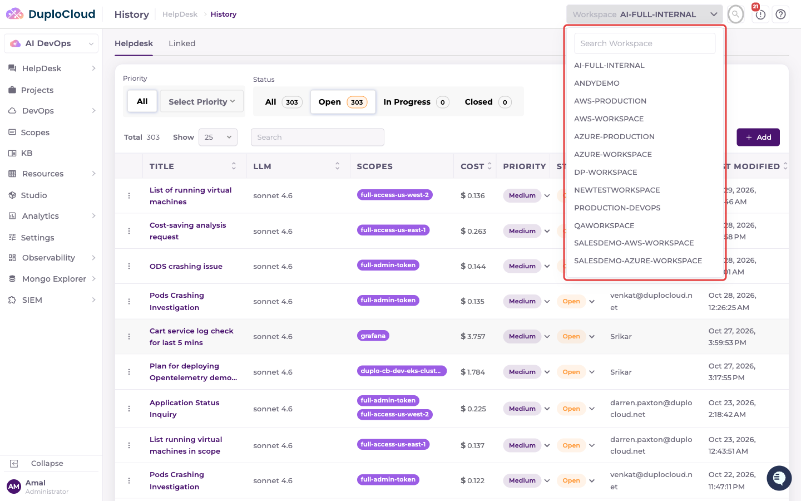
