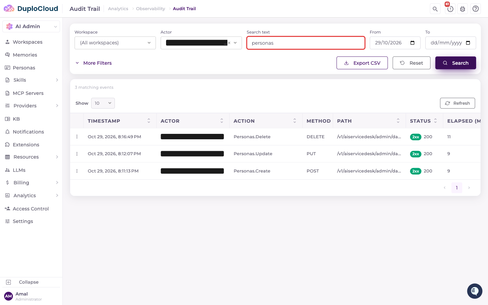
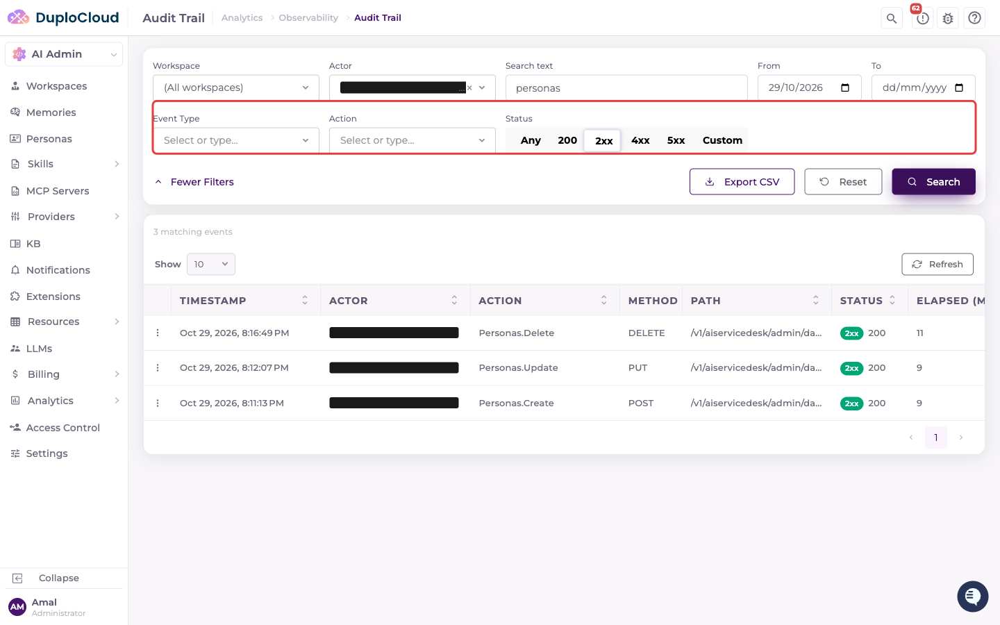
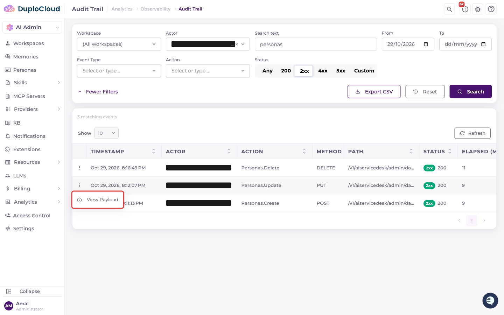
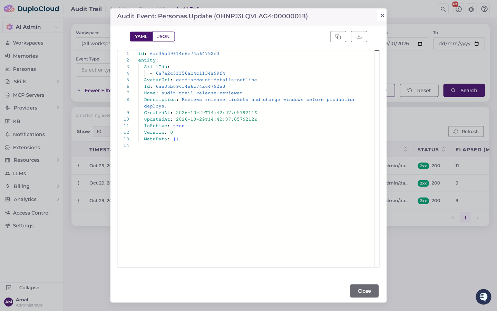

# Audit Trail

The Audit Trail records who did what across the HelpDesk and AI Studio: every change made through the API, failed and denied requests, and live-session activity. Administrators can search it from the admin portal, and operators can also ship the same records to cloud storage for long-term retention.

## Browse the Audit Trail

The Audit Trail is admin-only. You need the Administrator or AI Studio Admin role to open it. Audit records contain user emails, request paths and payloads, so the API refuses the search to anyone else even if they reach the URL.

To open it, in the admin portal go to **Analytics** > **Observability** > **Audit Trail**. You can also open a single workspace's events from the **Audit Trail** tab on that workspace's page under **Workspaces**.

### Search and filter events

The filter bar at the top narrows the events shown in the table. Set the filters, then click **Search**.

* **Workspace**: one workspace, **(All workspaces)** (the default for administrators), or **(No workspace)** for requests that never resolved one.
* **Actor**: the user who made the request. Pick from the list or type an email.
* **Search text**: matches anywhere in the request path, the action name, or the recorded payload. Case doesn't matter.
* **From** and **To**: the date range. With no From date, the search covers the last 30 days.

Click **More Filters** to add:

* **Event Type**: for example `HTTP` for API requests, or `HUB_INVOKE`, `HUB_CONNECT` and `HUB_DISCONNECT` for live-session activity.
* **Action**: the API action that handled the request, for example `Personas.Update`.
* **Status**: **Any**, exactly **200**, a class (**2xx**, **4xx**, **5xx**), or **Custom** to enter your own status-code range. Live-session events have no status code.

The table shows the total number of matching events, newest first, with the timestamp, actor, action, HTTP method, path, status code and elapsed time of each. **Reset** clears the filters and **Refresh** re-runs the current search.

### View an event's payload

To see what a request sent, click the **⋮** menu on its row and choose **View Payload**.

The payload opens in a viewer that you can switch between YAML and JSON, copy or download. Sensitive fields are already masked (see [What's captured](#whats-captured)), and payloads over 8 KB are cut short with `...[truncated]`.

### Export to CSV

**Export CSV** downloads the events that match the last search you ran, with timestamp, event type, actor, action, method, path and status code. An export holds at most 200 rows. If more events match, you'll see an **Export Truncated** warning; narrow the date range or filters and export again.

### When search isn't enabled

The Audit Trail reads from a ClickHouse audit store. If the operator hasn't enabled it (see [Configure audit sinks](#configure-audit-sinks)), the page shows **Audit log search is not enabled for this environment** instead of a table. This is different from a search that matches nothing. Events may still be recorded by the other sinks.

## What's captured

* **Write requests**: every POST, PUT, PATCH and DELETE, with the method, path, query string, status code, elapsed time, the action that handled it, and a masked copy of the request payload. Operators can add other methods, such as GET, with `Audit:Http:Methods`.
* **Failed requests**: any request that ends with a 4xx or 5xx status, including authentication failures (401, 403) and routing errors (404, 405) that never reach an action. If an action fails partway through, its event is still recorded.
* **Live-session activity**: SignalR hub calls, connections and disconnections, with the hub, method and disconnect reason.
* **Who made it**: the effective user, the signed-in user, the workspace, whether the user is an administrator, and any "on behalf of" identity for requests made by bots or Slack.

Health checks (`/health`, `/healthz`) are not recorded.

**Sensitive fields are masked automatically.** In the recorded payload, any field whose name contains one of the following is replaced with `***`: `secret`, `key`, `password`, `token`, `certificate`, `cert`, `auth`, `bearer`, `accesskey`, `secretkey`, `privatekey`, `passphrase`, `credentials`, `passcode`, `sessionid`, `connectionstring`, `jwt`, `ssh`. Fields marked as secret in the code are masked too, whatever their name.

## Configure audit sinks

This section is for operators who run the HelpDesk service. Audit records go to every enabled sink, configured under the `Audit` section of the service's configuration (or the matching environment variables, such as `Audit__ClickHouse__Enabled`).

A logger-based sink is always on and writes through the service's existing logging configuration. The other sinks are off by default.

| Sink | Settings | Used by the Audit Trail page |
| --- | --- | --- |
| ClickHouse | `Audit:ClickHouse:Enabled`, `ConnectionString`, `TableName` (default `audit_events`), `RetentionDays` (default `90`), `AllowTtlShortening` (default `false`) | Yes, this is the only sink the page searches |
| Amazon S3 | `Audit:S3:Enabled`, `BucketName`, `Prefix` (default `audit/`), `Region` (default `us-east-1`) | No |
| Azure Blob Storage | `Audit:AzureBlob:Enabled`, `ConnectionString`, `ContainerName`, `Prefix` (default `audit/`) | No |
| Google Cloud Storage | `Audit:Gcs:Enabled`, `BucketName`, `Prefix` (default `audit/`) | No |

**ClickHouse.** The service creates the table on first use and keeps rows for `RetentionDays`. Use `Username=` (not `User=`) in the connection string, or ClickHouse falls back to its `default` account. The account needs permission to create and alter the table. Lowering `RetentionDays` on an existing table only takes effect if you also set `AllowTtlShortening` to `true`. When it does, rows older than the new window are deleted permanently.

**Amazon S3.** Records are written in batches as newline-delimited JSON, under date-partitioned keys (`<prefix>year=YYYY/month=MM/day=DD/<event type>/...`), so you can query them with Athena without a repair step. The service's AWS credentials need `s3:PutObject` on the bucket and prefix.


This audit trail covers the AI Studio and HelpDesk API. It's separate from the DuploCloud infrastructure audit trail available elsewhere in the platform.

