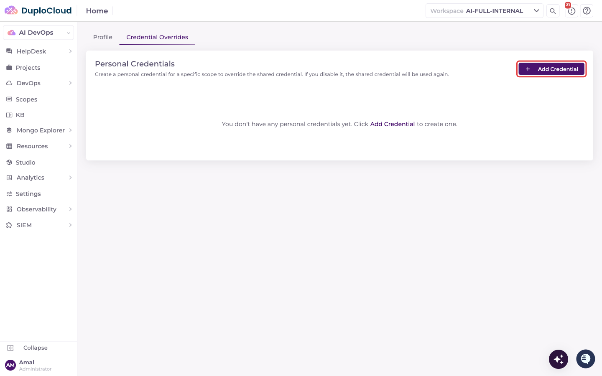
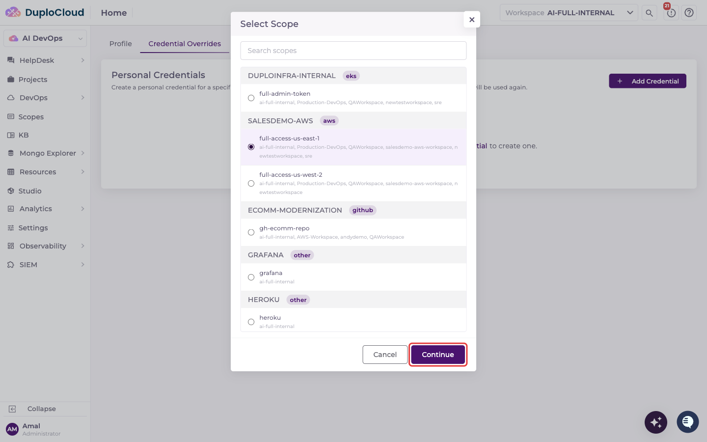
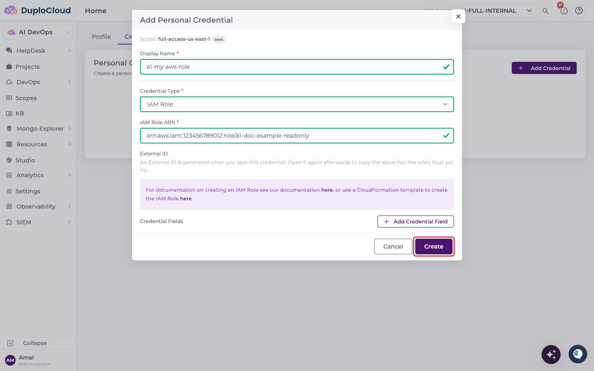
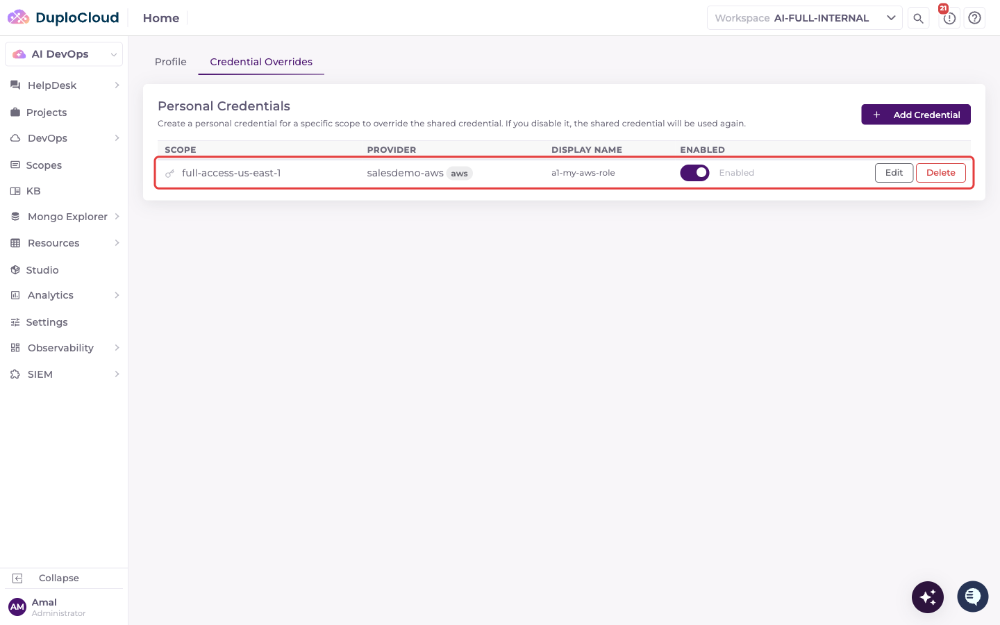

# User-Level Credentials

A Scope's credential is normally shared by everyone who uses it — a team-level secret set on the Provider. **User-Level Credentials** let an individual user override that shared credential with their own, for a specific Scope, without affecting anyone else using the same Scope.

This is useful when different people need to act with their own identity against the same infrastructure — for example, each engineer using their own IAM role on a shared `aws-read-only` Scope instead of a single team credential.

## Adding a Personal Credential

Personal credentials are managed from your own **Profile**, not from the Providers admin pages.

### 1. Open Credential Overrides

Click your name at the bottom of the left-hand sidebar, then click **Profile**. Go to the **Credential Overrides** tab. It lists your personal credentials for the Scopes in your current workspace.

### 2. Select a scope

Click **Add Credential**. Choose the Scope you want to override from the list — it shows every Scope you have access to across your workspaces, grouped by provider, with the workspaces each Scope belongs to underneath its name. Scopes you've already overridden show a **Configured** badge.

Click **Continue**.

### 3. Fill in your credential

Give it a **Display Name**, then fill in the fields for the Scope's provider type:

- **AWS** — choose **Access Key** (Access Key ID + Secret Access Key) or **IAM Role** (IAM Role ARN). For an IAM Role, an **External ID** is generated when you save; open the credential again afterwards to copy it into the role's trust policy as the `sts:ExternalId` condition.
- **Kubernetes** — choose **Kubernetes Token**, **Cloud Role**, or **Kubernetes Service Account Name**. On AKS, the choices are **Kubernetes Token**, **Service Principal**, **Managed Identity**, or **Kubernetes Service Account Name**.
- **Other providers** — the same credential fields the shared credential uses, plus any custom key/value pairs you need

Click **Create**.

### 4. It's active immediately

Your personal credential appears in the table and is used automatically whenever the agent acts on a message you send in a ticket that uses that Scope — no per-ticket toggle needed.


* Your personal credential only affects **your own** ticket messages — other users on the same Scope keep using the shared credential (or their own override, if they've set one).
* Background work, such as Terraform state sync, dashboard refreshes and extension resource actions, always uses the shared credential.
* Use the **Enabled** toggle to fall back to the shared credential without losing your saved values — disabling doesn't delete the credential.
* Click **Edit** to change a credential. Stored values aren't shown; leave a field blank to keep its current value. Click **Delete** to remove it.
* Any user with access to a Scope can add their own override for it; there's no additional admin permission required.

