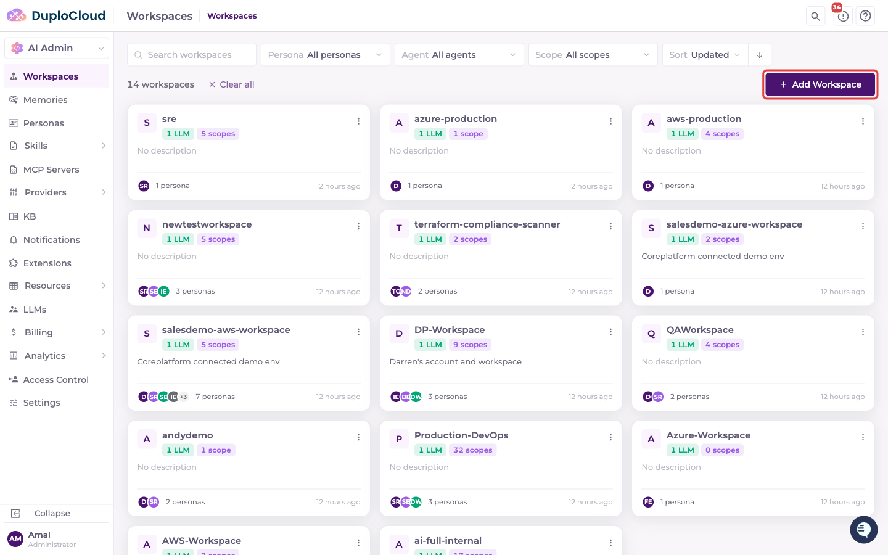
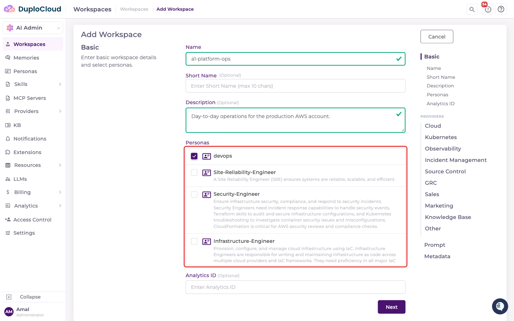
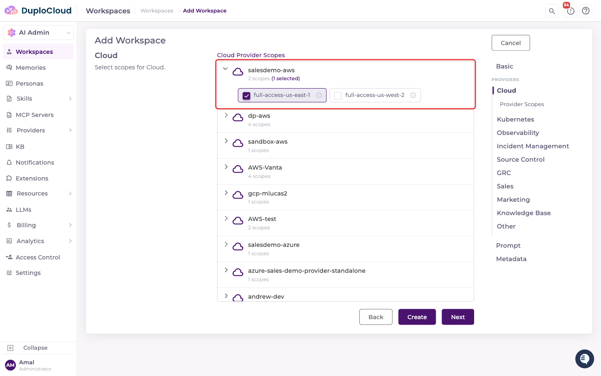
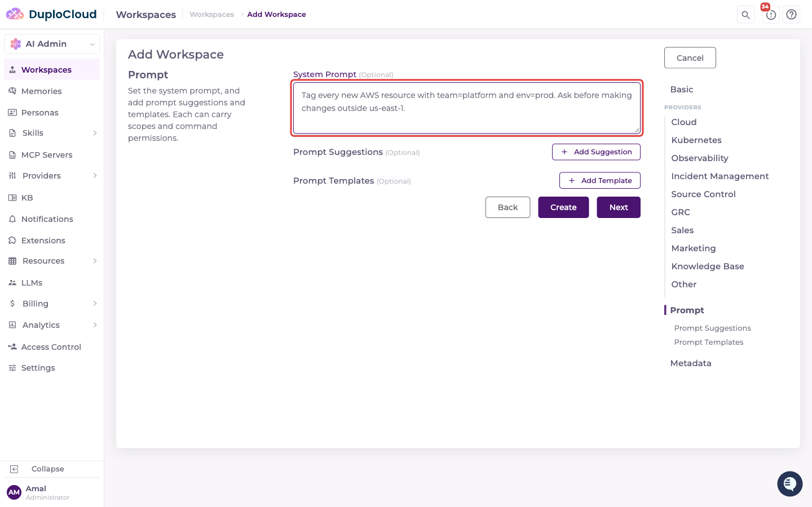
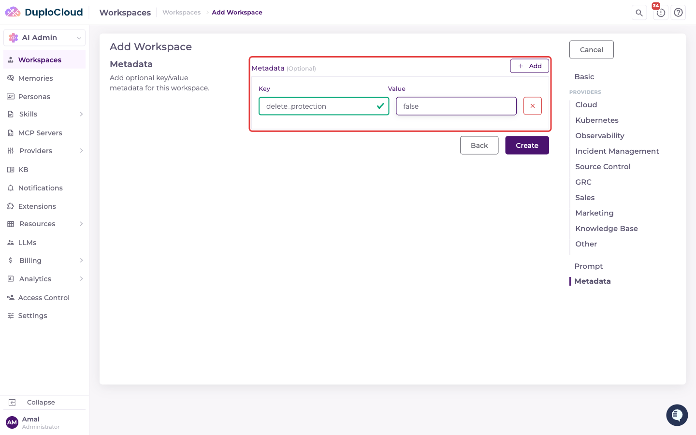
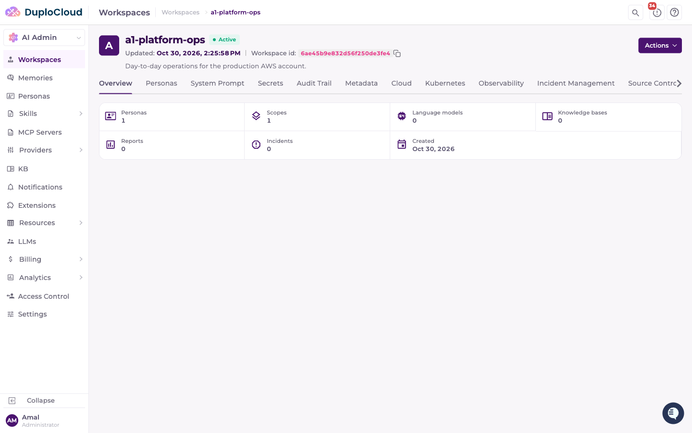
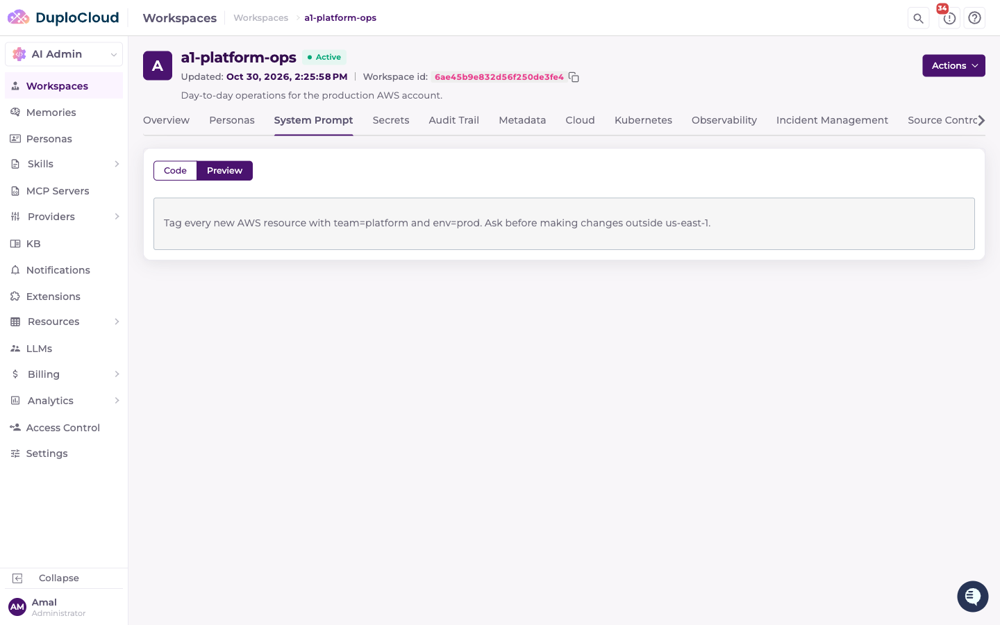
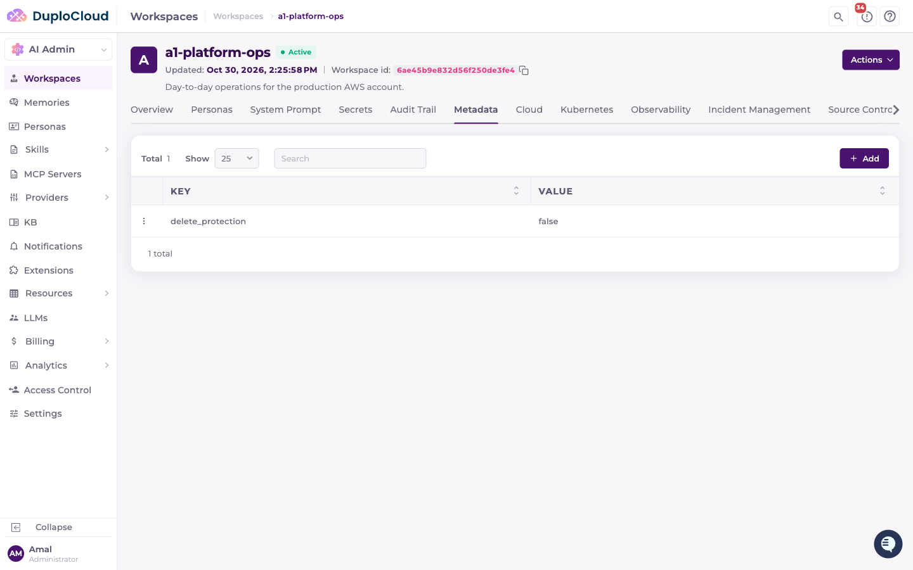

# Workspaces

A Workspace is the central entity that ties everything together — attach any number of Scopes and Personas to it. You can create multiple Workspaces and invite users to each one, enabling clear separation of responsibilities across your organization.

Open **Workspaces** from the AI Admin sidebar. Each Workspace appears as a card showing its LLM and scope counts, the Personas attached to it, and when it was last updated. Use the search box and the **Persona**, **Agent**, and **Scope** filters to narrow the list, and the menu on each card to **Edit**, **Delete**, or **View** a Workspace.

<figure><figcaption></figcaption></figure>

## Creating a Workspace

1. Click **Add Workspace**. The form is split into steps, listed on the right: **Basic**, one step per provider category under **Providers**, **Prompt**, and **Metadata**.
2. On the **Basic** step, enter:
   * **Name** — must start with a letter and contain only letters, numbers, hyphens, and underscores.
   * **Short Name** (optional) — up to 10 characters. It's used as the prefix for ticket numbers in this Workspace; if you leave it blank, the Name is used with hyphens and underscores removed.
   * **Description** (optional).
   * **Personas** — select at least one.
   * **Analytics ID** (optional).

   Click **Next**.

<figure><figcaption></figcaption></figure>

3. Each **Providers** step (**Cloud**, **Kubernetes**, **Observability**, **Incident Management**, **Source Control**, **GRC**, **Sales**, **Marketing**, **Knowledge Base**, **Other**) lists the providers in that category. Expand a provider and select the Scopes to include. A Workspace needs at least one Scope; skip any category you don't need by clicking **Next**.

<figure><figcaption></figcaption></figure>

4. On the **Prompt** step, optionally enter a **System Prompt** (see [Setting a System Prompt](#setting-a-system-prompt)) and add **Prompt Suggestions** or **Prompt Templates**. Each suggestion and template can carry its own Scopes and command execution permissions.

<figure><figcaption></figcaption></figure>

5. On the **Metadata** step, optionally add key/value metadata, then click **Create**.

<figure><figcaption></figcaption></figure>


Once a name, at least one Persona, and at least one Scope are set, a **Create** button appears on every step, so you don't have to step through the rest of the form.


**Congratulations!** Your Workspace is now ready to receive assignments, interpret goals, break down work, and provide a transparent audit trail—all with human oversight and control.

## Viewing a Workspace

Click a Workspace card to open it. The header shows its description, Short Name, last update, and Workspace ID, and the **Actions** menu has **Edit** and **Delete**.

The **Overview** tab summarizes what's attached: Personas, Scopes, Language models, Knowledge bases, Reports, Incidents, and the creation date.

<figure><figcaption></figcaption></figure>

The other tabs are:

* **Personas** — the Personas attached to the Workspace.
* **System Prompt** — shown only when a System Prompt is set.
* **Secrets** — secrets available to this Workspace's tickets.
* **Audit Trail** — this Workspace's events (administrators only). See [HelpDesk Audit Trail](helpdesk/audit-trail.md).
* **Metadata** — the Workspace's key/value metadata.
* One tab per provider category (**Cloud**, **Kubernetes**, and so on) listing the Workspace's Scopes in that category. Click **Add Scope** to attach another Scope. Knowledge Base scopes are attached by sharing a knowledge base with the Workspace, so that tab has no **Add Scope** button.

## Setting a System Prompt

Each Workspace can define a **System Prompt** — free-text instructions injected directly into the agent's system prompt on every ticket in that Workspace.

Enter it in the **System Prompt** field on the **Prompt** step, when you create a Workspace or later from **Edit**. Once saved, it appears on the Workspace's **System Prompt** tab.

<figure><figcaption></figcaption></figure>


This is distinct from [Agent Memories](agents/agent-memories.md). The System Prompt is a single field that's always injected verbatim into every ticket in the workspace. Memory is a set of files the agent reads on demand, and can be turned off per ticket. If the two conflict, persona instructions take precedence over the System Prompt.


## Deleting a Workspace

New Workspaces are **delete-protected** by default: they get a `delete_protection` metadata key set to `true`, and **Delete** stays disabled while it is. To delete a Workspace, open its **Metadata** tab, set `delete_protection` to `false` (or remove the key), then choose **Delete** from the **Actions** menu or the card menu. To create a Workspace without protection, add `delete_protection` = `false` on the **Metadata** step, as shown above.

<figure><figcaption></figcaption></figure>

A Workspace can't be deleted while active projects or incidents still reference it. Deleting a Workspace doesn't delete the Personas or Scopes attached to it — they stay available to other Workspaces.
