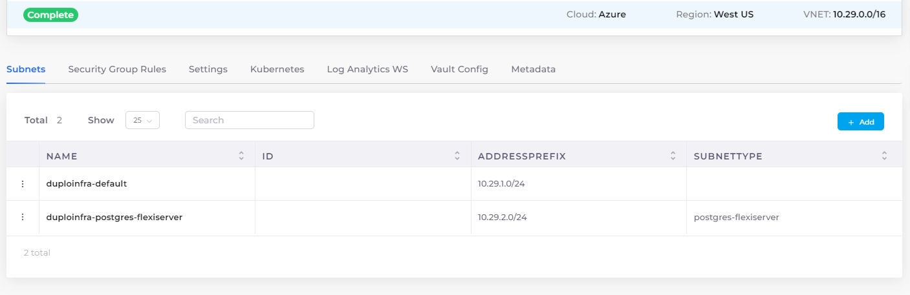

# PostgreSQL Flexible Server

## Prerequisites

### Create a PostgreSQL Flexible Server subnet in the Infrastructure

1. Navigate to **Administrator** -> **Infrastructure** from the DuploCloud Portal.
2. From the **NAME** column, select the Infrastructure.
3. Select the **Subnets** tab, and click **Add**. The **Add Subnet** pane displays.

<figure><figcaption>
The <strong>Add Subnet</strong> pane in the DuploCloud Portal
</figcaption></figure>

4. Enter a name for the subnet in the **Name** field.
5. Enter the **Address Prefix** for the subnet.
6. From the **Type** list box, select **PostgreSQL Flexi Server**.
7. In the **Isolated Network** list box, select **Yes** or **No**.
8. Select the appropriate endpoints from the **Service Endpoints** list box.
9. Click **Add**. The subnet is added.

<figure><figcaption></figcaption></figure>

## Creating a PostgreSQL Flexible Server database

1. From the DuploCloud Portal, navigate to **Cloud Services** -> **Database** -> **PostgreSQL Flexible**.
2.  Click **Add**. The **Create PostgreSQL Flexible Instance** page displays. 

    <figure><figcaption>
The <strong>Create PostgreSQL Flexible Instance</strong> page
</figcaption></figure>
3. Complete the required fields.
4. From the **Subnet** list box, select the **PostgreSQL Flexi Server** subnet previously created.
5. Click **Submit**. The PostgreSQL Flexible Server database is created.

## Viewing a PostgreSQL Flexible Server database

From the DuploCloud Portal, navigate to **Cloud Services** -> **Databases** -> **PostgreSQL Flexible**, and click on the PostgreSQL Flexible Server database in the **NAME** column. Use the **Overview** and **Details** tabs to view database info.
