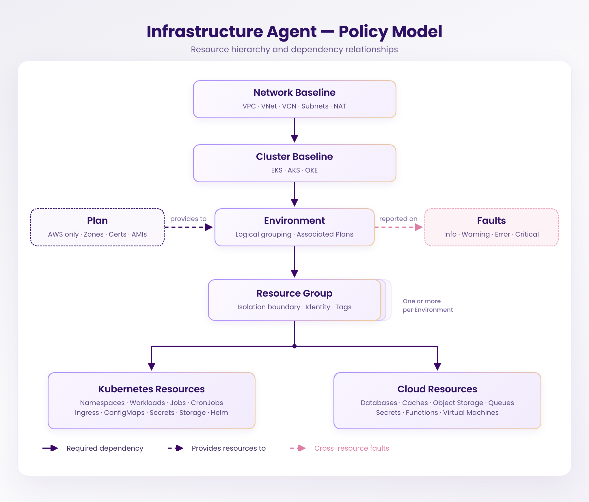

# Policy Model

The Infrastructure Agent Policy Model defines the resources the agent manages and how they relate to each other. Understanding this model helps you understand what the agent can do and why the creation flow follows the order it does.

## The Resource Hierarchy

The Infrastructure Agent organizes infrastructure as a hierarchy. Each level depends on the one above it:

**Network Baseline → Cluster Baseline → Environment → Resource Group → Kubernetes and Cloud Resources**

<figure><picture><source srcset="../../../.gitbook/assets/policy-model-dark.png" media="(prefers-color-scheme: dark)"></picture><figcaption></figcaption></figure>

A **Network Baseline** is the networking foundation everything else runs on. A **Cluster Baseline** runs a managed Kubernetes cluster inside that network. An **Environment** is a logical grouping that holds one or more **Resource Groups**.

A **Resource Group** is the isolation boundary. Every resource created inside it inherits its boundaries. It holds two kinds of children:

* **Kubernetes resources**: namespaces, workloads, jobs and cron jobs, ingress, config maps, secrets, storage, and Helm releases.
* **Cloud resources**: the managed services of the group's cloud, such as databases, storage and virtual machines.

**Faults** surface issues across any resource at any level of the hierarchy.

## On each cloud

You choose the cloud when you create a Network Baseline. Everything built on that network uses the same cloud.

| Resource | AWS | Azure | Oracle Cloud (OCI) |
| --- | --- | --- | --- |
| **Network Baseline** | VPC with subnets, NAT and route tables | VNet in its own resource group, with a network security group per subnet and NAT gateways | VCN |
| **Cluster Baseline** | Amazon EKS | Azure Kubernetes Service (AKS) | Oracle Kubernetes Engine (OKE) |
| **Resource Group** | IAM role and policies (including the account-wide `duplo-rg-common` policy), security groups, KMS key and EC2 key pair | Azure resource group with a managed identity that its resources use | Compartment |
| **Cloud resources** | S3, RDS, ElastiCache, SNS, SQS, Lambda, Secrets Manager, SSM parameters, EFS, MSK, ECR and EC2 hosts | Key Vault, Azure Database for PostgreSQL flexible server, Azure Managed Redis, storage accounts and virtual machines | None yet |
| **Plan** | Hosted zones, ACM certificates and AMIs | Not available | Not available |
| **Provisioned with** | CloudFormation | ARM deployments | OCI Resource Manager (Terraform) |

Google Cloud (GCP) support is coming soon.

## Resource Lifecycle

Every resource follows the same status lifecycle. Each resource has a **Spec** tab showing what was requested, a **Result** tab showing what was provisioned, and a link to the underlying ticket that executed the work. Updates trigger a reconciliation — the agent handles only the delta, not a full teardown and rebuild.

View all lifecycle states

| Status                | Description                                                |
| --------------------- | ---------------------------------------------------------- |
| **Pending**           | Resource has been created and is waiting to be provisioned |
| **Provisioning**      | The AI agent is actively provisioning the resource         |
| **Ready**             | Resource is live and available                             |
| **Failed**            | Provisioning or an update encountered an error             |
| **Blocked**           | Waiting for user input before proceeding                   |
| **Awaiting Approval** | A change is pending approval before it is applied          |
| **DeProvisioning**    | Resource is being torn down                                |
| **DeProvisioned**     | Resource has been removed                                  |

## Resource Types

<table data-view="cards"><thead><tr><th>Title</th><th>Description</th><th data-card-target data-type="content-ref">Target</th></tr></thead><tbody><tr><td><strong>Network Baseline</strong></td><td>The networking foundation: a VPC, VNet or VCN.</td><td><a href="network-baseline.md">network-baseline.md</a></td></tr><tr><td><strong>Cluster Baseline</strong></td><td>A managed Kubernetes cluster (EKS, AKS or OKE) on top of a Network Baseline.</td><td><a href="cluster-baseline.md">cluster-baseline.md</a></td></tr><tr><td><strong>Environment</strong></td><td>Logical grouping of Resource Groups inside a cluster.</td><td><a href="environment.md">environment.md</a></td></tr><tr><td><strong>Plan</strong></td><td>AWS only. Account-level catalog of hosted zones, certificates, and AMIs.</td><td><a href="plan.md">plan.md</a></td></tr><tr><td><strong>Faults</strong></td><td>Cross-resource issues detected across the hierarchy.</td><td><a href="faults.md">faults.md</a></td></tr><tr><td><strong>Kubernetes Resources</strong></td><td>Namespaces, workloads, configs, secrets, and storage inside a Resource Group.</td><td><a href="kubernetes/">kubernetes</a></td></tr><tr><td><strong>Databases</strong></td><td>AWS RDS and ElastiCache inside a Resource Group.</td><td><a href="databases/">databases</a></td></tr></tbody></table>
