# Step 1: Create a Network

A Network Baseline provisions the VPC that all other resources will run inside. This is the first resource you create.

## What gets created

* A VPC with your chosen CIDR block
* Public and private subnets, one pair per availability zone
* An Internet Gateway for public subnet routing
* NAT Gateways for private subnet outbound access (if enabled)
* Route tables for public and private subnets
* RDS and ElastiCache subnet groups pre-configured for databases
* An all-host security group for the network, created with no inbound rules
* A VPC peering connection to the helpdesk VPC, with routes and an inbound HTTPS rule (if **Peer with helpdesk VPC** is enabled)

## Walkthrough

### Step 1 — Navigate to Network

In the left sidebar, open **DevOps** and select **Network**.

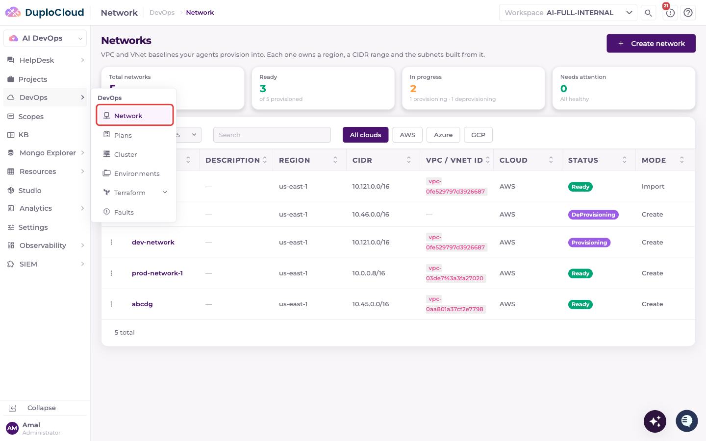

### Step 2 — Network List

The **Networks** page lists every network in the workspace, with summary cards for total, ready, in-progress and needs-attention networks. Use the **AWS**, **Azure** and **GCP** filters to narrow the list. Click **Create network** to begin.

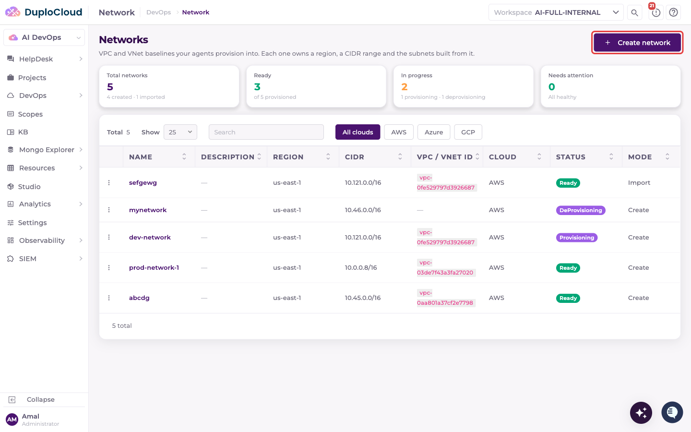

### Step 3 — Network Details

The **Create Network Baseline** wizard opens. Fill in the first page:

* **Name** — a unique identifier for the network (e.g. `prod-vpc-us-east-1`). Letters, numbers and hyphens.
* **Cloud** — select **AWS**
* **Description** — optional
* **Account (Scope)** — the cloud account scope to provision into
* **Metadata** — optional key/value pairs to attach to the network

Click **Next**.

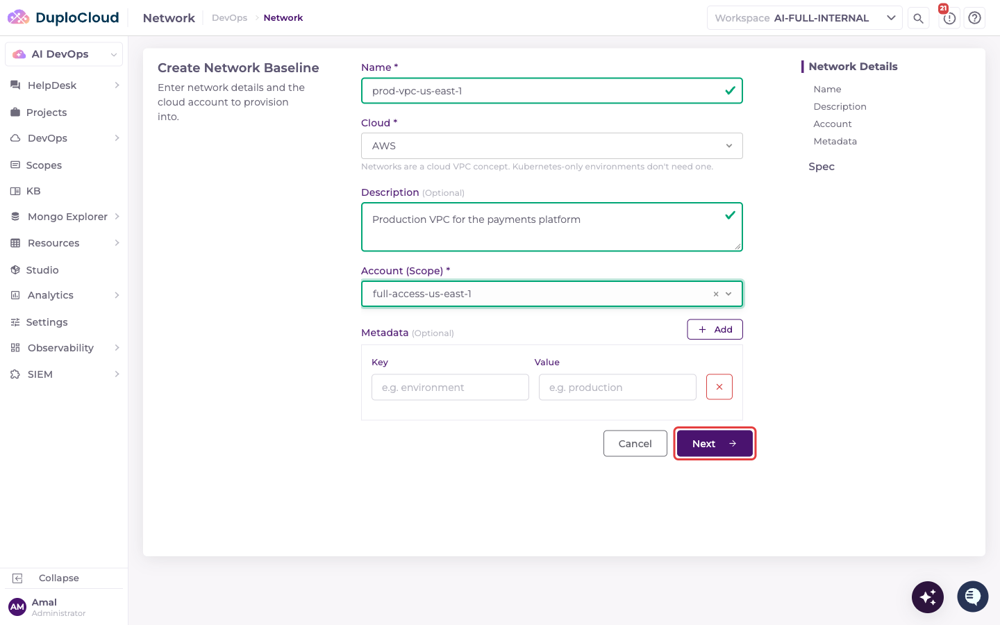

### Step 4 — Network Spec

Define the network configuration. Select **Create new** to provision a fresh VPC, or **Import existing** to register an existing one.

* **Region** — the AWS region (e.g. `us-east-1 — N. Virginia`)
* **VPC CIDR** — the IP range for the VPC (e.g. `10.0.0.0/16`). The platform checks for overlap with existing networks.
* **Availability Zones** — number of AZs to span (`2` or `3`)
* **NAT Gateway** — `One per AZ (High Availability)`, `Single NAT Gateway` (the default), or `None`
* **Customize subnet CIDRs** — off by default. Turn it on to enter your own public and private CIDR for each AZ instead of having them computed. Each CIDR must sit inside the VPC CIDR and not overlap the others.
* **Subnet Prefix** — the prefix length of each subnet (e.g. `24`); must be at least the VPC prefix + 3. Hidden when **Customize subnet CIDRs** is on.
* **Peer with helpdesk VPC** — on by default. Peers the new VPC with the DuploCloud helpdesk VPC so that instances and databases in private subnets are reachable from DuploCloud. When enabled, the VPC CIDR must not overlap the helpdesk VPC or any other network already peered with it.

The **Subnets — computed from CIDR** table previews the private and public subnet CIDRs that will be created per AZ before you submit.

Click **Create & Provision**.

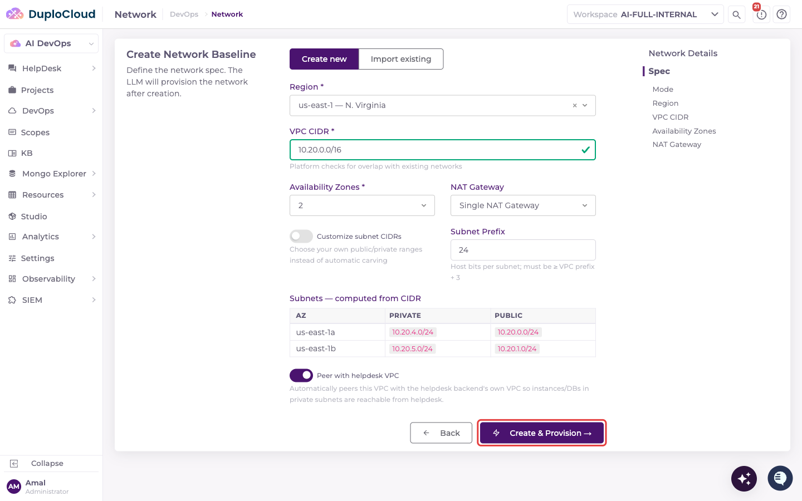

### Step 5 — Network Detail Page

DuploCloud creates the network and opens its detail page. The header shows the account, region and cloud, and the **Provisioning** panel on the right tracks the network's status. Provisioning runs as an agent ticket: click **Track Status** (or **Ask the Agent** in the header) to open it.

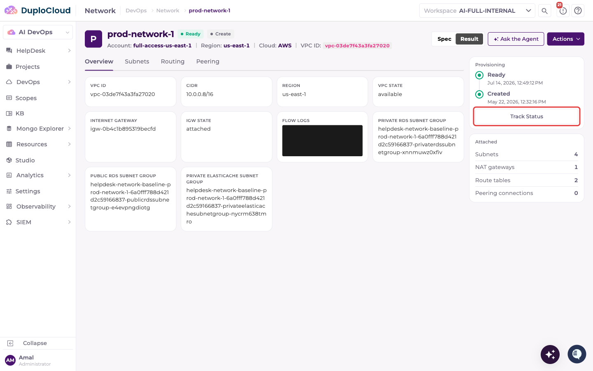

### Step 6 — Agent Ticket Opens

The agent uses the `duplo-aws-infra` skill and begins by reading the `aws-network-baseline.md` skill file to load its instructions.

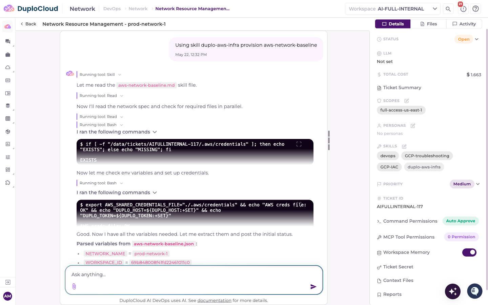

### Step 7 — Parameters Parsed

The agent sets up AWS credentials, then parses the network spec into structured parameters:

* `NETWORK_NAME`, `REGION`, `VPC_CIDR`, `azs`, `subnet_mask`
* `NAT_MODE` (e.g. `SingleAz`), `ENABLE_DNS`, `ENABLE_FLOW_LOGS`
* `FLOW_LOGS_RETENTION_DAYS`, `ENV_TAG`
* Custom subnet CIDRs and the helpdesk VPC peering settings, when set

If helpdesk VPC peering is enabled but no helpdesk VPC can be resolved, the agent skips peering for this run and records a warning (Step 1.1a). Provisioning continues for everything else.

These values drive every subsequent step of the provisioning workflow.

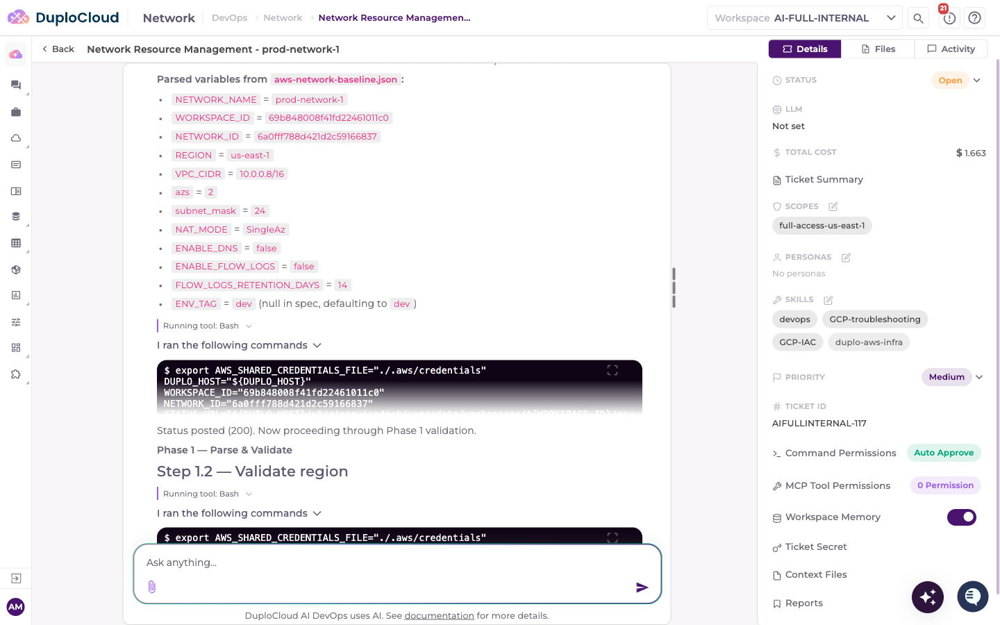

### Step 8 — Phase 1: Validate

The agent runs **Phase 1 — Parse & Validate**:

* **Step 1.2** — Validates the region exists and is accessible
* **Step 1.3** — Resolves availability zone names (e.g. `us-east-1a`, `us-east-1b`) for the selected region
* **Steps 1.4–1.7** — Validates the VPC CIDR, AZ count, NAT mode and subnet mask, and computes the full CIDR layout
* **Steps 1.8–1.9** — Resolves the platform context and posts its first status update

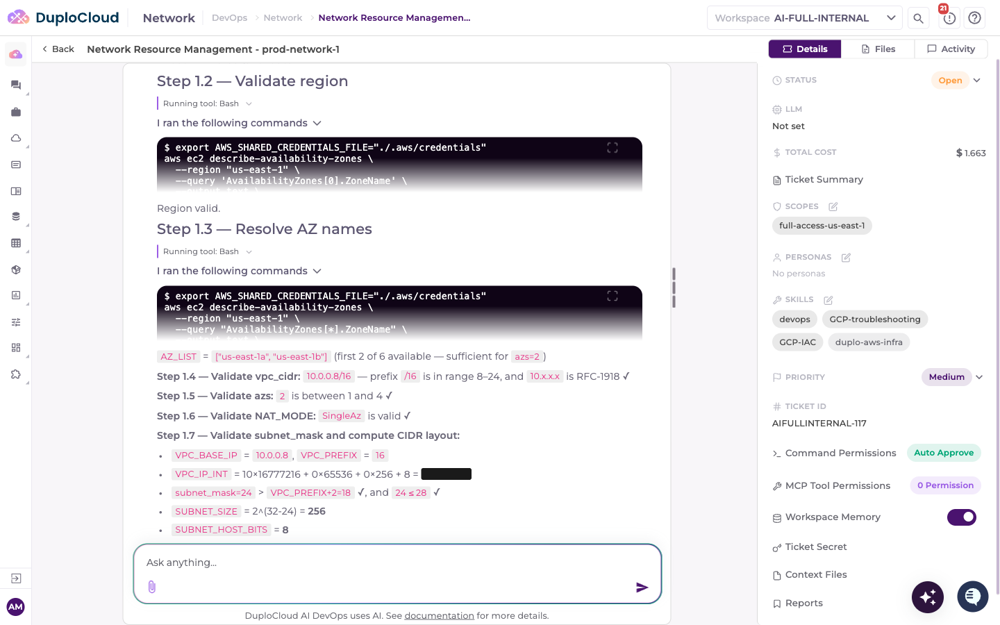

### Step 9 — Phase 2: Compute

**Phase 2 — Compute** calculates the exact subnet CIDRs and resource counts:

* **Step 2.1** — Computes public and private subnet CIDRs per AZ from the VPC CIDR block (or uses your custom CIDRs)
* **Step 2.2** — Determines NAT configuration (EIP count, NAT count, private route table count)
* **Step 2.3** — Tallies the total number of AWS resources to be created

Then **Phase 3 — Provision via CloudFormation** begins with Step 4.0 deriving the CloudFormation stack name.

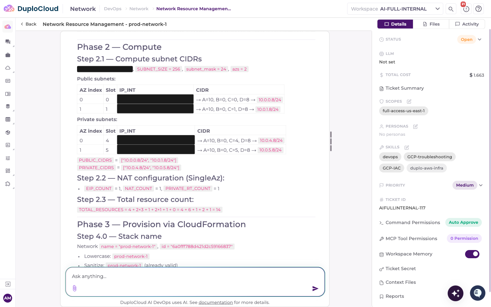

### Step 10 — Pre-flight Checks

Before creating the stack the agent runs two pre-flight checks:

* **Step 4.1** — Checks whether the stack already exists to avoid duplicate provisioning
* **Step 4.1b** — VPC CIDR preflight: confirms no existing VPC uses the same CIDR block in the account

If both checks pass, the agent proceeds to stack creation.

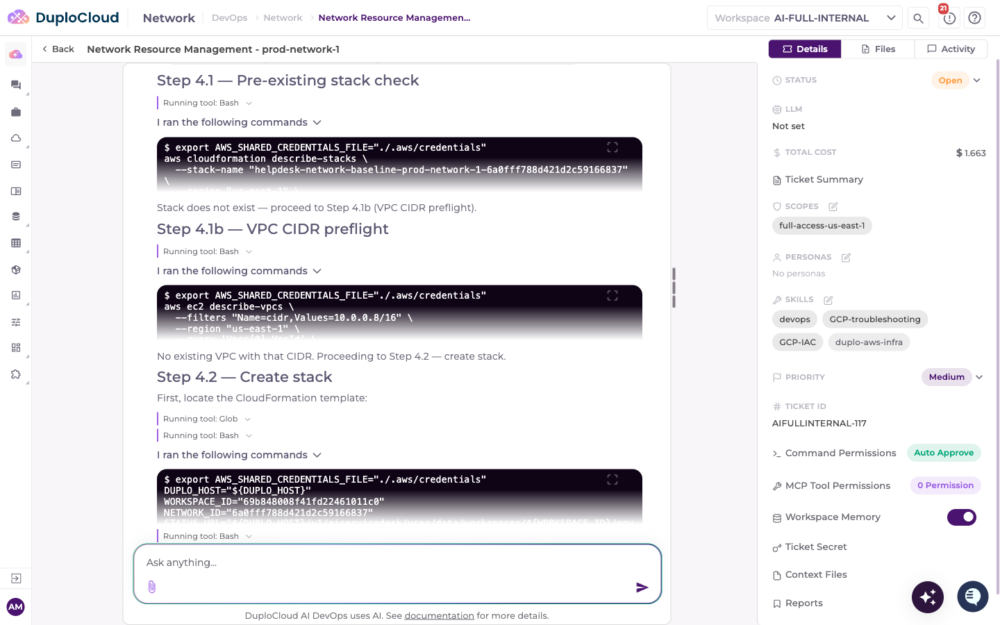

### Step 11 — CloudFormation Stack Created

* **Step 4.2** — Deploys the CloudFormation template, creating the stack
* **Step 4.3** — Starts an event-stream polling loop that tracks stack events in real time for up to 15 minutes, reporting each resource as it is created

When helpdesk VPC peering is enabled, the stack also creates the peering request, this VPC's routes to the helpdesk VPC and an inbound HTTPS rule. DuploCloud then accepts the connection and adds the matching routes on the helpdesk side.

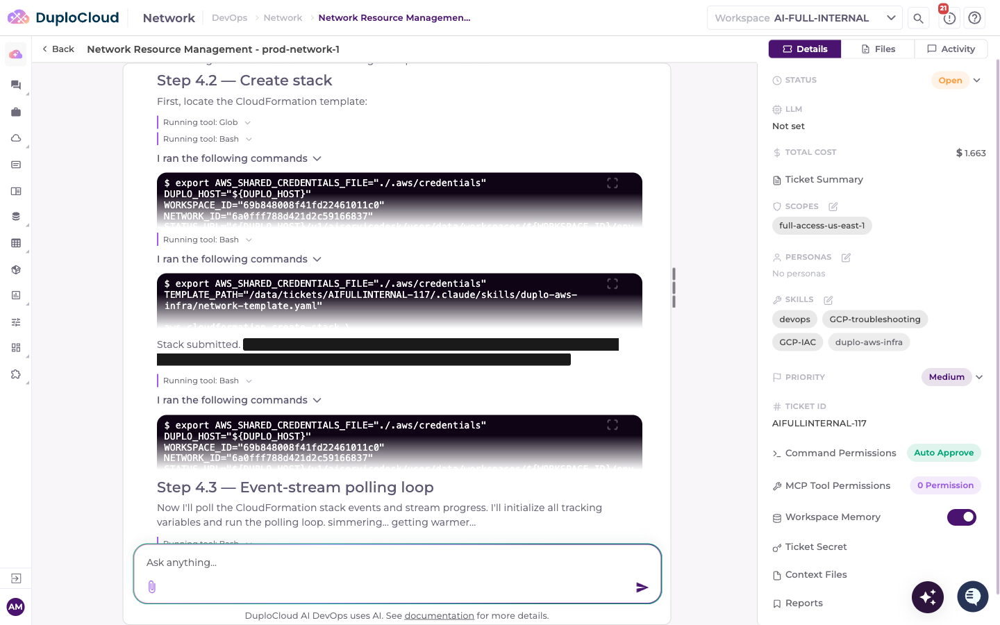

### Step 12 — Stack Outputs Retrieved

**Phase 5 — Finalize** begins once the stack completes:

* **Step 5.1** — Reads all stack outputs (VPC ID, subnet IDs, route table IDs, NAT gateway ID, subnet group names, etc.)

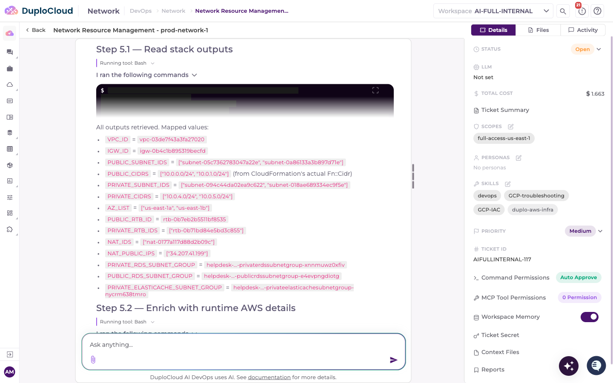

### Step 13 — Runtime Details Enriched

* **Step 5.2** — Queries AWS at runtime to enrich the output with additional subnet metadata (available IPs, public IP mapping, route table associations, NAT gateway details) that CloudFormation outputs alone don't include

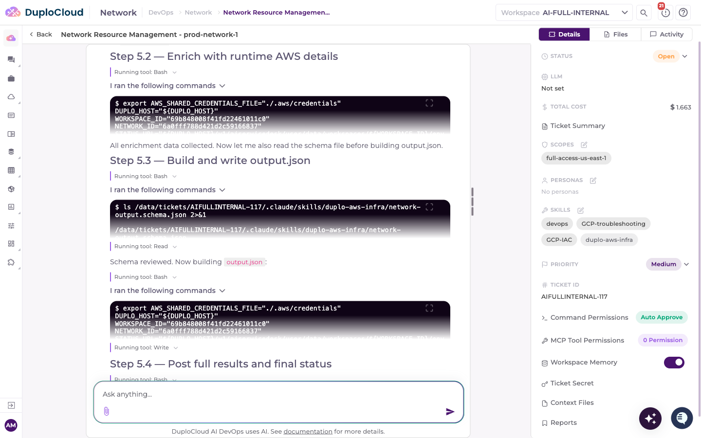

### Step 14 — Output Written

* **Step 5.3** — Builds the structured `output.json` file from the enriched data, validated against the skill's output schema, for downstream provisioning steps (Plan, Cluster, Environment)
* **Step 5.4** — Posts the full results and the final status to the platform

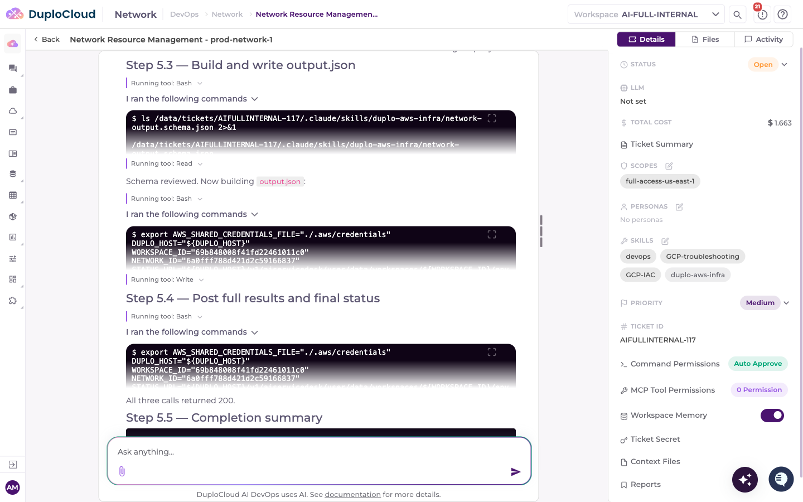

### Step 15 — Provisioning Complete

The agent reports **Step 5.5 — Completion summary**. The network baseline is fully provisioned. The summary confirms:

* VPC created with the specified CIDR in the selected region
* Public and private subnets across the selected AZs
* NAT gateway with an associated Elastic IP (if enabled)
* Internet gateway, route tables, and RDS and ElastiCache subnet groups

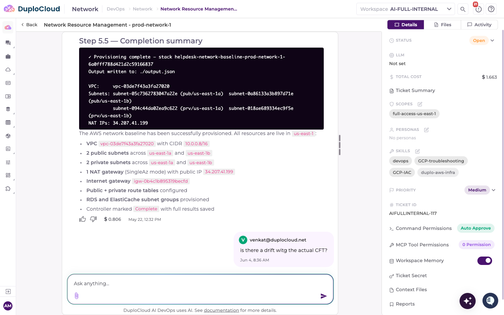

## Next step

Once the network's status shows **Ready**, proceed to [Step 2: Create a Cluster](step-2-cluster.md).
