# Step 2: Create a Cluster

A Cluster Baseline provisions an EKS cluster inside the Network you created in the previous step. The cloud account, region, VPC and subnets are inherited automatically from the Network Baseline.

## What gets created

* An EKS cluster with your chosen Kubernetes version
* The EKS service IAM role, a cluster security group and an all-host security group
* A default system node group in the network's private subnets (if **Add Default System Node Group** is enabled)
* An OIDC identity provider for IAM Roles for Service Accounts (IRSA)
* A Kubernetes Provider and Scope automatically connected to the new cluster

## Walkthrough

### Step 1 — Navigate to Cluster

In the left sidebar, open **DevOps** and select **Cluster**.

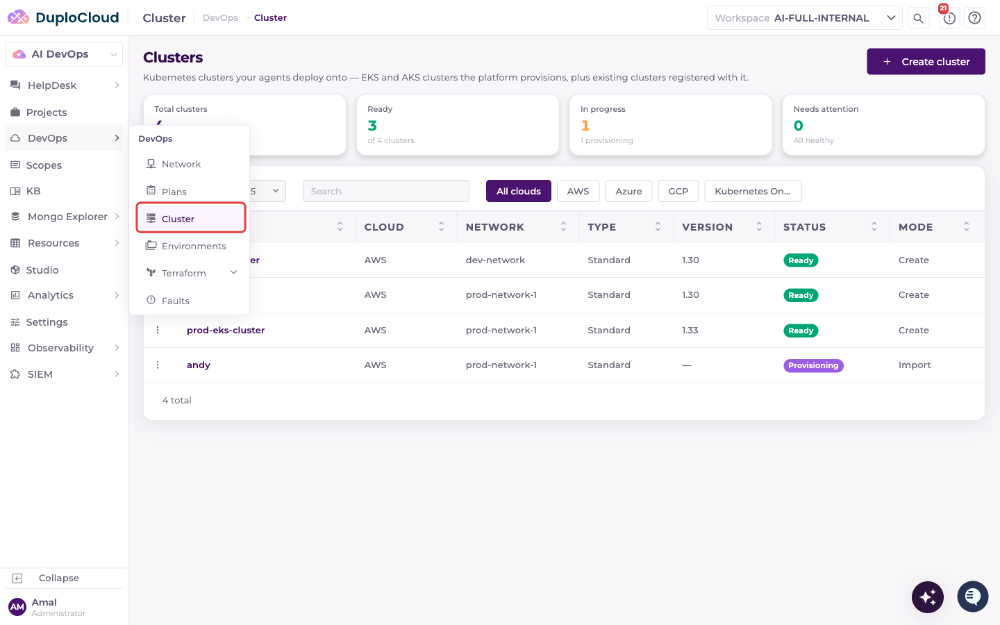

### Step 2 — Cluster List

The **Clusters** page lists every cluster in the workspace, with summary cards for total, ready, in-progress and needs-attention clusters. Each row shows the cluster's cloud, network, type, Kubernetes version, status and mode (**Create** or **Import**). Use the cloud filters to narrow the list. Click **Create cluster** to begin.

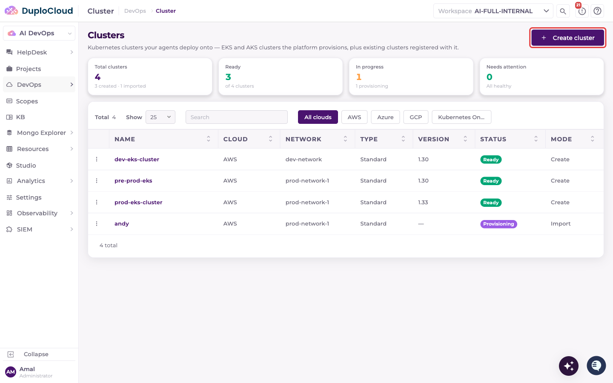

### Step 3 — Cluster Details

The **Create Cluster Baseline** wizard opens. Fill in the first page:

* **Mode** — **Create new** to provision a new EKS cluster, or **Import existing** to register a cluster that already exists
* **Cloud** — select **AWS**
* **Name** — a unique identifier for the cluster (e.g. `prod-eks-cluster`). Letters, numbers and hyphens.
* **Description** — optional
* **Metadata** — optional key/value pairs to attach to the cluster

Click **Next**.

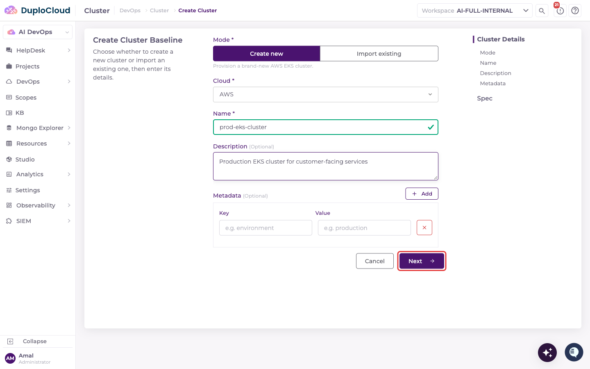

### Step 4 — Cluster Spec

Define the cluster configuration:

* **Network Source** — select **Choose Network** to inherit the cloud account, region, VPC and subnets from a provisioned network. **Choose VPC** lets you enter an account, VPC ID, region and subnet IDs directly instead.
* **Network** — the network you created in Step 1 (e.g. `prod-network-1`)
* **Cluster Type** — `Standard`, or `Auto` for EKS Auto Mode
* **Version** — the Kubernetes version to deploy. Defaults to the latest stable release once a network is selected.
* **API Server Visibility** — `Public` exposes the Kubernetes API endpoint publicly, `Private` restricts it to the VPC, and `Public and Private` enables both
* **Control Plane Logging** — optional; select which EKS control plane log types to enable (API Server, Audit, Authenticator, Controller Manager, Scheduler)
* **Cluster IP CIDR** — optional; the CIDR block for Kubernetes service IP addresses. Leave blank to use the EKS default.

If the selected network has no NAT gateway, the wizard warns you: EKS nodes need outbound internet access to join the cluster, so pick a NAT-enabled network before provisioning.

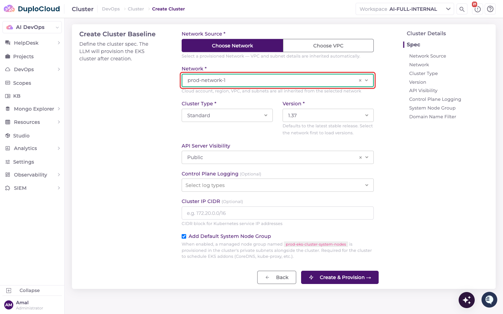

### Step 5 — System Node Group and Domain Filter

Scroll down to finish the spec:

* **Add Default System Node Group** — on by default (Standard clusters with **Choose Network** only). Provisions a managed node group named `<cluster>-system-nodes` in the network's private subnets. The cluster needs it to schedule EKS add-ons such as CoreDNS and kube-proxy.
  * **Instance Type** — an x86\_64 instance type (e.g. `t3.medium`). ARM and GPU families aren't offered.
  * **Min Size** / **Max Size** — the node group's scaling bounds (default `2` and `3`)
* **Domain Name Filter** — optional; select one or more Route 53 hosted zones from the cloud account. When set, External DNS is enabled on the cluster automatically once it's Ready, scoped to these zones.

Click **Create & Provision**.

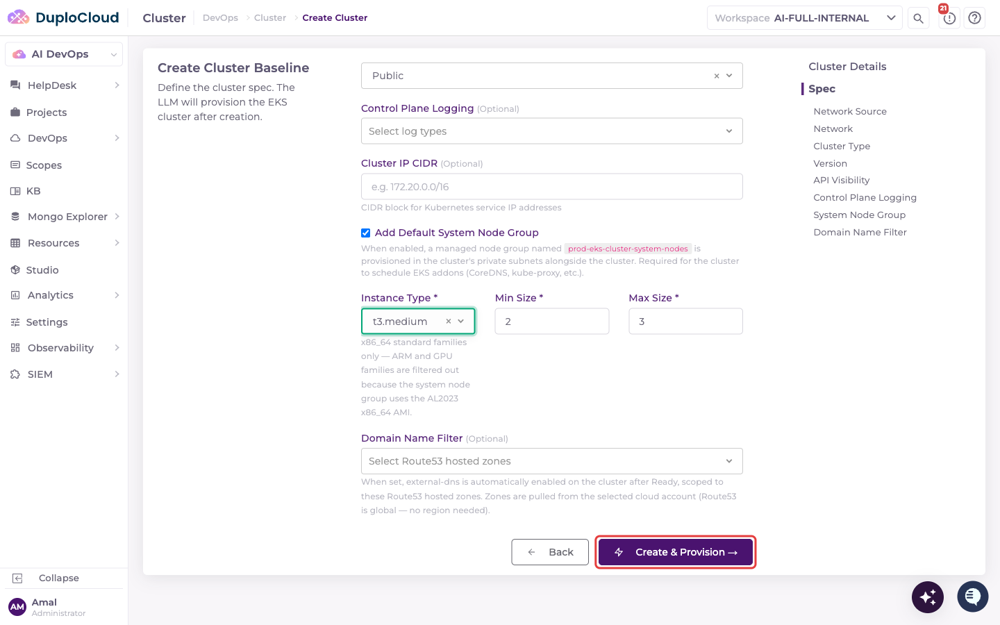

### Step 6 — Cluster Detail Page

DuploCloud creates the cluster and opens its detail page. The header shows the account and, once provisioned, the cluster ARN. Use the **Spec** / **Result** toggle to switch between the configuration you submitted and the provisioned cluster details. The **Provisioning** panel on the right tracks the cluster's status, and **Configuration** shows the cluster type and network.

Provisioning runs as an agent ticket: click **Track Status** (or **Ask the Agent** in the header) to open it.

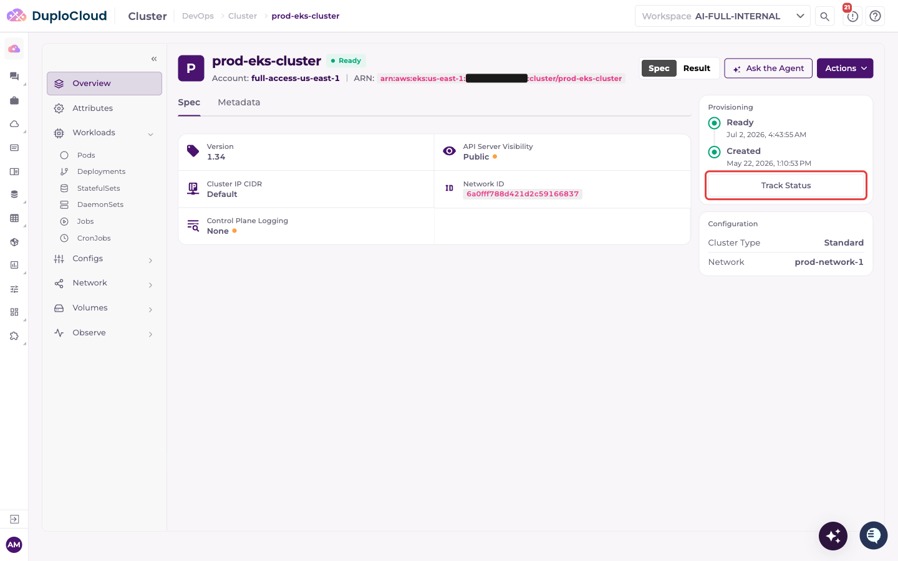

### Step 7 — Agent Ticket Opens

The agent uses the `duplo-aws-infra` skill and begins by reading the `aws-cluster-baseline.md` skill file to load its instructions. It then checks its environment, sets up AWS credentials for the target account and loads the cluster spec.

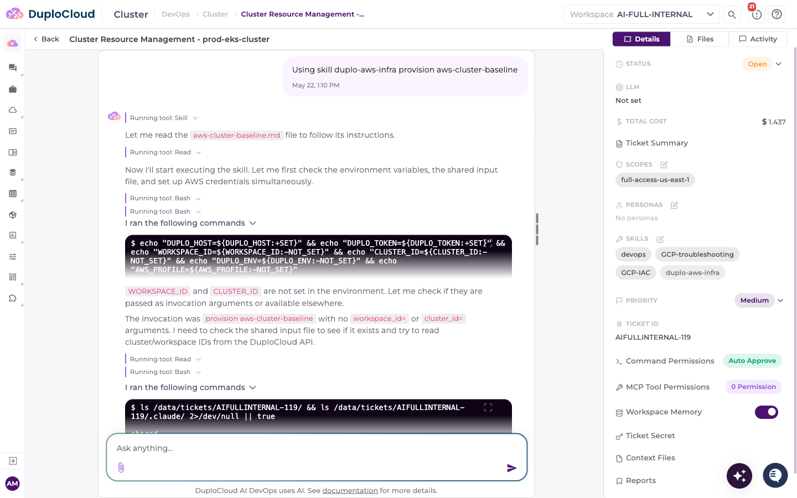

### Step 8 — Phase 1: Parse & Validate

The agent reads the cluster spec and validates each field before touching AWS:

* Name, VPC, region and subnets — inherited from the linked Network Baseline
* Cluster type, Kubernetes version and API server visibility
* Cluster IP CIDR and control plane logging, when set
* At least two subnets are available for the cluster
* The system node group's instance type and min/max size, when enabled

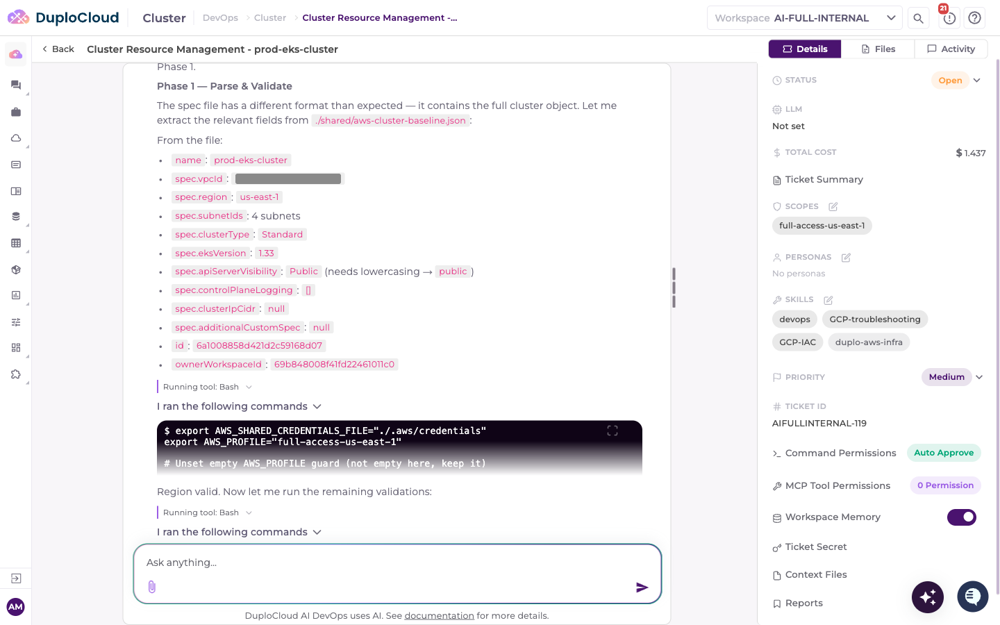

### Step 9 — Phase 2: Compute

**Phase 2 — Compute** derives the resource names and counts without making any AWS calls:

* The CloudFormation stack name and the EKS service IAM role name, both derived from the cluster name
* Whether an Auto Mode node role is needed
* The total number of resources to create

Then **Phase 3 — Provision** begins. Step 4.1 creates the Auto Mode node role (skipped for Standard clusters), and Step 4.2 starts deploying the CloudFormation stack.

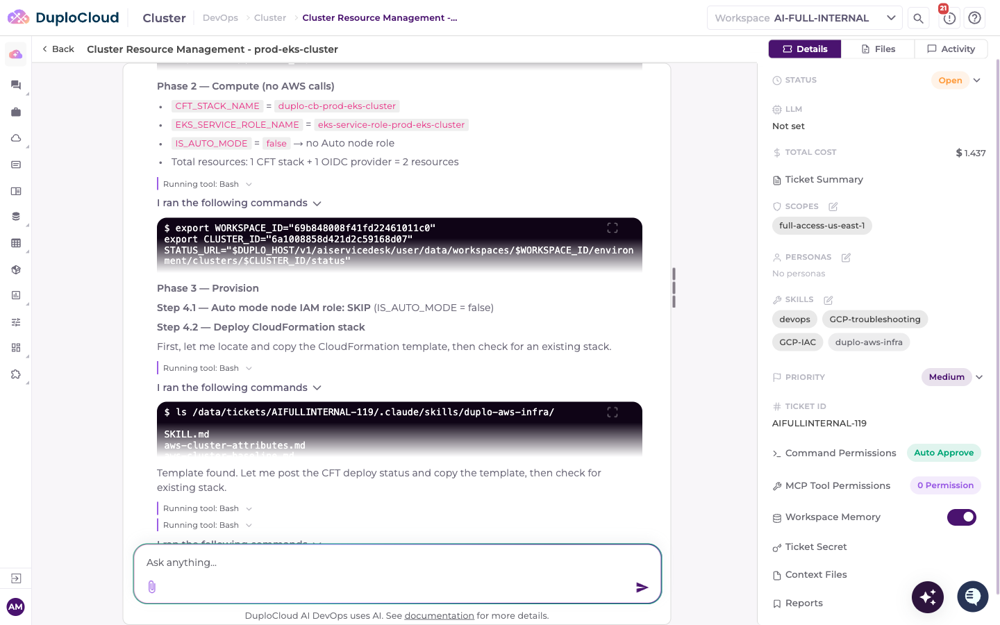

### Step 10 — Deploy the CloudFormation Stack

**Step 4.2 — Deploy CloudFormation stack**:

* Copies the CloudFormation template and builds its parameters
* Checks whether the stack already exists to prevent duplicate provisioning
* Creates the stack — the EKS cluster, its IAM roles, security groups and, when enabled, the system node group — and follows the stack events until it completes (around 15 minutes)

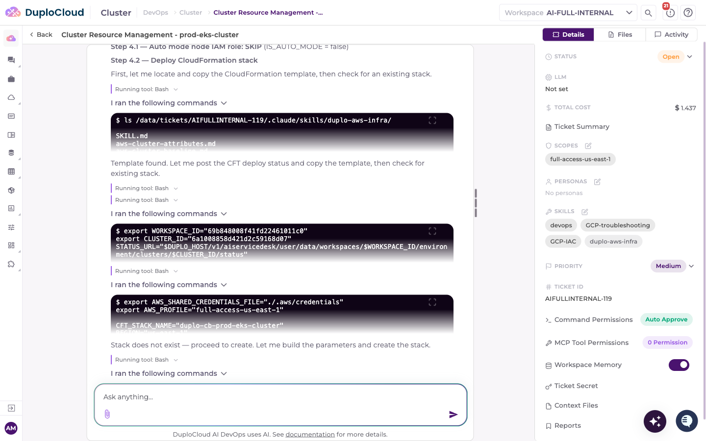

### Step 11 — Stack Outputs and OIDC Provider

Once the stack completes:

* **Step 4.2.5** — Reads the stack outputs: cluster ARN, API endpoint, certificate authority data, OIDC issuer and security group IDs, and posts a partial result to DuploCloud
* **Step 4.3** — Creates the OIDC identity provider, registering the cluster's OIDC issuer as a trusted identity provider in IAM so workloads can use IAM Roles for Service Accounts

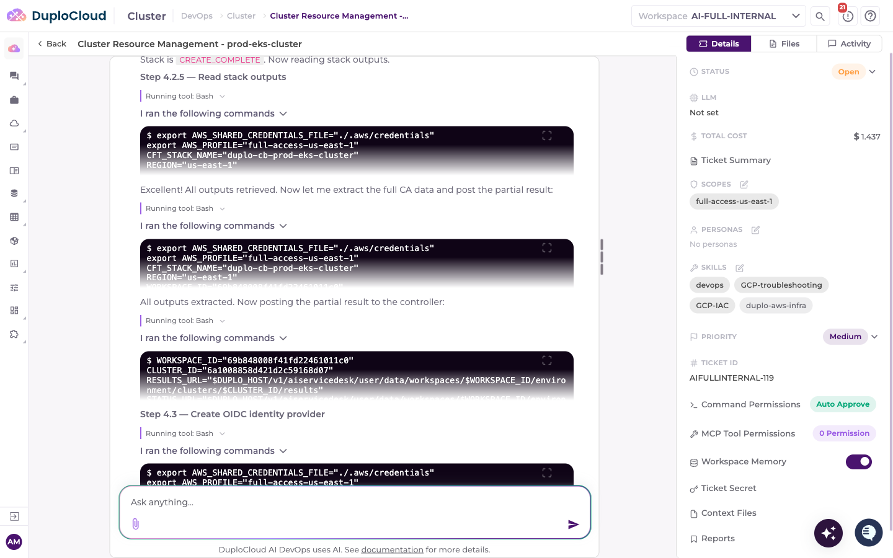

### Step 12 — Provisioning Complete

**Phase 5 — Output** finishes the run:

* **Step 5.1** — Writes `output.json`, used later for de-provisioning
* **Step 5.2** — Posts the final results and sets the cluster status to **Complete**. DuploCloud then connects a Kubernetes Provider and Scope to the new cluster.
* **Step 5.3** — Prints the completion summary: cluster name, type and version, cluster ARN, API endpoint, OIDC issuer URL and provider ARN, and the cluster and all-host security groups

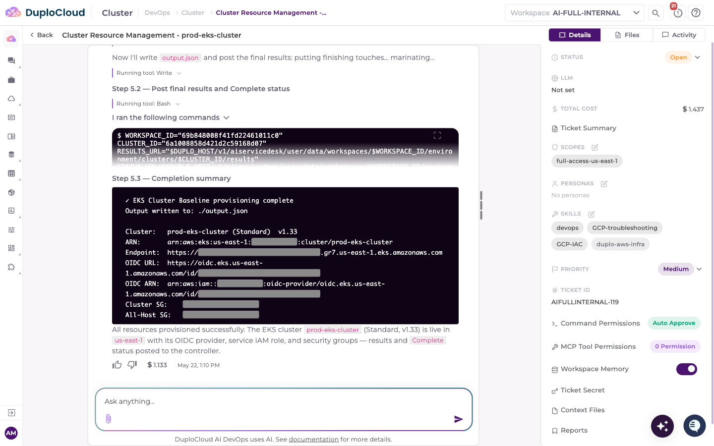

### Step 13 — Cluster Result

Back on the cluster detail page, the status shows **Ready**. Select **Result** to see the provisioned cluster's identifiers:

* **Cluster ARN** — the Amazon Resource Name for the EKS cluster
* **API Endpoint** — the Kubernetes API server URL
* **OIDC Issuer URL** — used to configure IAM Roles for Service Accounts (IRSA)
* **Certificate Authority** — the base64-encoded CA data for `kubectl` configuration

The **Actions** menu offers **Kubectl**, **Download Kubeconfig**, **Deprovision Cluster** and **Deprovision Attributes only**. The cluster's left-hand navigation gives access to **Attributes** and to its Kubernetes resources: **Workloads** (Pods, Deployments, StatefulSets, DaemonSets, Jobs, CronJobs), **Configs**, **Network**, **Volumes** and **Observe**.

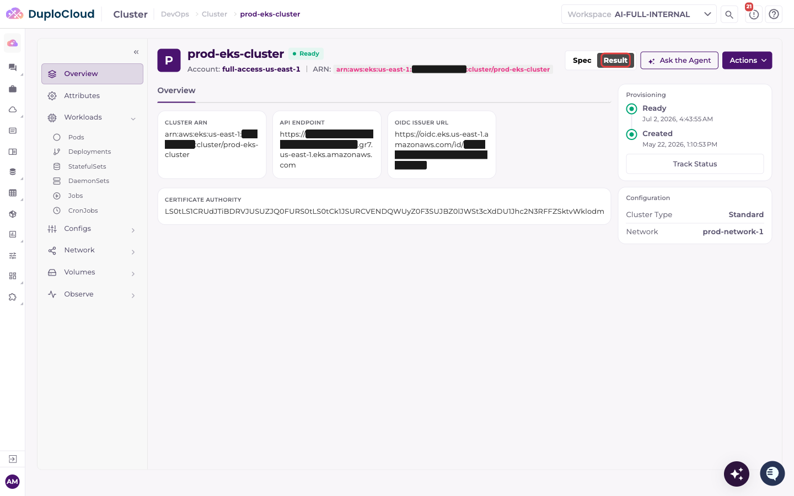

### Step 14 — Cluster List: Ready

The Cluster list now shows the cluster with **Status: Ready**. The three-dot menu on a row offers **View** and **Deprovision**. Deprovisioning an AWS cluster tears down everything the platform created for it; **Delete** is only offered for Kubernetes-only clusters, which register an existing cluster without provisioning anything.

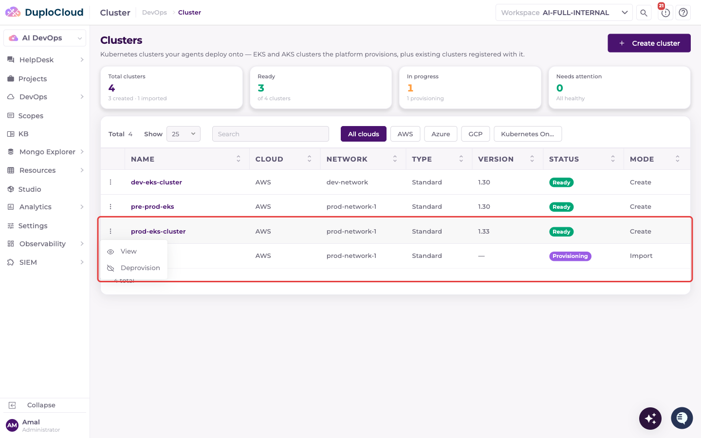

### Step 15 — Cluster Attributes

Click **Attributes** in the cluster's left-hand navigation to manage optional Kubernetes components and EKS add-ons. On a new cluster this opens the **Configure Cluster Attributes** form; once attributes have been applied, it shows the attributes object (named `<cluster>-attributes`) with its own provisioning status. The **Components**, **AddOns** and **External DNS** tabs list what's installed.

The available components are:

* Cluster Autoscaler
* Secret CSI Driver
* ALB Load Balancer Controller
* EFS Volumes
* Metrics Server
* Kube State Metrics
* Flux CD
* External DNS

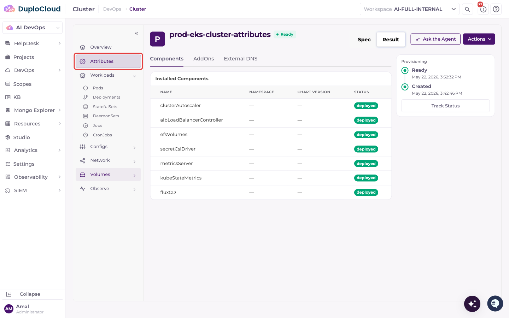

### Step 16 — Selecting Components

Check the components you want enabled on the cluster. On a new cluster, select them in the **Configure Cluster Attributes** form and click **Configure**; to change existing attributes, choose **Actions** > **Edit**, then **Save**. Components can be enabled incrementally — you don't need to select all at once.

The **EKS Addons** section installs managed AWS add-ons: click **+ Add Addon** and select one.

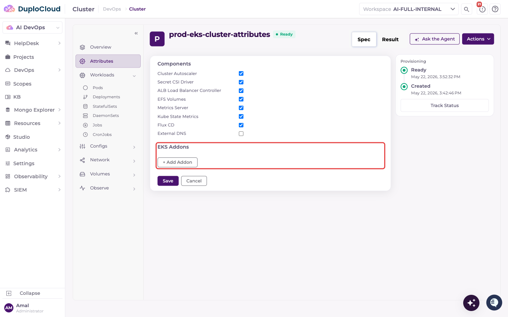

### Step 17 — External DNS Domain Filters

When **External DNS** is enabled, a **Domain Filters** field appears and needs at least one domain. Enter the Route 53 hosted zone domain (e.g. `example.com`) and click **+ Add Domain** for additional domains. External DNS only manages records within the specified domains.

Saving the attributes starts an agent ticket that installs the selected components into the cluster. Click **Track Status** to follow it.

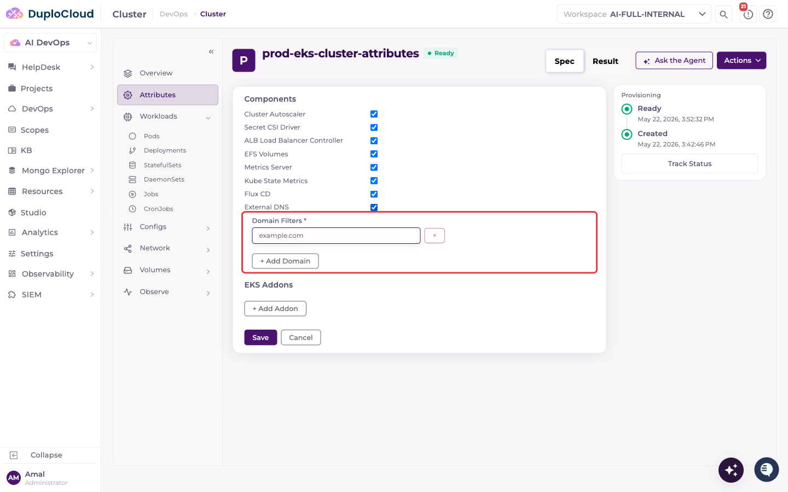

## Next step

Once the cluster's status shows **Ready**, proceed to [Step 3: Create a Plan](step-3-plan.md).
