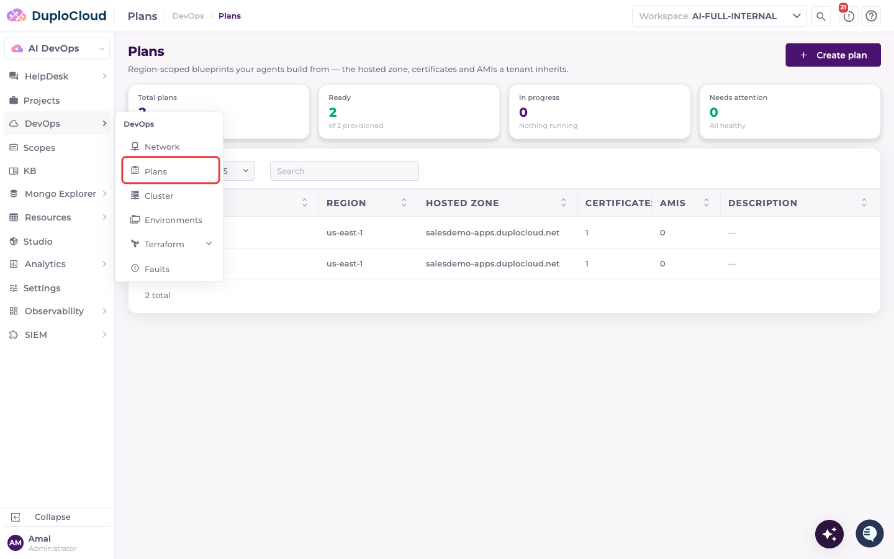
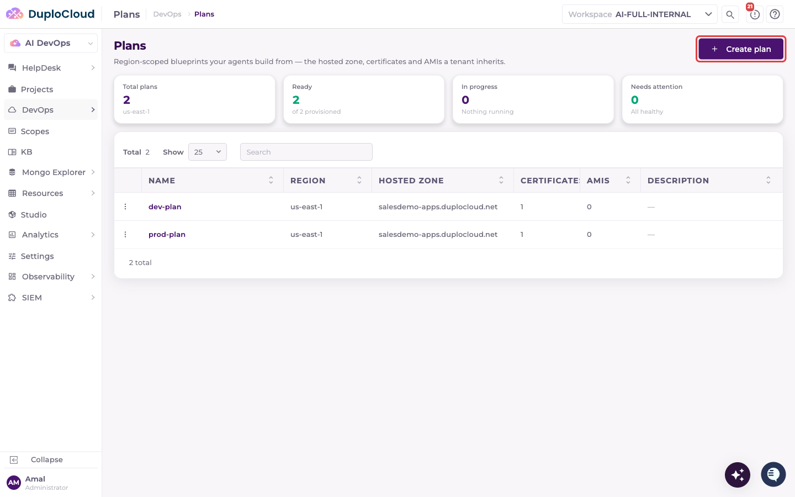
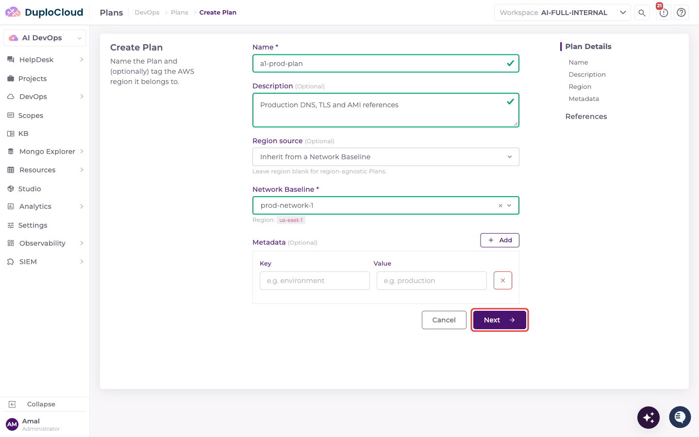
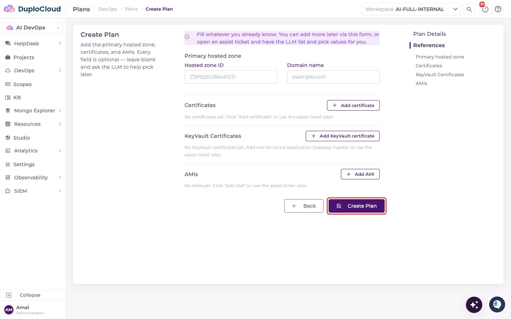
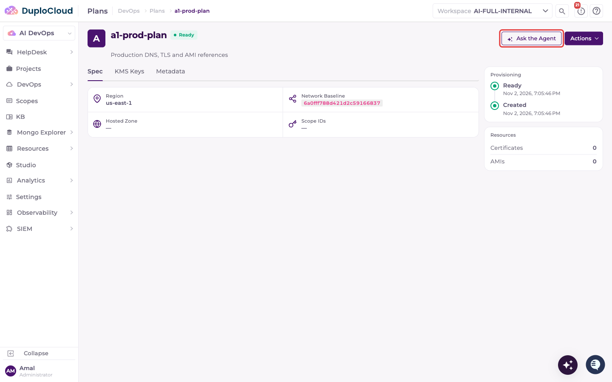
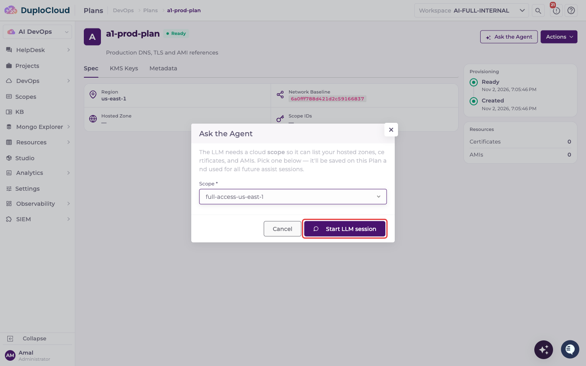
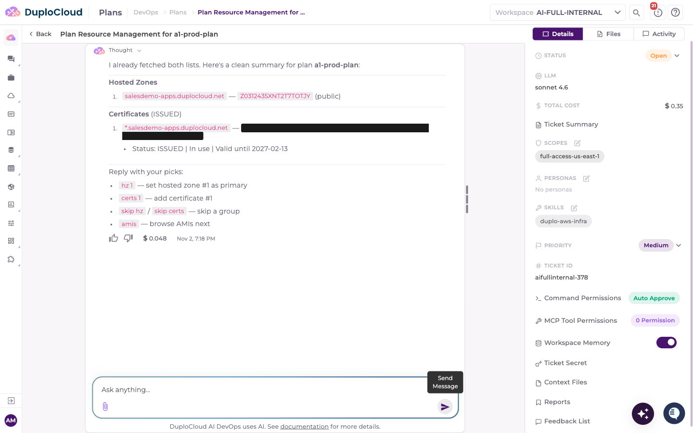
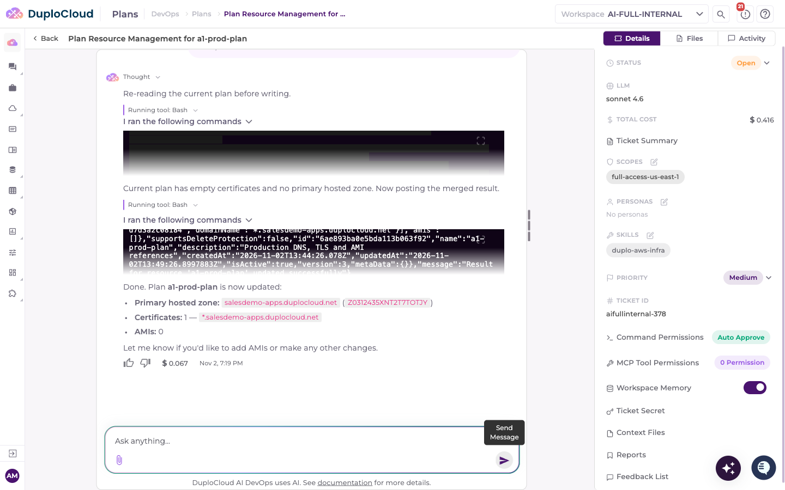
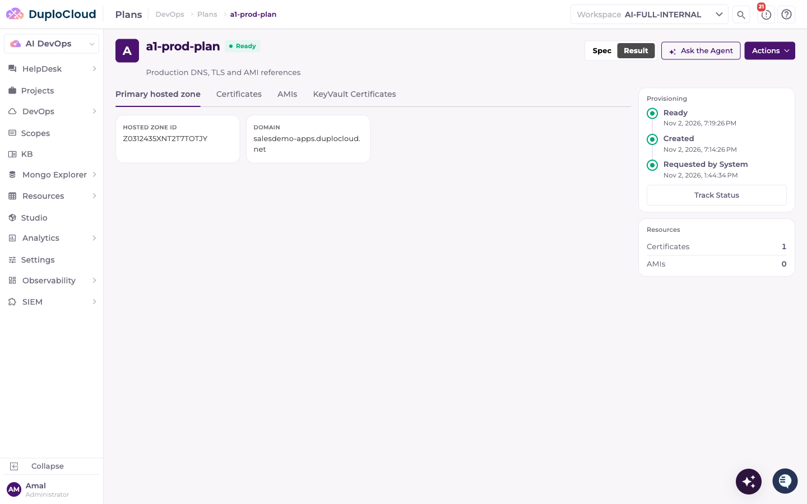

# Step 3: Create a Plan

A Plan records the AWS account-level resources your environments and workloads will reference: a Route 53 hosted zone for DNS, ACM certificates for TLS, and AMIs for compute. Creating a Plan before the Environment means you can attach it when you create the Environment.

Unlike the Network and Cluster, a Plan provisions nothing in AWS. It is a catalog record that points at resources that already exist in your account, and it is **Ready** as soon as you create it.

## What gets created

* A Plan record tagged with an AWS region, optionally inherited from a Network Baseline
* References to a primary Route 53 hosted zone, ACM certificates, and AMIs, entered by hand or picked with the agent's help
* Nothing in AWS. Deleting the Plan removes only the record; the hosted zones, certificates, and AMIs it references are not affected.

## How Plans are used

When a Plan is attached to an Environment, resources in that Environment draw on it:

* **Certificates** appear in the certificate picker when you add a Kubernetes ingress, filtered to the network's region
* **The primary hosted zone** is suggested as the host domain for ingress routing rules
* **AMIs** are offered when you provision hosts
* **KMS keys** registered on the Plan can be used to encrypt resources

An Environment can attach more than one Plan. A Plan can't be deleted while an Environment still references it.

## Walkthrough

### Step 1 — Navigate to Plans

In the left sidebar, open **DevOps** and select **Plans**.

### Step 2 — Plans List

The **Plans** page lists every plan in the workspace with its region, hosted zone, certificate count, AMI count, and description. Summary cards above the table show the total number of plans and how many are ready, in progress, or need attention. Click **Create plan** to begin.

### Step 3 — Plan Details

The **Create Plan** wizard opens. Fill in the first page:

* **Name** — a unique identifier (e.g. `prod-plan`). Starts with a letter; letters, numbers, hyphens and underscores.
* **Description** — optional
* **Region source** — optional. Choose **Pick a region directly** to select an AWS region, or **Inherit from a Network Baseline** to take the region from a network you've already provisioned. Leave it blank for a region-agnostic Plan.
* **Network Baseline** — shown when you inherit the region. Select the network from Step 1; only completed networks are listed. The resolved region appears below the field.
* **Metadata** — optional key/value pairs

The region and Network Baseline can't be changed after the Plan is created.

Click **Next**.

### Step 4 — References

The **References** page collects the resources the Plan points at. Every field is optional:

* **Primary hosted zone** — the Route 53 hosted zone ID and domain name
* **Certificates** — ACM certificate ARNs and their domains
* **KeyVault Certificates** — for Azure Application Gateway ingress; leave empty for AWS
* **AMIs** — AMI IDs, with an optional name and description

Fill in whatever you already know. You can leave everything blank and have the agent look up and select values from your AWS account after the Plan is created.

Click **Create Plan**.

### Step 5 — Plan Detail Page

DuploCloud creates the Plan and opens its detail page with the status **Ready**. The **Spec** tab shows the region, linked Network Baseline, hosted zone and scope. The **KMS Keys** tab is where you register customer-managed KMS keys by hand, and **Metadata** holds the Plan's key/value pairs. The **Resources** panel on the right counts the Plan's certificates and AMIs.

Click **Ask the Agent** to populate the references from your AWS account.

### Step 6 — Choose a Scope

The first time you ask the agent about a Plan, a modal asks for a cloud **Scope** that gives the agent access to your AWS account (e.g. `full-access-us-east-1`). The scope is saved on the Plan and reused for every later agent session.

Click **Start LLM session**. DuploCloud opens an agent ticket for the Plan and takes you to it.

### Step 7 — Agent Lists Available Resources

The agent reads the Plan and lists what's available in your account for the Plan's region:

* **Hosted zones** — Route 53 hosted zones with their IDs
* **Certificates** — issued ACM certificates with their ARNs

Reply with your picks, in plain language or with the agent's shortcuts:

* `hz 1` — set hosted zone 1 as the primary hosted zone
* `certs 1,2` — add certificates 1 and 2
* `skip hz` / `skip certs` — skip a group
* `amis` — browse AMIs next. Because an account can hold hundreds of AMIs, the agent asks for a filter (by name, by tag, or the latest 20) before it lists them.

The agent may start by asking what you'd like to do. If it does, ask it to list the hosted zones and certificates for the Plan.

### Step 8 — Plan Updated

When you reply with your selections, the agent re-reads the current Plan, merges your picks into it, and confirms the result:

* **Primary hosted zone** — replaced by your pick
* **Certificates** and **AMIs** — your picks are added to any already on the Plan, without duplicates

The agent only reads from AWS. It doesn't create, change, or delete any AWS resource, and it writes only to the Plan. You can ask the agent again at any time, or edit the Plan directly.

### Step 9 — Review the Result

Back on the Plan detail page, the **Result** view shows what the Plan now references, with tabs for **Primary hosted zone**, **Certificates**, **AMIs** and **KeyVault Certificates**. Switch between **Spec** and **Result** at the top right. The **Resources** panel shows the updated counts.

## Next step

Once the Plan is ready, proceed to [Step 4: Create an Environment](step-4-environment.md).
