# Step 4: Create an Environment

An Environment is a logical grouping that binds the Plan you created in Step 3 to the Resource Groups your agents deploy into. The Environment itself holds no cloud resources, and creating one provisions nothing in AWS.

The infrastructure comes from the **Resource Group** you create inside the Environment. Each AWS Resource Group inherits the network and Cluster you created in Steps 1 and 2, and provisions its own security baseline. All resources created in a Resource Group share that security profile, so the Resource Group is the security boundary for your workloads.

## What gets created

Creating the Environment adds a record only. Creating a Resource Group in it provisions a CloudFormation stack with:

* A security group for the Resource Group's resources, and a second security group for load balancers
* IAM policies and an IAM role scoped to the Resource Group, with a matching instance profile
* A KMS key and alias
* An EC2 key pair

## Walkthrough

### Step 1 — Navigate to Environments

In the left sidebar, open **DevOps** and select **Environments**. The **Environments** page lists every environment in the workspace with its cloud, attached Plans, description, Resource Group count, and created and last-modified dates. Summary cards show the totals for environments, Plans and Resource Groups. Click **Create environment** to begin.

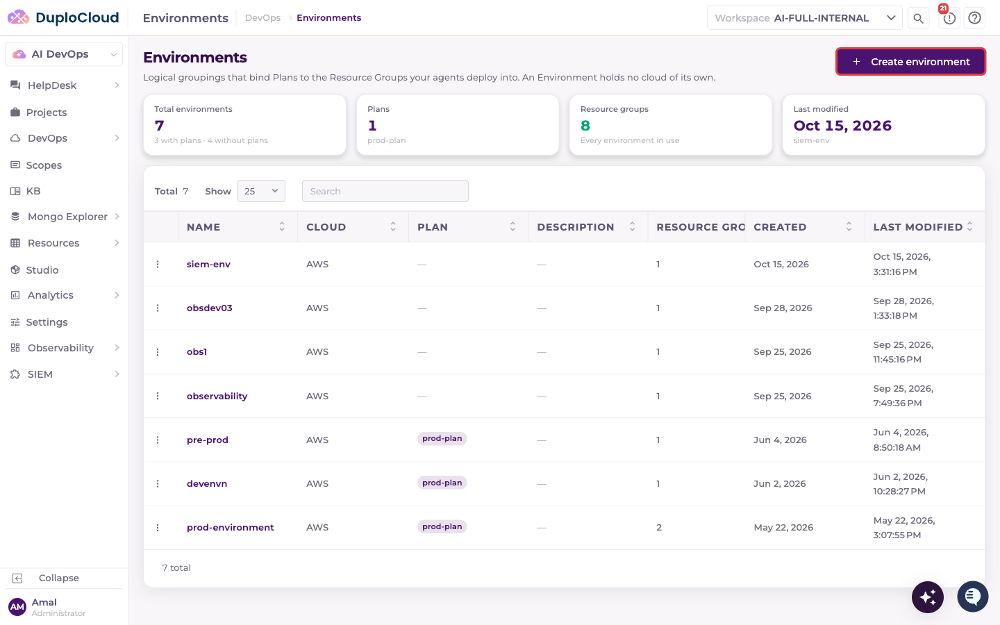

### Step 2 — Create Environment

The **Create environment** modal opens. Fill in:

* **Name** — a unique name for the environment (e.g. `prod-environment`)
* **Description** — optional
* **Plans** — optional; associate one or more Plans to contribute reusable AWS references (AMIs, certificates, hosted zones) to this environment
* **Metadata** — optional key/value pairs to attach to the environment

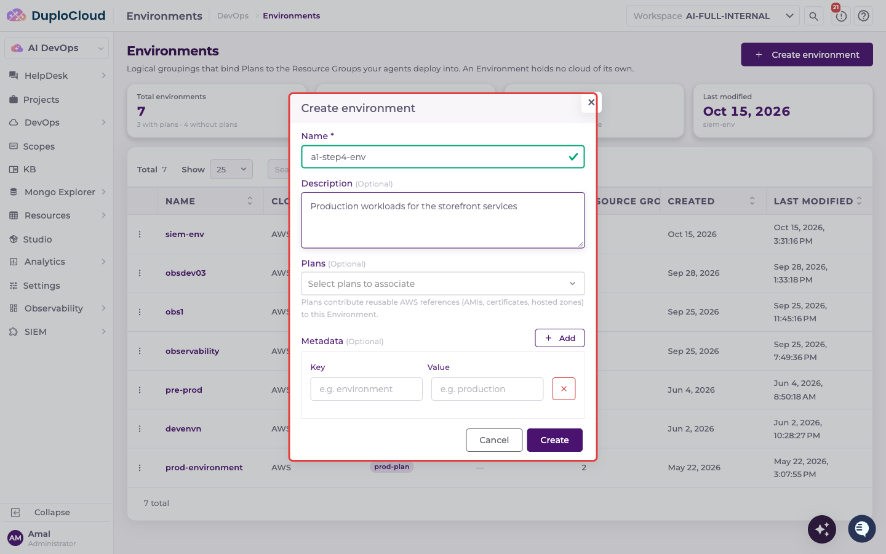

### Step 3 — Associate a Plan

Open the **Plans** dropdown to see the Plans in the workspace, and select the Plan you created in the previous step (e.g. `prod-plan`). The selected Plan appears as a chip in the field. You can add or remove Plans later by editing the environment.

Click **Create**.

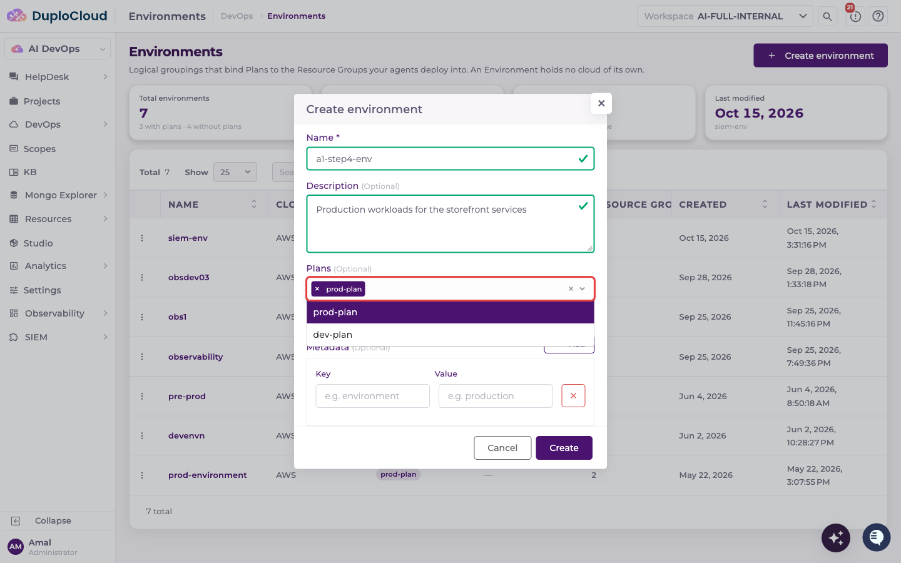

### Step 4 — Environment Created

The environment's page opens. The **Resource Group** selector in the header shows **None**, and the page shows an empty state explaining that a Resource Group is a container of resources and acts as their security boundary.

Click **Create Resource Group** to add the first Resource Group.

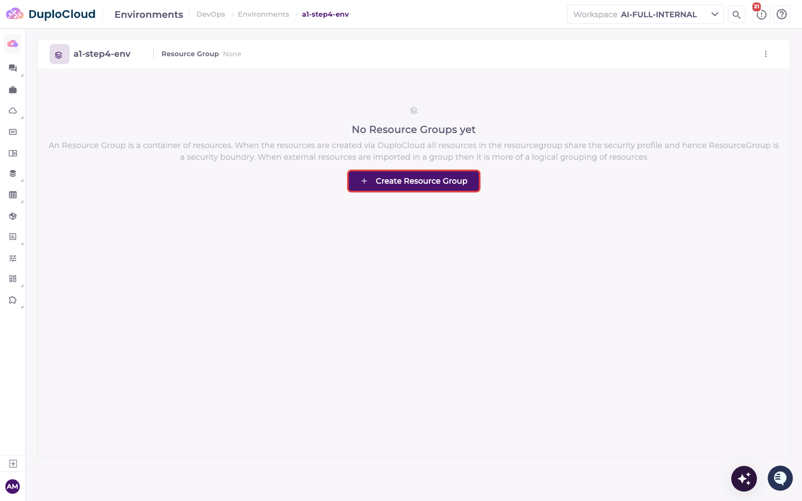

### Step 5 — Create a Resource Group

The **Create Resource Group** form opens. Fill in:

* **Name** — a unique name for the Resource Group (e.g. `prod-resourcegroup-1`). Letters, numbers and hyphens.
* **Cloud** — select **AWS**
* **Description** — optional
* **Network Baseline** — optional; select the network you provisioned in Step 1 (e.g. `prod-network-1`). Picking a network filters the cluster list to that network's VPC and region.
* **Kubernetes Cluster** — optional; select the Cluster you provisioned in Step 2 (e.g. `prod-eks-cluster`). Only clusters that are **Ready** with their cluster-level setup complete are listed. Namespaces and workloads created under this Resource Group are provisioned into the selected cluster.
* **Tags** — optional; inherited by every resource in the group, applied as tags on AWS resources and as labels on Kubernetes objects. The `duplocloud.ai/` prefix is reserved.
* **Metadata** — optional key/value pairs

Click **Create & Provision**.

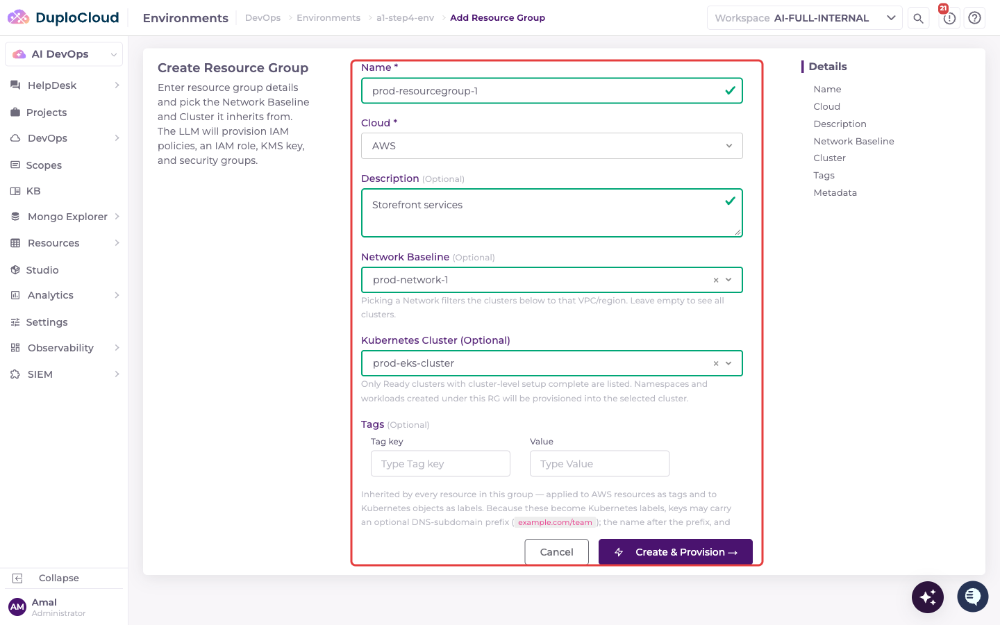

### Step 6 — Resource Group Page

DuploCloud creates the Resource Group and opens its page inside the environment. The **Provisioning Status** panel tracks its status while the agent provisions it, and shows **Ready** when it completes. Once provisioned, the **Result** view lists the resources it created: the security group, the ALB security group, the IAM role ARN and name, and the KMS key ARN and alias. The **Subnets** panel lists the subnets the Resource Group inherited from its network.

The environment's navigation on the left opens up for the selected Resource Group: **Overview**, **Micro Services**, **Kubernetes** (Namespaces, Nodes, Workloads, Configs, Storage, Helm, Networks), **Cloud Resources** (Hosts, KMS Keys, Serverless, Storage, Databases, Analytics, Messaging, Networks, Configs, Access Grants, App Integration), and **Observability**.

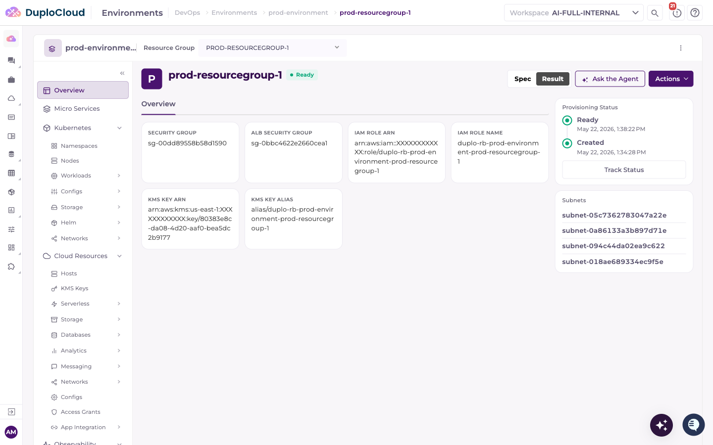

### Step 7 — Resource Group Spec

Switch to the **Spec** view to see the configuration the Resource Group inherited: the cloud, the region and VPC ID from its network, the cluster, and its tags.

Click **Track Status** to open the agent ticket that provisions the Resource Group.

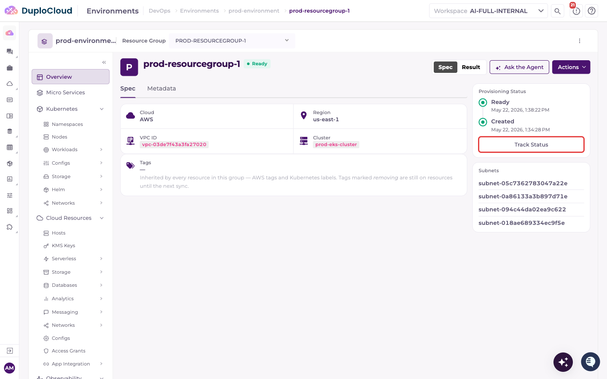

### Step 8 — Agent Ticket Opens

The agent opens a ticket titled **ResourceGroup Resource Management - prod-resourcegroup-1** and uses the `duplo-aws-infra` skill. It reads the sub-skill file for `aws-resource-group` provisioning, sets up AWS credentials, reads the Resource Group spec, and begins Phase 1.

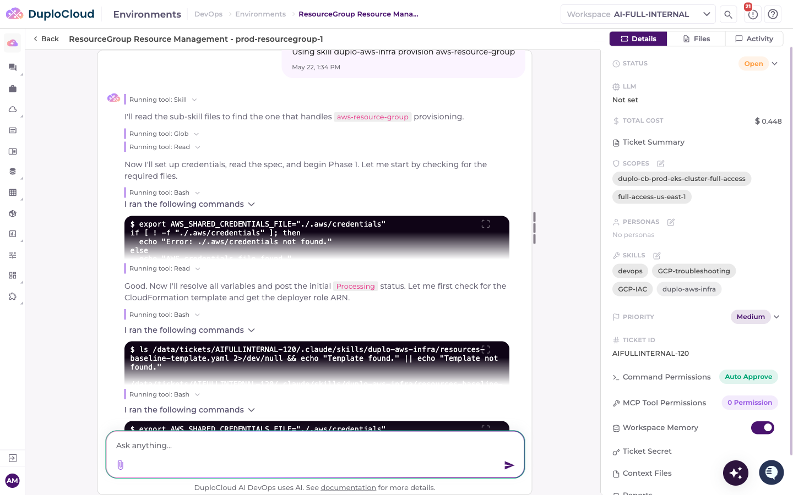

### Step 9 — Inputs Validated & Stack Check

**Phase 1** resolves the variables from the Resource Group spec (Resource Group ID, workspace, region and VPC ID) and confirms that the region and the VPC both exist.

**Phase 2** derives the CloudFormation stack name from the Resource Group, and the agent then checks whether a stack with that name already exists, so provisioning isn't duplicated.

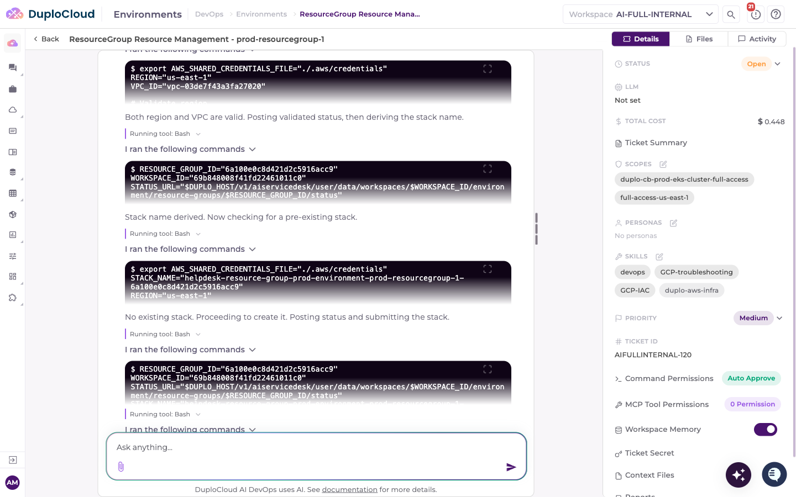

### Step 10 — Stack Submitted

Finding no existing stack, the agent submits the CloudFormation stack in **Phase 3** and polls its events, posting status updates and partial results as each resource completes: the security groups, IAM policies, IAM role and KMS key.

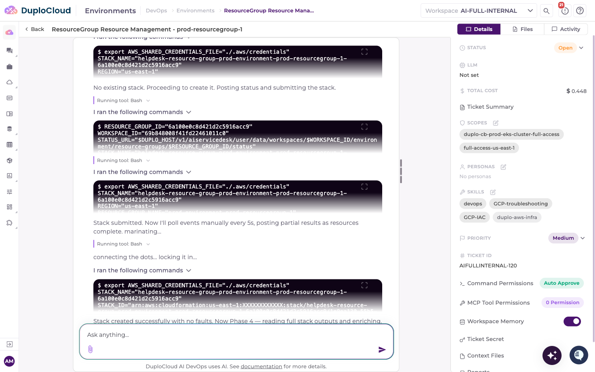

### Step 11 — Provisioning Complete

In **Phase 4** the agent reads the stack outputs, looks up the security group and role names, writes the `output.json` file, posts the results and marks the Resource Group **Complete**. The completion summary lists the provisioned resources:

| Resource               | ID                                                              |
| ---------------------- | --------------------------------------------------------------- |
| **Security Group**     | `duplo-rb-prod-environment-prod-resourcegroup-1`                |
| **ALB Security Group** | `duplo-rb-prod-environment-prod-resourcegroup-1-alb`            |
| **IAM Role**           | `arn:aws:iam::…/duplo-rb-prod-environment-prod-resourcegroup-1` |
| **KMS Key**            | `arn:aws:kms:us-east-1:…`                                       |

AWS resource names follow the pattern `duplo-rb-<environment>-<resource-group>`. The Resource Group's status changes to **Ready**, and the environment is ready for workload deployment.

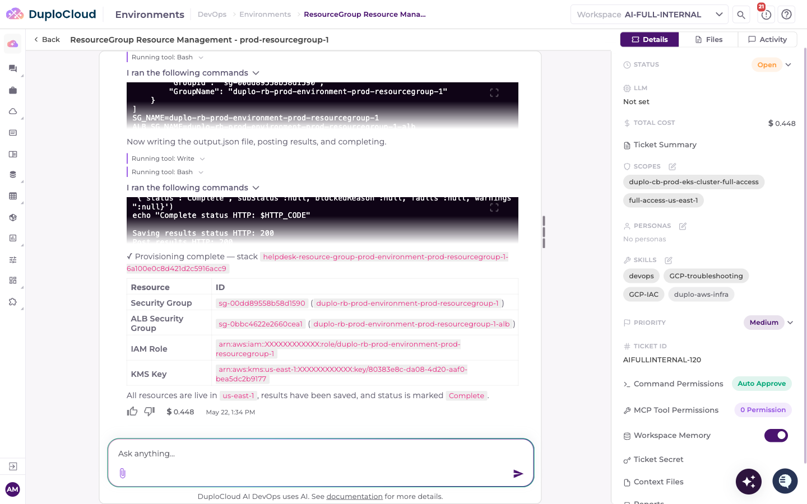

## Next step

Once the Resource Group's status shows **Ready**, proceed to [Step 5: Deploy Workloads](step-5-workloads.md).
