# Step 5: Deploy Workloads

With your Resource Group **Ready** (see [Step 4](step-4-environment.md)), you can deploy applications into it. Workloads run on the Kubernetes Cluster the Resource Group was created with, and every workload inherits the Resource Group's security boundary.

Open the Resource Group from its environment. The **Kubernetes** section of its sidebar holds **Namespaces**, **Nodes** and **Workloads**, and **Micro Services** holds your long-running applications.

## What gets created

* A **Namespace** on the cluster, with a read-only and a read/write service account. Both are bound to the Resource Group's IAM role through IRSA.
* An **EKS managed Node Group**, provisioned as a CloudFormation stack. It launches EC2 instances, so it incurs AWS charges.
* An **App Service**: a Kubernetes Deployment or StatefulSet, with an optional Service and Ingress. An Ingress with the ALB ingress class creates an Application Load Balancer, which also incurs AWS charges.

## Walkthrough

### Step 1 — Namespaces List

In the Resource Group's sidebar, expand **Kubernetes** and click **Namespaces**. Summary cards show the total namespaces and how many are ready, in progress or need attention. The list shows each namespace's roles, service accounts, IAM role and status. Click **Create Namespace** to begin.

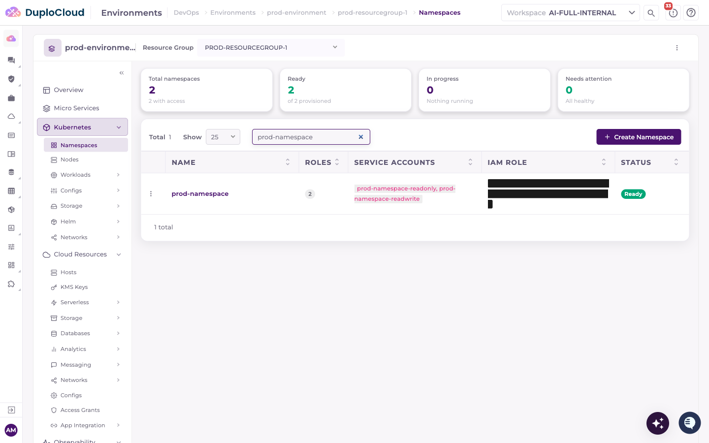

### Step 2 — Create Namespace

The **Create Namespace** form opens. Fill in:

* **Name** — DNS-1123: lowercase letters, digits and hyphens, starting and ending with a letter or digit, up to 63 characters (e.g. `prod-namespace`)
* **Description** — optional
* **Metadata** — optional key/value pairs

The namespace is created under this Resource Group with a read-only and a read/write service account, both bound to the Resource Group's IAM role via IRSA.

Click **Create & Provision**.

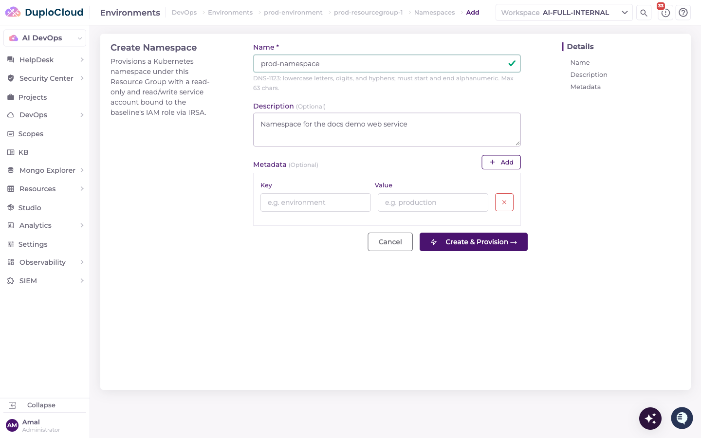

New namespaces are delete-protected by default. To deprovision one later, first set its `delete_protection` metadata to `false`.

### Step 3 — Namespace Provisioning

DuploCloud opens the namespace's page. The **Spec** view shows the Resource Group and Environment it belongs to, and the **Provisioning Status** panel tracks it from **Created** through **Provisioning** to **Ready**. Click **Track Status** to open the agent ticket, titled **Namespace Resource Management - \<name\>**.

The agent uses the `duplo-kubernetes-infra` skill to run the namespace handler. The handler:

* creates the namespace and its two service accounts
* labels them with the workspace, environment and Resource Group
* annotates both service accounts with the Resource Group's IAM role
* adds the namespace to that role's trust policy

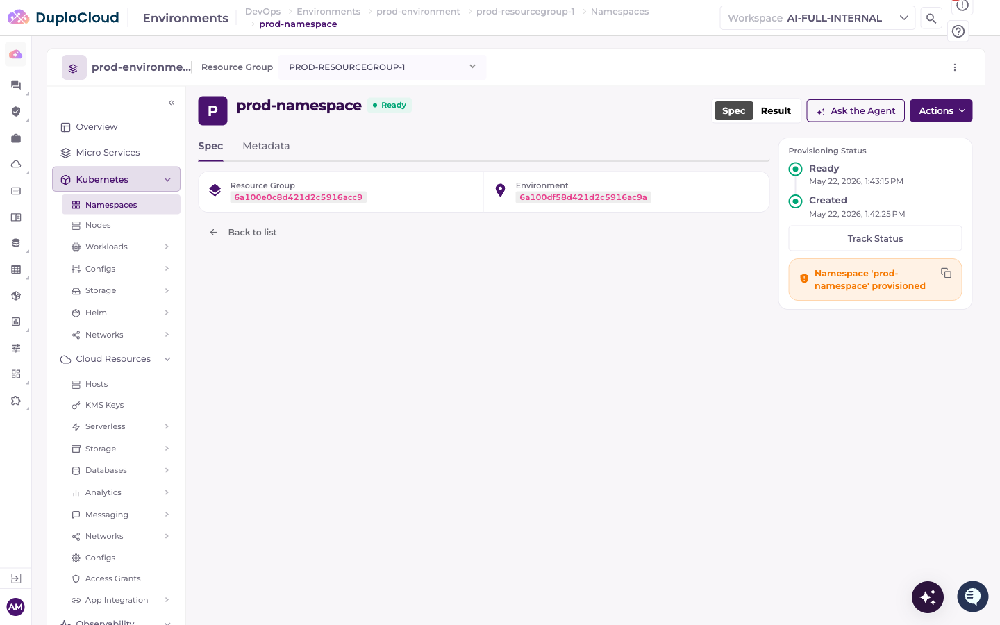

### Step 4 — Namespace Ready

When provisioning completes, the status changes to **Ready**. Switch to the **Result** view to see the **Service-account role bindings**:

| Service account      | ClusterRole | Access     |
| -------------------- | ----------- | ---------- |
| `<name>-readonly`    | `view`      | Read-only  |
| `<name>-readwrite`   | `edit`      | Read/write |

Both service accounts map to the Resource Group's IAM role, so any pod that uses one of them can assume that role.

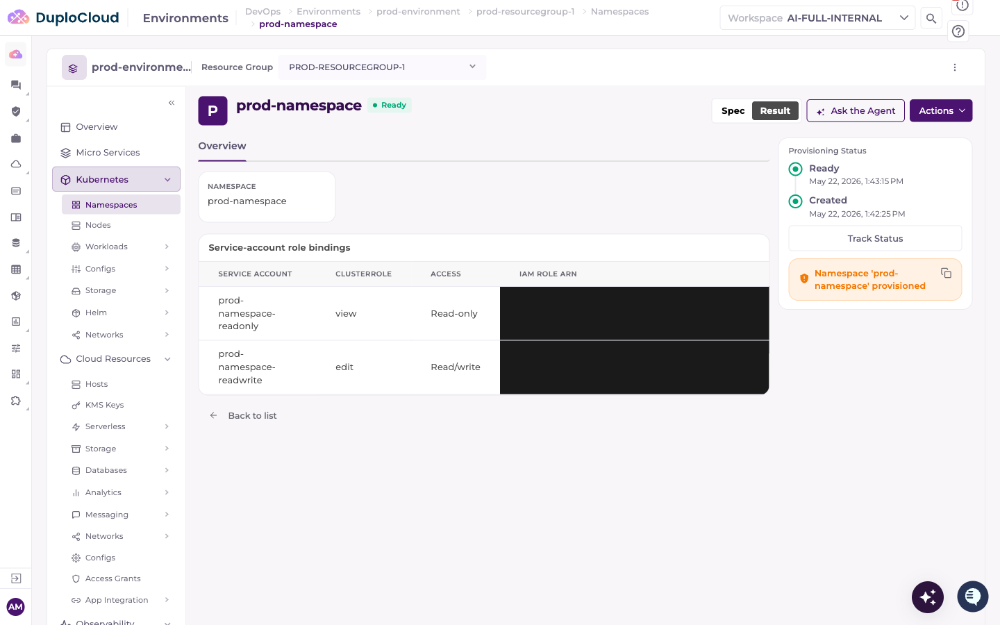

### Step 5 — Node Groups List

Click **Nodes** in the sidebar. Summary cards show the node groups, the number of nodes, spot capacity and health issues. The list shows each node group's instance types, its scaling (**Min / Desired / Max**) and its status. Click **Create Node Group** to begin.

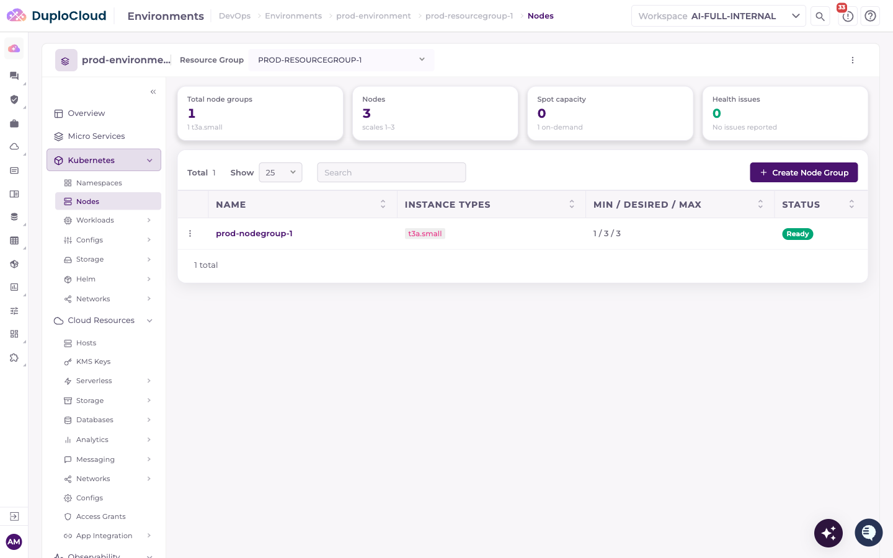

### Step 6 — Create Node Group: Basic Info

The **Create EKS Node Group** wizard has three pages. On **Basic Info**, fill in:

* **Name** — used as the EKS node group name (e.g. `prod-nodegroup-1`)
* **Description** — optional
* **AMI Type** — selected automatically from the cluster's Kubernetes version. For 1.33 and later this is **AL2023 x86\_64 Standard**; earlier versions use AL2. You can also choose an ARM64 or NVIDIA GPU variant, or **Custom (bring your own AMI)**, which asks for an **AMI ID**. Changing the AMI type re-filters the instance types.
* **User Data** — optional; extra EC2 user data merged with EKS's own bootstrap. Don't include commands that start or reconfigure `kubelet`.
* **Instance Types** — one or more instance types (e.g. `t3a.small`). Selecting several improves availability.
* **Instance Visibility** — **Internal (private subnets)** (the default) or **Public subnets**

Click **Next**.

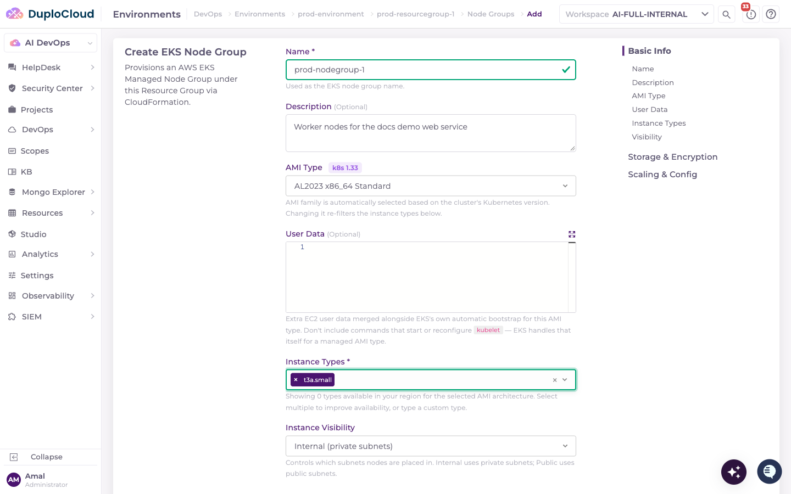

### Step 7 — Create Node Group: Storage & Encryption

Configure the nodes' storage:

* **Disk Size (GiB)** — the root EBS volume (gp3). Minimum 20, default 50.
* **Encrypt Disks** — **Yes** (the default) or **No**
* **KMS Key** — optional. Leave it blank to use the Resource Group's default key, or the AWS-managed `aws/ebs` key if the Resource Group has none.
* **Additional Volumes** — optional YAML list of extra EBS volumes (up to four), with snippets for a data volume, an encrypted data volume and a provisioned-IOPS volume

Click **Next**.

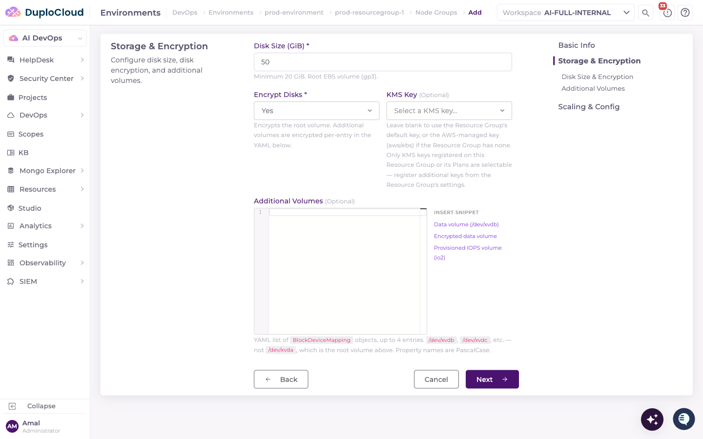

### Step 8 — Create Node Group: Scaling & Config

Configure scaling and tags:

* **Min Size**, **Desired Size**, **Max Size** — defaults 1 / 2 / 3. Desired must lie between Min and Max.
* **Capacity Type** — **On-Demand** for stable workloads, **Spot** for lower cost on fault-tolerant workloads
* **Enable Cluster Autoscaler** — scales the group between Min and Max based on pending pods. Cluster Autoscaler must also be enabled on the cluster.
* **Allocation Tag** — optional. Applied under the key `allocationtags` as a Kubernetes node label on every node, so workloads can target the group, and as an AWS tag on the node group, its EC2 instances and EBS volumes for cost reporting.
* **Tags** — optional AWS tags for the node group, its Auto Scaling group and its instances and volumes

Click **Create & Provision**.

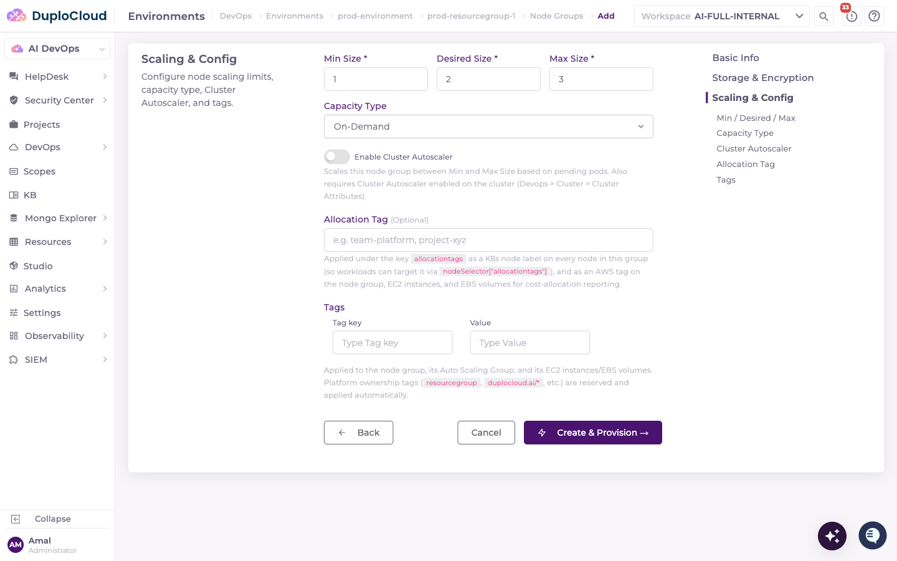

### Step 9 — Node Group Page

DuploCloud opens the node group's page. The **Spec** view shows its capacity type, AMI type, disk size and disk encryption, and the side panel shows its instance types and scaling. Once provisioned, the **Result** view adds the node group and CloudFormation stack ARNs, Kubernetes and release versions, AWS status, Auto Scaling group and subnets, with **Scaling**, **Nodes** and **Health Issues** tabs.

Click **Track Status** to follow the agent.

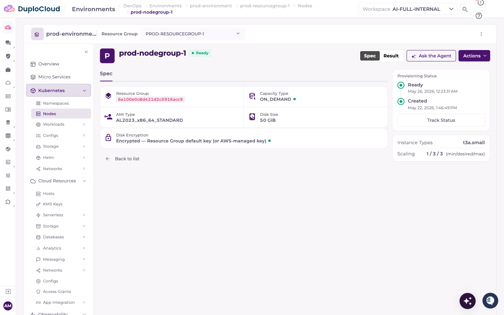

### Step 10 — Agent: Preflight

The agent opens a ticket titled **AWSEksNodeGroup Resource Management - \<name\>** and uses the `duplo-kubernetes-infra` skill with its `aws-eks-nodegroup` sub-skill:

* **Phase 0** acknowledges the ticket.
* **Phase 0.5** sets up the AWS environment.
* **Phase 1 (Preflight)** reads the spec and validates the context. It checks that the Resource Group has a cluster, an IAM role and subnets of the chosen visibility. It then derives the CloudFormation stack name and checks whether the stack already exists.

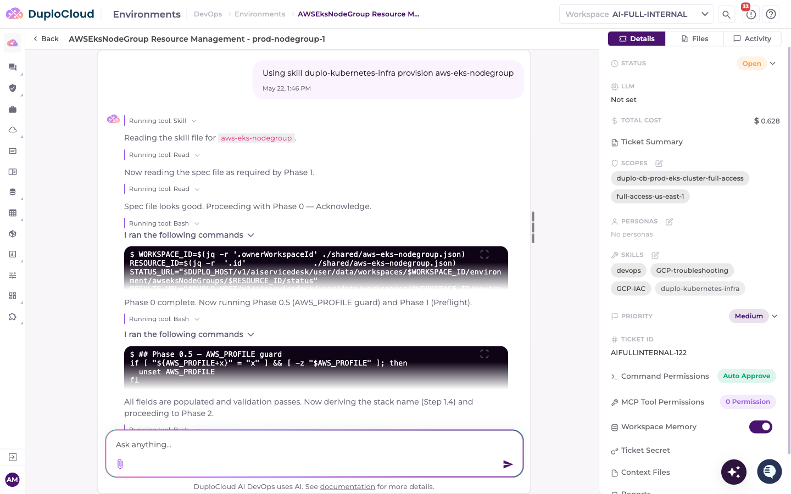

### Step 11 — Agent: Stack Submitted

In **Phase 2** the agent submits the CloudFormation stack for the EKS managed node group. In **Phase 4** it polls the stack's events until the stack reaches `CREATE_COMPLETE`, then moves to **Phase 5** to collect the node group's details.

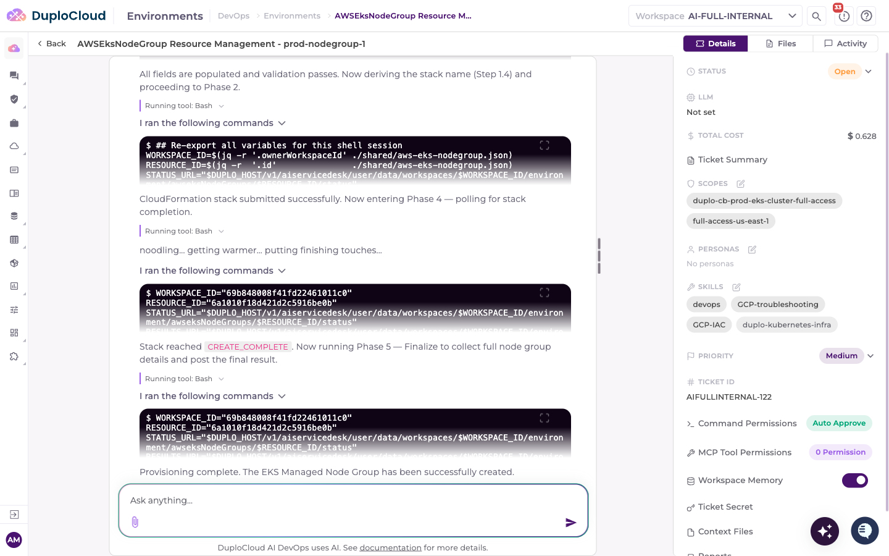

### Step 12 — Agent: Node Group Complete

Phase 5 posts the result and marks the node group **Complete**. The summary lists:

* the node group name and ARN
* the CloudFormation stack
* the Kubernetes and release versions
* the instance type and capacity type
* the scaling configuration
* the subnets

The node group's status changes to **Ready**.

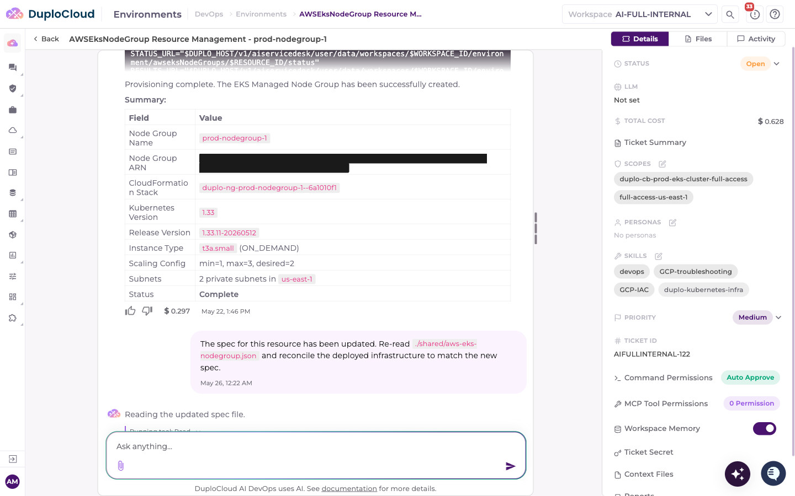

### Step 13 — Micro Services List

Click **Micro Services** in the sidebar. Summary cards show the total services, requested replicas, and how many are exposed and autoscaled. The list shows each service's type, image and status. Click **Create App Service** to deploy an application.

Micro Services, and **Kubernetes > Workloads** (Jobs and CronJobs), are available once the Resource Group has a namespace.

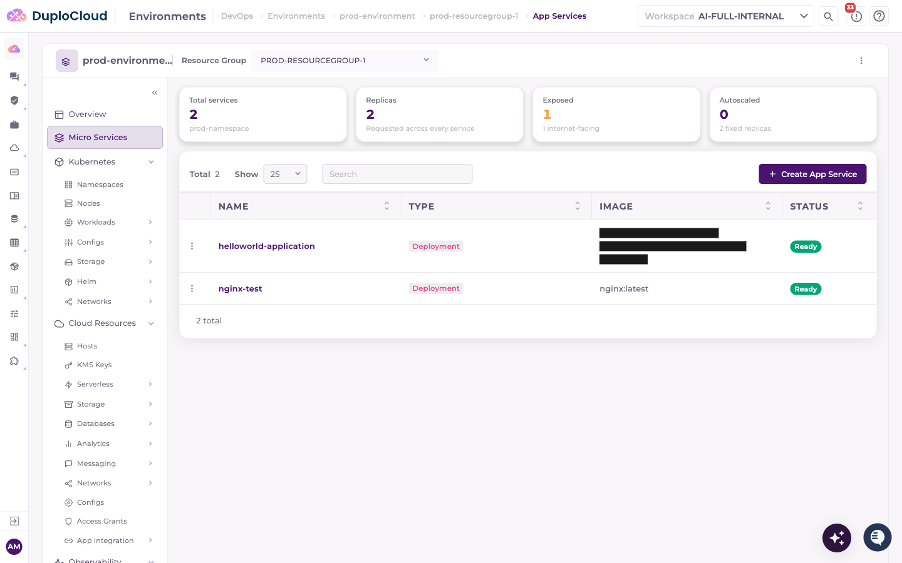

### Step 14 — Add App Service: Workload Basics

The **Add App Service** wizard opens on **Workload Basics**. Fill in:

* **Service Name** — DNS-1123, up to 63 characters (e.g. `helloworld-application`)
* **Namespace** — the namespace to deploy into. It is pre-selected when the Resource Group has exactly one Ready namespace.
* **Docker Image** — the container image to run (e.g. `nginx:1.27`)
* **Allocation Tag** — optional; schedules the pods onto nodes with the matching `allocationtags` label
* **Replication Type** — **Static** (a fixed **Replicas** count, default 1), **HPA (Managed)** (DuploCloud creates a Horizontal Pod Autoscaler from the configuration you enter) or **External HPA** (an initial replica count, with an autoscaler you manage)
* **Workload Type** — **Deployment** for stateless services or **StatefulSet**, which adds volume claim templates. The type can't be changed after creation.

The platform automatically attaches a read-only service account, a Resource Group node selector and resource-tracking labels to every workload.

Click **Next**.

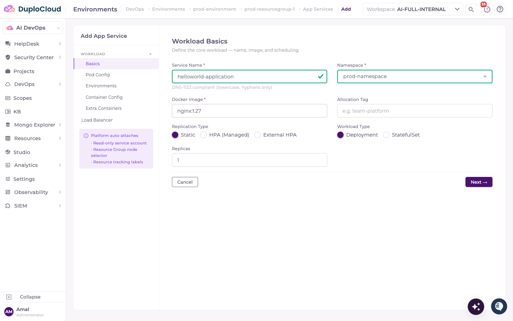

### Step 15 — Pod Configuration

**Pod Configuration** sets pod-level scheduling and security in YAML, on two tabs:

* **Scheduling** — node affinity, pod anti-affinity and tolerations. Snippets: **Required (linux)**, **Prefer spot nodes**, **Spread across nodes**, **Strict: 1 per node**, **Dedicated GPU** and **Spot instances**.
* **Security & Other** — security context and other pod-level settings

Leave both blank for a standard deployment and click **Next**.

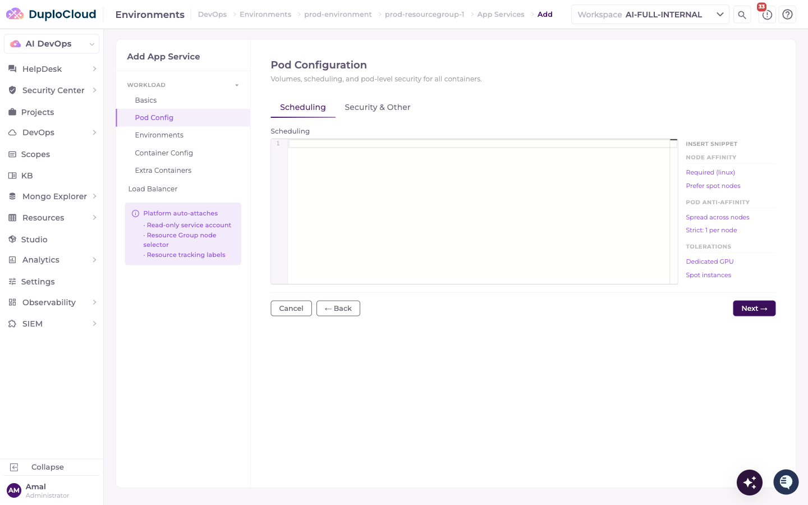

### Step 16 — Environment Variables

**Environment Variables** configures the main container's environment, on two tabs:

* **ENV** — individual variables. Snippets: **Key / Value** and **Field Ref**, plus **SecretKeyRef** and **ConfigMapKeyRef** to read single keys from a Secret or ConfigMap.
* **ENV from** — import every key from a Secret or ConfigMap

Leave both blank if the container needs no variables and click **Next**.

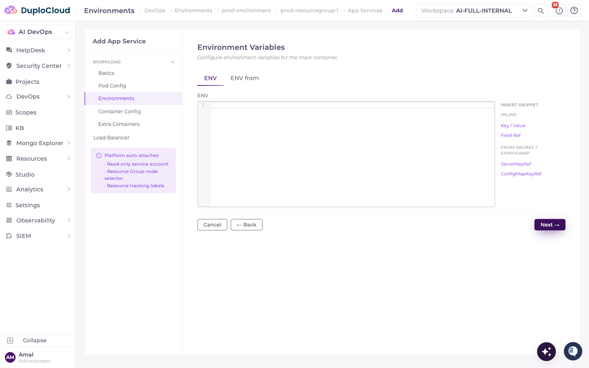

### Step 17 — Container Configuration

**Container Configuration** sets the main container's resources, ports, probes and mounts, on four tabs:

* **Resources & Ports** — CPU and memory requests and limits, and container ports. Snippets: **HTTP 8080**, **HTTPS 8443**, **Metrics 9090**, **Full Example**, **1 CPU / 1Gi** and **Medium workload**.
* **Probes** — liveness and readiness probes
* **Volumes & Mounts** — volume mounts
* **Other** — other container settings

Leave them blank for the defaults and click **Next**.

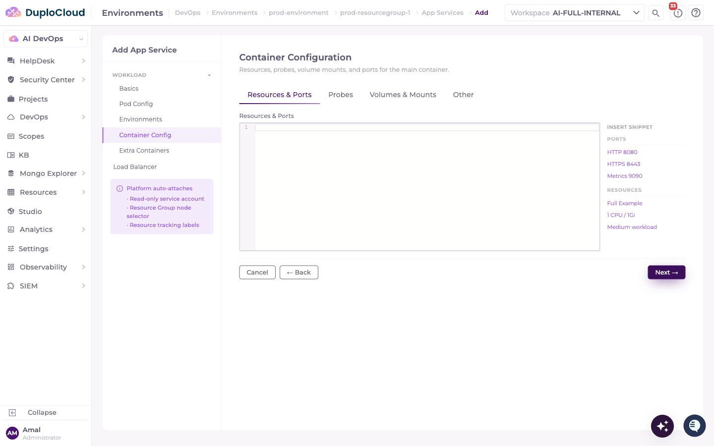

### Step 18 — Extra Containers

**Extra Containers** adds containers alongside the main one, on two tabs:

* **Init Containers** — run to completion before the main container starts. Snippets: **Wait for TCP port**, **Wait for HTTP** and **DB Migration**.
* **Sidecar Containers** — run alongside the main container for the life of the pod

Leave both blank if you need no extra containers and click **Next**.

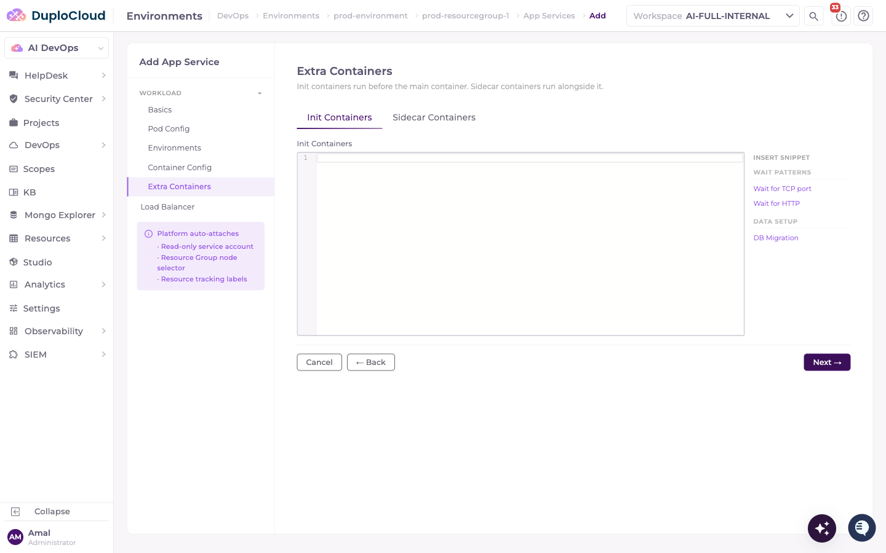

### Step 19 — Load Balancer

**Load Balancer** configures the Kubernetes Service and an optional Ingress. Click **Add Port** to expose a port, or leave the page empty to deploy without one. Under **Service Settings**, click **Edit** to set annotations and labels on the Service.

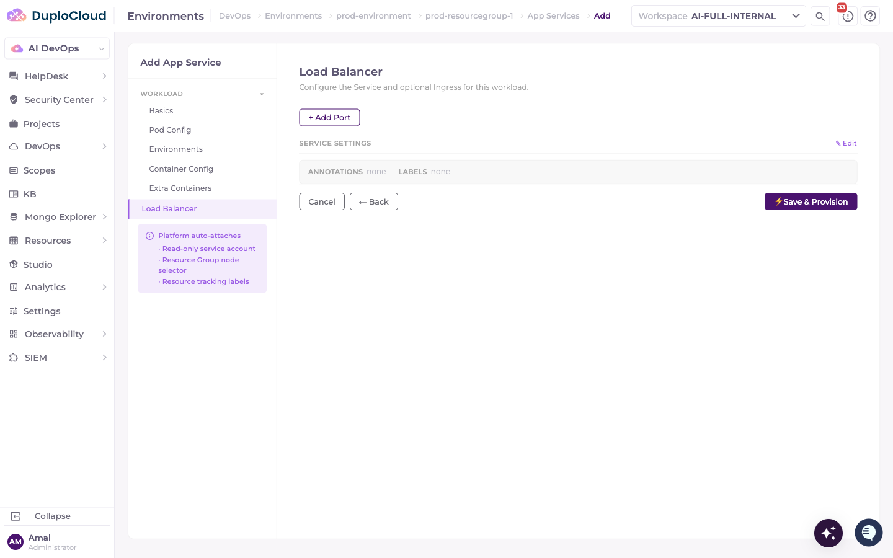

### Step 20 — Add Port

The **Add Port** modal configures the port:

* **Service Type** — **ClusterIP** (internal to the cluster) or **NodePort**
* **Container Port** — the port the container listens on (e.g. `80`)
* **Service Port** — optional; defaults to the container port
* **Protocol** — **TCP** or **UDP**
* **Enable Ingress** — turn on to route external traffic to this port through an Ingress:
  * **Certificate** — optional; one or more ACM certificates from the environment's Plans, or an ARN you enter
  * **Load Balancer Visibility** — **Public** (internet-facing) or **Internal**
  * **HTTP Port** and **HTTPS Port** — the listener ports. HTTPS and **Redirect HTTP → HTTPS** are available once a certificate is selected.
  * **Ingress Annotations** — optional YAML, with snippets for common ALB, NGINX and GCP settings
  * **Host** — optional; pre-filled as `<service>-<resource group>.<domain>` from the Plan's hosted zone
  * **Path** — must start with `/` (default `/`)
  * **Path Type** — **Prefix**, **Exact** or **ImplementationSpecific**

Click **Add Port**, then **Save & Provision**.

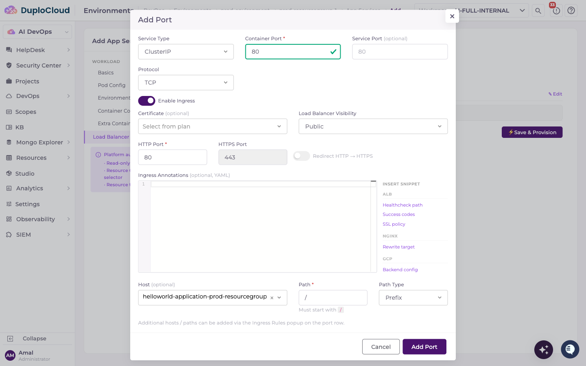

### Step 21 — App Service Ready

DuploCloud deploys the App Service directly to the cluster; no agent ticket is involved. Its page shows the status in the **Provisioning Status** panel and changes to **Ready** when the workload is up. The **Overview** shows:

* the namespace, workload, Service and Ingress names
* the ready and available replicas
* the Service type and cluster IP

A **Running pods** table lists each pod's status, restarts, IP and node. The **Workload**, **Service** and **Ingress** tabs show each object, and **Ask the Agent** opens a diagnostic agent ticket for the service.

When the Ingress uses the ALB ingress class, the **Load balancer** section fills in with the ALB's hostname a few minutes later.

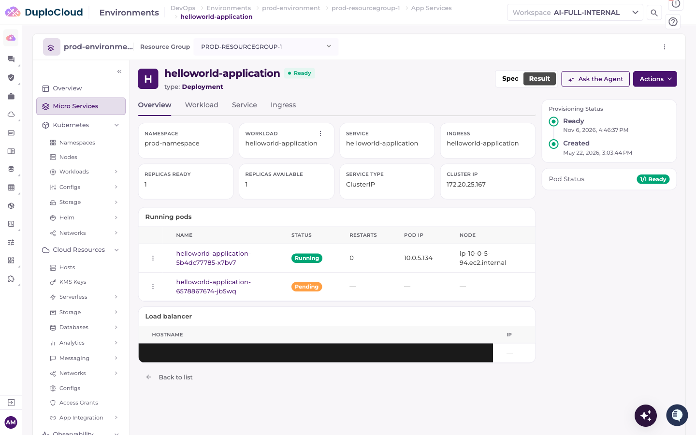


DuploCloud doesn't create a DNS record for the Ingress host unless the external-dns component is enabled on the cluster. Without it, create a record pointing the host at the ALB hostname, or reach the application on the ALB hostname directly.


## Next step

Once your workload is running, proceed to [Step 6: Add Databases](step-6-databases.md).
