# Step 6: Add Databases

Databases are provisioned inside a Resource Group, like the workloads in Step 5. In the Resource Group's sidebar, open **Cloud Resources** and then **Databases**. It holds three services:

* **RDS → Instances**: single RDS DB instances (MySQL, MariaDB, PostgreSQL, Oracle and SQL Server)
* **RDS → Clusters**: Aurora clusters (Aurora MySQL and Aurora PostgreSQL)
* **ElastiCache**: Redis, Valkey and Memcached caches

Each service has a create wizard. When you submit it, the agent provisions the database with CloudFormation. The database inherits the Resource Group's network, security groups and KMS key, so you don't configure those again.

***

## RDS Instance

### Step 1 — RDS Instances list

In the Resource Group sidebar, open **Cloud Resources → Databases → RDS → Instances**. Summary cards show how many instances you have, how many are publicly reachable, how many are encrypted and how many are backed up. The list shows each instance's engine, class, visibility, Multi-AZ setting and status. Click **Create RDS Instance** to start.

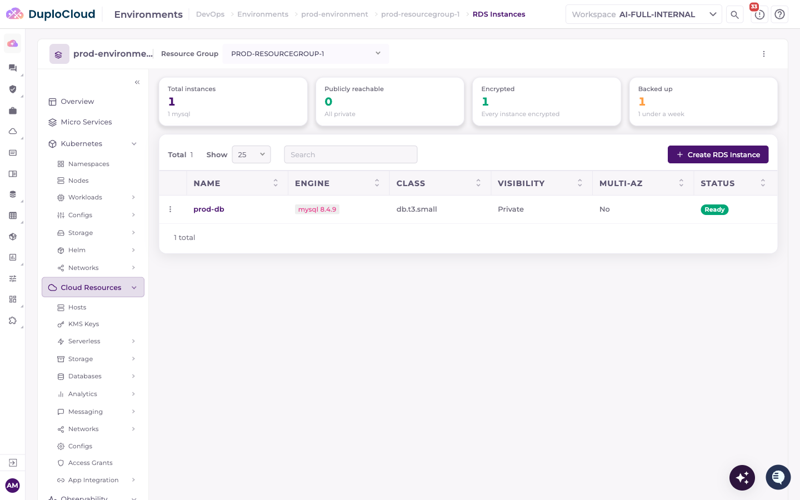

### Step 2 — Basics

Fill in the **Basics** step:

* **Name**: used as the AWS `DBInstanceIdentifier` (for example `orders-db`)
* **Description**: optional
* **Restore from snapshot**: turn on to create the instance from an existing snapshot. The engine, version, credentials and storage size come from the snapshot.

Click **Next**.

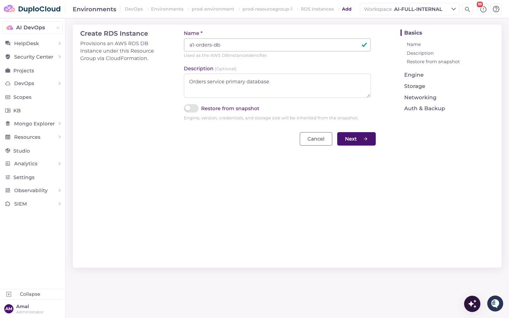

### Step 3 — Engine

* **Engine**: `mysql`, `mariadb`, `postgres`, or one of the Oracle and SQL Server editions
* **Engine Version**: the versions available in the Resource Group's region. The list is cached for 6 hours.
* **DB Instance Class**: the classes available for that engine and version (for example `db.t4g.small`)
* **Initial DB Name**: optional; defaults to the instance name

Click **Next**.

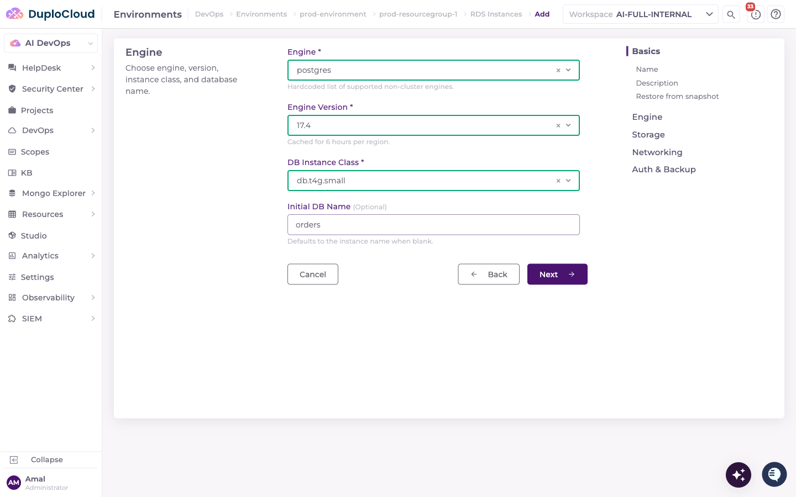

### Step 4 — Storage

* **Allocated Storage (GiB)**: the starting size
* **Enable storage autoscaling**: lets AWS grow the volume as it fills, up to the **Maximum Allocated Storage** you set. The maximum must be larger than the allocated storage.
* **Storage Type**: optional; `gp3`, `gp2`, `io1`, `io2` or magnetic (`standard`)
* **IOPS**: shown for storage types that support provisioned IOPS. It's required for `io1` and `io2`, and optional for `gp3`.
* **Storage Encryption**: **Encrypt with Resource Group KMS key**, **Encrypt with AWS-managed default key** (`aws/rds`), or **No encryption**
* **Storage KMS Key**: optional, shown when you encrypt with the Resource Group key. Leave it blank to use the Resource Group's default key.

Click **Next**.

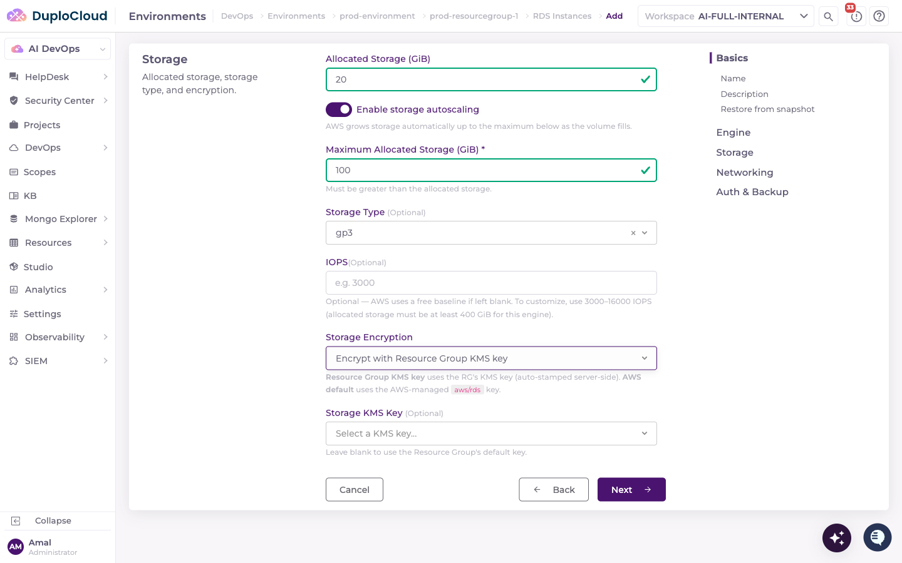

### Step 5 — Networking

* **Visibility**: **Private (recommended)** places the instance in the network's private subnets. **Public** makes it publicly accessible.
* **Multi-AZ deployment**: turn on to keep a standby copy in a second Availability Zone
* **Availability Zone**: optional; leave it blank to let AWS choose. AWS picks the zones itself for Multi-AZ deployments.
* **DB Subnet Group Name**: optional; leave it blank to use the network's managed subnet group, or pick or type the name of another group in the same VPC

Click **Next**.

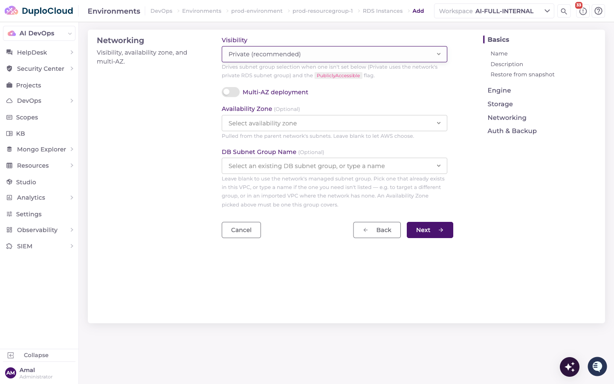

### Step 6 — Auth & Backup

* **Master Username**: the database admin user
* **Store credentials in AWS Secrets Manager**: AWS generates and rotates the master password, and the secret's ARN is shown on the instance after provisioning. Turn it off to enter a **Master Password** yourself. A password you enter is stored encrypted and sent to AWS only as a hidden CloudFormation parameter.
* **Backup Retention (days)**: `0` turns off automated backups; the maximum is 35
* **Deletion protection**: blocks the instance from being deleted until you turn it off

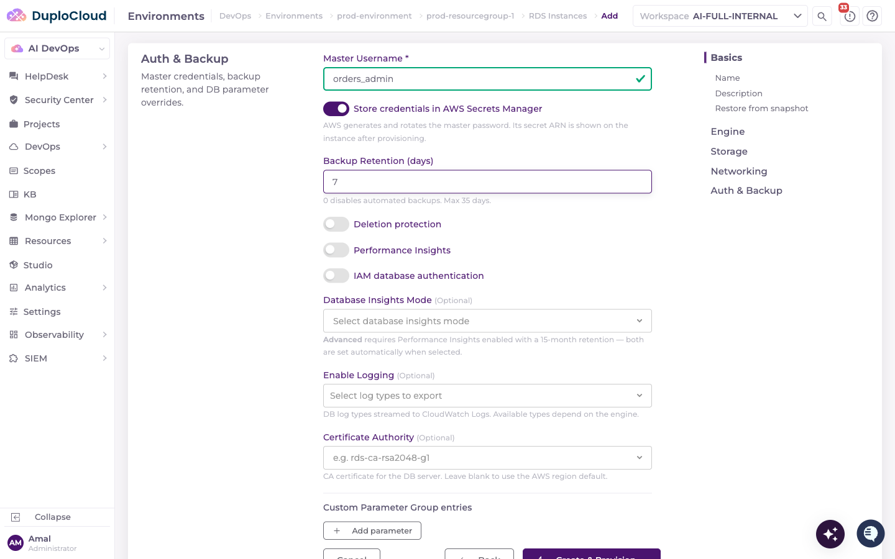

Scroll down for the optional settings:

* **Performance Insights**: turn on query-level monitoring, then choose its encryption key and retention. Not every instance class supports it, and the wizard warns you when the selected class doesn't.
* **IAM database authentication**: lets users sign in with IAM as well as a password
* **Database Insights Mode**: **Standard** or **Advanced**. Advanced turns on Performance Insights with 15-month retention.
* **Enable Logging**: the database log types to stream to CloudWatch Logs; the choices depend on the engine
* **Certificate Authority**: the CA certificate for the database server; leave it blank for the region's default
* **Custom Parameter Group entries**: name and value pairs added to the instance's parameter group

Click **Create & Provision**.

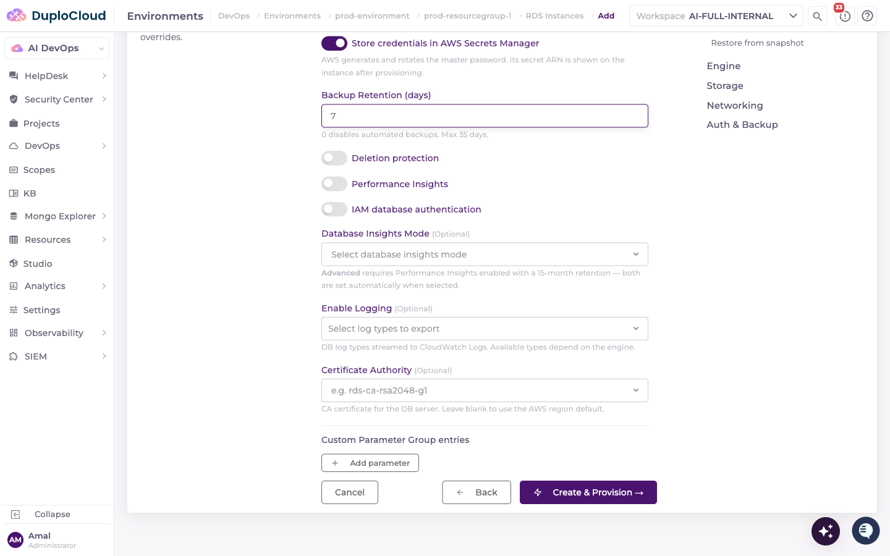

### Step 7 — The agent provisions the instance

The instance's page opens with the status **Provisioning**. Click **Track Status** to open the agent's ticket, **AWSRdsInstance Resource Management - \<name\>**. The agent uses the `duplo-aws-resources` skill and works through these phases:

* **Phase 0 — Acknowledge**: confirms the spec file and credentials are present and marks the request as received
* **Phase 0.5 — AWS env setup**: points the AWS CLI at the ticket's own credentials

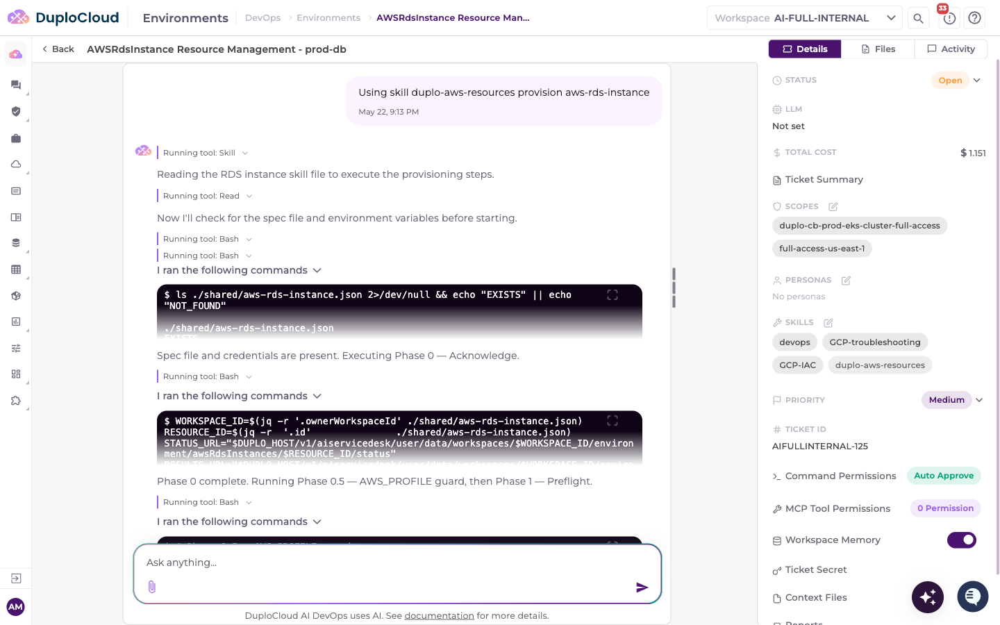

* **Phase 1 — Preflight**: reads the spec, validates it, works out the parameter group family (for example `postgres17`) and the CloudFormation stack name, and adds any custom parameter group entries to the template
* **Phase 2 — Submit CloudFormation stack**: deploys the stack, creating it the first time and updating it on later runs
* **Phase 4 — Poll CloudFormation events**: posts progress until the stack finishes
* **Phase 5 — Finalize**: writes the results back to the instance and marks it **Ready**

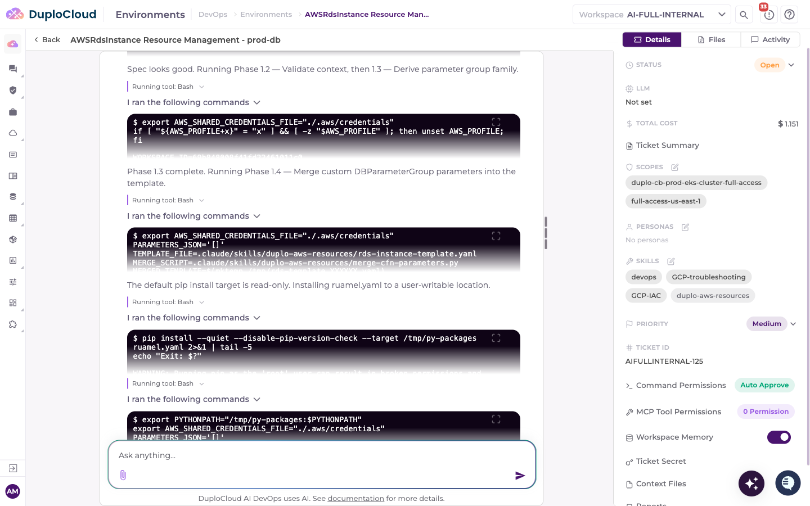

### Step 8 — RDS instance ready

When provisioning finishes, the instance's status changes to **Ready**. The **Overview** tab shows the engine and version, instance class, AWS status, port, Availability Zone, Multi-AZ and public-access settings, the **Endpoint** your applications connect to, and the CloudFormation stack that manages the instance.

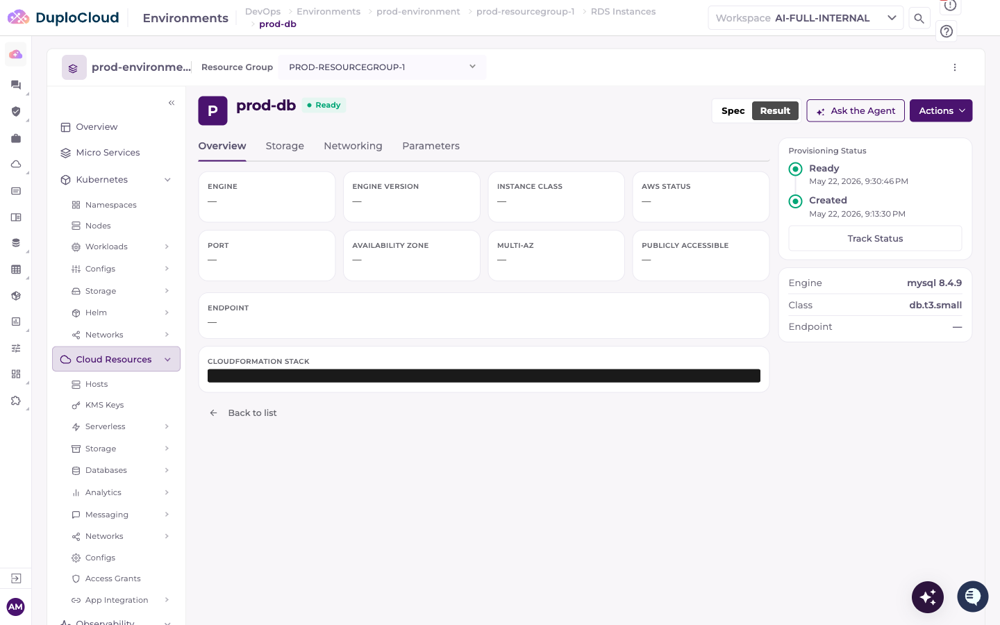

The other tabs show the rest of the configuration:

* **Storage**: allocated and maximum storage, storage type, IOPS and encryption
* **Networking**: the subnet group, subnets and security groups
* **Parameters**: the parameter group and any custom entries
* **Snapshots**: the instance's snapshots

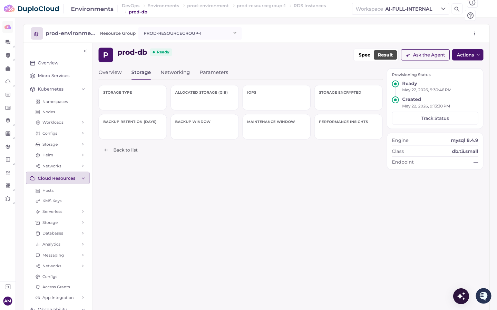

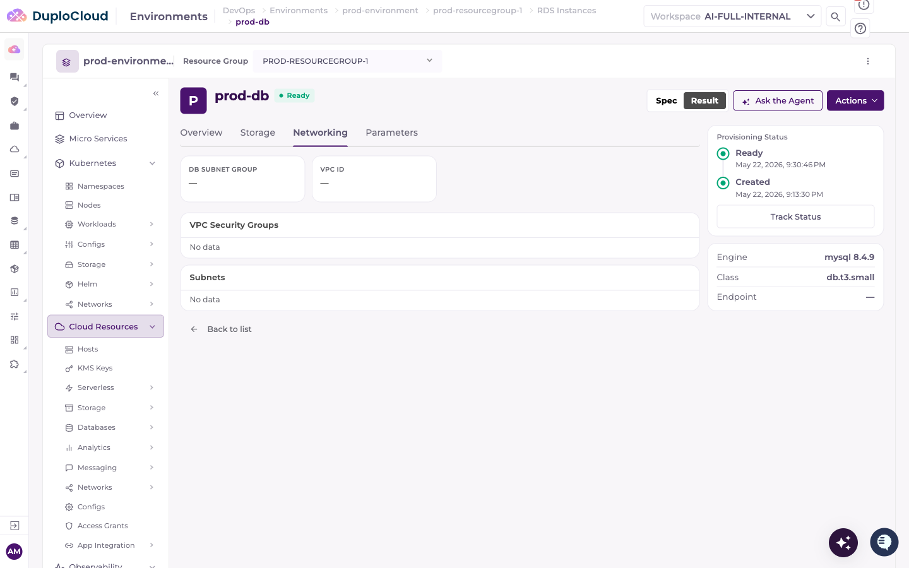

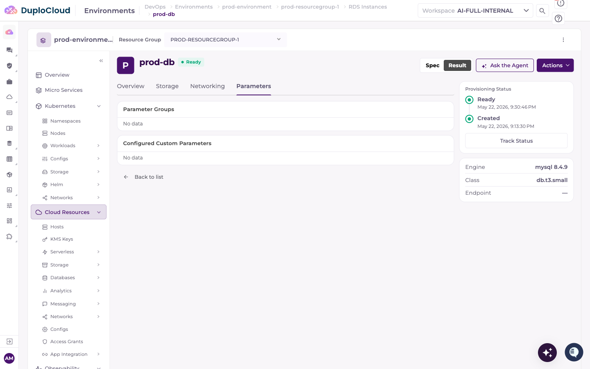

***

## RDS Cluster (Aurora)

An Aurora cluster has one writer instance and up to three reader instances that share the cluster's storage.

### Step 1 — RDS Clusters list

In the Resource Group sidebar, open **Cloud Resources → Databases → RDS → Clusters**. The list shows each cluster's engine, mode, instance count, visibility and status. Click **Create RDS Cluster** to start.

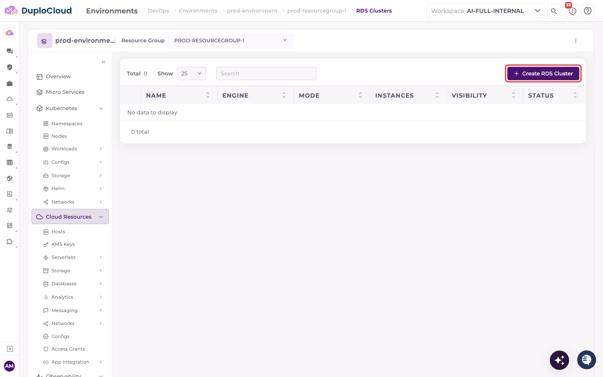

### Step 2 — Basics

* **Name**: used as the AWS `DBClusterIdentifier`
* **Description**: optional
* **Restore from cluster snapshot**: turn on to create the cluster from an existing cluster snapshot. The engine, version and credentials come from the snapshot.

Click **Next**.

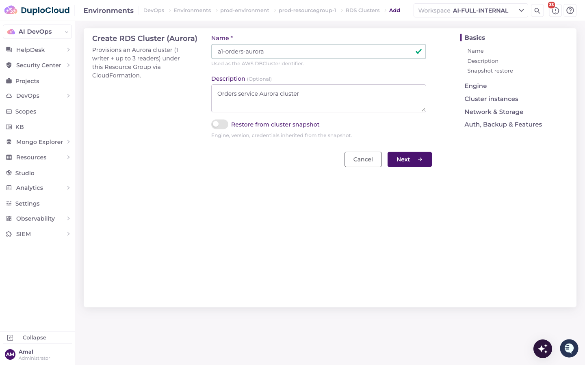

### Step 3 — Engine

* **Engine**: `aurora-mysql` or `aurora-postgresql`
* **Engine Version**: the versions available in the Resource Group's region
* **Engine Mode**: **Provisioned** (you choose an instance class for each member) or **Serverless v2** (capacity scales between the **Min ACUs** and **Max ACUs** you set)
* **Initial DB Name**: optional; defaults to the cluster name

Click **Next**.

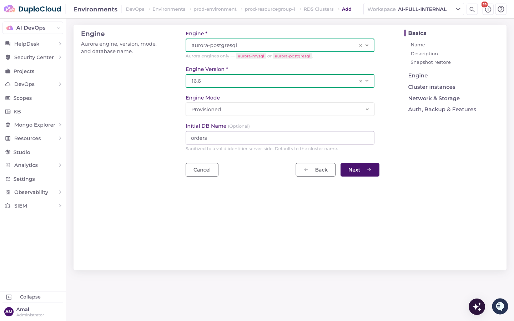

### Step 4 — Cluster Instances

Add one to four cluster members. The first is the writer. For each member, set:

* **Name**
* **DB Instance Class**: pick from the classes available for the engine version, or type one in (for example `db.t4g.medium`, or `db.serverless` for Serverless v2 members)
* **Availability Zone**: optional

Click **Add instance** to add a reader. Click **Next**.

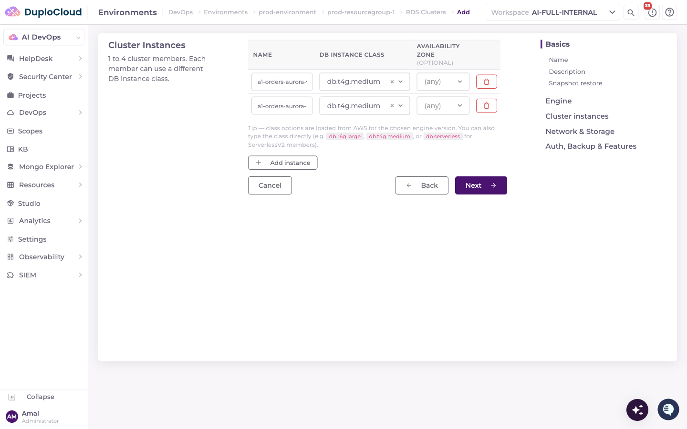

### Step 5 — Networking & Storage

* **Visibility**: **Private (recommended)** or **Public**
* **DB Subnet Group Name**: optional; leave it blank to use the network's managed subnet group
* **Storage Type**: `aurora` (standard) or `aurora-iopt1` (I/O-Optimized)
* **Storage Encryption**: Aurora always encrypts storage. Choose the **Resource Group KMS key** or the **AWS-managed default key**. With the Resource Group key you can also pick a specific **Storage KMS Key**.

Click **Next**.

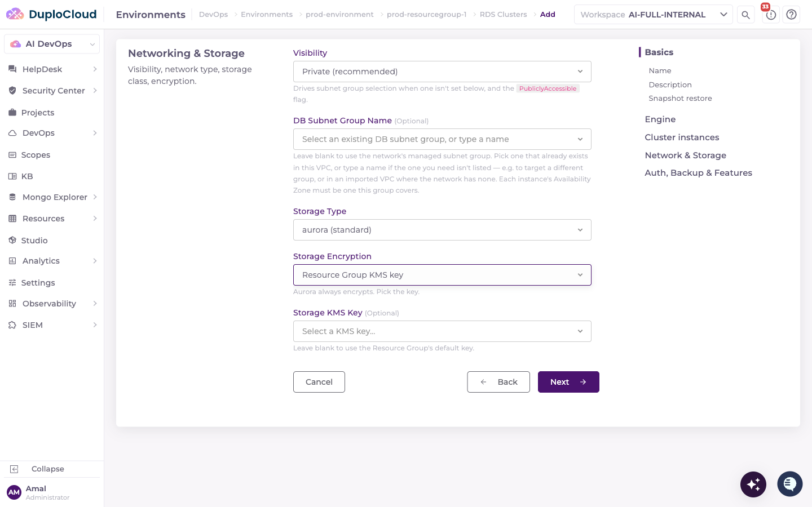

### Step 6 — Auth, Backup & Cluster Features

* **Master Username** and **Master Password**: the database admin credentials. The password is stored encrypted.
* **Backup Retention (days)**: 1 to 35
* **Backup Window (UTC)** and **Maintenance Window (UTC)**: optional; leave the start empty to let AWS choose
* **Deletion protection**
* **IAM database authentication**
* **Enable Aurora Data API (HTTP endpoint)**: lets applications run SQL over HTTPS without a database driver
* **Performance Insights**: with its own encryption and retention settings, applied to every member
* **CloudWatch Log Exports**: the log types to stream to CloudWatch Logs
* **Database Insights Mode**: **Standard** or **Advanced**
* **Backtrack Window (seconds)**: Aurora MySQL only; how far back you can rewind the cluster without restoring from a backup
* **Custom Cluster Parameter Group entries**: name and value pairs for the cluster parameter group

Click **Create & Provision**.

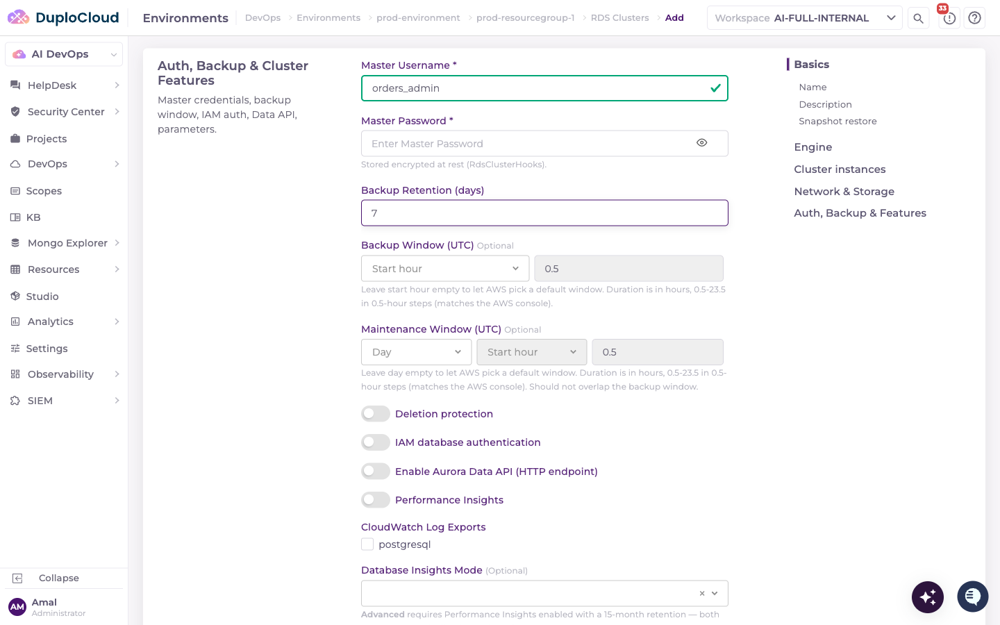

### Step 7 — The agent provisions the cluster

As with an RDS instance, the cluster's page opens with the status **Provisioning**, and **Track Status** opens the agent's ticket. The phases match the RDS instance's, with one extra step in Phase 1: the agent maps each cluster member onto the CloudFormation template, so each member becomes its own instance in the stack. When the stack finishes, the cluster's status changes to **Ready**. Its page shows the engine, the number of instances and the **Writer Endpoint**. From **Actions** you can start or stop the cluster, take a manual snapshot, or reboot a single member.


When you delete a cluster, the agent turns off deletion protection, deletes the stack, and AWS takes a final cluster snapshot automatically. You can create a new cluster from that snapshot later, using **Restore from cluster snapshot**.


***

## ElastiCache

### Step 1 — ElastiCache list

In the Resource Group sidebar, open **Cloud Resources → Databases → ElastiCache**. Summary cards show how many caches you have, how many are encrypted, how many have snapshots and how many are Multi-AZ. The list shows each cache's engine, cluster mode, topology and status. Click **Create ElastiCache** to start.

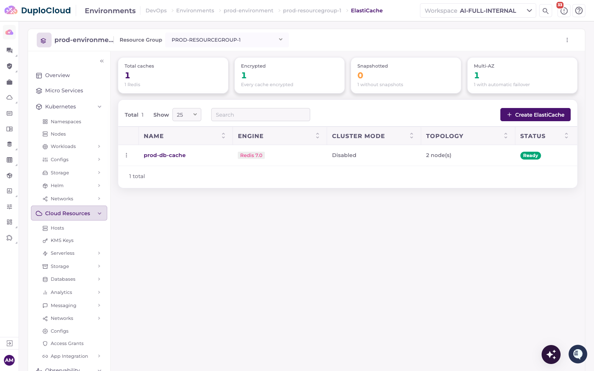

### Step 2 — Basics

* **Name**: used as the AWS `ReplicationGroupId` for Redis and Valkey, or the `CacheClusterId` for Memcached
* **Description**: optional

Click **Next**.

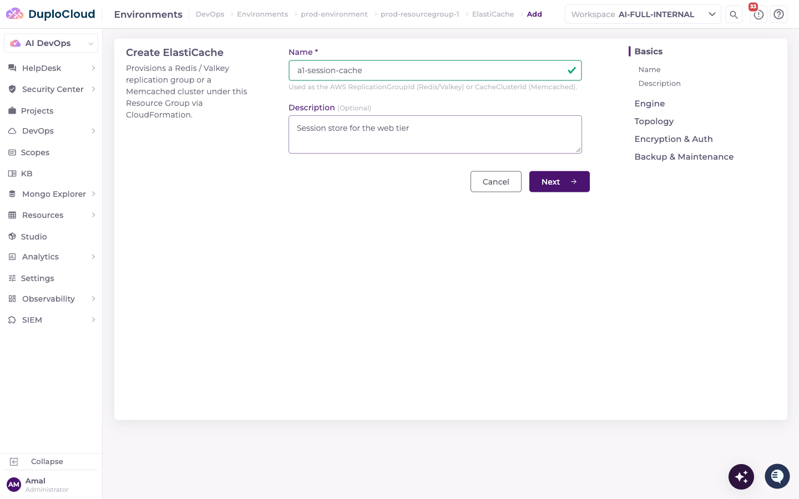

### Step 3 — Engine

* **Engine**: **Redis**, **Valkey** or **Memcached**
* **Engine Version**: the versions available in the Resource Group's region. When you restore from a snapshot, the version comes from the snapshot.
* **Cache Node Type**: for example `cache.t4g.small`
* **Port**: defaults to `6379` for Redis and Valkey and `11211` for Memcached
* **Restore source** (Redis and Valkey only): **None (fresh)**, **ElastiCache snapshot**, or **S3 RDB seed** (one or more `.rdb` files in S3)

Click **Next**.

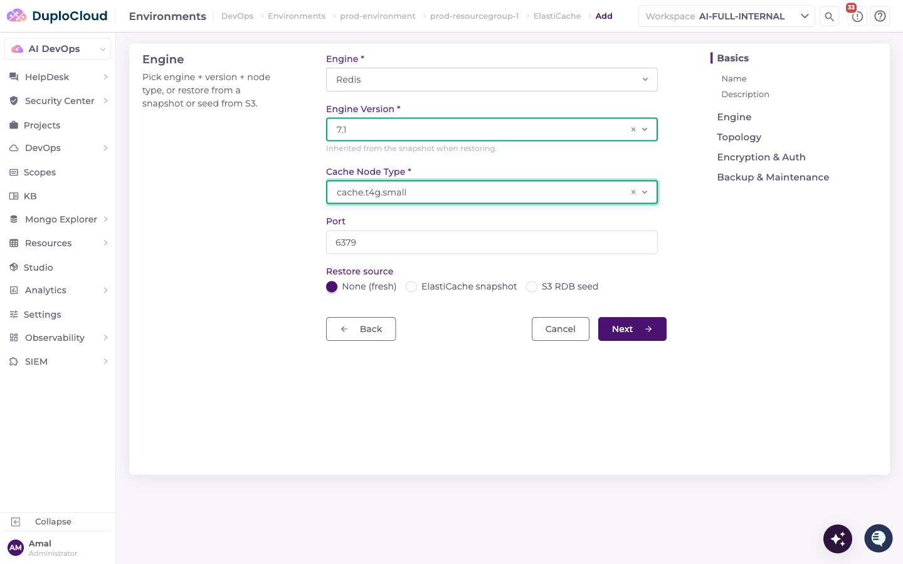

### Step 4 — Topology

For Redis and Valkey, choose a **Cluster Mode**:

* **Disabled**: a single shard with one primary and replicas. Set the **Number of Cache Clusters** (1 primary + N replicas, up to 6).
* **Enabled**: a sharded cluster. Set the **Number of Shards** and the **Replicas Per Shard**.

Multi-AZ and automatic failover are turned on for you whenever the topology has replicas.

For Memcached, set the **Number of Cache Nodes** (1 to 40), the **AZ Mode** (**Cross-AZ** or **Single-AZ**; a single node must be Single-AZ) and, optionally, the **Preferred Availability Zones**. Memcached has no replication; each node holds part of your data.

Click **Next**.

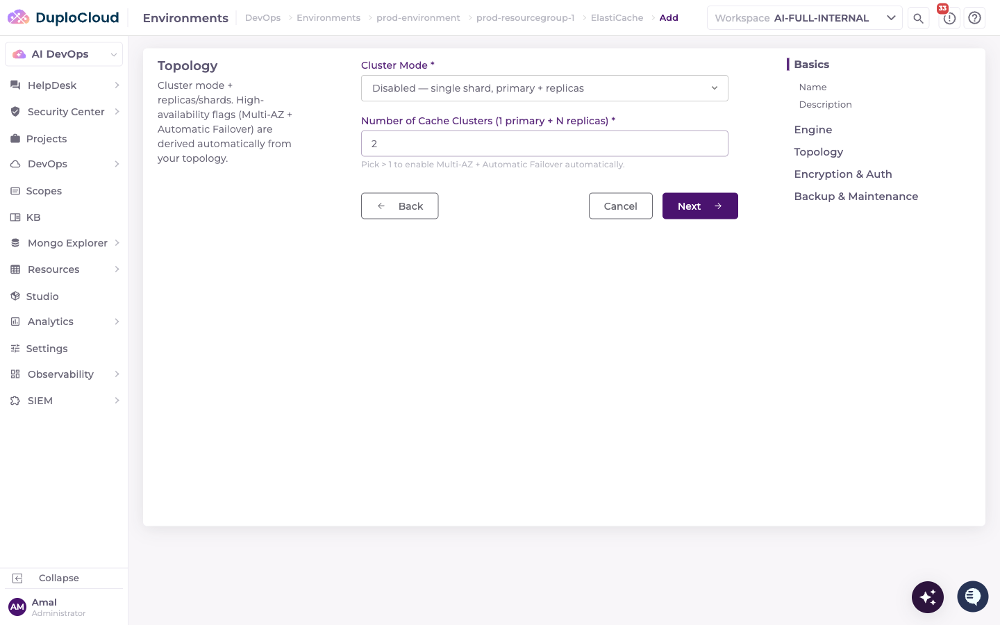

### Step 5 — Encryption & Auth

For Redis and Valkey:

* **At-Rest Encryption**: **Resource Group KMS key (recommended)**, **AWS-managed default ElastiCache key**, or **No encryption**. With the Resource Group key you can also pick a specific **KMS Key**.
* **Transit Encryption (TLS)**: requires TLS on every client connection
* **Auth Token**: required when TLS is on; 16 to 128 characters

Memcached supports only transit encryption, on engine version 1.6.12 and later.

Click **Next**.

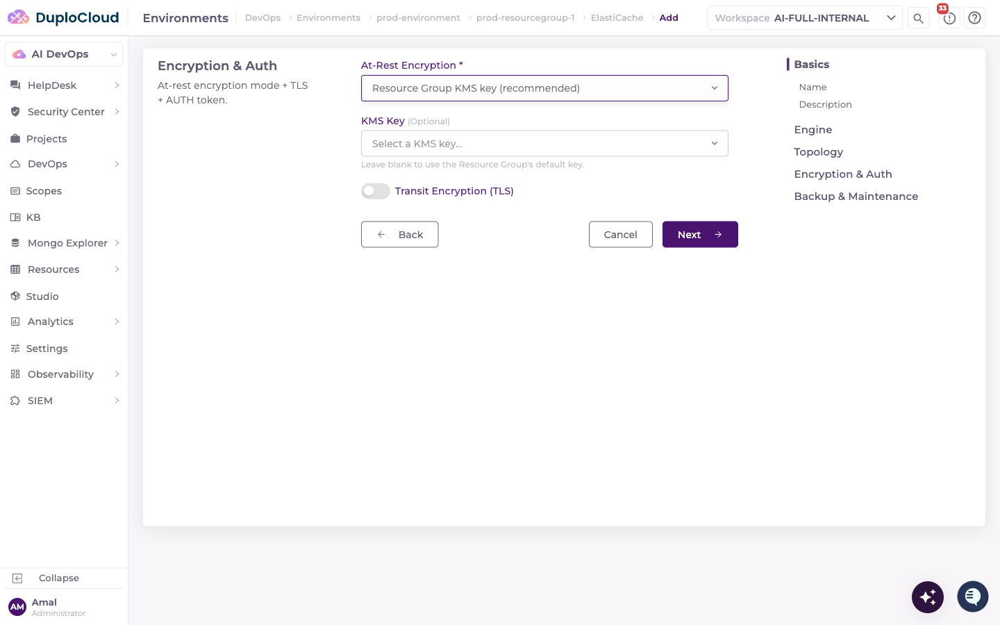

### Step 6 — Backup & Maintenance

* **Snapshot Retention (days)**: Redis and Valkey only; `0` turns off automatic snapshots
* **Snapshot Window (UTC)**: optional; leave the start empty to let AWS choose
* **Maintenance Window (UTC)**: optional; it shouldn't overlap the snapshot window
* **Auto Minor Version Upgrade**: applies minor engine upgrades during the maintenance window
* **Data Tiering**: Redis and Valkey only, and only on `cache.r6gd.*` node types
* **Parameter Group Overrides**: optional name and value pairs

Click **Create**.

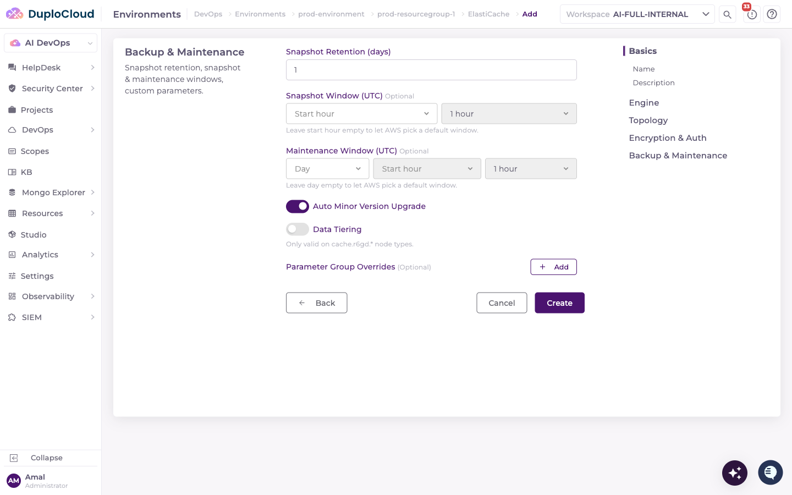

### Step 7 — The agent provisions the cache

The cache's page opens with the status **Provisioning**. Click **Track Status** to open the agent's ticket, **AWSElastiCache Resource Management - \<name\>**. The agent reads the ElastiCache skill and the spec, then runs **Phase 0 — Acknowledge**, **Phase 0.5** (AWS credentials) and **Phase 1 — Preflight**.

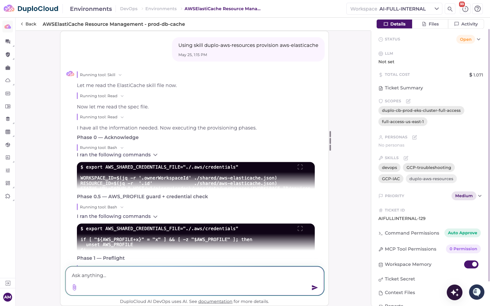

Phase 1 validates the spec, works out the parameter group family and the CloudFormation stack name, and adds any parameter group overrides to the template.

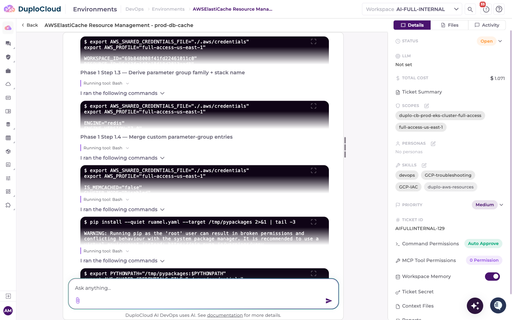

In **Phase 2** the agent checks whether the stack already exists and then deploys it.

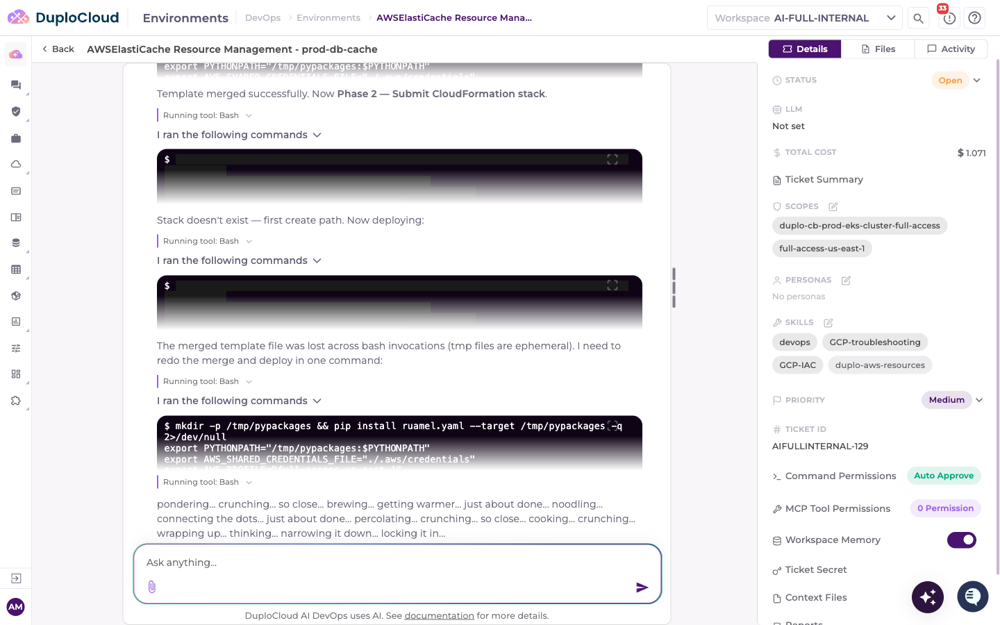

In **Phase 4** it polls the stack until it reaches `CREATE_COMPLETE`, and in **Phase 5** it writes the results back and posts a summary with the engine, node type, topology, encryption settings and endpoints.

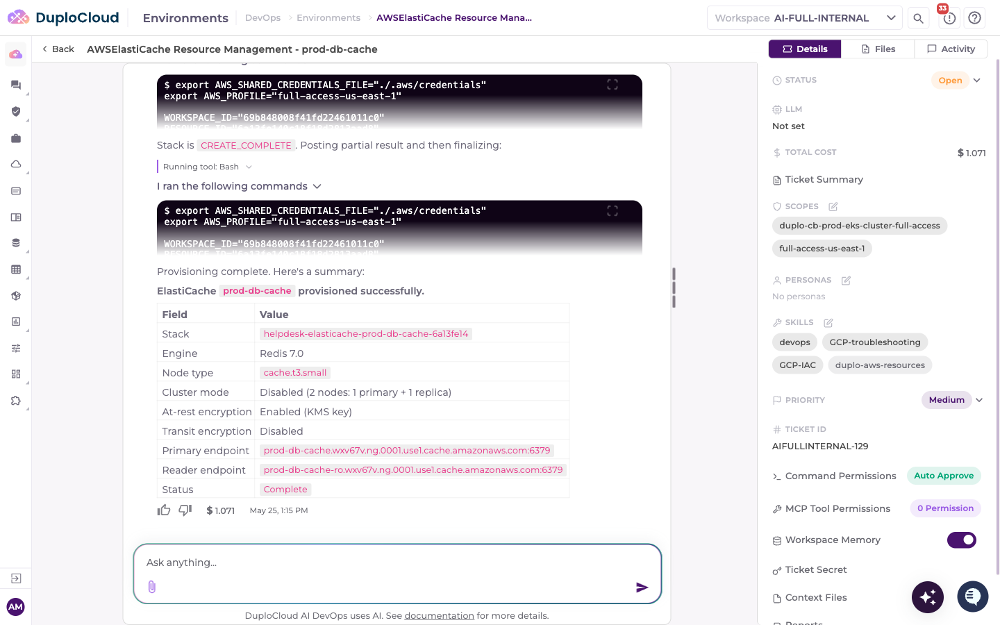

### Step 8 — ElastiCache ready

The cache's status changes to **Ready**. The **Overview** tab shows the engine and version, cluster mode, AWS status, port, node type, the **Primary Endpoint** for writes, the **Reader Endpoint** that spreads reads across replicas, and the CloudFormation stack.

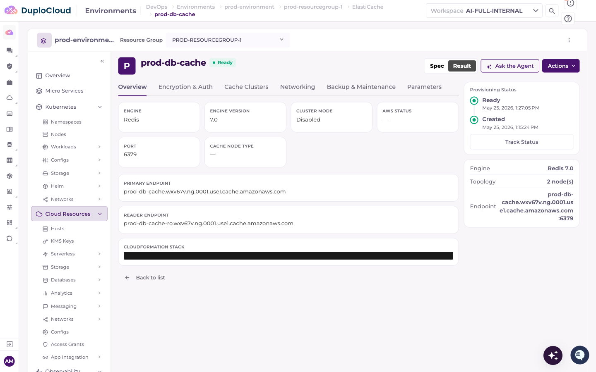

The **Cache Clusters** tab shows the topology. The **Shards / Node Groups** table lists each shard with its endpoints, and the **Cache Cluster Nodes** table lists each node with its type, status, Availability Zone and engine version. The **Encryption & Auth**, **Networking**, **Backup & Maintenance** and **Parameters** tabs show the rest of the configuration.

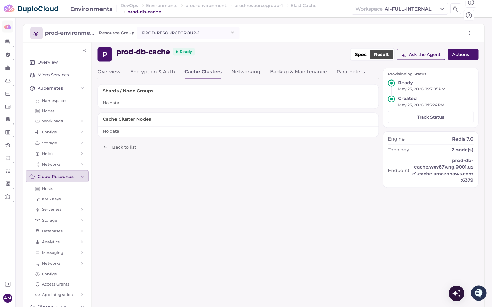
