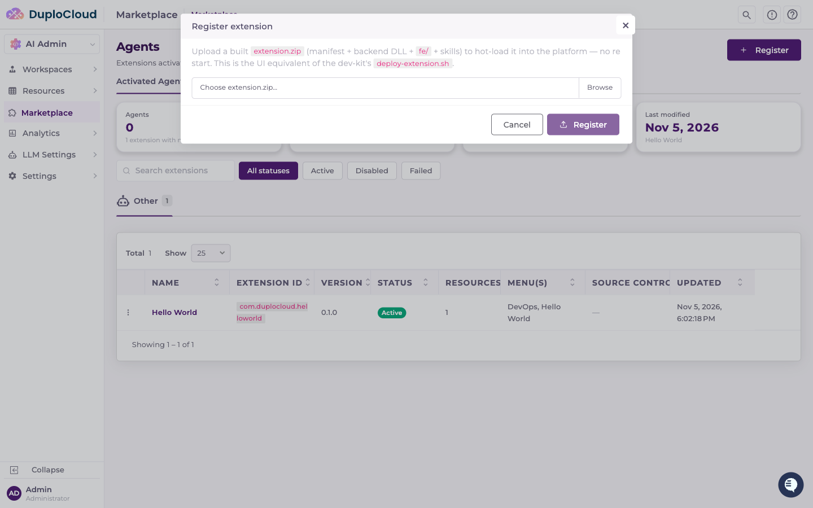

# Deploy Your Own Agents

You can deploy agents you build yourself to your own portal today. You build an agent in the [DevKit](install-the-devkit.md) on your machine, and the build produces one file, `extension.zip`. Getting that file into your portal takes one of three routes:

| Route | Best for |
| --- | --- |
| [Upload it in the portal](#upload-it-in-the-portal) | A one-off install, or trying a build on a portal you don't script against |
| [Push it from the DevKit or CI](#push-it-from-the-devkit-or-ci) | Day-to-day work: every build lands in your portal, and CI can deploy on every merge |
| [Install it from GitHub releases](#install-it-from-github-releases) | Letting portal admins choose and update versions in the portal, from releases your CI cuts |

All three load the agent without restarting the portal. Your agent stays private: only DuploCloud can list an agent in the public [Agent Marketplace](marketplace.md).


A free license limits how many agents a portal can run. The [License](licensing.md) page in your portal shows your limits.


## Before you start

* A portal running in your cloud. See [Deploy Your Portal to Your Cloud](installation/README.md).
* The **Administrator** role on that portal.
* An agent built in the DevKit. To build one, see [Build your first extension](https://github.com/duplocloud/devkit/blob/main/docs/getting-started/build-your-first-extension.md) in the DevKit repository. To build it on its own:

  ```bash
  ./scripts/build-extension.sh extensions/<name>
  ```

  The bundle lands in `extensions/<name>/dist/extension.zip`.

***

## Upload it in the portal



### Open the Marketplace

In your portal, go to **AI Admin → Marketplace** and click **Register**. If your sidebar still says **Extensions**, you're on a release from before the Extensions → Agents rename: go to **AI Admin → Extensions** instead. The screens are the same.



### Choose the file

Choose your `extension.zip` and click **Register**.





The agent loads straight away and appears under **Installed Extensions** (**Activated Agents** in the renamed portal). To update it later, register a zip with a higher `version` in its `manifest.json`. For managing installed agents (disabling, deleting, and checking what each one adds), see [Agents](../armor/extensions.md).

***

## Push it from the DevKit or CI

The DevKit's build and deploy scripts work against your local DevKit stack by default. Point them at your portal instead with three settings in the DevKit's `.env`:

```bash
DUPLO_TARGET=remote
DUPLO_HOST=https://<your-portal-host>
DUPLO_TOKEN=<an Administrator API token for that portal>
```

* `DUPLO_HOST` is your portal's base URL, over HTTPS, with no trailing path.
* `DUPLO_TOKEN` is an API token for a user with the Administrator role. Create one from your **Profile** page. See [User Tokens](../armor/access-control/user-tokens.md).

Then build and deploy:

```bash
./scripts/build-extension.sh  extensions/<name>
./scripts/deploy-extension.sh extensions/<name>/dist/extension.zip
```

To build and deploy every agent in the repository at once, run `./scripts/build-all.sh` and then `./scripts/deploy-all.sh`. The `/duplo-extension` command in Claude Code also asks whether to build against your local stack or a remote portal. The full list of variables is under "Build and deploy target" in the DevKit's [configuration reference](https://github.com/duplocloud/devkit/blob/main/docs/configuration.md).

### From CI

Real environment variables take precedence over `.env`, so CI needs no `.env` file at all. The DevKit ships a GitHub Actions workflow, `.github/workflows/extension-ci.yml`, that builds every agent in your repository and deploys them to your portal on each push to `main`. Pull requests are only built. To use it, add two repository secrets:

* `DUPLO_HOST`: your portal's base URL
* `DUPLO_TOKEN`: an Administrator API token for that portal

The build downloads the portal's SDK from `DUPLO_HOST`, so the portal must be reachable from your CI runners. See [CI workflows](https://github.com/duplocloud/devkit/blob/main/docs/cli-reference.md#ci-workflows) in the DevKit's CLI reference.


`DUPLO_TOKEN` is an Administrator credential for your portal. Keep it in your CI's secret store, never in a committed `.env`.


***

## Install it from GitHub releases

The DevKit's release workflow, `.github/workflows/release.yml`, cuts a GitHub release with `extension.zip` attached each time you bump `version` in an agent's `manifest.json` and push to `main`. Portal admins can then install and update those releases from the **Extension Library** tab under **AI Admin → Extensions**, picking a version and reading its release notes before they install.


The Library lists the agents named in a registry file, `registry.yaml`, held in a GitHub repository. By default your portal reads DuploCloud's registry, so DuploCloud's own agents are listed. To list your own agents, point your portal at a registry repository of your own.



### Create a registry repository

Create a GitHub repository holding a `registry.yaml` at its root, with one entry per agent:

```yaml
apiVersion: v1
extensions:
  - id: com.example.billing          # the id in the agent's manifest.json
    name: Billing
    description: Billing reports for the finance team.
    category: Operations
    icon: 💳
    sourceRepo: example-org/billing-agent   # the repository whose releases carry extension.zip
```

DuploCloud's public [registry](https://github.com/duplocloud/duploai-extension-registry) shows the format. Copy its entries into yours if you also want DuploCloud's agents in your Library.



### Connect GitHub

In your portal, add a GitHub source-control provider and a scope named `github`. See [GitHub](integrating-providers/github.md). The scope's token needs read access to your registry repository and to every agent repository it lists. The Library uses that scope for every GitHub call, so private repositories work.



### Point your portal at your registry

Set the registry repository as an environment variable on the portal's backend, in your Helm values:

```yaml
backend:
  extraEnv:
    - name: Extensions__DefaultRegistryRepo
      value: example-org/agent-registry
```

Apply the change with a Helm upgrade.



### Install from the Library

Go to **AI Admin → Extensions → Extension Library** and click **Refresh**. Click **Install** on your agent, pick a version, and click **Install**.




The **Extension Library** tab is called **Agent Marketplace** in the renamed portal, and where it reads its list from is still changing. This route describes the current release.



If a release doesn't appear in the Library, check that it carries an asset named exactly `extension.zip` and that the `github` scope's token can read its repository.


***

## Which route should I use?

* **Uploading** is quickest when you have a zip in hand and want it running now. Nothing is tracked, and a portal admin repeats the upload for every new version.
* **Pushing from the DevKit or CI** suits the team building the agent. Each build replaces the running copy, and CI keeps the portal in step with `main`.
* **Installing from GitHub releases** suits portals run by people other than the agent's builders. Admins see the available versions with release notes and choose when to update.

***

## Signing (coming soon)

Portals will soon require signed agents by default, and refuse an agent without a valid signature. A signature proves that your company built the zip and that nobody has changed it since. To sign agents, your company will need:

* **A namespace** in the [DuploCloud console](https://console.duplocloud.com): a prefix that your agents' manifest ids must start with. By default it's your domain reversed, so a company on `example.com` names its agents `com.example.billing` and so on.
* **A signing key and its certificate**, created by your team in the console. The console shows the private key once, at creation. Store it as a CI secret.
* **Signing in CI**, with the DevKit's `.github/actions/extension-sign` action. It writes `extension.zip.sig` next to the zip. See "Signing a build" in the DevKit's [releasing guide](https://github.com/duplocloud/devkit/blob/main/docs/releasing-extensions.md).

Until signing is enforced, the three routes above work with unsigned agents.

***

## Next steps

* [Manage installed agents](../armor/extensions.md)
* [Browse and buy agents from DuploCloud](marketplace.md)
* [Learn the Agent Framework](../extension-framework/extension-framework.md)
