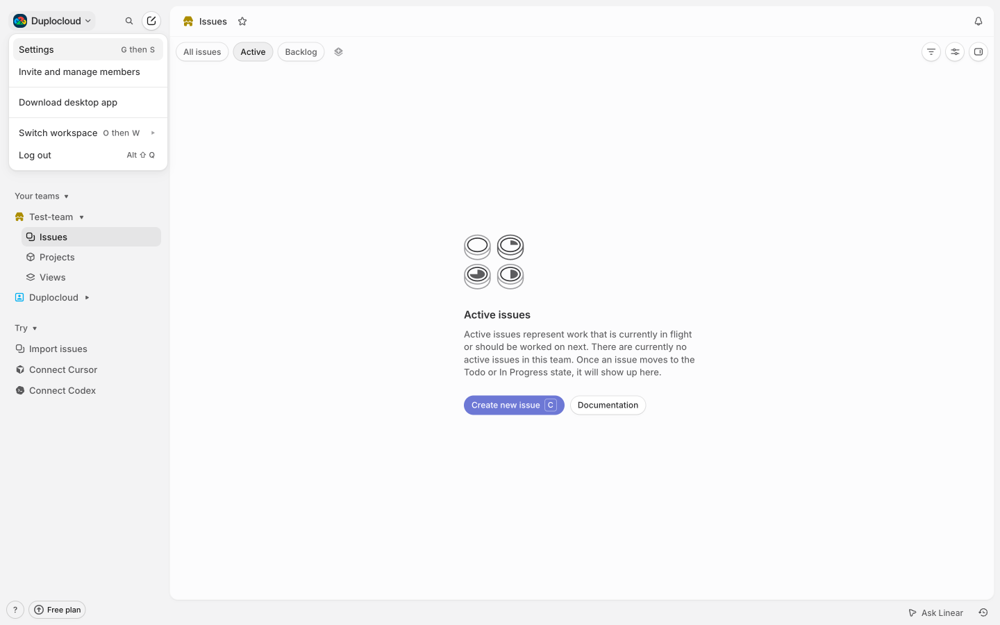
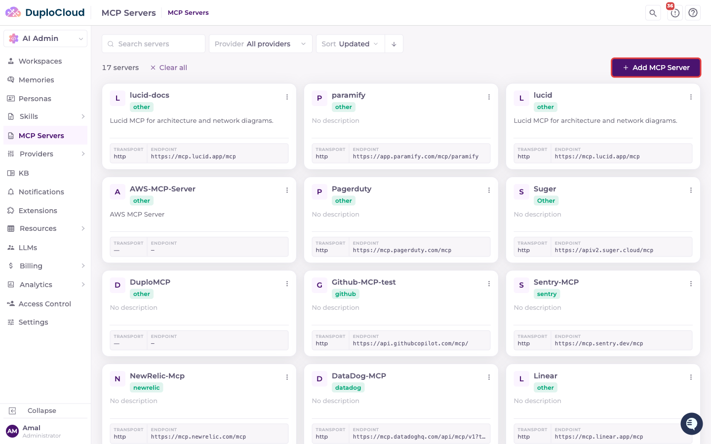
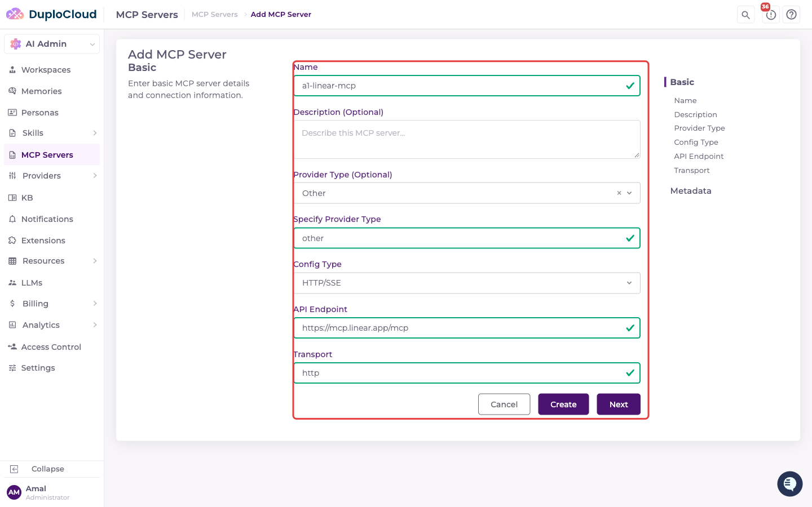
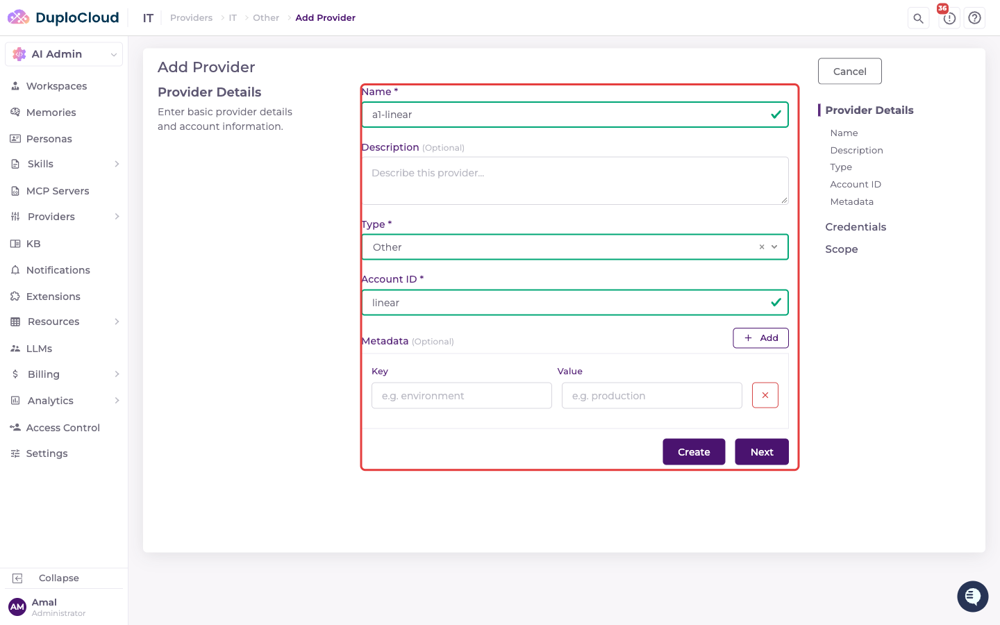
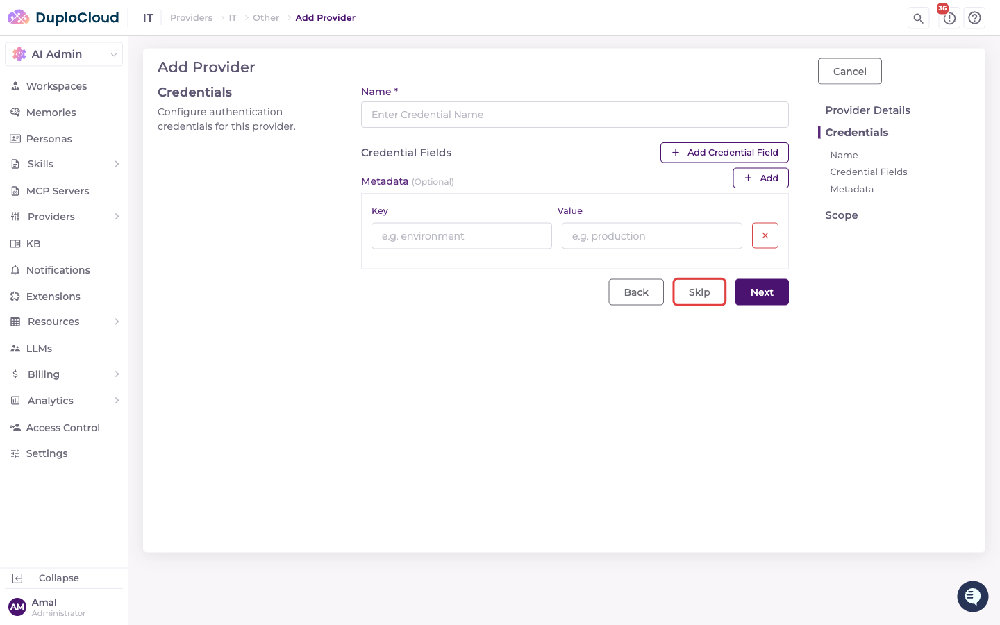
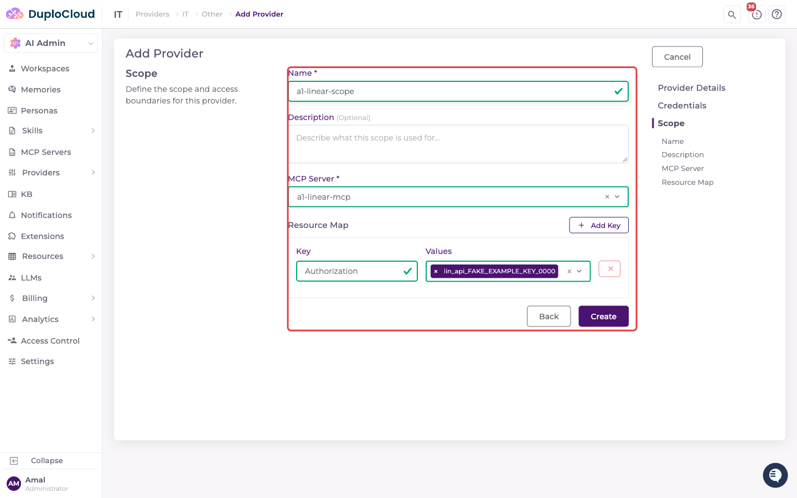
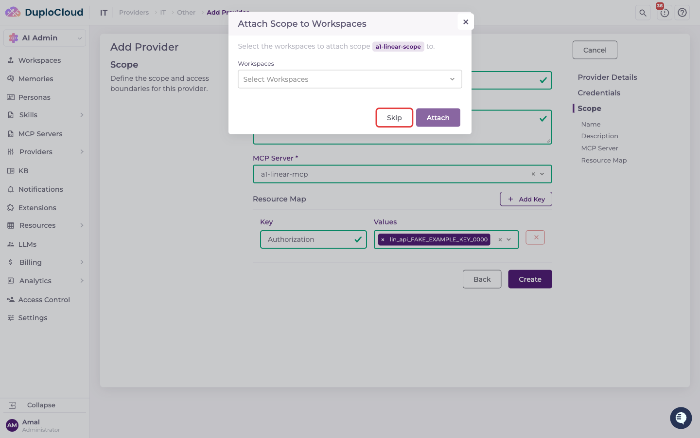

# Linear

This guide walks through connecting Linear to DuploCloud — registering the Linear MCP server, creating a provider and scope that carry your Linear API key, and querying Linear data through the AI agent.

It covers the Linear-specific values you need. For the general mechanics of MCP servers, providers and scopes, see [MCP Servers](../../armor/mcp-servers/README.md).

***

## Step 1 — Generate a Linear API Key

In Linear, open the workspace menu (top-left) and click **Settings**.

Navigate to **Security & access** in the left sidebar. Scroll down to the **Personal API keys** section and click **New API key**. Give it a name, click **Create**, and copy the generated key — it is only shown once.

***

## Step 2 — Register the Linear MCP Server

In DuploCloud, go to **AI Admin → MCP Servers** and click **+ Add MCP Server**.

Fill in the **Basic** section:

* **Name** — e.g. `Linear`
* **Provider Type** — select **Other** (the last entry in the list), then enter `other` in **Specify Provider Type**
* **Config Type** — **HTTP/SSE**
* **API Endpoint** — `https://mcp.linear.app/mcp`
* **Transport** — `http`


The server's provider type must be exactly `other`, matching the **Other** provider you create in Step 3. A scope can only use an MCP server whose provider type matches its provider's type, so any other value here makes the scope fail to save.


Click **Create**. (The **Metadata** section is optional — see [Registering an MCP server](../../armor/mcp-servers/README.md#stage-1-register-the-mcp-server).)

***

## Step 3 — Create the Provider and Scope

Go to **AI Admin → Providers → IT**, select the **Other** tab, and click **+ Add Provider**. The page walks through three sections in order — Provider Details, Credentials, and Scope — described in full under [Create the Provider, credential, and Scope](../../armor/mcp-servers/README.md#stage-2-create-the-provider-credential-and-scope).

**Provider Details**

* **Name** — e.g. `Linear`
* **Type** — **Other**
* **Account ID** — any identifying label; Linear does not require a specific account ID

Click **Next**.

**Credentials**

Click **Skip**. The Linear MCP server is an HTTP/SSE server, and those authenticate with the `Authorization` value in the scope's Resource Map, not with a provider credential.

**Scope**

* **Name** — e.g. `Linear`
* **MCP Server** — the Linear server registered in Step 2
* **Resource Map** — add one key:
  * **Key** `Authorization`, **Values** your Linear API key. The key name is case-sensitive; use `Authorization` exactly as written. The agent sends the value as a `Bearer` token, adding the `Bearer ` prefix if you leave it out.


Resource Map values are stored as plain configuration, not as a secret. Anyone who can view this scope in AI Admin can see the key.


Click **Create**, then choose which workspaces the scope should be available to, or click **Skip** to attach it later.

***

## Step 4 — Use Linear in a Ticket

Go to **HelpDesk** in the left-hand navigation and click **Add Ticket**. Click **Select Scopes** and choose your Linear scope — see [Creating a ticket](../../armor/tickets.md#step-3-select-scopes-optional). The scope appears only in workspaces it is attached to.

Describe what you want — for example, asking the agent to list your open Linear issues — and create the ticket. The agent connects to Linear through the MCP server and calls tools named `mcp__<server>__<tool>`, where `<server>` is the name you gave the server in Step 2.


By default the agent asks before running any MCP tool. To let Linear's tools run without prompting on a given ticket, set that under **MCP Tool Permissions** in the ticket's Details panel — see [Controlling which tools the agent may call](../../armor/mcp-servers/README.md#controlling-which-tools-the-agent-may-call).

