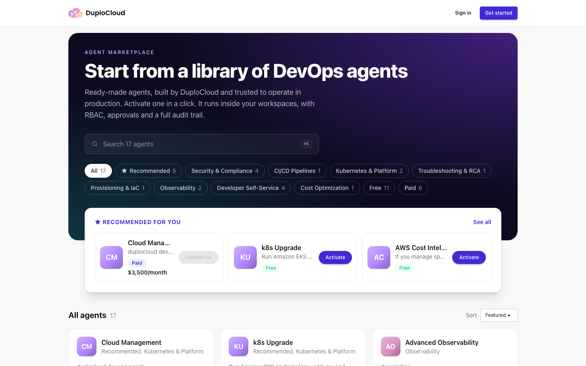
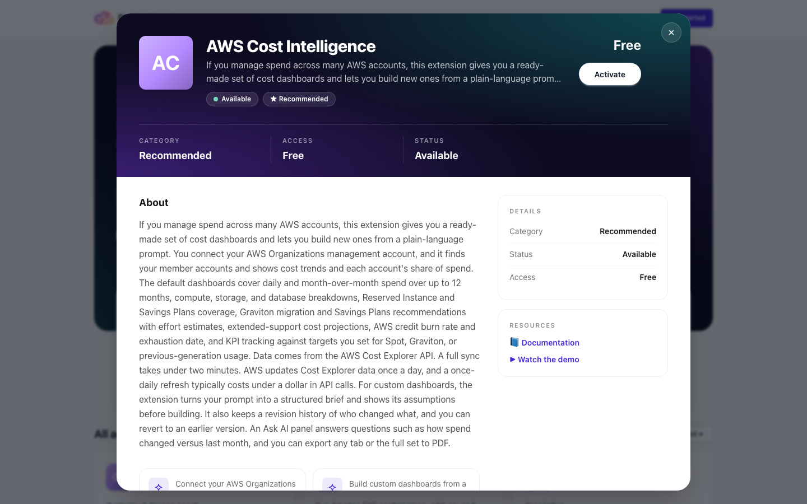

# Agent Marketplace and Buying Agents

The Agent Marketplace is the catalog of ready-made agents that DuploCloud publishes. You browse it on the web, and you install agents from inside your own portal. Some agents are included with DuploCloud. Others are paid, and your company buys them through the DuploCloud console.

This page covers the public catalog, buying, and billing. To install an agent in your portal, see [Agents](../armor/extensions.md). To build an agent of your own, see [Deploy Your Own Agents](deploy-your-own-agents.md).

***

## Browse the catalog

Go to [marketplace.duplocloud.com](https://marketplace.duplocloud.com). You don't need an account to browse.

You can search agents by name, filter them by category, or show only **Free** or **Paid** agents. **Recommended for you** highlights a few agents to start with. Each card shows the agent's categories, a short description, its status, and whether it's free or paid. Paid agents show their price when one is set.

Click an agent to open its details: what it does, its main features, its status and price, and links to its documentation or demo video when it has them. If the agent has published versions, the details also show the latest version and the release notes for each one. Every agent has its own link (`/agents/<id>`), so you can copy the address and share it.

The marketplace is for browsing. Use **Sign in** if you want to buy (see below). It uses your DuploCloud console account, though the two sign-ins are separate, so you may be asked to sign in again when you open the console.


Only DuploCloud can list an agent in the public catalog. An agent your company builds stays private to your company. See [Deploy Your Own Agents](deploy-your-own-agents.md).


***

## Included and paid agents

| | Included agents | Paid agents |
| --- | --- | --- |
| **Shown as** | **Free** | **Paid**, with a price when one is set |
| **Cost** | Included with your DuploCloud license | A price in US dollars, billed through the console |
| **To install** | Activate it in your portal | Buy it for your company, then activate it in your portal |

A paid agent's price has four parts:

* **Billing model**: per company, per environment, or one-time. A per-environment agent is bought for the environments you choose, so your company needs at least one environment first.
* **Billing interval**: monthly or yearly. Yearly agents are charged once a year.
* **Term**: month to month, or a 12-month commitment that you pay monthly.
* **Free trial**: some agents include trial days. A trial applies only to recurring purchases, and your company gets it once per agent.


A free license limits how many agents a portal can run. The [License](licensing.md) page in your portal shows your limits.


***

## Buy a paid agent

Buying needs the **Purchase agents** capability in the console. Built-in administrators have it. If you don't, you can send a request instead (see [Ask someone to buy an agent](#ask-someone-to-buy-an-agent)).



### Open the agent

Sign in at [marketplace.duplocloud.com](https://marketplace.duplocloud.com) and open the paid agent you want.



### Click Activate

The purchase wizard opens. If you belong to more than one company, choose the company you're buying for. For a per-environment agent, choose the environments to cover.



### Review and accept

The wizard shows what you'll pay, the term, and any free trial. The first time you buy for a company, you accept DuploCloud's purchase terms.



### Pay by card

Enter a card in the secure card field. Cards are the only payment method, and payments go through Stripe. If your bank asks you to authenticate (3D Secure), you finish that inside the wizard. The card becomes your company's default, so later purchases and every renewal are charged to it.



When the purchase completes, you get a confirmation email and the agent shows as **Owned**. Then install it in your portal. See [Agents](../armor/extensions.md).

### What the Activate button means

Once you're signed in, the button reflects the agent's state for your company:

| Button | Meaning |
| --- | --- |
| **Activate** | You can buy the agent, or request it if you can't buy. |
| **Requested** | You asked for this agent and the request is still open. |
| **Owned** | Your company already has the agent. |
| **Add environments** | Your company owns a per-environment agent, and some environments have no seat yet. |
| **Finish purchase** | An earlier purchase wasn't finished, for example because your bank is still waiting for authentication. |
| **Contact us** | You can't buy online right now. Hover over the button to see why, for example because the agent has no published price yet. |


Online checkout is opening agent by agent. If a paid agent only shows **Contact us**, email [sales@duplocloud.net](mailto:sales@duplocloud.net).


### Ask someone to buy an agent

If you don't have the **Purchase agents** capability, clicking **Activate** opens a **Request** step instead. Add an optional note and send it. Everyone at your company who can buy agents gets an email with a link to the checkout. If a colleague already asked for the same agent, your request joins theirs. When the agent is bought, everyone who asked is emailed.

***

## Manage your purchases

Open the [DuploCloud console](https://console.duplocloud.com) and go to **Agent billing**. From there you can:

* See your purchases, your saved card, and your invoices, with a PDF download for each invoice
* Update your card
* Cancel a purchase, or resume one you cancelled
* Change the seats on a per-environment purchase

Viewing needs the **View agent billing** capability, and changes need **Purchase agents**. Built-in administrators have both.

### Cancel a purchase

Choose the purchase in **Agent billing** and click **Cancel**. When it takes effect depends on the purchase:

| Purchase | When the cancellation takes effect |
| --- | --- |
| Free trial | Immediately. You're not charged. |
| Month to month or yearly | At the end of the period you've paid for |
| 12-month term | At the end of the term |
| One-time | Can't be cancelled |

You can click **Resume** at any time before that date to keep the agent.

If you uninstall an agent from your portal, the console can cancel the purchase for you. For a company-billed agent, removing its last install cancels the purchase. For a per-environment agent, uninstalling frees that environment's seat, but billing continues. Reinstalling before the end date undoes a cancellation caused by an uninstall. The people who can buy agents get an email each time this happens.

### Change seats

A per-environment agent has one seat per environment.

* **Add environments**: the extra seats are charged today, prorated for the rest of the current period. The new total applies from your next renewal.
* **Reassign**: move a seat from one environment to another. This is free and takes effect at once.
* **Reduce**: drop seats at your next renewal. At least one seat must remain, and the current period isn't refunded.

### Renewals and reminders

The people at your company who can buy agents get an email:

* 30 days before a yearly purchase or a 12-month term renews
* 3 days before a free trial ends and billing starts
* When DuploCloud publishes a new price for an agent you own. A new price applies from your next renewal, never mid-period.

For refunds, ending a 12-month term early, or extending a trial, contact [sales@duplocloud.net](mailto:sales@duplocloud.net).

***

## Next steps

* [Install an agent in your portal](../armor/extensions.md)
* [Build and deploy your own agent](deploy-your-own-agents.md)
* [Check your license limits](licensing.md)
