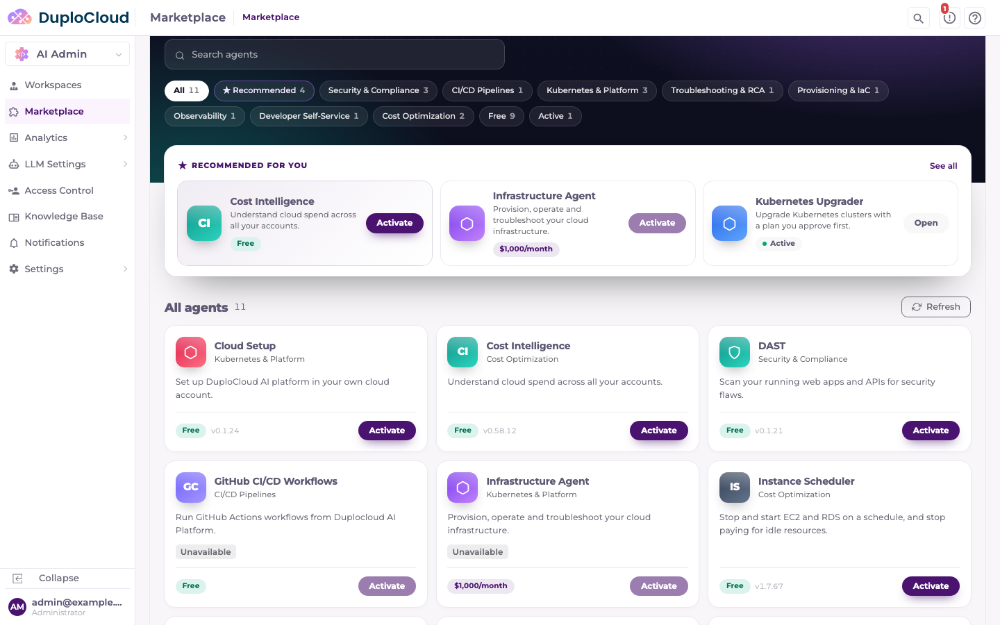
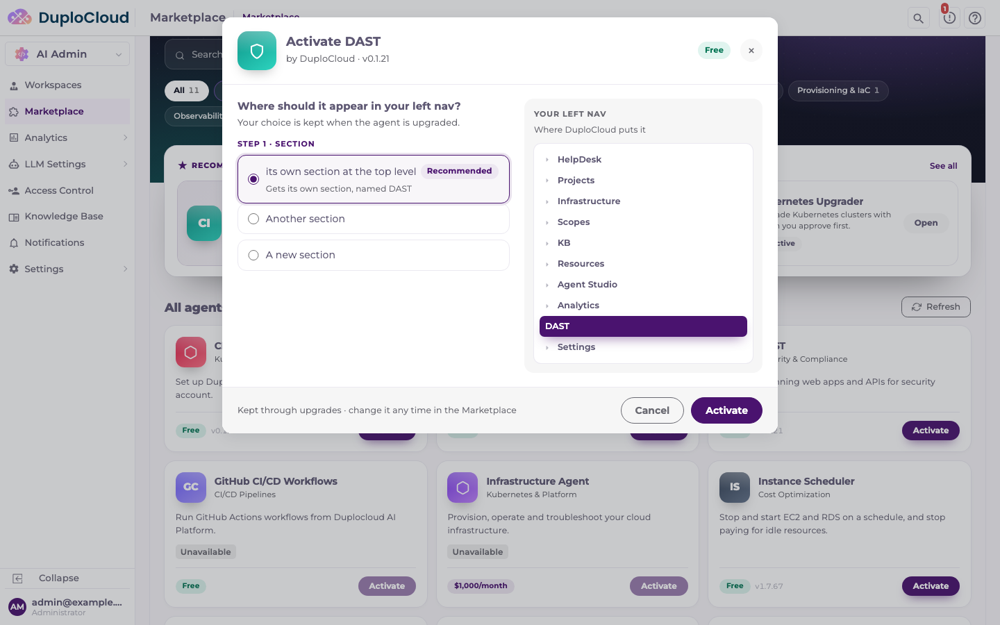
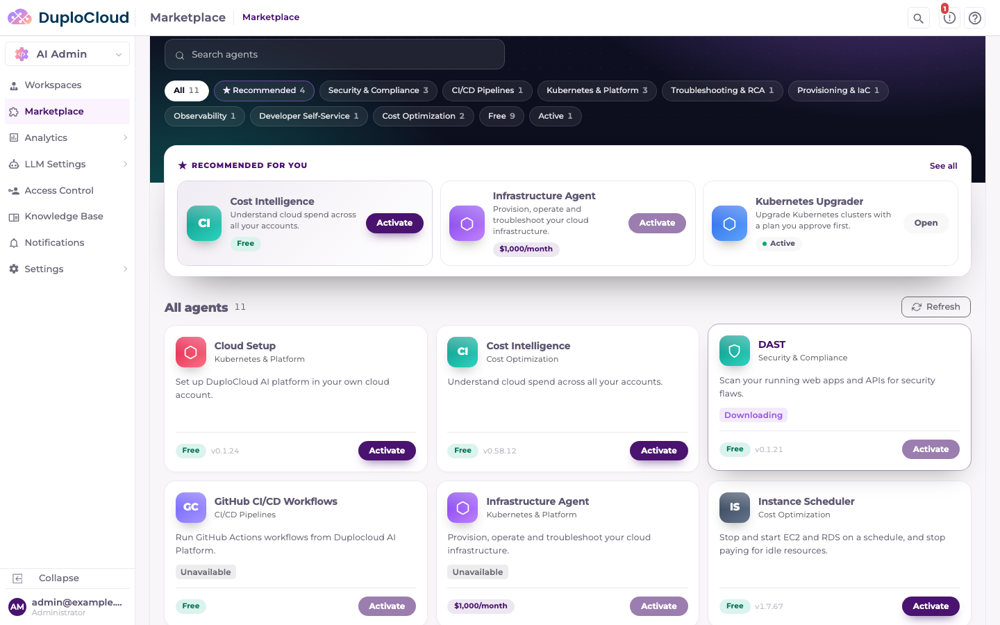
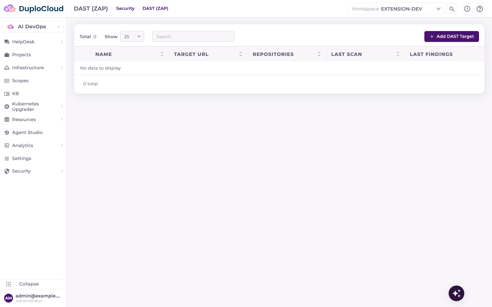
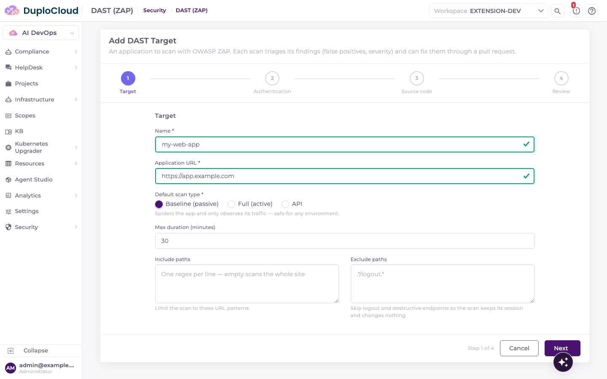
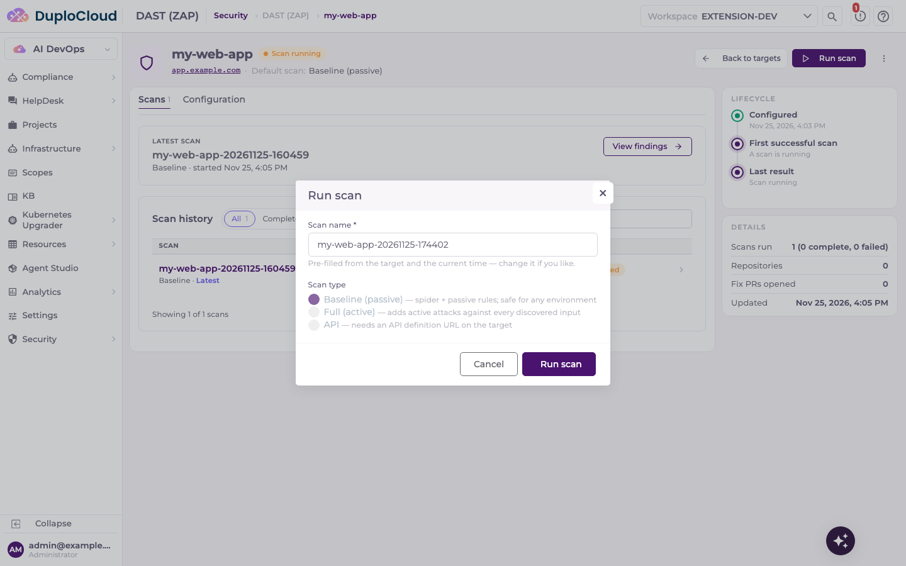
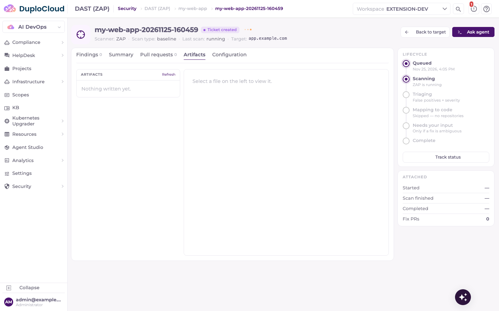
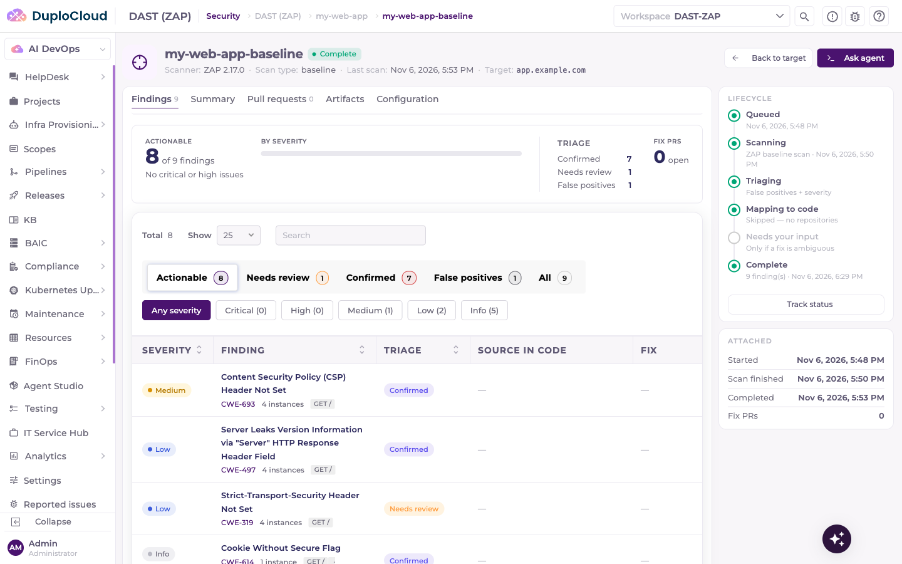
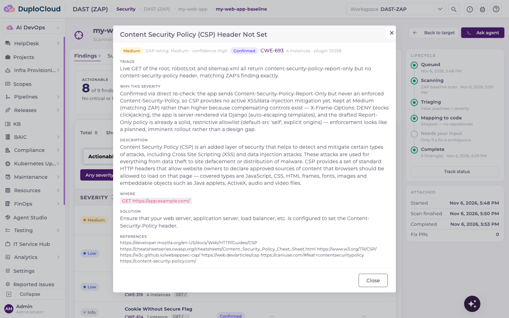
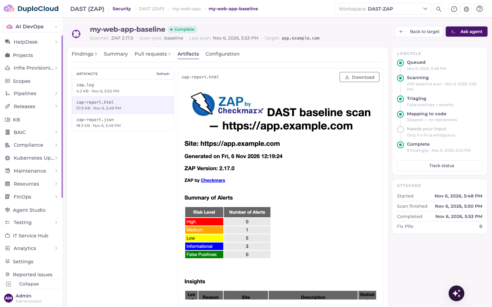

# Try a Marketplace Agent

In this step you activate a ready-made agent, **DAST**, and use it to scan a running web app for security flaws. DAST runs [OWASP ZAP](https://www.zaproxy.org/) against the app, then the agent triages what ZAP found: it flags false positives, re-rates severities, and explains each finding.

DAST only needs the URL of a running web app. You don't need to connect a cloud account. DAST is **Free** in the Marketplace.

You'll run a **baseline** scan. A baseline scan crawls the app and only watches its traffic. It doesn't send attacks, so it's safe for any environment.


Only scan apps you own or have written permission to test. Even a passive scan crawls every page it can find.


## What you need

* The DevKit running, and signed in as the admin user. See [Install the DevKit](install-the-devkit.md).
* The URL of a web app you own or are authorized to test.

<details>

<summary>No app handy? Run a practice app on your computer</summary>

[OWASP Juice Shop](https://owasp.org/www-project-juice-shop/) is an intentionally insecure web app made for security training. Run it next to the DevKit:

```bash
docker run -d --name juice-shop -p 3000:3000 bkimminich/juice-shop
```

The scanner runs in its own container inside the DevKit, so `localhost` there isn't your computer. Use your computer's network IP address instead, for example `http://192.168.1.20:3000`. On macOS, `ipconfig getifaddr en0` prints it.

When you're done with the walkthrough, remove the app with `docker rm -f juice-shop`.

</details>

## 1. Activate DAST



### Open the Agent Marketplace

Go to **AI Admin → Marketplace** and open the **Agent Marketplace** tab. Find the **DAST** card, under **Security & Compliance**, and click **Activate**.

<figure><figcaption><p>DAST in the Agent Marketplace</p></figcaption></figure>



### Choose where it appears

The portal asks **Where should it appear in your left nav?** Keep the recommended option, or pick another section. The preview on the right shows where the agent will go. Click **Activate**.

<figure><figcaption><p>Choose the agent's place in the left nav</p></figcaption></figure>



### Wait for it to install

The card shows its progress: **Queued**, **Downloading**, then **Verifying**. It usually takes under a minute.

<figure><figcaption><p>DAST installing</p></figcaption></figure>



## 2. Add a target

A **DAST target** is the app you want to scan. It only stores settings. Nothing runs until you start a scan.

1. Switch to your workspace and open **DAST (ZAP)** in the left nav. With the default placement it's under **Security**.

   <figure><figcaption><p>The DAST target list</p></figcaption></figure>
2. Click **Add DAST Target**.
3. On the **Target** step, fill in:
   * **Name**: a short name, such as `my-web-app`.
   * **Application URL**: the app's full `http://` or `https://` address.
   * **Default scan type**: keep **Baseline (passive)**.

   <figure><figcaption><p>The minimum a target needs</p></figcaption></figure>
4. Click **Next** through **Authentication** and **Source code** without changing anything, then click **Create** on **Review**.

The other steps let you scan as a signed-in user, link the app's GitHub repositories, and limit which paths are scanned. See [DAST: Set Up](../marketplace-agents/dast/set-up.md).

## 3. Run a baseline scan

1. Open your target and click **Run scan**.
2. Keep the suggested **Scan name** and **Baseline (passive)**, then click **Run scan**.

   <figure><figcaption><p>Start a baseline scan</p></figcaption></figure>

The scan page opens. The **Lifecycle** panel shows where the scan is: **Queued**, **Scanning** while ZAP runs, then **Triaging** while the agent reviews the results. **Mapping to code** is skipped, because you didn't link a repository.

<figure><figcaption><p>A scan in progress</p></figcaption></figure>

A baseline scan of a small app usually takes a few minutes. Findings appear in two passes. First you see ZAP's raw alerts, with triage still pending. Then the agent replaces them with triaged findings and a summary.

## 4. Review the findings

When the scan reaches **Complete**, the **Findings** tab shows:

* how many findings are **Actionable**, and whether any are critical or high
* the triage result: how many the agent **Confirmed**, marked **Needs review**, or flagged as **False positives**
* a list you can filter by triage result and by severity

<figure><figcaption><p>Triaged findings</p></figcaption></figure>

Click a finding's title to open its details. Next to ZAP's own description, solution and references, the agent adds:

* **Triage**: what it checked, and whether it agrees with ZAP
* **Why this severity**: why it kept or changed ZAP's rating
* **Where**: the requests that showed the problem

<figure><figcaption><p>One finding, explained</p></figcaption></figure>

The **Artifacts** tab holds ZAP's own output: `zap-report.html`, `zap-report.json` and `zap.log`. Select one to view it, or click **Download**.

<figure><figcaption><p>The ZAP report</p></figcaption></figure>

If you link the app's GitHub repositories to the target, the agent also points each finding to the file and line that causes it, and can open a pull request that fixes the findings you select. See [DAST: Use](../marketplace-agents/dast/use.md).

## What you just did

You activated an agent from the Marketplace, gave it a target, and got a scan with every finding already triaged. You didn't need a cloud account. Every Marketplace agent follows the same pattern: activate it, give it what it works on, and review what it reports.

To learn more about this agent, including authenticated scans and fix pull requests, see [DAST](../marketplace-agents/dast/README.md).

**Next step in the Quick Start:** [Build Your Own Agent](build-your-own-agent/README.md).
