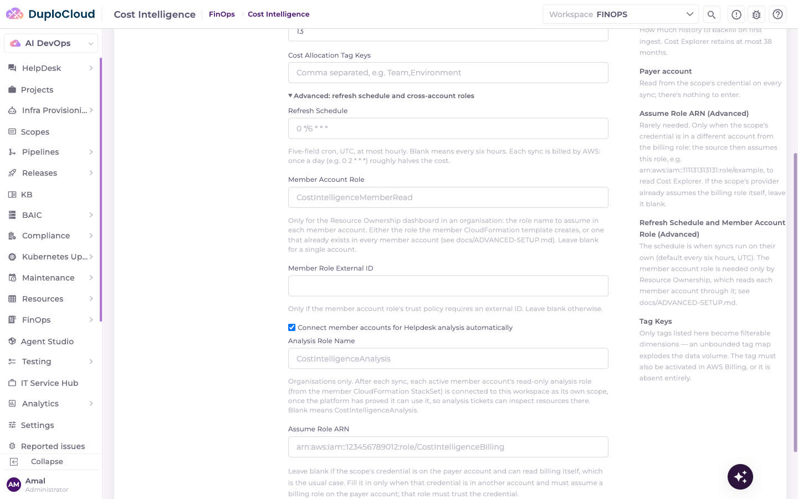
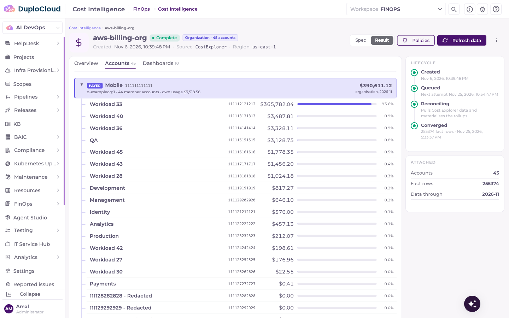

# Set Up

Setup takes six steps. An AWS administrator does the first two in the AWS console, signed in to your payer (management) account. A DuploCloud administrator does the rest in DuploCloud. Allow about an hour, plus up to a day if Cost Explorer has never been used in the account.

## Before you start

| What | Who | Needed? |
| --- | --- | --- |
| The **platform identity ARN**: the AWS identity your DuploCloud platform runs as. The billing role trusts it. | Your DuploCloud contact | Required |
| An AWS administrator who can create IAM roles and CloudFormation stacks in the payer account | You | Required |
| A DuploCloud administrator, and the workspace where the dashboards will live | You | Required |
| AWS Cost Intelligence installed: **FinOps** > **Cost Intelligence** shows in the left menu | Your DuploCloud contact | Required |
| A Jira service account or a ClickUp bot member, to send savings tickets there instead of Helpdesk | A Jira or ClickUp administrator | Optional |
| Roles in each member account, for the Resource Ownership dashboard and Helpdesk analysis | Your AWS administrator | Optional |
| An AI model in the workspace, for Ask AI, custom dashboards and adding policies | Your DuploCloud contact | Optional |

Your DuploCloud contact also gives you the two CloudFormation templates used below: the billing template and the member account template.

## 1. Turn on Cost Explorer

In the AWS console, open **Billing and Cost Management** > **Cost Explorer**. Opening it once turns it on. AWS can take up to 24 hours to fill it the first time.

Also turn these on, from the same page's left menu:

| Setting | Where | Without it |
| --- | --- | --- |
| **Resource-level data at daily granularity** | **Cost Management preferences** | Resource Explorer is empty, and the Action Center can't confirm that a resolved item's cost stopped. |
| **Cost Optimization Hub**, including member accounts | **Cost Optimization Hub** > **Enable** | The Optimisation tab and most Action Center items are empty. |
| **Cost allocation tags** you want to report on, such as `Team` or `Owner` | **Cost allocation tags** > **Activate** | Tag Attribution and item owners have no tag data. A tag appears only after AWS's backfill. |
| A **Cost Anomaly Detection** monitor | **Cost Anomaly Detection** | The Cost Anomalies dashboard is empty. The billing template can create one for you. |

## 2. Create the billing role

1. In the payer account, open **CloudFormation** > **Create stack** > **With new resources (standard)**.
2. Choose **Upload a template file**, pick the billing template (`cost-intelligence-billing.yaml`), and select **Next**.
3. Name the stack, for example `cost-intelligence-billing`.
4. Keep **Credential type** as `IamRole`, and paste the platform identity ARN into **DuploCloud platform identity ARNs**. Leave the rest as it is, unless you want the optional parts below.
5. Select **Next** twice, acknowledge that the stack creates IAM resources, and select **Submit**.
6. When the stack shows **CREATE_COMPLETE**, open **Outputs** and copy **RoleArn** and **AccountId**.

The role can only read billing data. It can't change anything in AWS.

| Optional parameter | What it adds |
| --- | --- |
| Resource Ownership | Inventory and CloudTrail reads in this account, and lets the role assume the member account role in the organization's other accounts. |
| Helpdesk analysis | Configuration and metrics reads (never data or secrets) so Helpdesk analysis tickets can check resources in this account. |
| Create a Cost Anomaly Detection monitor | An AWS services monitor for the Cost Anomalies dashboard. Leave it off if the account already has one. |

To cover a single account instead of an organization, deploy the same template in that account. Its dashboards then cover only that account.

### Member accounts (optional)

The cost dashboards need only the billing role. Resource Ownership and Helpdesk analysis also need a role in each member account. To create them, deploy the member account template (`cost-intelligence-member.yaml`) as a **StackSet** from the management account, to the organizational units you want. It creates a read role that trusts only the billing role and, if you choose, an analysis role. New accounts in those units get the roles automatically.

### What the billing role can read

All of these are read actions. AWS's managed `AWSBillingReadOnlyAccess` policy covers most of them, but not the Budgets, Organizations or `ec2:DescribeTags` actions.

| For | AWS actions |
| --- | --- |
| Cost data (required) | `sts:GetCallerIdentity`, `ce:GetCostAndUsage`, `ce:GetCostForecast`, `ce:GetTags`, `ce:ListCostAllocationTags`, `ce:ListCostAllocationTagBackfillHistory` |
| Resource costs and Action Center confirmation | `ce:GetCostAndUsageWithResources` |
| Commitments | `ce:GetSavingsPlansUtilization`, `ce:GetSavingsPlansUtilizationDetails`, `ce:GetSavingsPlansCoverage`, `ce:GetSavingsPlansPurchaseRecommendation`, `ce:GetReservationUtilization`, `ce:GetReservationCoverage`, `ce:GetReservationPurchaseRecommendation` |
| Anomalies and recommendations | `ce:GetAnomalies`, `cost-optimization-hub:ListRecommendations`, `cost-optimization-hub:GetPreferences`, `cost-optimization-hub:ListRecommendationSummaries`, `cost-optimization-hub:GetRecommendation` |
| Budgets and invoices | `budgets:ViewBudget`, `invoicing:ListInvoiceSummaries` |
| Accounts and resource names | `organizations:DescribeOrganization`, `organizations:ListAccounts`, `organizations:ListTagsForResource`, `ec2:DescribeTags` |

A missing action doesn't fail the sync. The tab that needs it shows a notice naming the action, and the source page lists it as a warning.

## 3. Connect AWS to DuploCloud

Register the billing role as an AWS provider with an IAM role credential and a scope, as described in [Amazon Web Services (AWS)](../../getting-started/integrating-providers/amazon-web-services-aws.md). Use the **AccountId** and **RoleArn** from step 2. A region of `us-east-1` is fine.

When **Attach Scope to Workspaces** opens, choose the workspace where the cost dashboards will live and select **Attach**. Don't skip it: AWS Cost Intelligence lists only scopes attached to the workspace you are in.


Use an IAM role credential. Credentials that hold temporary session keys fail on current platform versions.


## 4. Add the cost data source

A cost data source is one AWS billing connection. Only a platform administrator can add one.

1. In the workspace, open **FinOps** > **Cost Intelligence** and select **Add Cost Data Source**.
2. Enter a **Name** and pick the **AWS Scope** you attached in step 3. The other fields can stay as they are:

| Field | Default | What it does |
| --- | --- | --- |
| Home Region | `us-east-1` | The region the AWS calls use. Commercial regions only. |
| Cost Metric | Amortized | Amortized spreads upfront commitment fees over their term. Unblended shows them when billed. |
| Accounts covered | Auto | Organization or single account. Auto decides from what the sync finds. |
| Lookback Months | 13 | How much history the dashboards hold, from 1 to 38. Longer windows fill in over several syncs. |
| Cost Allocation Tag Keys | None | Extra cost allocation tags to pull, up to 20. |

3. **Advanced** is closed by default, and most sources need none of it:

| Field | What it does |
| --- | --- |
| Refresh Schedule | When syncs run on their own: a five-field cron in UTC, at most hourly. The default, `0 */6 * * *`, is every 6 hours. |
| Member Account Role | The role to assume in each member account. Only Resource Ownership needs it. Use the name the member account template created. |
| Member Role External ID | Sent when assuming the member account role, if its trust policy requires one. |
| Connect member accounts for Helpdesk analysis automatically | On by default. After each sync, connects each member account's analysis role to the workspace, so Helpdesk analysis tickets can inspect resources there. Organizations only. |
| Analysis Role Name | The analysis role in each member account. Leave it blank to use `CostIntelligenceAnalysis`, the name the member account template creates. |
| Assume Role ARN | Only when the scope's credential is in another account and must assume a billing role in the payer account. Leave it blank otherwise. |

4. Select **Create**. The first sync starts straight away. The current and previous month are ready after it. Older months fill in over the next few syncs, and a box on the source page shows the progress.

## 5. Add your first dashboard

On the source, select **Add dashboard** and choose **Cost and Usage**. See [Use](use.md#add-a-dashboard) for the other dashboards.

## 6. Give people access

In **AI Admin** > **Access Control**, give each group a permission set on the workspace:

| Who | Grant | They can |
| --- | --- | --- |
| Viewers, such as finance and team leads | Read on the workspace | View every dashboard and download PDF and CSV. |
| FinOps owners | Read on the workspace, Post on the cost data source and Put on its dashboards | Also add dashboards, use Ask AI, work Action Center items and create tickets. |

Two rights are granted separately, by name. Add them only to people who need them:

* **`finops.sync`**, to refresh data on demand and to add the Tag Attribution, Action Center and Resource Ownership dashboards. Each of these adds AWS requests.
* **`finops.export`**, to pull raw cost rows through the API.

See [Permissions and Safety](permissions-and-safety.md#who-can-do-what) for the full list.

## Check it works

| Check | Where | You should see |
| --- | --- | --- |
| The sync worked | The source page | Status **Complete**, the accounts and billing months listed, and no warnings. |
| The numbers are right | **Cost and Usage** > **Billing Summary** | Last month's total matches Cost Explorer for the same cost metric. |
| Viewers can't change anything | Sign in as a viewer | The dashboards load. Add, edit and refresh are greyed out, with the reason on hover. |

## Optional: send tickets to Jira or ClickUp

Action Center tickets go to Helpdesk unless you choose otherwise. To use Jira or ClickUp, a DuploCloud administrator registers it as a provider and attaches its scope to the workspace that holds the cost data source. Then you choose it in the Action Center's **Settings** (see [Use](use.md#choose-where-tickets-go)).

Use an identity that exists only for this, never a person's own token. Tickets are created as that identity, and a person's token would carry all their access and stop working when they leave.



**Identity**, best first:

| Jira | Identity | Credential keys |
| --- | --- | --- |
| Cloud (recommended) | Atlassian service account with an OAuth 2.0 credential (client credentials) | `clientId`, `clientSecret`, `siteUrl` (or `cloudId`) |
| Cloud | Atlassian service account with a scoped API token | `apiToken`, `siteUrl` (or `cloudId`), optionally the service account's `email` |
| Data Center or Server | A dedicated bot user with a personal access token that expires | `personalAccessToken`, `siteUrl` |

**Rights**, in the target project only:

* OAuth or API token scopes: `read:jira-work`, `write:jira-work` and `read:jira-user`.
* Project permissions: **Browse projects**, **Create issues**, **Add comments**, **Transition issues**, and optionally **Assign issues**.
* Product access to Jira on the site. No administrator rights are needed.

**Register it:** in **AI Admin** > **Providers**, add a provider in the **Other** category, of type `jira` if offered, otherwise `other` with "Jira" in its name. Add the credential keys above and mark the secrets sensitive. Create a scope and attach it to the workspace.



**Identity:** ClickUp has no service accounts, so create a dedicated bot member (for example `finops-bot@your-company.com`) and use its API token only here.

**Rights:**

* Membership of the ClickUp Workspace, with access to the target List only. Use a guest with **Can edit** on that List where your plan allows it, otherwise a member added to that Space alone.
* Permission to create and edit tasks, and to comment, in that List.
* Permission to use tags in that Space, if you want tickets tagged.

ClickUp tokens don't expire. Rotate the token on a schedule by regenerating it and updating the provider.

**Register it:** in **AI Admin** > **Providers**, add a provider in the **Other** category, of type `clickup`, or `other` with "ClickUp" in its name. Add a credential with the key `apiToken` holding the token, marked sensitive. Create a scope and attach it to the workspace.



The links back to the Action Center in Jira, ClickUp and Helpdesk tickets need the portal's address to be configured on the platform. Without it, tickets are created without that link. Ask your DuploCloud contact if the link is missing.

Next: [Use](use.md).
