# Use

Open **FinOps** > **Cost Intelligence** and select a cost data source. The source page shows its status, the accounts and billing months it holds, any warnings, and its dashboards.

## Add a dashboard

1. On the source page, open the **Dashboards** tab and select **Add dashboard**.
2. Enter a **Name**, and choose the **Dashboard** kind. You can't change the kind later: add another dashboard instead.
3. Optionally set the default date range, granularity, cost metric and currency.
4. Select **Create**. The dashboard opens on its first tab.

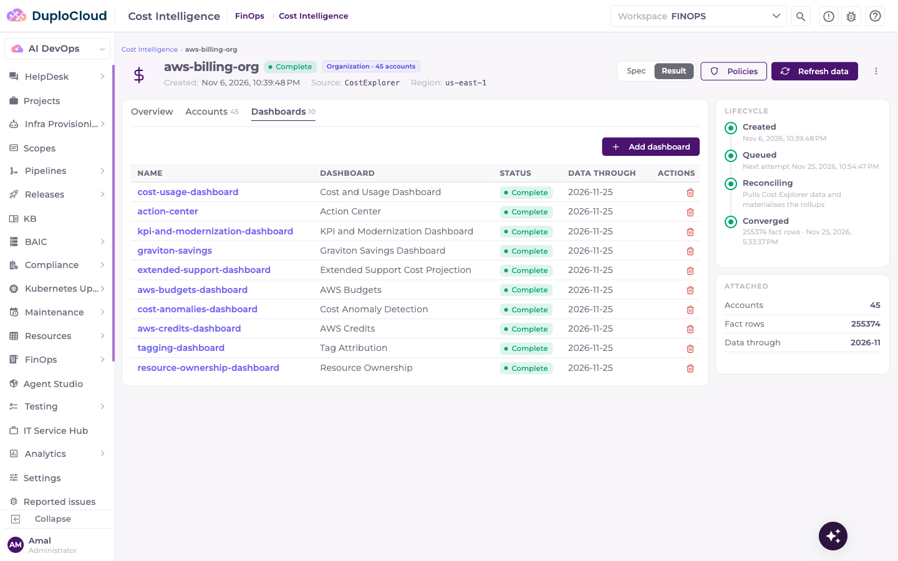

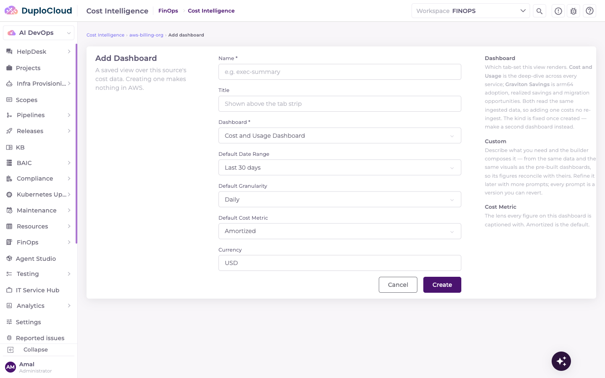

| Dashboard | Answers |
| --- | --- |
| **Cost and Usage** | Where the money goes. Overview, Billing Summary, Compute, Storage, Database, Data Transfer, AI/ML, Analytics, Commitments, Optimisation, Idle and waste, and Resource Explorer. Start here. |
| **Graviton Savings** | How much runs on Graviton across EC2, RDS, ElastiCache and OpenSearch, what it saves, and what could still move. |
| **KPI and Modernization** | Progress against goals you set, per KPI and per account. |
| **Extended Support** | What old RDS, EKS, OpenSearch and ElastiCache versions cost now, and what they will cost as they age. |
| **AWS Budgets** | Budget against actual and forecast, the budget history, and which budgets are heading over. |
| **Cost Anomalies** | Unusual spend AWS detected, its impact, whose it is, and whether it is still running. |
| **AWS Credits** | Credit applied, burn rate and coverage, checked against each invoice. |
| **Tag Attribution** | Spend by cost allocation tag, what can't be attributed and why, tagging hygiene and showback. |
| **Resource Ownership** | Who owns each resource, priced as stacks, and what a teardown left behind. Needs the member account role (see [Set Up](set-up.md#member-accounts-optional)). |
| **Action Center** | Every saving the other dashboards found, as one list to work through. |
| **Custom** | A dashboard you describe in plain English. See [Build a custom dashboard](#build-a-custom-dashboard). |

Tag Attribution, Action Center and Resource Ownership each add AWS requests to every sync, so adding one also needs the `finops.sync` right. See [Permissions and Safety](permissions-and-safety.md#who-can-do-what).

## Work with a dashboard

* **Date range.** One control on every tab: presets, any billing month, or a custom range. A tab whose data is monthly says which months it used.
* **Filters.** Each tab offers only the filters it can apply exactly. The date range, account and region carry over to every tab of the dashboard. A tab that can't apply one of them says so under its filters.
* **Summary tiles.** A tile with **View in** under it opens the tab that breaks that number down, sometimes already filtered.
* **Zoom.** Drag the slider under a trend chart, or scroll inside it.
* **PDF.** The **PDF** menu exports the current tab or every tab.
* **Theme.** The light and dark switch applies to the whole extension and is remembered.
* **Settings.** Dashboards with options (KPI and Modernization, Tag Attribution, Action Center) have a **Settings** button in the header.

After each sync the tabs are rebuilt in the background, one at a time. A tab that isn't rebuilt yet shows its previous figures, and swaps in the new ones a few seconds later.

### Single account or organization

A source on the management account covers every account in the organization and compares them. A source on one account carries a **Single account** badge, and its dashboards leave out the account comparisons. **Accounts covered** on the source decides which, or **Auto** works it out on each sync.

## Dashboard how-tos

### Cost and Usage

**Billing Summary** shows month to date, AWS's forecast, the same point last month, the daily trend, top services, top movers and spend by account. Last month's total should match Cost Explorer for the same cost metric.

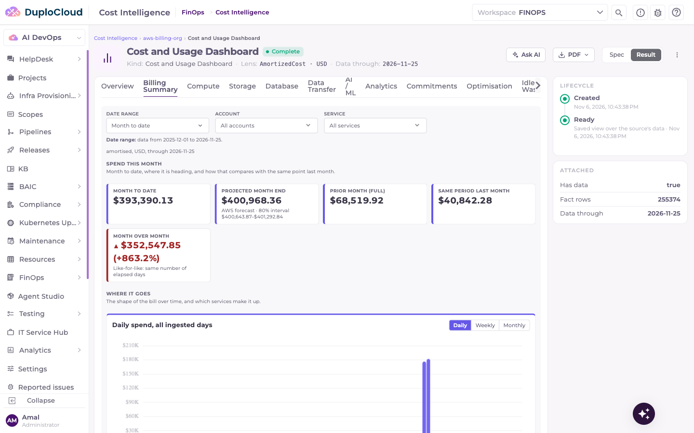

**Commitments** shows which Savings Plans and Reserved Instances you hold and when each ends, how coverage and utilization have moved month by month, and what AWS recommends buying next. Use it to spot commitments that are about to end, or have already ended, before coverage drops.

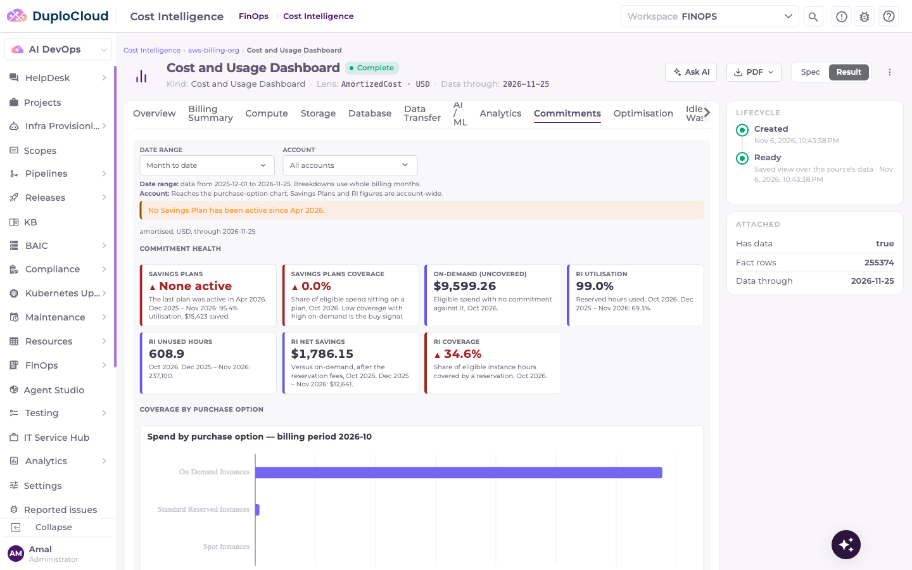

**Optimisation** lists Cost Optimization Hub's recommendations, grouped by account, largest saving first. **Idle and waste** lists resources that cost money and do nothing. Both feed the Action Center.

### KPI and Modernization

1. Open the **Set KPI Goals** tab. Each goal has a slider and a number box, grouped into Optimization, Storage, Database and Commitment.
2. Move a slider. Every other tab re-scores straight away against the draft, without saving, so you can try out a target first.
3. Select **Save goals** to keep them, or **Revert** to go back to the saved goals. The page says when a draft is unsaved.

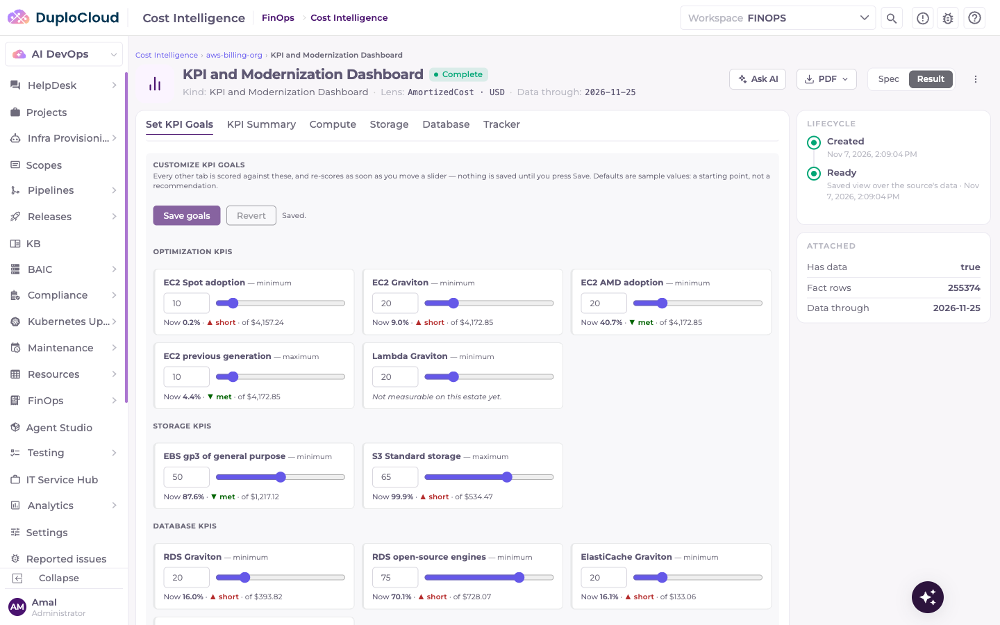

A goal that's met is green with a tick, and one that isn't is red with a cross, with how far beyond or short of the target underneath. A ceiling, such as the on-demand share, is scored as a ceiling. A goal for a service you don't use shows as not measurable rather than 0%.

### Tag Attribution

Tag Attribution splits spend four ways that always add up to the bill: **tagged**, **via account tag**, **not tagged** (could carry the tag but doesn't) and **can't be tagged** (tax, credits, commitment fees, data transfer, support and similar). Its tabs are Overview, Explore by tag, Month compare, Tag hygiene, Shared costs and showback, Anomalies, and Forecast and budgets.

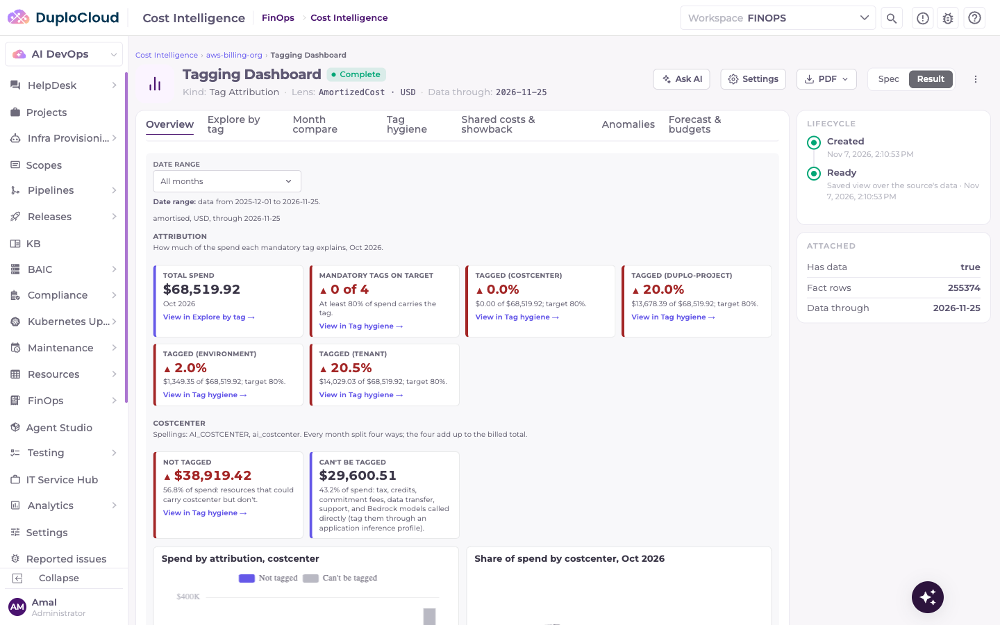

Select **Settings** to set:

| Setting | What it does |
| --- | --- |
| Mandatory tags | The tags you expect on everything, up to 8. Pick from the account's active tags, or type one that isn't active yet. |
| Default tag | The tag every tab opens on. |
| Further tags to explore | Extra tags for Explore and Month compare, up to 4. |
| Coverage target | The share of spend that should carry the mandatory tags. 80% by default. |
| Shared costs | How untagged and can't-be-tagged spend is shared out (proportional or even), and which categories to share. |
| Anomalies | How sensitive anomaly detection on tag spend is. |
| Data refresh | How often tag data is pulled, every 6 to 72 hours. |
| Account tags | Read from AWS Organizations, or uploaded as a CSV of `account_id, tag_key, tag_value` when Organizations can't be read. |

Changing the mandatory or explore tags pulls new data, which needs `finops.sync`. The panel follows the pull and refreshes the tabs as data arrives.

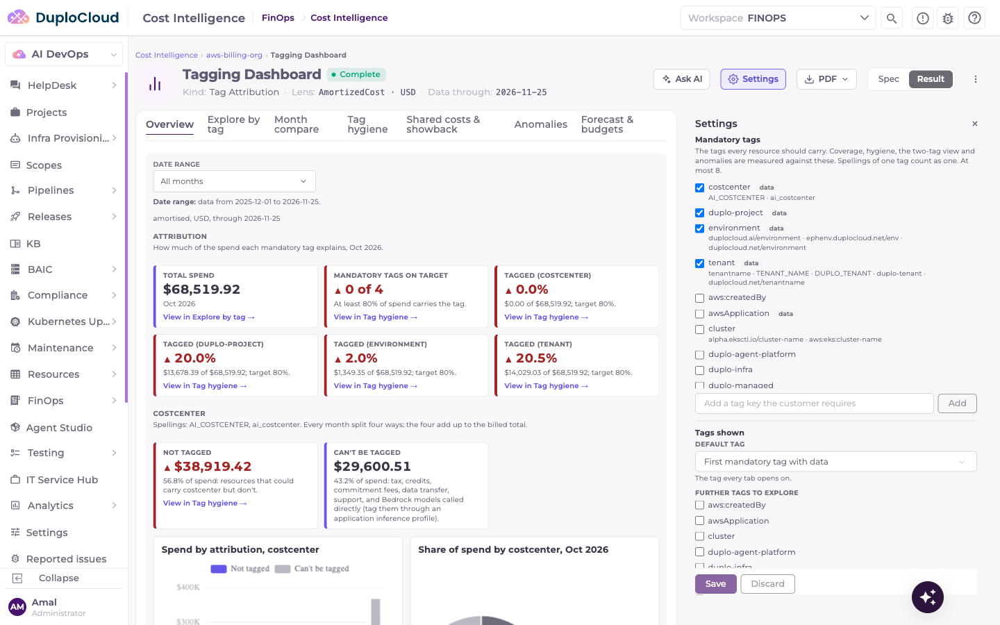

### Resource Ownership

Resource Ownership reads what exists in each member account and the last 90 days of CloudTrail. It groups every resource under the **stack** whose deletion would remove it, and prices it from resource-level billing (measured) or list prices (estimated).

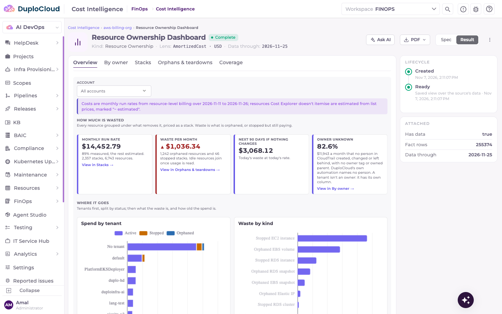

Each resource gets an **Owner** to ask: the owner tag, an owner confirmed in the extension, or the person CloudTrail shows creating it. DuploCloud's tenant and project tags appear in their own **Tenant** column, never as the owner.

| Tab | Shows |
| --- | --- |
| Overview | Monthly run rate, waste per month, and how much has no owner. |
| By owner | Each owner's resources and cost. |
| Stacks | Every stack. Select one to see its owner, costs, timeline and read-only AWS CLI commands to inspect it. |
| Orphans and teardowns | What a teardown left behind, who deleted the parent, and the root cause. |
| Coverage | Which accounts were reached, and the call that was refused where one wasn't. |

### AWS Credits

Credits shows credit applied, how fast it is used, and where, checked against each invoice. AWS has no API for credit balances or expiry dates, so the page doesn't show them.

### Extended Support, Budgets, Anomalies and Graviton

* **Extended Support** has Projection, RDS, EKS, OpenSearch and ElastiCache, and By Account tabs. It projects what running past standard support costs now and later.
* **AWS Budgets** has Overview, Hierarchy and Needs Attention tabs. It shows the payer account's own budgets. Budgets in member accounts need a source on those accounts.
* **Cost Anomalies** has Overview, By Account and All Anomalies tabs. It lists what AWS's Cost Anomaly Detection flagged, the impact, and whether it is still running.
* **Graviton Savings** has a Summary tab, then EC2, RDS, ElastiCache and OpenSearch.

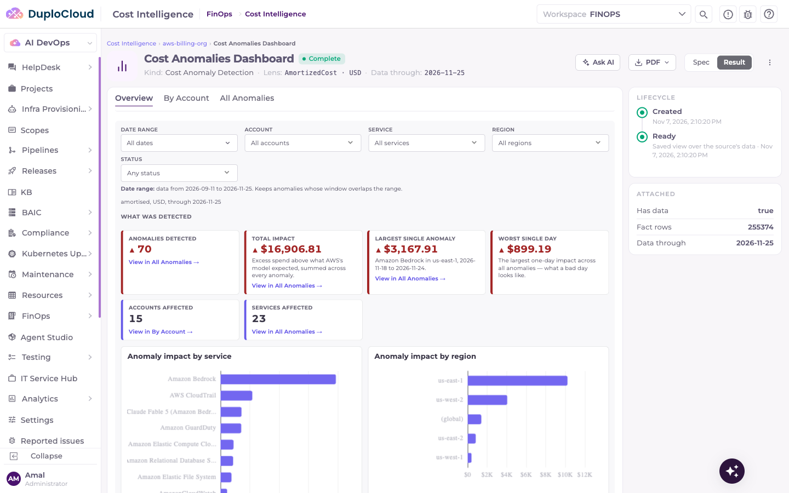

## Refresh the data

Syncs run on the source's schedule, every 6 hours by default. To run one now, select **Refresh data** on the source page. You need the `finops.sync` right. Each refresh calls AWS, so a new one can't start while one is running, or within 15 minutes of the last one unless that one failed. The page says how long to wait.

After the first sync, Tag Attribution, Resource Ownership and Idle and waste fill in on their own in the background, usually within an hour or two. There's no need to refresh to speed them up.

## Work the Action Center

1. Add an **Action Center** dashboard to the source.
2. Use the tabs:

| Tab | Shows |
| --- | --- |
| **Overview** | Pending, Realized, Back in use and Excluded totals, where the savings are by account, and month by month tracking. |
| **Open items** | What's left to do, largest saving first. **Group by** status (items with a ticket are in an **In work** section), account or source. |
| **Realized** | Items confirmed done, with the saving actually measured. |
| **Back in use** | Items marked done whose resource started costing money again. |
| **Exclusions** | Items someone decided not to act on, with the reason, who and when. |

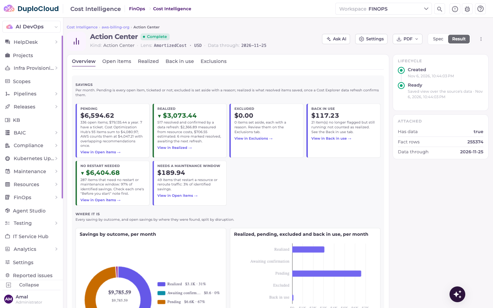

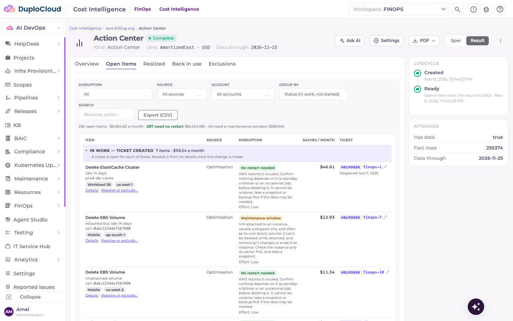

3. Open an item to see its evidence, history and comments, then choose what to do:

| Action | What happens |
| --- | --- |
| **Create ticket** | Shows the ticket first: where it goes, the title and the description. Nothing is created until you approve it. The item moves to **In work** and links to its ticket. |
| **Mark as resolved** | You made the change. The item shows **Resolved · awaiting refresh** until a sync confirms it. |
| **Exclude** | You won't act on it. A reason is required, and is recorded with your name and the time. **Bring back to Open items** on an excluded item restores it. |
| **Reopen** | Returns a resolved item to Open items. |
| **Add comment** | A note for whoever picks it up. |

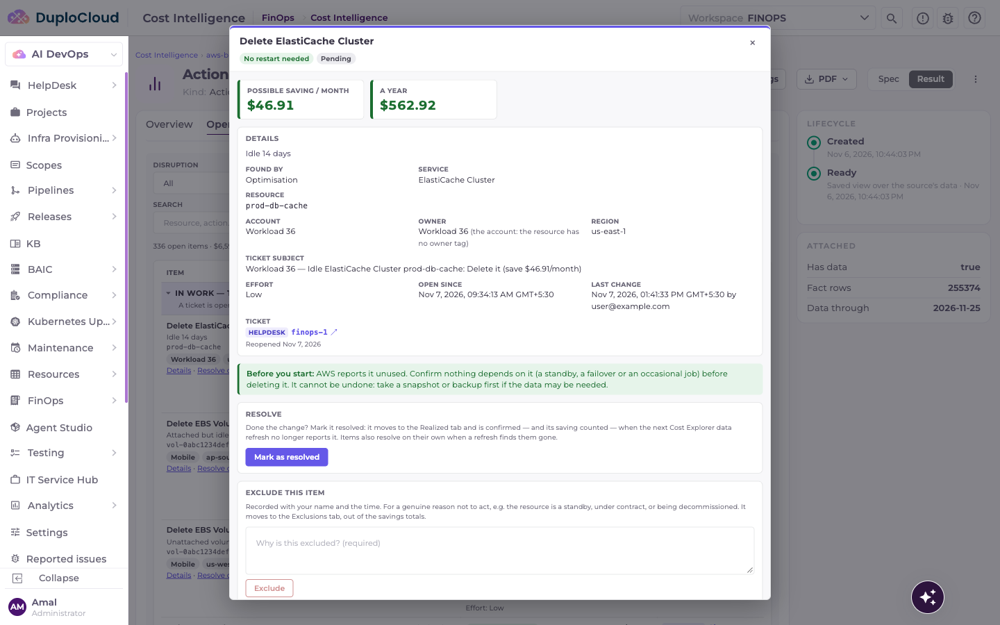

### How a resolved item is confirmed

Marking an item resolved is a claim. The next sync checks it against AWS's daily cost for that resource over the last 14 days:

| The sync finds | Result |
| --- | --- |
| The resource no longer exists | **Realized**. Use **Check accounts now** in Policies after a cleanup to confirm it straight away. |
| The cost stopped, or dropped by at least half the estimated saving | **Realized**, with the measured saving. |
| The resource still costs about the same | **Back in use**, not counted as a saving. |
| AWS has no data for it yet | Stays awaiting refresh until the next sync. AWS's resource data can lag by a day. |

A Savings Plan or Reserved Instance purchase counts as realized only when a matching commitment appears in the account. When an account is closed or leaves the organization, its open items count as realized at their estimated saving.

### Choose where tickets go

In the Action Center, select **Settings** and choose **Helpdesk**, **Jira** or **ClickUp**.

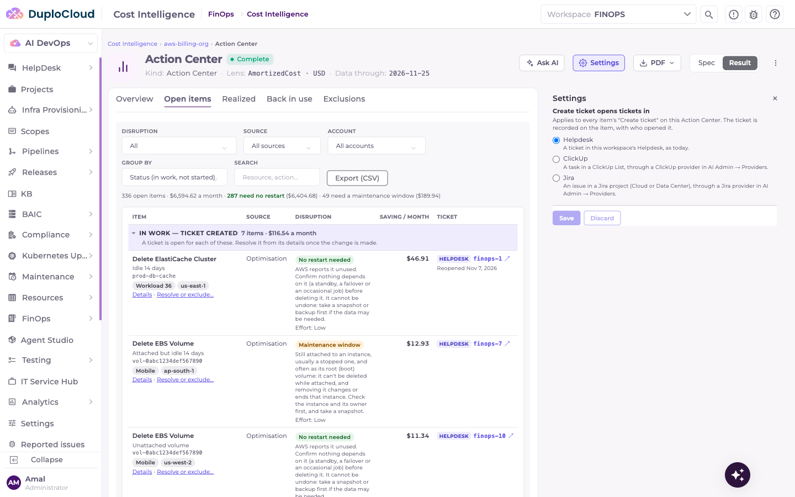

* **Helpdesk** (the default). The ticket is an analysis. An AI agent checks the finding with read-only AWS calls and writes a plan for a person to carry out. Every command it wants to run waits for your approval in the ticket, and it never makes the change.
* **Jira** or **ClickUp**. Pick the provider (see [Set Up](set-up.md#optional-send-tickets-to-jira-or-clickup)). Check the line under it that says who tickets will be created as: if it says **Not recommended**, the provider uses a person's own token. Then choose the project and issue type (Jira) or the Workspace, Space and List (ClickUp), and optionally assignees, labels or tags, and whether priority follows the saving. Select **Save**. Each item's button becomes **Create Jira issue** or **Create ClickUp task**.

Once an item has a ticket, the Action Center keeps the ticket in step. It closes the ticket when the item is realized, excluded or back in use, and reopens the same ticket if the item is open again, with a note saying why each time. Closing a ticket by hand doesn't resolve the item: select **Mark as resolved** in the Action Center once the change is made.

## Policies

**Policies**, on the source page next to **Refresh data**, lists every rule the dashboards flag resources by. There is one set per source.

| Group | What it is |
| --- | --- |
| **Organization policy** | Your own rules. |
| **Account scan** | Built-in rules over what exists now in each account: unattached EBS volumes, unassociated Elastic IPs, stopped instances, duplicate CloudTrail trails, load balancers with no targets, log groups kept forever, untagged ECR images, disabled KMS keys, empty Route 53 zones and incomplete S3 multipart uploads. A few more rules are off by default. |
| **Optimisation**, **Idle and waste**, **Commitments**, **Tag hygiene** | What AWS and the other dashboards recommend, one switch per kind. |

Each rule shows what it flags now and the monthly saving. Open a rule to see every resource it flags. Switch a rule off and its items leave the Action Center, the Optimisation and Idle and waste tabs and the KPI totals.

Anyone who can see the source can read the policies. Only a platform administrator can change them.

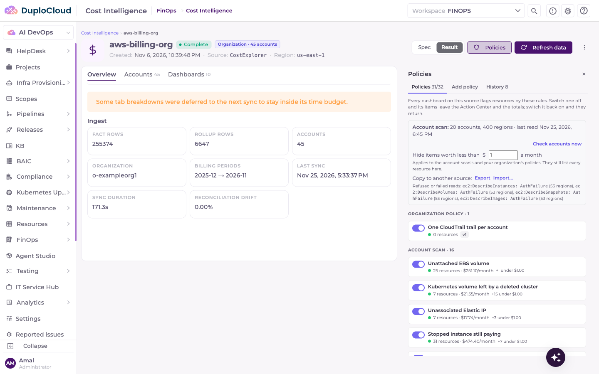

* **Hide items worth less than** keeps tiny findings out of the Action Center. The default is $1 a month. Set it to 0 to show everything.
* **Check accounts now** re-reads every account within two minutes instead of waiting for the daily scan. Use it after a cleanup.
* **Export** and **Import**, next to **Copy to another source**, copy your policies between cost data sources.
* To keep a resource on purpose, tag it `finops:justification` with the reason. The built-in CloudTrail rules never flag a trail that has one.

### Add a policy

1. Select **Add policy** and describe the rule in your own words, for example "Only one CloudTrail trail per account unless there is a justification".
2. Select **Rephrase and review**. An AI session with no AWS access rephrases it as a rule, and lists what it assumed and any questions. Answer them to rephrase again.
3. Review what the rule would flag against today's data, with the saving, and any built-in policy that already says the same thing. Edit and review again if needed.
4. Select **Add policy**. Every dashboard on the source uses it from then on.

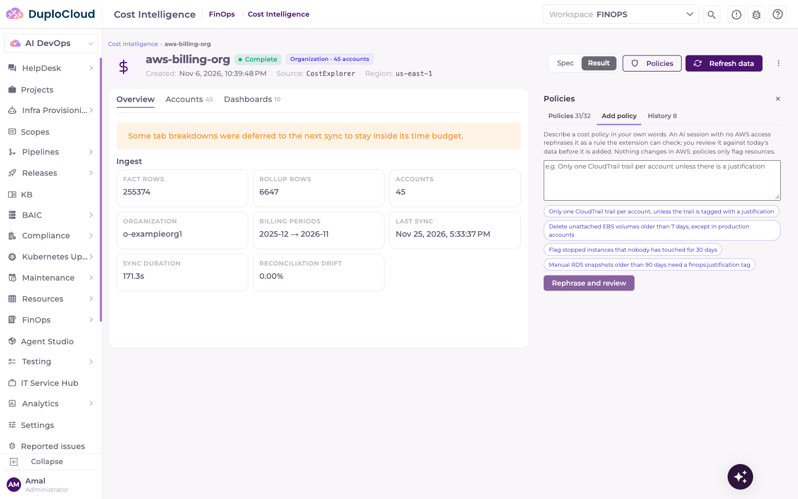

**Edit** saves a new version. **History** lists every change, and **Restore** puts an earlier version back. A rule can only use what the extension reads. One that needs anything else shows as **can't be checked yet**, naming the data it needs.

## Build a custom dashboard

1. Select **Add dashboard**, choose **Custom - build from a prompt**, and describe what you want, for example "EC2 and RDS spend by account for the last 3 months, with a monthly trend".
2. Review the **brief**: what will be built, what was assumed and what isn't available. Choose **Build**, **Edit** or **Back**. Nothing is built until you choose **Build**.
3. To change it later, select **Update Dashboard**. Each build shows what it changes, tab by tab, and is saved as a new version only when you select **Save**.
4. **Revision history** lists the versions with who built each and when. **Revert** goes back to any of the latest 20.

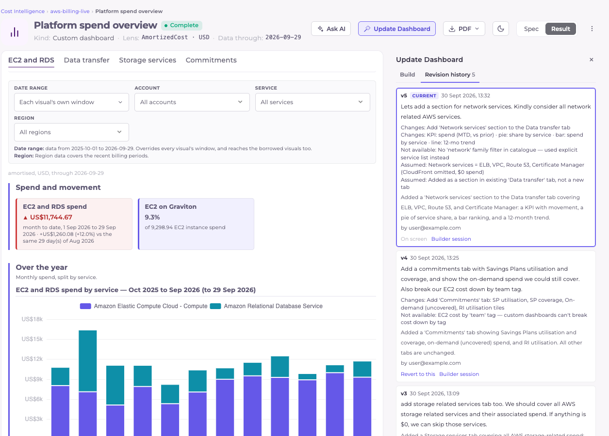

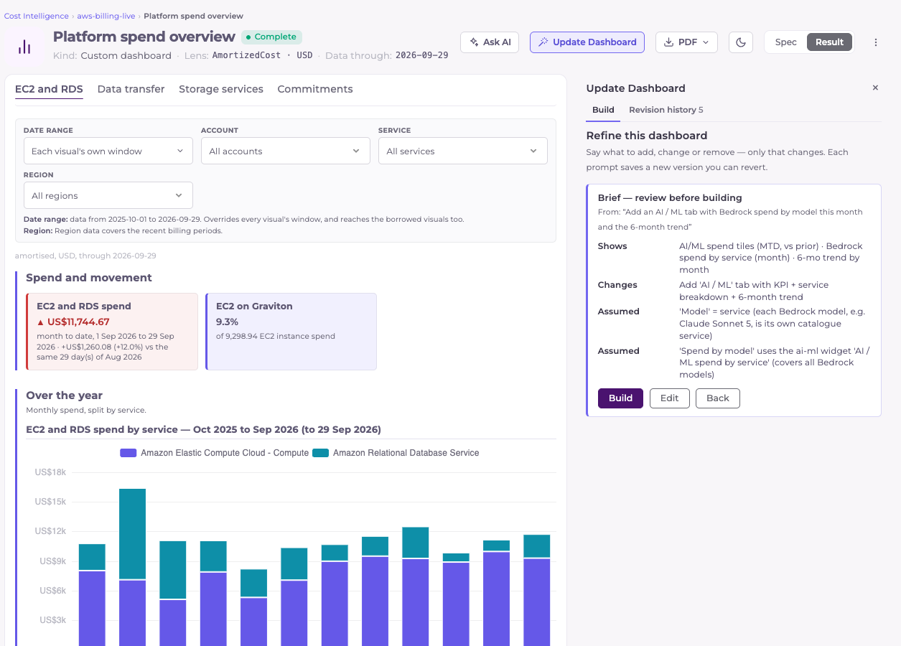

Custom dashboards use the same data as the ready-made ones, so the figures match. Anything the data can't answer is listed as not available, never estimated. Cost by tag isn't available here yet: use Tag Attribution.

## Ask AI

1. On a dashboard, select **Ask AI**. A panel opens beside the dashboard.
2. Ask about the spend, for example "why did EC2 go up last month?" or "which accounts have the most idle resources?".
3. Answers use the dashboard's own figures. For anything more, the agent proposes a read-only AWS query, which runs only after you approve it.

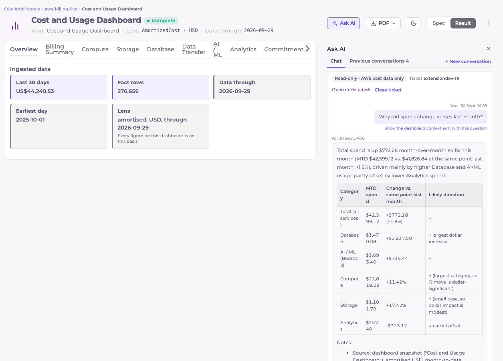

Each conversation is saved as a Helpdesk ticket and listed under **Previous conversations**. Ask AI can't change anything in AWS. See [Permissions and Safety](permissions-and-safety.md#ai-data-handling) for what is shared with the AI.
