# Set Up

## Before you start

* **An application you own or may test**, reachable by an `http` or `https` URL. Prefer a staging or test environment.
* **A network path from the agent to the application.** ZAP runs in a Docker container next to the agent, so the scan's requests come from the agent's network, not from your browser. A URL that only works on your own computer, such as `http://localhost:3000`, doesn't reach the application. The agent also needs to pull the ZAP image from `ghcr.io`.
* **Optional: a login for the application**, if you want to scan pages behind sign-in. Use a dedicated test account. See [Add an application login](#add-an-application-login-optional).
* **Optional: a GitHub scope** for the application's repositories, if you want code locations and fix pull requests. See [Connect GitHub](#connect-github-optional).


DAST needs no cloud (AWS, Azure or GCP) access. The only credentials it uses are the optional application login and the optional GitHub scope.


## Activate DAST

1. Switch to **AI Admin**, open **Marketplace**, and select the **Agent Marketplace** tab.
2. Find the **DAST** card under **Security & Compliance** and click **Activate**.

   <figure>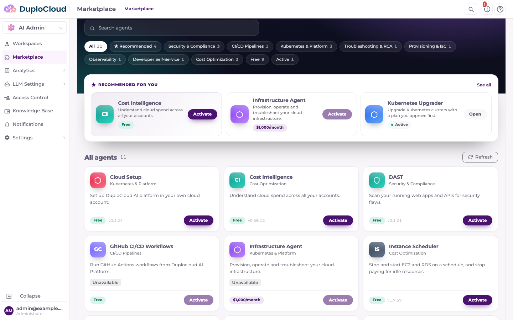<figcaption>
DAST in the Agent Marketplace
</figcaption></figure>
3. Choose where the agent appears in your left nav, then click **Activate**.

   <figure>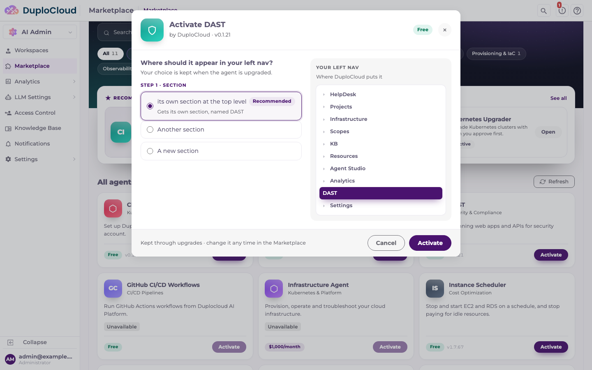<figcaption>
Choose the agent's place in the left nav
</figcaption></figure>
4. Wait while the card shows **Queued**, **Downloading** and **Verifying**. It usually takes under a minute.

When it finishes, switch to your workspace. DAST appears in the left menu under **Security → DAST (ZAP)**.

<figure>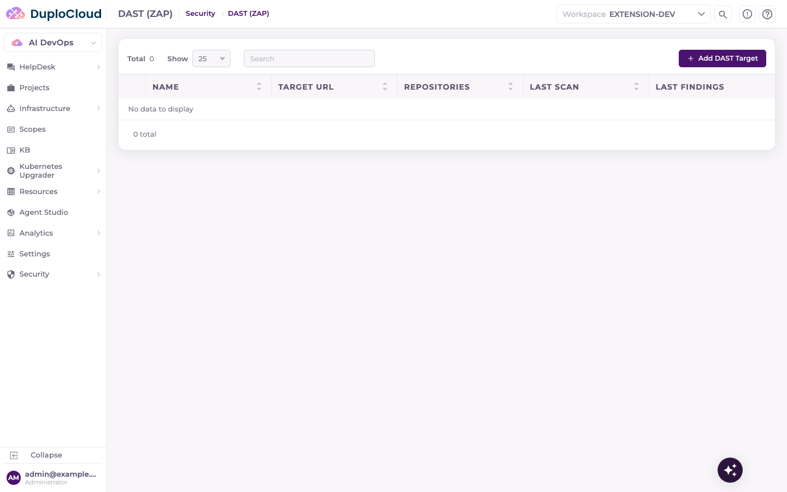<figcaption>
The DAST target list
</figcaption></figure>

## Add an application login (optional)

Without a login, ZAP only sees what an anonymous visitor sees: usually the sign-in page and public assets. To scan the pages and APIs behind sign-in, store a test login as an **Other** provider and attach its scope to the workspace.

1. In **AI Admin**, open **Settings → Providers → IT**, select the **Other** tab, and click **Add Provider**.
2. Enter a **Name** and set **Account ID** to the application's base URL, for example `https://app.example.com`. DAST resolves a relative `loginUrl` against this value.

   <figure>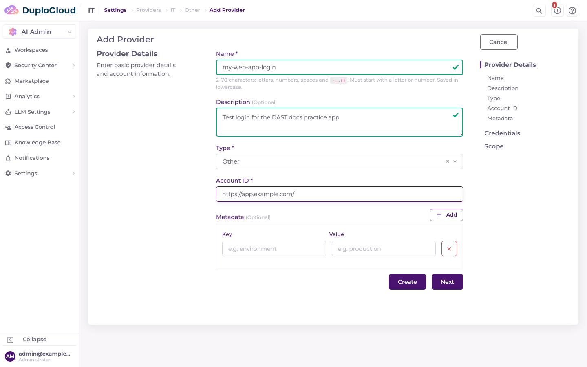<figcaption>
An Other provider for the application login
</figcaption></figure>
3. Click **Next**. Enter a credential **Name**, then click **Add Credential Field** once for each key you need from the table below. Keep **Sensitive** on for passwords and tokens.

   <figure>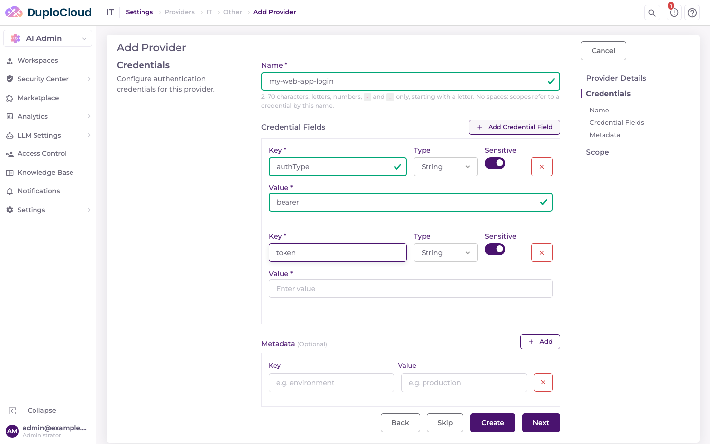<figcaption>
A bearer-token login: <code>authType</code> and <code>token</code>
</figcaption></figure>
4. Click **Next**, name the scope, and click **Create**.
5. In **Attach Scope to Workspaces**, select the workspace where you'll use DAST and click **Attach**. DAST only offers scopes that are attached to the current workspace.

DAST reads these keys from the credential. Key names aren't case-sensitive.

| Key | Used for |
| --- | --- |
| `authType` | `form`, `json`, `bearer`, `header` or `none`. If it's missing, DAST infers it: a `token` means bearer, a `username` plus `password` means form login, otherwise no login. |
| `loginUrl` | The login page, for form and JSON logins. A relative URL is resolved against the provider's **Account ID**. |
| `loginRequestUrl` | Where the login is posted, if that differs from `loginUrl`. |
| `username`, `password` | The test account, for form and JSON logins. |
| `usernameField`, `passwordField` | The field names in the login request. Default `username` and `password`. |
| `loggedInRegex`, `loggedOutRegex` | Patterns ZAP uses to check that the session is still signed in. |
| `token`, `headerName` | The bearer token or header value. The default header is `Authorization`. |

If a target uses a login that can't work (for example `authType` is `form` but there's no password), the scan stops and lists the key names it found. It never falls back to an anonymous scan.

## Connect GitHub (optional)

Link the application's repositories to get a file and line for each finding, and to raise fix pull requests.

1. Create a GitHub token that can reach the application's repositories:

   | Permission (fine-grained token) | Needed for |
   | --- | --- |
   | Metadata: Read | Listing repositories |
   | Contents: Read | Reading the code to map findings |
   | Contents: Read and write | Pushing a fix branch (only for fix pull requests) |
   | Pull requests: Read and write | Opening fix pull requests (only for fix pull requests) |

   A classic personal access token with the `repo` scope also works.
2. Add GitHub as a source-control provider, add the token as a credential, and create a scope, as described in [Connecting GitHub to DuploCloud](../../getting-started/integrating-providers/github.md). Then attach the scope to the workspace.

DAST supports GitHub only.

## Add your first target

1. Open **Security → DAST (ZAP)** and click **Add DAST Target**.
2. On the **Target** step, fill in:
   * **Name**: letters, digits and hyphens, 2 to 60 characters, for example `portal-staging`. You can't change it later.
   * **Application URL**: an absolute `http` or `https` URL.
   * **Default scan type**: **Baseline (passive)**, **Full (active)** or **API**. Baseline is the default.
   * **Max duration (minutes)**: how long ZAP may crawl and scan, 1 to 240. Default 30.
   * **Include paths** and **Exclude paths**: optional, one regular expression per line. Empty include paths scan the whole site. Exclude logout and destructive endpoints, for example `.*/logout.*`.

   <figure>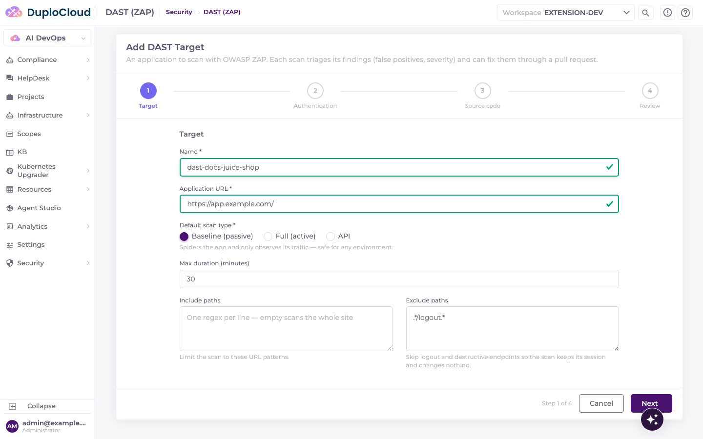<figcaption>
The Target step
</figcaption></figure>

   Choosing **Full (active)** shows a warning that a full scan sends attack payloads and can change data. Choosing **API** adds a required **API definition URL** field for your OpenAPI or Swagger definition.

   <figure>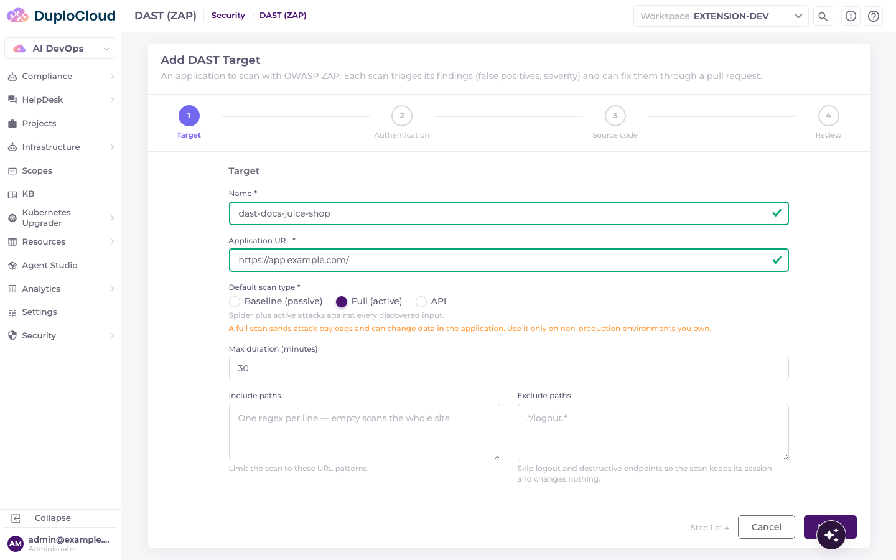<figcaption>
The warning for Full (active)
</figcaption></figure>

   <figure>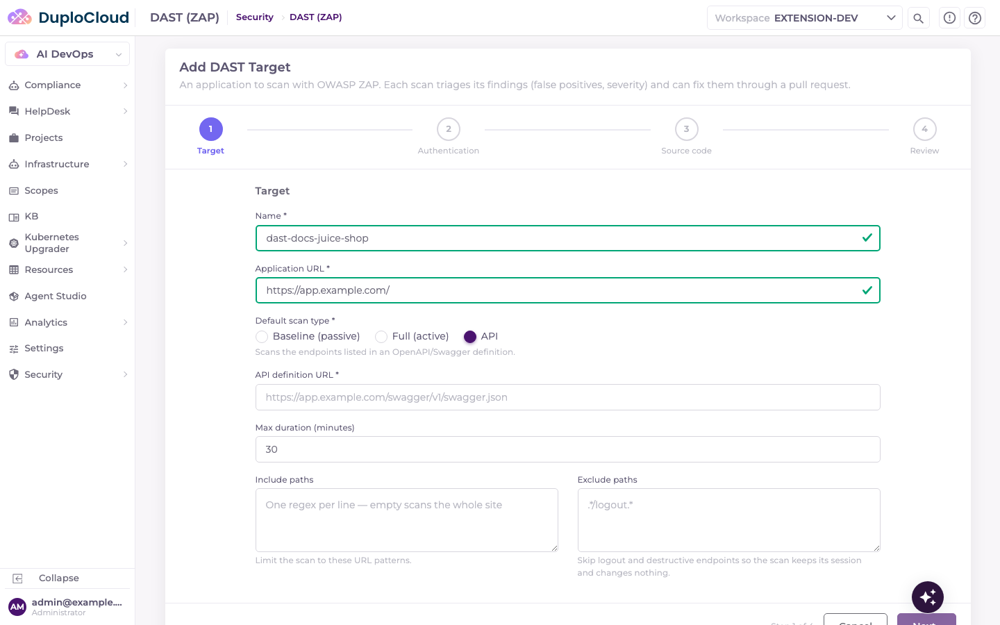<figcaption>
API scans need an OpenAPI definition URL
</figcaption></figure>
3. On the **Authentication** step, select **Scan as a signed-in user** and choose the **Authentication scope** that holds the login. Leave it clear to scan anonymously.

   <figure>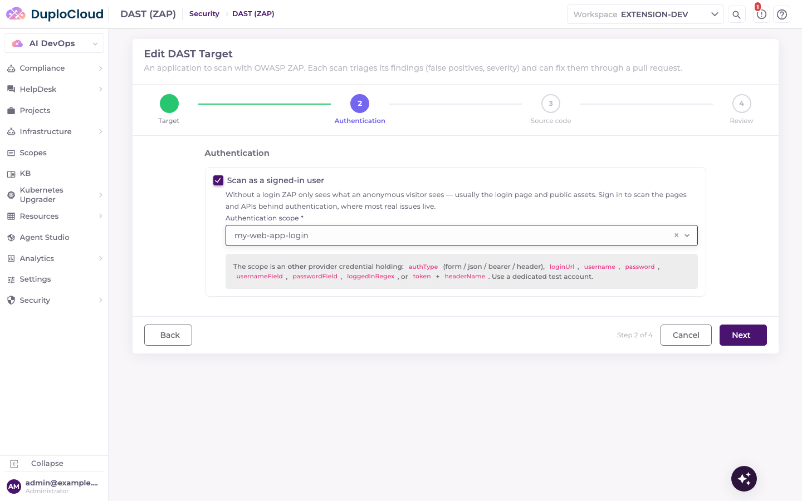<figcaption>
Scan behind a login
</figcaption></figure>
4. On the **Source code** step, select **Link the application's source code**, choose the **GitHub scope**, and pick the **Repositories**, or type them as `org/repo`. You can also attach **Architecture skill(s)**: workspace skills that describe your application. Without one, the agent works out the architecture from the repositories. Leave the step clear to get triaged findings without code locations or fix pull requests.

   <figure>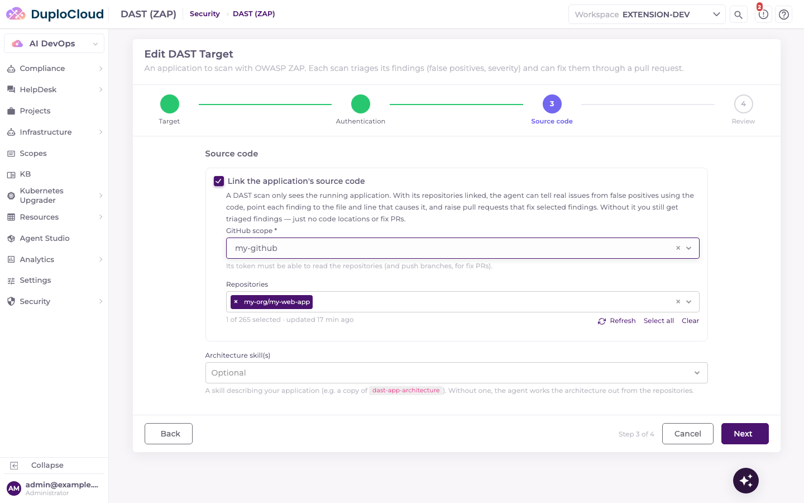<figcaption>
Link the application's repositories
</figcaption></figure>
5. On **Review**, check the summary and click **Create**.

   <figure>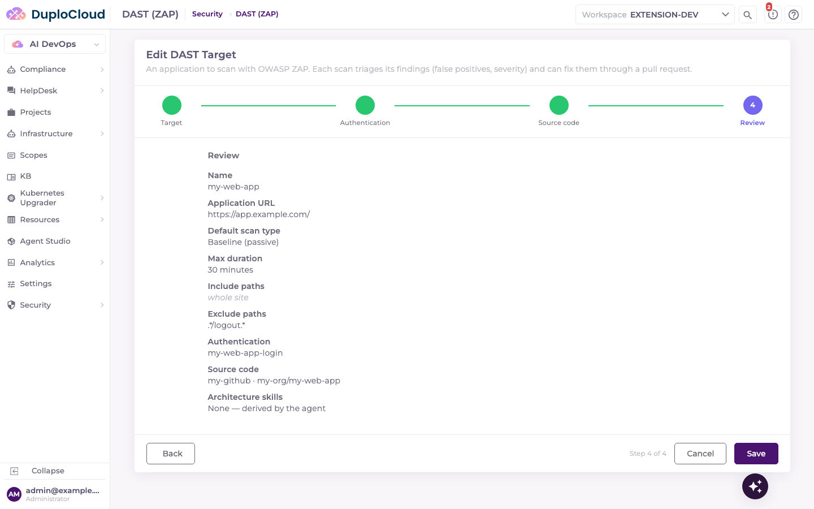<figcaption>
Review the target
</figcaption></figure>

A target only stores settings. Nothing is scanned until you run a scan.

## Grant access

Give the people who will use DAST the permissions in [Permissions and Safety](permissions-and-safety.md). Raising fix pull requests needs the separate **Fix DAST findings via pull request** action, which the "all" permission doesn't include.

Next: [Use](use.md).
