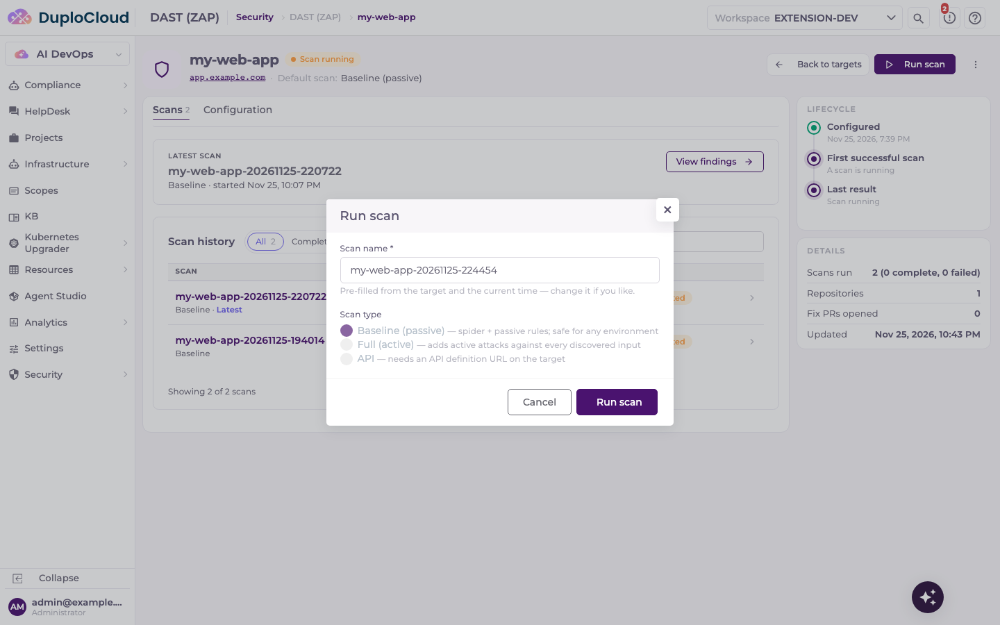
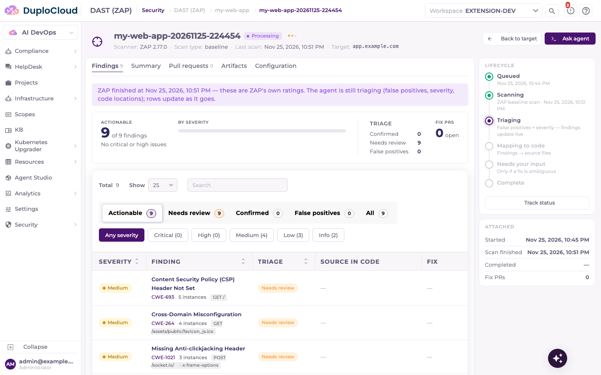
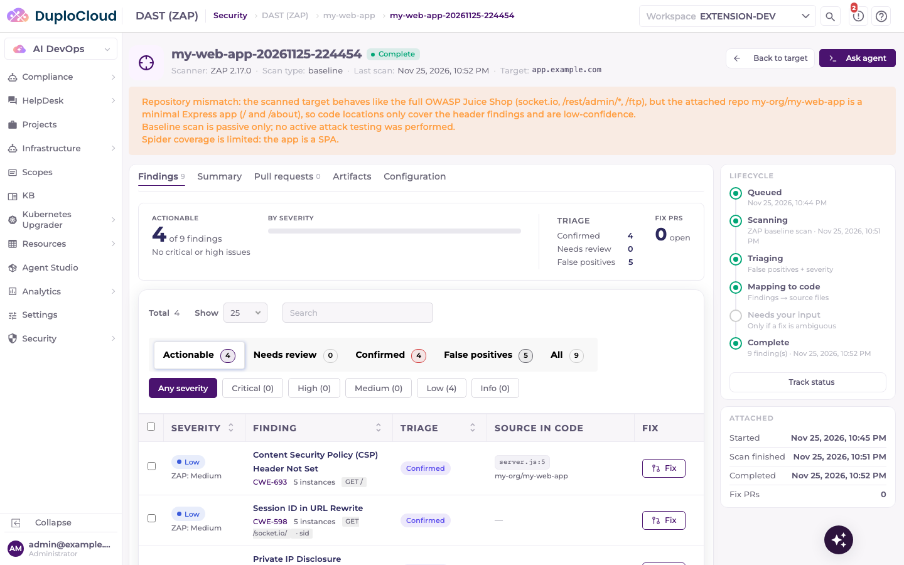
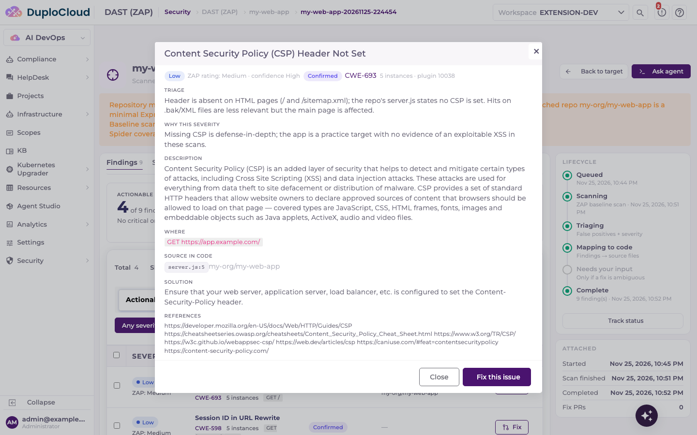
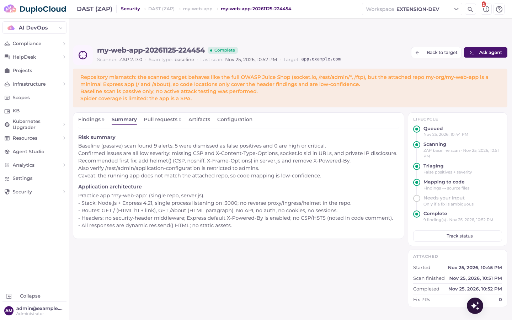
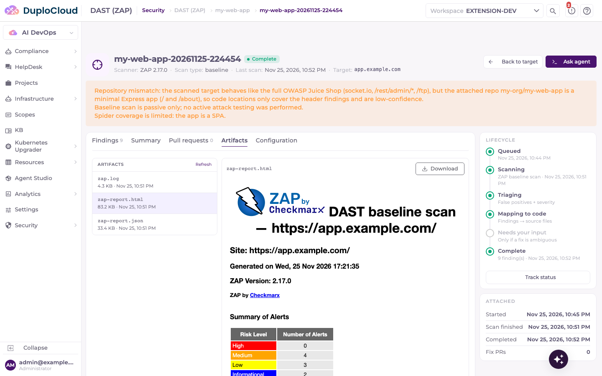
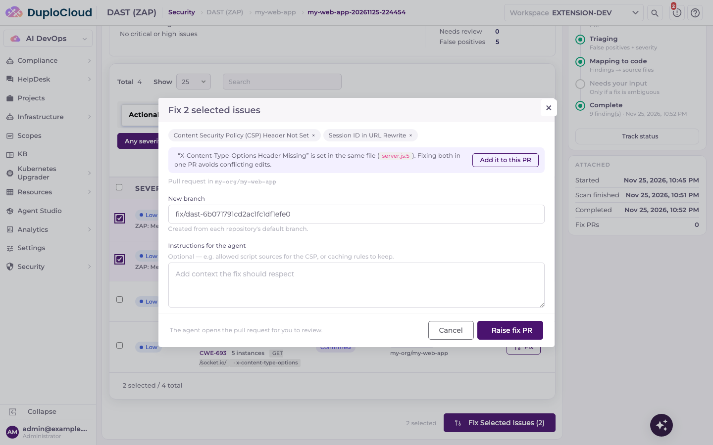
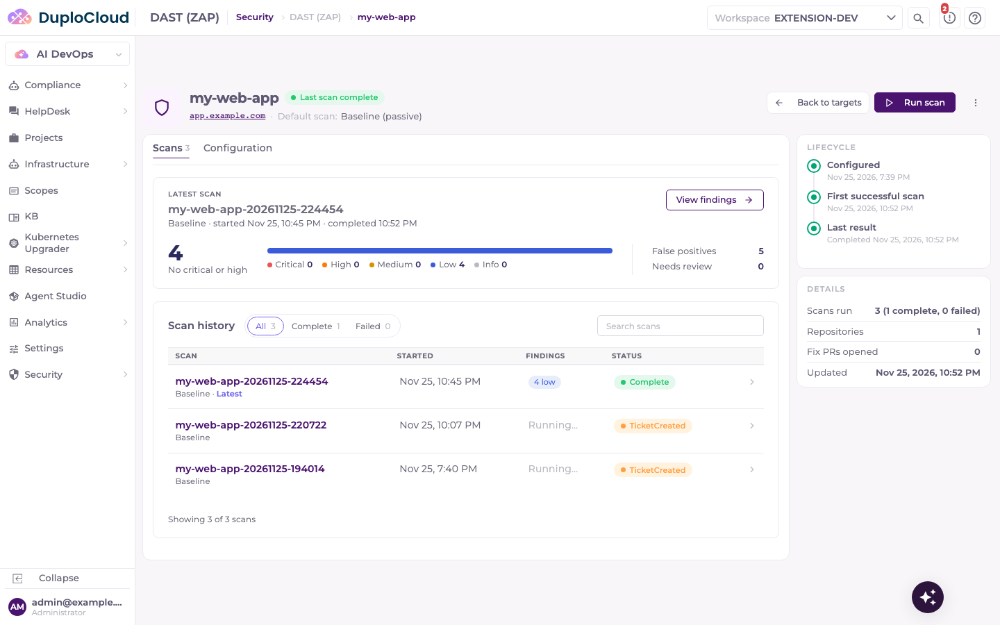

# Use

## Run a scan

1. Open **Security → DAST (ZAP)** and select your target.
2. Click **Run scan**.
3. In the **Run scan** window:
   * **Scan name**: pre-filled from the target name and the current time. You can change it.
   * **Scan type**: starts on the target's default. **API** is only available when the target has an API definition URL. Choosing **Full (active)** shows a warning that a full scan sends attack payloads and can change data in the application.
4. Click **Run scan**. The scan starts right away and its page opens.

<figure><figcaption>
Start a scan
</figcaption></figure>

## Follow a scan

The **Lifecycle** panel on the scan page shows where the scan is:

| Stage | What happens |
| --- | --- |
| **Queued** | The scan is waiting for the agent. |
| **Scanning** | ZAP is running against the application. |
| **Triaging** | The agent reviews ZAP's findings. |
| **Mapping to code** | The agent places findings in your repositories. Skipped when no repositories are linked. |
| **Needs your input** | Only while fixing, if a fix needs a decision from you. |
| **Complete** | Findings, summary and reports are final. |

A baseline scan of a small application typically finishes in about ten minutes.

As soon as ZAP finishes, the **Findings** tab shows ZAP's own ratings with a note that the agent is still triaging. The rows update as the agent works through them.

<figure><figcaption>
ZAP's raw findings, before triage
</figcaption></figure>

The **Artifacts** tab shows the live ZAP log while the scan runs. **Ask agent** opens the scan's chat, where you can ask the agent about the scan.

## Read the findings

When the scan reaches **Complete**, the top of the **Findings** tab shows how many findings are actionable, whether any are critical or high, and the triage totals. Notes from the agent, such as limits of this scan, appear in a banner above the tabs.

<figure><figcaption>
Triaged findings
</figcaption></figure>

Each row has:

| Column | Meaning |
| --- | --- |
| **Severity** | Critical, High, Medium, Low or Info, as set by the agent for your application. ZAP's original rating is shown under it when they differ. |
| **Finding** | The issue, its CWE, how many places it was found, and where. Click the name for details. |
| **Triage** | **Confirmed**, **False positive** or **Needs review**. |
| **Source in code** | The file and line, when repositories are linked and the agent could place the finding. Left empty rather than guessed. |
| **Fix** | Raise a fix pull request for this finding, when fixing is available. |

Use the **Actionable**, **Needs review**, **Confirmed**, **False positives** and **All** tabs, and the severity buttons, to narrow the list.

Click a finding's name to open its details. Next to ZAP's description, solution and references, the agent adds:

* **Triage**: what it checked, and whether it agrees with ZAP
* **Why this severity**: why it kept or changed ZAP's rating
* **Where**: the requests that showed the problem
* **Source in code**: the file and line, if it found one

<figure><figcaption>
One finding, explained
</figcaption></figure>

The other tabs on the scan page:

* **Summary**: the agent's risk summary, with the fixes it recommends first, and the **Application architecture** brief it used for triage.
* **Pull requests**: the fix pull requests raised from this scan.
* **Artifacts**: ZAP's own files: `zap-report.html`, `zap-report.json` and `zap.log`. Select one to view it, or click **Download**.
* **Configuration**: the settings the scan ran with.

<figure><figcaption>
The scan summary
</figcaption></figure>

<figure><figcaption>
ZAP's report
</figcaption></figure>

## Fix findings with a pull request

This needs a GitHub scope and repositories on the target, and the **Fix DAST findings via pull request** permission. False positives can't be fixed.

1. On the **Findings** tab, select one or more findings and click **Fix Selected Issues**. To fix a single finding, click **Fix** on its row, or **Fix this issue** in its details.
2. Check the list in the **Fix** window. If another finding is in the same file, the window offers to **Add it to this PR**, so both fixes land together.
3. Keep or change the **New branch** name. Branches are created from each repository's default branch.
4. Optionally, add **Instructions for the agent**, such as the script sources your content security policy must allow.
5. Click **Raise fix PR**.

<figure><figcaption>
Raise a fix pull request
</figcaption></figure>

The agent edits the code, pushes the new branch and opens one pull request per repository, for you to review. It never merges and never force-pushes. The links appear on the **Pull requests** tab. If a fix needs a decision from you, the scan moves to **Needs your input** and the agent asks in the scan's chat.

Treat a fix as a starting point. Review it and test it like any other change before you merge it.

## Review a target's history

The target page shows the latest scan with its severity counts, and the **Scan history** of every scan. The **Configuration** tab shows the target's settings, including the cached architecture brief from the last completed scan.

<figure><figcaption>
A target and its scans
</figcaption></figure>

Each new scan of the same target starts from the previous scan's architecture brief and code locations, so repeat scans need less work.

## Edit or delete a target

* **Edit**: from the target page's **⋮** menu, or the row menu in the target list. You can't change the name. Changes apply to new scans only.
* **Delete**: from the row menu in the target list. This deletes the target **and all of its scans**. Pull requests already opened stay in GitHub.
