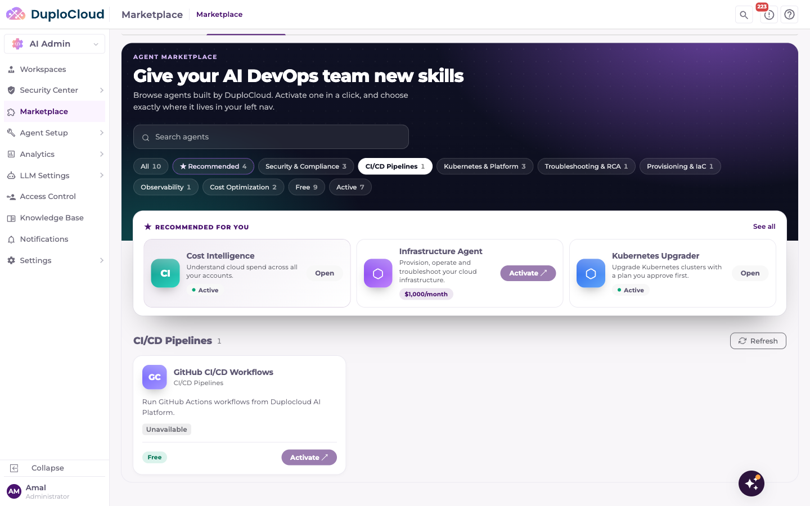
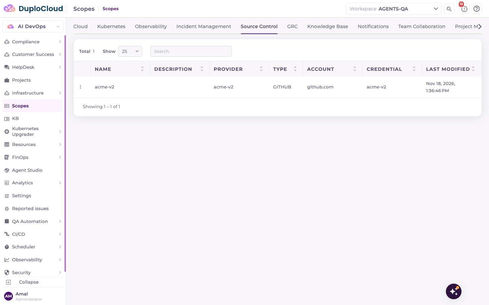
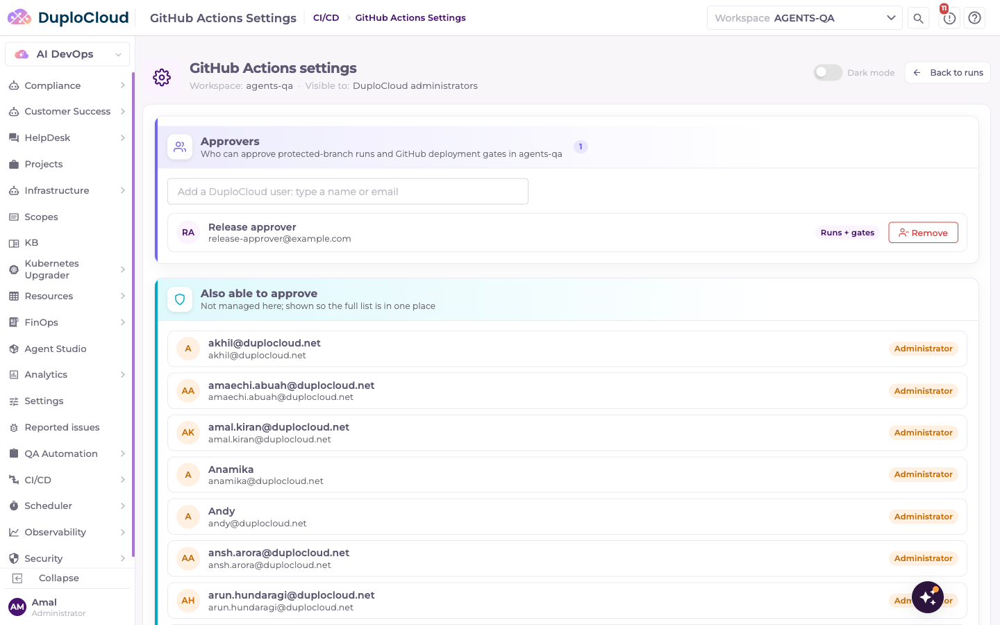

# Set Up

Setting up is a job for a DuploCloud administrator.

## Before you start

- A **GitHub account or token** that can see the repositories you want to automate. Everyone who uses the scope in DuploCloud acts on GitHub through that one identity, so use a dedicated account or a fine-grained token limited to those repositories.
- Workflows that declare **`on: workflow_dispatch`** (GitHub's manual trigger). Without it a workflow cannot be started from DuploCloud.

## Activate GitHub CI/CD Workflows

1. Open **Marketplace > Agent Marketplace** and find **GitHub CI/CD Workflows**. The **CI/CD Pipelines** filter shows it, or search for `GitHub`. It is marked **Free**.
2. Select **Activate**. See [Agent Marketplace and Buying Agents](../../getting-started/marketplace.md) for what happens next.
3. When it finishes, the **CI/CD** section of the menu shows **GitHub Actions** and **GitHub Actions Metrics**. Administrators also see **GitHub Actions Settings**.

## Connect GitHub

### 1. Create a GitHub token

The token needs these repository permissions:

| Permission (fine-grained token) | Needed for |
| --- | --- |
| Metadata: Read | Listing repositories (always included) |
| Contents: Read | Branches, tags, branch protection, and reading the workflow file to build the input form |
| Actions: Read and write | Listing workflows, starting runs, run status, jobs and logs, and cancelling an approved run that started on the wrong commit |
| Deployments: Read and write | Reviewing GitHub deployment gates (only if you use them) |
| Checks: Read | Better failure summaries from GitHub's error annotations (optional) |

A classic personal access token also works. Give it the `repo` and `workflow` scopes.

If your organization requires approval of fine-grained tokens, an organization owner must approve the token before it works.

### 2. Add a GitHub scope

Add GitHub as a source-control provider, add the token as a credential, and create a scope, as described in [Connecting GitHub to DuploCloud](../../getting-started/integrating-providers/github.md). Then attach the scope to the workspace. Users never see the token.

The provider's **GitHub Hostname** (shown as **Account** in the Scopes list) decides which GitHub is used:

| GitHub Hostname | GitHub used |
| --- | --- |
| Empty, `github.com`, or a plain name such as `my-org` | github.com. A plain name is treated as the organization whose repositories are listed. |
| Another host name or URL, for example `github.mycompany.com` | GitHub Enterprise Server at `https://<host>/api/v3` |

If no organization is set, or the organization lists no repositories, the token's own repositories are listed.

The scope then appears under **Scopes > Source Control** with the type **GITHUB**.

### 3. Limit what can be run (recommended)

Set the scope's **Repository Names RegEx** and **Branch Names RegEx**. The agent applies them in every picker and again when a run is created, so a repository or branch outside them cannot be run, even through the API.

- Matching ignores case and is not anchored: `main` also matches `not-main`. Write `^main$` to match one branch exactly.
- A blank field allows everything for this agent. A pattern that is not a valid regular expression blocks everything.

## Protect the branches that deploy

The agent asks GitHub whether the chosen branch is protected:

- **Protected branch:** the run is held in DuploCloud with **Waiting for approval**. Nothing reaches GitHub until a second person approves it.
- **Unprotected branch:** the run starts straight away for anyone allowed to start runs.

Turn on branch protection in GitHub (**Settings > Branches**) for every branch that deploys. Repository rulesets alone do not count, and tags are never held.

## Set up deployment gates (optional)

If a workflow deploys to a GitHub **environment** (for example `production`) with required reviewers, GitHub pauses the run at that job. Approvers can review it from DuploCloud.

In GitHub, for each environment:

1. Go to **Settings > Environments** and open or create the environment.
2. Turn on **Required reviewers** and add the GitHub account that owns the scope's token. DuploCloud reviews as that account.
3. Leave **Prevent self-review** off. The same account starts the runs, so with it on GitHub refuses every review made from DuploCloud. DuploCloud applies its own four-eyes rule instead (see [Permissions and Safety](permissions-and-safety.md)).


GitHub offers **Required reviewers** on private repositories only with GitHub Enterprise. On Free, Pro and Team plans it exists for public repositories only. Branch protection on private repositories needs GitHub Pro, Team or Enterprise, so on GitHub Free no run on a private repository is held for approval.


## Grant access

Access is set with DuploCloud permission sets. The agent adds four actions:

| Action | Shown in the permission editor as | Lets a user |
| --- | --- | --- |
| `github-actions.dispatch` | Dispatch a GitHub workflow | Start runs. Granted on the workspace, not on GitHub Action runs. |
| `github-actions.approve-run` | Approve a run on a protected branch | Approve or reject runs held on protected branches |
| `github-actions.approve-deployment` | Review a GitHub deployment gate | Approve or reject GitHub deployment gates |
| `github-actions.view-logs` | Read full GitHub job logs | Read the full log text of jobs |

Reading runs needs read (GET) access to the workspace's GitHub Action runs and access to the GitHub scope. Starting runs also needs create (POST) access to runs. See [Permissions and Safety](permissions-and-safety.md) for the full table.

## Choose approvers

1. Open **CI/CD > GitHub Actions Settings** (administrators only).
2. Type a name or email and pick a DuploCloud user. Only active users who are not administrators are listed, because administrators can already approve.

The first time you add someone, DuploCloud creates a permission set named `GitHub Actions approvers - <workspace>`. It lets approvers see the workspace's runs, approve or reject held runs and deployment gates, and use the workspace's scopes for that. It grants nothing else. To remove an approver, select **Remove** and type their email to confirm.

The page also lists, read-only, the administrators and users who can approve through other permission sets.

Next: [Use](use.md).
