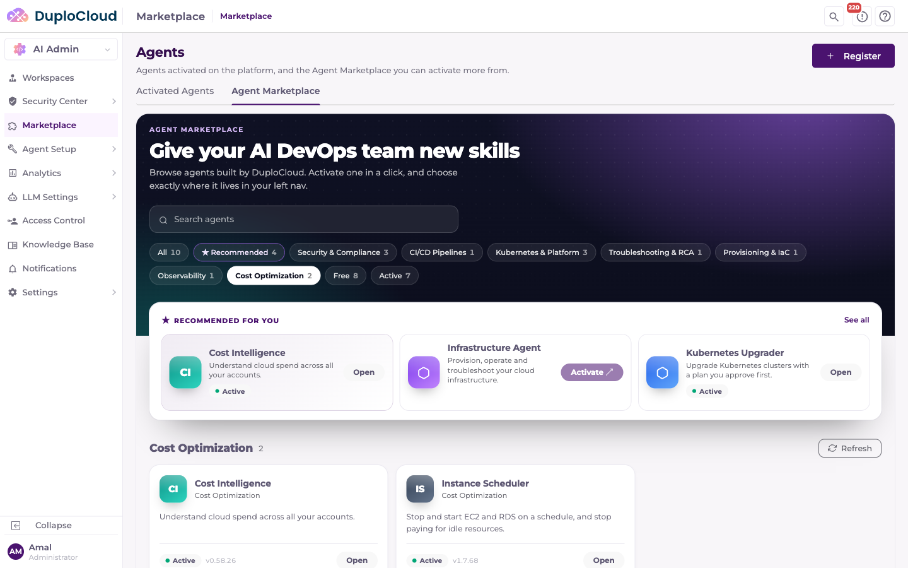

# Set Up

Setting up is a job for a DuploCloud administrator.

## Before you start

- An **AWS account** with the EC2 instances, Auto Scaling groups or RDS databases you want to schedule.
- An **AWS identity** (an IAM role or user) that DuploCloud can use in that account, with the permissions listed in [AWS permissions](#aws-permissions). Instance Scheduler creates IAM roles, EventBridge schedules and, for RDS, Lambda functions and a Secrets Manager secret in the account, so the identity needs more than read access.
- For **RDS** schedules, the scope's credential must be an **access key** (access key ID and secret access key). RDS schedules do not work with a scope that assumes an IAM role. EC2 schedules work with either.

## Activate Instance Scheduler

1. Open **Marketplace > Agent Marketplace** and find **Instance Scheduler**. The **Cost Optimization** filter shows it, or search for `Instance Scheduler`.
2. Select **Activate**. See [Agent Marketplace and Buying Agents](../../getting-started/marketplace.md) for what happens next.
3. When it finishes, a **Scheduler** section with **EC2** and **RDS** appears in the left menu.

## Connect your AWS account

Add AWS as a cloud provider, add a credential, and create a scope, as described in [Connecting AWS to DuploCloud](../../getting-started/integrating-providers/amazon-web-services-aws.md). Then attach the scope to the workspace. Both schedule forms list the scopes attached to the workspace, and a scope from another workspace is refused.

Instance Scheduler finds instances and databases in every region the scope's identity can see, so one scope covers all regions of an account.

## AWS permissions

Give the scope's identity these actions. Most write actions only ever touch resources whose names start with the prefixes in [What it creates in your account](#what-it-creates-in-your-account), so you can limit them with resource ARNs if you prefer.

| Used for | AWS actions |
| --- | --- |
| Listing instances, groups and databases in the forms | `ec2:DescribeRegions`, `ec2:DescribeInstances`, `autoscaling:DescribeAutoScalingGroups`, `rds:DescribeDBInstances`, `rds:DescribeDBClusters` |
| Creating EC2 and Auto Scaling group schedules | `sts:GetCallerIdentity`, `iam:GetRole`, `iam:CreateRole`, `iam:PutRolePolicy`, `iam:PassRole`, `scheduler:CreateSchedule` |
| Resizing an Auto Scaling group now (**Execute now**) | `autoscaling:UpdateAutoScalingGroup` |
| The EC2 dry run and the **Execute Now** button on an EC2 schedule's page | `ec2:DescribeInstances`, `ec2:StartInstances`, `ec2:StopInstances` |
| Creating RDS schedules | `sts:GetCallerIdentity`, `iam:GetRole`, `iam:CreateRole`, `iam:PutRolePolicy`, `iam:DetachRolePolicy`, `iam:PassRole`, `lambda:GetFunction`, `lambda:CreateFunction`, `lambda:UpdateFunctionCode`, `lambda:UpdateFunctionConfiguration`, `lambda:AddPermission`, `lambda:RemovePermission`, `secretsmanager:CreateSecret`, `secretsmanager:PutSecretValue`, `secretsmanager:DescribeSecret`, `scheduler:CreateSchedule` |
| RDS stops and starts that run straight away, and snapshots | `rds:StopDBInstance`, `rds:StartDBInstance`, `rds:StopDBCluster`, `rds:StartDBCluster`, `rds:CreateDBSnapshot`, `rds:CreateDBClusterSnapshot`, `rds:DescribeDBSnapshots`, `rds:DescribeDBClusterSnapshots` |
| The RDS schedule page (upcoming runs, pause and resume, snapshots, logs) | `scheduler:GetSchedule`, `scheduler:UpdateSchedule`, `iam:PassRole`, `rds:DescribeDBSnapshots`, `rds:DescribeDBClusterSnapshots`, `rds:DeleteDBSnapshot`, `rds:DeleteDBClusterSnapshot`, `logs:DescribeLogGroups`, `logs:FilterLogEvents` |
| Deleting schedules | `scheduler:DeleteSchedule`, `iam:ListRolePolicies`, `iam:DeleteRolePolicy`, `iam:ListAttachedRolePolicies`, `iam:DetachRolePolicy`, `iam:DeleteRole`, `lambda:DeleteFunction`, `secretsmanager:DeleteSecret`, `autoscaling:DeleteScheduledAction` |

If you only schedule EC2, you can leave out the Lambda, Secrets Manager, RDS and CloudWatch Logs actions.

## What it creates in your account

Each schedule gets its own roles, with permissions limited to that schedule's targets:

| Resource | Name starts with | Trusted by | Allowed to |
| --- | --- | --- | --- |
| EC2 schedule (one per region) | `duplo-ec2-sched-` | | Run the chosen action at the chosen time |
| EC2 scheduler role | `duplo-ec2-role-` | EventBridge Scheduler | Only the chosen action (`ec2:StopInstances`, `ec2:StartInstances` or `ec2:RebootInstances`) on only the schedule's instances |
| Auto Scaling group schedule | `duplo-asg-sched-` | | Set the group's size at the chosen time |
| Auto Scaling group role | `duplo-asg-role-` | EventBridge Scheduler | `autoscaling:UpdateAutoScalingGroup` on that one group |
| RDS schedules | `rds-sched-`, `rds-paired-` | | Invoke the schedule's Lambda function, or start the database directly |
| RDS Lambda functions | `rds-snap-`, `rds-paired-` | | Stop or start the database and take snapshots |
| RDS roles | `rds-scheduler-`, `rds-paired-`, `rds-snap-exec-` | EventBridge Scheduler or Lambda | Stop and start only the schedule's databases, create and delete only `rds-sched-` snapshots, write logs, and read the schedule's one secret |
| RDS secret | `rds-snap-exec/` | | Holds the credential the Lambda function uses to record each run back in DuploCloud |
| RDS snapshots | `rds-sched-` | | Snapshots taken before a stop |

Deleting a schedule removes its schedules, roles, Lambda functions and secret. Snapshots and the Lambda functions' CloudWatch log groups (`/aws/lambda/rds-`) are kept. See [Troubleshooting](troubleshooting.md#if-something-is-left-behind).

## Grant access

Instance Scheduler does not add permissions of its own. It uses each user's DuploCloud role:

- **Administrators** create schedules that go live straight away, and approve or reject other users' requests.
- **Regular users** submit schedules, edits and deletions for an administrator to approve.
- **Read-only users** can only view.

Users also need access to the workspace and to the AWS scope. See [Permissions and Safety](permissions-and-safety.md).

Next: [Use](use.md).
