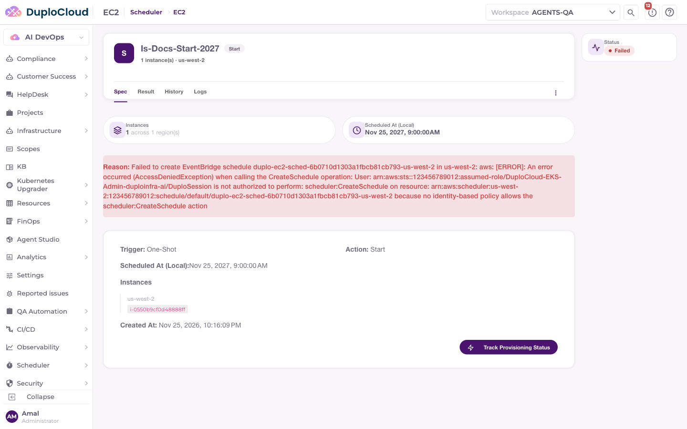

# Troubleshooting and FAQ

## Common problems

| What you see | What it means | What to do |
| --- | --- | --- |
| **Waiting for Approval** | A regular user submitted the schedule and no administrator has approved it. Nothing exists in AWS yet. | Ask an administrator to approve or reject it (see [Use](use.md#approve-or-reject-a-request)). |
| **Rejected**, with "Rejected by" an administrator's email and a reason | An administrator rejected the request. | Read the reason, then submit a new request. |
| **Pending Deletion** | A regular user asked to delete the schedule. It keeps running. | An administrator selects **Approve Deletion** or **Reject Deletion**. |
| **Failed** after the schedule was created or approved | Creating it in AWS failed, most often because the scope's identity is missing a permission. | Open **Track Provisioning** to read the AWS error, and compare the identity's permissions with [AWS permissions](set-up.md#aws-permissions). Then delete the schedule and create it again. |
| **Scope is missing AWS credential keys.** (RDS form) | The scope's credential assumes an IAM role. RDS schedules need an access key credential. | Use a scope whose credential is an access key. |
| **Scope '...' is not found or not accessible from this workspace.** | The scope isn't attached to this workspace, or you can't use it. | Pick a scope attached to the workspace, or ask an administrator to attach it. |
| **ScheduledAt '...' is in the past — pick a future date/time.** | The one-time date and time has passed. | Pick a time in the future. |
| **Cannot approve — the scheduled time (...) has already passed.** | A one-time request waited past its time. | Edit the time before approving, or ask the requester to submit it again. |
| **... must be a 5-field cron expression** or **... has an invalid field** | The custom cron expression is malformed. | Use five fields (minute, hour, day of month, month, day of week) with digits and `* / , -` only. |
| **Timezone '...' is not a recognized IANA timezone name.** | The time zone sent with the schedule isn't valid. | Check your browser's time zone setting, which the form uses. |
| **Use only lowercase letters, numbers, and hyphens.** | The name has other characters. | Rename it, for example `nightly-stop-dev`. |
| **Read-only users cannot make changes to this resource.** | Your DuploCloud role is read-only. | Ask an administrator for a role that can submit requests. |
| **Only Administrators can ...** | You tried to approve, reject, run, pause or resume a schedule, or delete a snapshot. | Ask an administrator. |
| An instance can't be ticked | It belongs to an Auto Scaling group. | Schedule the group on the **Auto Scaling Group** tab. |
| An instance or database is missing from the list | The scope's identity can't see it, or lacks a Describe permission in that region. | Check the identity's permissions (see [AWS permissions](set-up.md#aws-permissions)). |
| An RDS run shows **skipped** | The database was already in the requested state. | Nothing. This is expected. |
| A stopped RDS instance started again by itself | AWS starts stopped RDS instances again after 7 days. | Use a recurring stop. |

This is how a provisioning failure looks on the schedule's page. The reason names the AWS action the identity is missing:

## If something is left behind

Deleting a schedule removes what it created in AWS. If a deletion failed part way, look in the AWS account for resources whose names start with:

- EventBridge Scheduler schedules: `duplo-ec2-sched-`, `duplo-asg-sched-`, `rds-sched-`, `rds-paired-`
- IAM roles: `duplo-ec2-role-`, `duplo-asg-role-`, `rds-scheduler-`, `rds-paired-`, `rds-snap-exec-`
- Lambda functions: `rds-snap-`, `rds-paired-`
- Secrets Manager secrets: `rds-snap-exec/`

These are always kept, by design:

- RDS snapshots named `rds-sched-...`. Delete them from the schedule's page before you delete the schedule, or in AWS.
- CloudWatch log groups named `/aws/lambda/rds-...`.

## FAQ

**Can a regular user schedule instances?** They can submit a request. Nothing is created in AWS until an administrator approves it.

**Does it run in my AWS account or DuploCloud's?** In yours. The schedules, roles and Lambda functions are created in the account of the scope you choose, and AWS runs them there.

**Does a schedule pick up instances I tag later?** No. A schedule keeps the instances that were ticked when it was saved. Edit the schedule to add more. An Auto Scaling group schedule acts on whatever instances the group has at the time.

**Does stopping a database take a backup?** A recurring stop takes one snapshot of each database when the schedule is created. Turn on **Take snapshot before stopping** for a snapshot before every stop. The latest seven per database are kept.

**Can I pause an EC2 schedule?** No. Pause and resume are for RDS schedules. To stop an EC2 schedule, delete it.

**Can I schedule an Auto Scaling group?** Yes. You set its minimum, maximum and desired size, and can add a restore schedule that brings back the earlier sizes.
