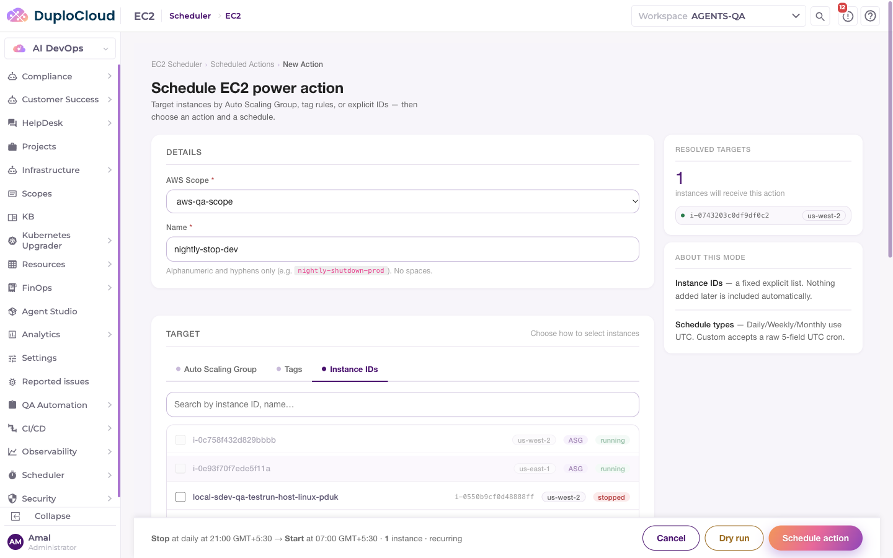
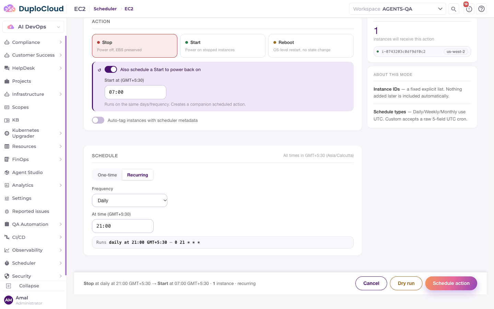
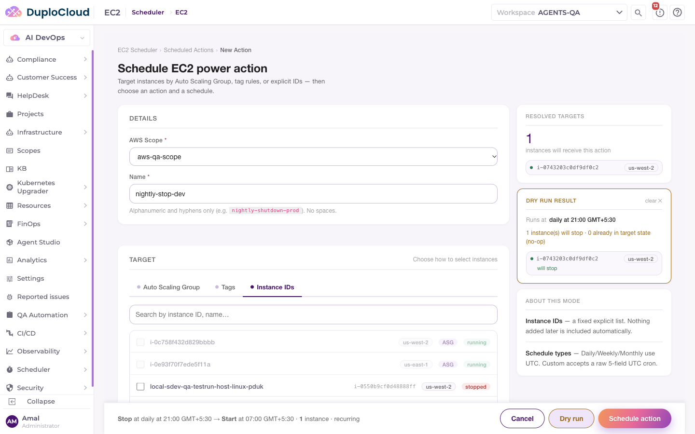
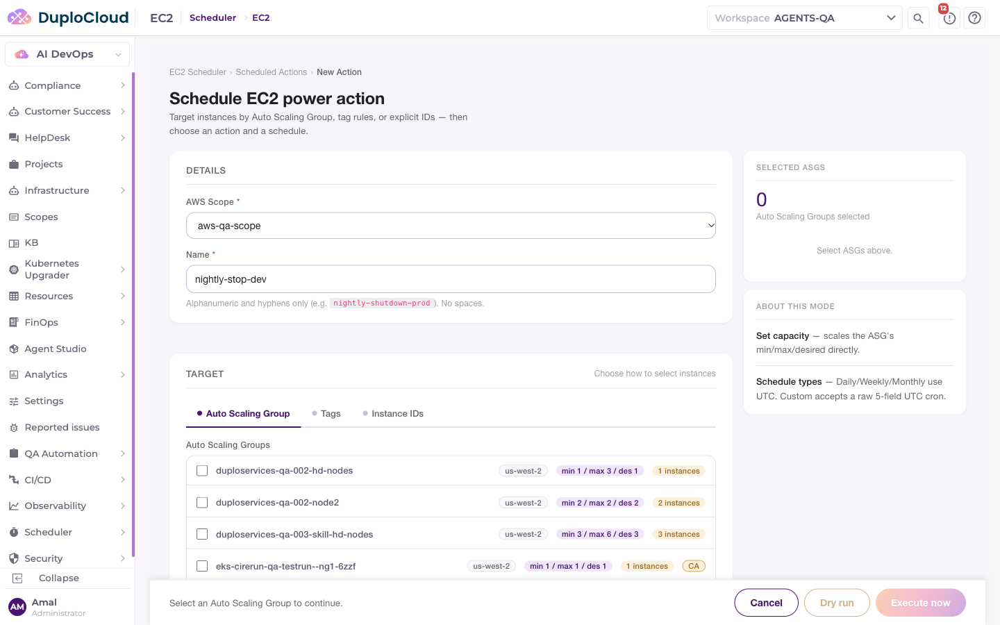
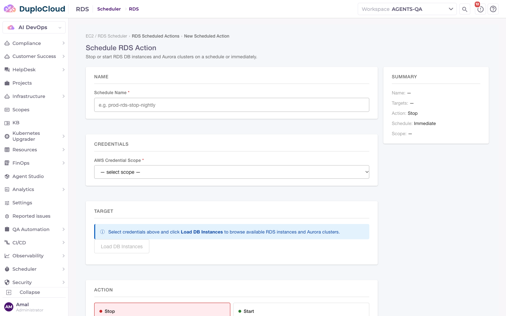
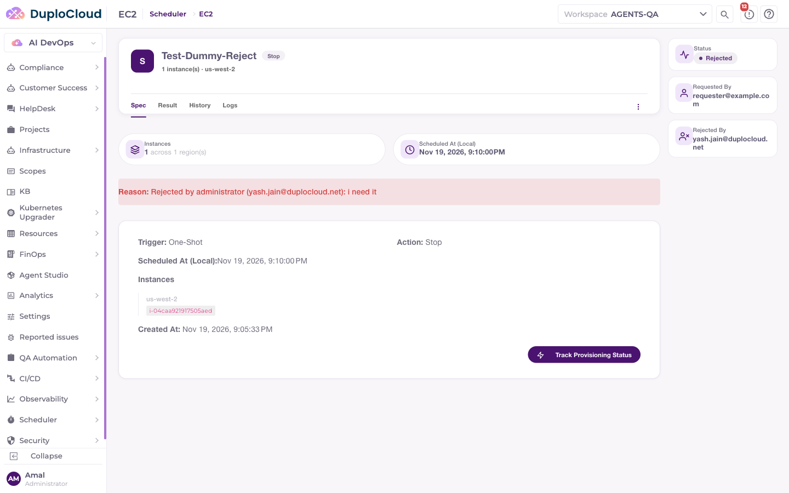
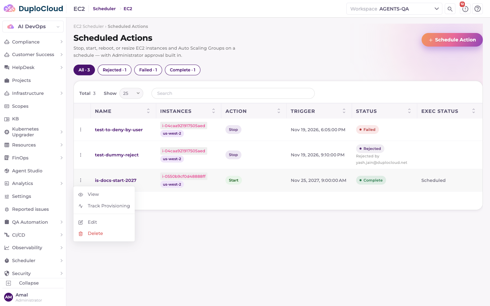
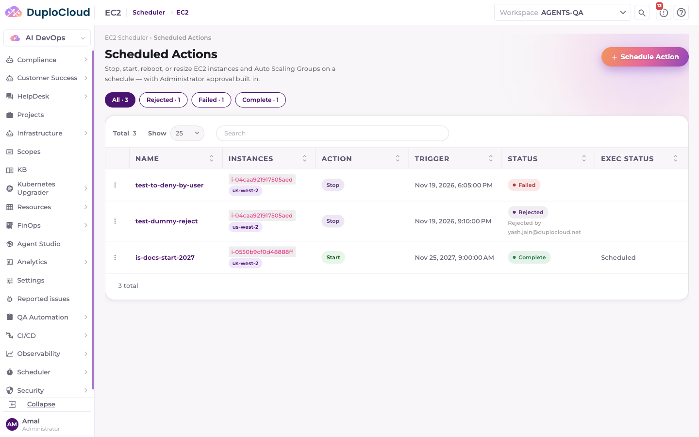
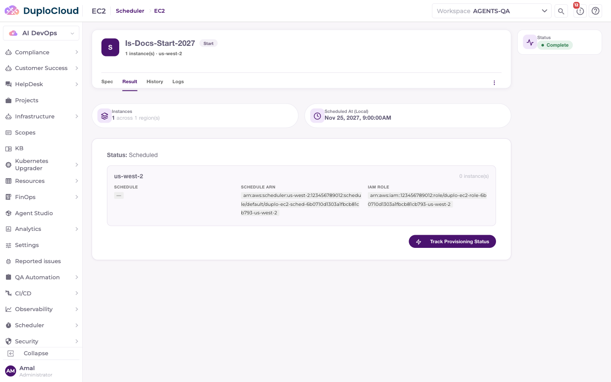

# Use

If you are not an administrator, every form below ends with **Submit for Approval** instead of the usual button, and nothing is scheduled until an administrator approves it. See [Approve or reject a request](#approve-or-reject-a-request).

## Schedule EC2 instances



## Open the form

Open **Scheduler > EC2** and select **Schedule Action**.



## Name it and pick the scope

Under **Details**, choose the **AWS Scope** for the account, and enter a **Name**: lowercase letters, numbers and hyphens, for example `nightly-stop-dev`.



## Choose the instances

Under **Target**, choose how to pick them:

- **Instance IDs:** tick instances from the list of every instance the scope can see, in all regions.
- **Tags:** enter tag keys and values, then tick from the instances that match. The schedule keeps the instances you ticked. Instances tagged later are not added.

Instances that belong to an Auto Scaling group are shown but can't be ticked, because the group would replace them. Schedule the group instead (see [Resize an Auto Scaling group](#resize-an-auto-scaling-group)).




## Choose the action

Under **Action**, pick **Stop**, **Start** or **Reboot**. If every selected instance is already in that state (for example a stop on stopped instances), the form warns you and won't save the schedule. Try the other action instead.

For **Stop** and **Start** on instances picked by ID, you can turn on **Also schedule a Start to power back on** (or **Also schedule a Stop to power off**) and give it its own time. This creates a second schedule named after the first, ending in `-start` or `-stop`.



## Choose when

Under **Schedule**, pick:

- **One-time:** a date and time in the future.
- **Recurring:** **Hourly**, **Daily**, **Weekly**, **Monthly**, or **Custom cron** (a five-field cron expression: minute, hour, day of month, month, day of week).

The form shows the time zone it uses at the top of this section.




## Check and save

Select **Dry run** to see each instance the schedule would affect and its current state. Then select **Schedule action**.

The schedule shows **New** while DuploCloud creates it in AWS, then **Complete**.



## Resize an Auto Scaling group

Use this to scale a group down overnight, for example to zero, and back up in the morning.

1. Open **Scheduler > EC2**, select **Schedule Action**, pick the **AWS Scope** and enter a **Name**.
2. Under **Target**, select **Auto Scaling Group** and tick the groups. Each shows its current minimum, maximum and desired size.

   

3. Under **Action**, enter the new **Min size**, **Max size** and **Desired** size.
4. To bring the old size back later, turn on **Also schedule a restore action to bring capacity back later** and enter when. This creates a second schedule, ending in `-restore`, with the sizes the group had when you filled in the form.
5. Under **Schedule**, pick **Execute now**, **One-time** or **Recurring**, and select **Execute now** or **Schedule action**.


A group with a **CA** badge runs the Kubernetes Cluster Autoscaler. Scale its workloads down first before you set the group's minimum and maximum to 0, or the autoscaler works against the schedule.


## Schedule RDS databases



## Open the form

Open **Scheduler > RDS** and select **Schedule Action**.




## Name it and pick the scope

Enter a **Schedule Name** and choose the **AWS Credential Scope**. The scope's credential must be an access key (see [Set Up](set-up.md#before-you-start)).



## Choose the databases

Select **Load DB Instances**, then tick RDS instances and Aurora clusters. Each shows its engine, region and state. Use the filter box to narrow the list.



## Choose the action

Pick **Stop** or **Start**. Only databases in the opposite state are affected: a stop skips stopped databases.

For **Stop**, you can turn on **Take snapshot before stopping**.



## Choose when

Pick **Immediate** (runs as soon as it is created), **One-time** (a date and time), or **Recurring (cron)** (**Hourly**, **Daily**, **Weekly**, **Monthly** or **Custom cron**).

For a recurring schedule you can turn on **Add paired Start schedule** (or **Stop**) and give it its own time, for example stop at 21:00 and start at 08:00.

If a recurring schedule overlaps a database's maintenance window, the form warns you. AWS may restart or patch the database during that window.



## Check and save

Review the **Summary** and select **Create Schedule**.




AWS starts a stopped RDS instance again by itself after 7 days, and this can't be turned off. To keep a database stopped longer, use a recurring stop, for example every night. To get rid of a database for good, delete it in AWS instead.


**About snapshots.** A recurring stop takes one snapshot of each database when the schedule is created. With **Take snapshot before stopping** on, it also takes one before every stop and keeps the latest seven per database. Snapshot names start with `rds-sched-`. Taking a snapshot can make the stop take longer.

## Approve or reject a request

Administrators only.

1. Open **Scheduler > EC2** or **Scheduler > RDS**. Requests show **Waiting for Approval** and **Requested by** with the requester's email. On EC2, the **Waiting For Approval** filter lists only these.
2. Open the row's menu, or the schedule's page, and select **Approve** or **Reject**.
   - **Approve** asks you to confirm ("This will start real provisioning against AWS"), then creates the schedule.
   - **Reject** asks for an optional reason, which the requester sees.

A rejected request stays in the list as **Rejected**, with who rejected it and the reason.

Rejecting a change to a live schedule does not undo the change. Edit the schedule back if you need to.

A one-time request whose time has already passed can't be approved. Edit the time first, or ask the requester to submit it again.

**Deletion requests** work the same way. A schedule a regular user asked to delete shows **Pending Deletion** and keeps running. Select **Approve Deletion** to remove it from AWS, or **Reject Deletion** to keep it.

## Run, pause, edit or delete a schedule

| Task | Who | Where |
| --- | --- | --- |
| **Execute Now** (run a one-time or immediate RDS schedule straight away) | Administrators | The RDS schedule's page |
| **Pause** and **Resume** a recurring RDS schedule | Administrators | The RDS row menu (**Pause Schedule**, **Resume Schedule**) or the schedule's page |
| **Edit** | Administrators apply it. Other users select **Edit (request)**, which waits for approval. | Row menu or the schedule's page |
| **Delete** | Administrators delete it and its AWS resources. Other users select **Delete (request)**. Users can delete their own requests that were never approved. | Row menu or the schedule's page |
| **Delete a snapshot** | Administrators | **Snapshots** on the RDS schedule's page |

A paired or restore schedule (ending in `-start`, `-stop` or `-restore`) is a schedule of its own. Delete it separately.

## Check what happened

- The **Status** column shows where each schedule is: **New**, **Complete**, **Waiting for Approval**, **Rejected**, **Failed** and so on. **Exec Status** on EC2 shows **Scheduled** once the schedule exists in AWS, or **Success** after a change that ran straight away.
- Select a schedule's name to open its page. The **Result** tab shows the EventBridge schedule and IAM role created for each region.

  

  **Track Provisioning** (or **View Provisioning Ticket**) opens the provisioning ticket, which shows each step DuploCloud took in AWS and any AWS error.
- An RDS schedule's page shows:
  - **Upcoming Schedule:** the next runs of a recurring schedule.
  - **Recent Executions:** each run, with the database, the result (success, skipped or error) and the snapshot taken.
  - **Snapshots:** the `rds-sched-` snapshots of the schedule's databases.
  - **Lambda Execution Logs:** the log lines of the scheduler's Lambda functions for a time window you choose.
