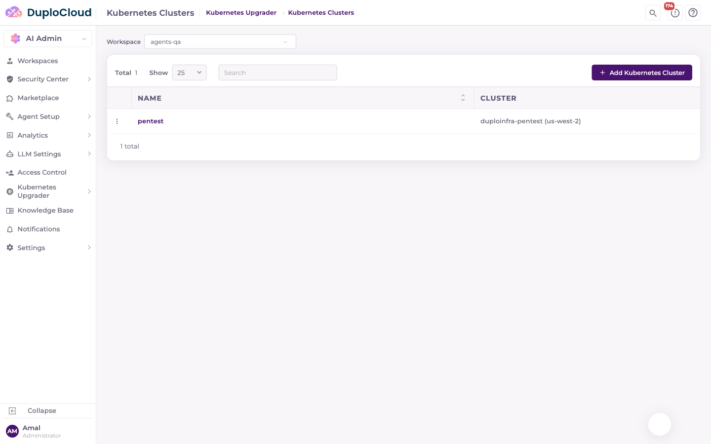

# Kubernetes Upgrader

Upgrade your Amazon EKS clusters as one tracked job, with a plan you approve first. Kubernetes Upgrader upgrades the control plane, the EKS add-ons and the worker nodes in the order AWS recommends, shows live progress, and stops safely when something looks wrong.


Kubernetes Upgrader changes your cluster and terminates worker nodes. Nothing runs until an administrator approves the exact plan. See [Permissions and Safety](permissions-and-safety.md).


These pages describe Kubernetes Upgrader version 0.9.22.

## What it does

An upgrade job can run up to three phases, always in this order:

1. **Control plane:** upgrades the EKS control plane to the version you choose. EKS moves one minor version at a time, so a multi-version upgrade is planned as a series of steps.
2. **Add-ons:** upgrades the EKS add-ons installed on the cluster (such as `vpc-cni`, `coredns`, `kube-proxy` and `aws-ebs-csi-driver`) to versions that match the new control plane, keeping their configuration and IAM roles.
3. **Worker nodes:** replaces worker nodes with nodes on the new Kubernetes version. In self-managed Auto Scaling groups, new nodes are added first, then the old nodes are cordoned, drained and terminated. EKS managed node groups are upgraded with EKS's own rolling update.

You choose which phases to run. Every job follows **plan, approve, run**. Creating a job only builds the plan and runs pre-flight checks. Nothing changes in your cluster until someone approves that exact plan.

## Who it is for

Platform and DevOps teams who run EKS clusters and want a repeatable, reviewed upgrade instead of a manual runbook. Only DuploCloud administrators can use it.

## Where to find it

After activation, a **Kubernetes Upgrader** section appears in the **AI Admin** menu with one item, **Kubernetes Clusters**. Users without the Administrator role don't see it.

Clusters and jobs belong to a workspace, so choose one in the **Workspace** list at the top of **Kubernetes Clusters**. Register a cluster there, then create upgrade jobs on it.

<figure><figcaption></figcaption></figure>

## What it works with

| | |
| --- | --- |
| Cloud | AWS, in commercial regions and AWS GovCloud (US) |
| Clusters | Amazon EKS, on the standard and extended support versions EKS offers |
| Credential | An AWS scope or a DuploCloud scope attached to the workspace |
| Worker nodes rotated | Self-managed Auto Scaling groups (Amazon Linux 2, Amazon Linux 2023 and Ubuntu EKS images; x86_64 and arm64; standard, NVIDIA and Neuron variants) and EKS managed node groups |
| Not rotated | Karpenter and EKS Auto Mode nodes, Fargate, standalone EC2 nodes, and Bottlerocket and Windows self-managed groups. The plan lists them and checks that they stay within the Kubernetes version-skew limit. |
| Not covered | Other Kubernetes distributions, rolling back an upgrade, and changing node instance types. |

## In this section

| Page | What it covers |
| --- | --- |
| [Set Up](set-up.md) | What you need before you start, how to activate Kubernetes Upgrader from the Agent Marketplace, and how to connect it to your accounts. |
| [Use](use.md) | Plan, approve and follow an upgrade, cancel or resume it, and ask the AI about it. |
| [Permissions and Safety](permissions-and-safety.md) | What Kubernetes Upgrader can read and change, who can use it, and which actions need approval. |
| [Troubleshooting and FAQ](troubleshooting.md) | Common problems with Kubernetes Upgrader and how to fix them. |
