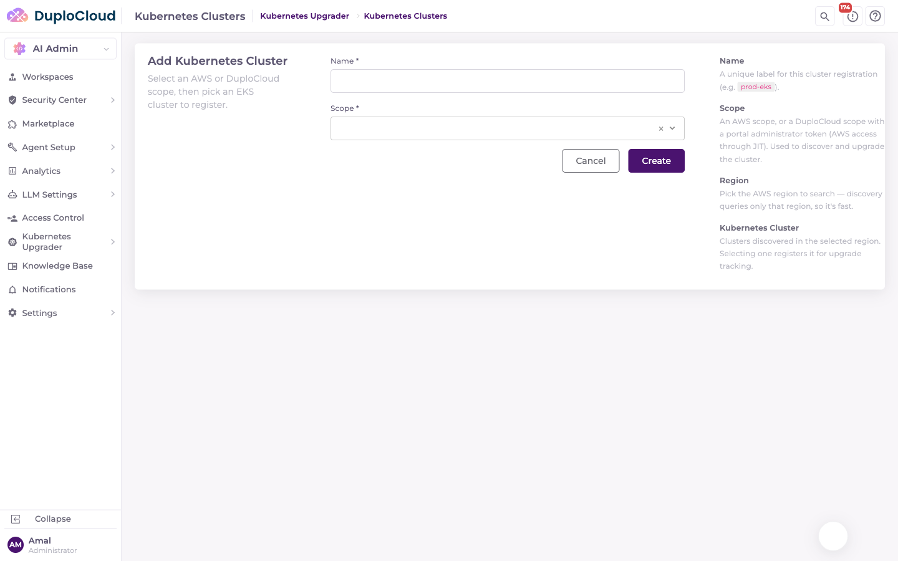

# Set Up

Setting up is a job for a DuploCloud administrator.

## Before you start

- A **scope** attached to the workspace that reaches the AWS account with your EKS clusters. Either works:
  - an **AWS scope**, which acts with its own IAM identity, or
  - a **DuploCloud scope**, which gets temporary AWS credentials through DuploCloud.
- An **IAM policy** on that identity that allows the AWS actions listed below.
- An **EKS access entry** (or `aws-auth` mapping) for that identity on each cluster, so Kubernetes Upgrader can read the cluster and cordon and drain nodes. `AmazonEKSClusterAdminPolicy` covers everything; the least-privilege list is below.
- A **reachable Kubernetes API.** Pre-flight checks and node swaps call the cluster's API from DuploCloud. With a private-only endpoint, plans finish with warnings, and a swap of self-managed groups is blocked.


A missing read permission makes the related check show as not verified. A missing write permission stops the step that needs it, and the error names the AWS action that was refused.


## Activate Kubernetes Upgrader

1. Open **Marketplace > Agent Marketplace** and find **Kubernetes Upgrader**, or search for `Kubernetes`.
2. Select **Activate**. See [Agent Marketplace and Buying Agents](../../getting-started/marketplace.md) for what happens next.
3. When it finishes, the **Kubernetes Upgrader** section, with **Kubernetes Clusters**, appears in the **AI Admin** menu.

## Connect your AWS account

Add AWS as a cloud provider, add a credential, and create a scope, as described in [Amazon Web Services (AWS)](../../getting-started/integrating-providers/amazon-web-services-aws.md). Then attach the scope to the workspace. You choose the scope when you register each cluster, and every job on that cluster uses it.

### AWS permissions

| Used for | AWS actions |
| --- | --- |
| Discovering and registering clusters | `eks:ListClusters`, `eks:DescribeCluster`, `eks:DescribeClusterVersions`, `ec2:DescribeRegions`, `sts:GetCallerIdentity` |
| Control plane upgrade | `eks:UpdateClusterVersion`, `eks:DescribeUpdate`, `eks:ListInsights` |
| Add-on upgrades | `eks:ListAddons`, `eks:DescribeAddon`, `eks:DescribeAddonVersions`, `eks:UpdateAddon`, `eks:DescribeUpdate` |
| EKS managed node groups | `eks:ListNodegroups`, `eks:DescribeNodegroup`, `eks:UpdateNodegroupVersion`, `eks:DescribeUpdate`. Groups with a custom AMI also need `ec2:DescribeLaunchTemplateVersions`, `ec2:DescribeImages` and `ec2:CreateLaunchTemplateVersion`. |
| Self-managed node swap | `autoscaling:DescribeAutoScalingGroups`, `autoscaling:DescribeScalingActivities`, `autoscaling:UpdateAutoScalingGroup`, `autoscaling:SetDesiredCapacity`, `autoscaling:CreateOrUpdateTags`, `autoscaling:DeleteTags`, `autoscaling:TerminateInstanceInAutoScalingGroup`, `ec2:DescribeInstances`, `ec2:DescribeImages`, `ec2:DescribeLaunchTemplateVersions`, `ec2:CreateLaunchTemplateVersion`, `ec2:ModifyLaunchTemplate` |
| Guard policy on the Duplo-Master role | `ec2:DescribeRegions`, `ec2:DescribeInstances`, `iam:GetInstanceProfile`, `iam:PutRolePolicy`, `iam:DeleteRolePolicy` |
| Container image pre-flight check | `ecr:DescribeImages`, `ecr:DescribePullThroughCacheRules`, `ecr:GetAuthorizationToken`, `ecr:BatchGetImage` |
| EC2 capacity pre-flight check | `servicequotas:GetServiceQuota`, `servicequotas:GetAWSDefaultServiceQuota`, `ec2:DescribeInstances`, `ec2:DescribeInstanceTypes`, `ec2:DescribeSubnets` |

In AWS GovCloud (US), use the `arn:aws-us-gov:` partition in resource ARNs.

### Kubernetes permissions

The same identity needs `AmazonEKSClusterAdminPolicy` on the cluster, or this least-privilege equivalent. The plan checks these permissions and blocks if any are missing.

| Resource | Verbs | Used for |
| --- | --- | --- |
| `nodes` | get, list, patch | Readiness checks and cordoning |
| `pods` | get, list | Drain and workload checks |
| `pods/eviction` | create | Draining nodes (honours PodDisruptionBudgets) |
| `pods/log` | get | The `kubectl` console and add-on diagnosis |
| `deployments`, `statefulsets` | get, list, patch | Moving workloads with a rolling restart, and pausing the cluster autoscaler |
| `daemonsets` | get, list | CNI mode and add-on checks |
| `replicasets` | get | Finding a pod's Deployment |
| `poddisruptionbudgets` | list | Workload availability check |
| `persistentvolumeclaims`, `persistentvolumes` | get | EBS availability-zone check |
| `serviceaccounts`, `secrets` | get | Image pull secrets for the image check |
| `services`, `namespaces`, `events` | get, list | The read-only `kubectl` console and Ask AI |
| `eniconfigs.crd.k8s.amazonaws.com` | list | EC2 capacity check with VPC CNI custom networking |

## Who can use it

Only users with the DuploCloud **Administrator** role can use Kubernetes Upgrader. There is nothing to grant: other users don't see it, and permission sets don't give them access. See [Permissions and Safety](permissions-and-safety.md#who-can-use-it).

## Register your first cluster

1. Open **AI Admin > Kubernetes Upgrader > Kubernetes Clusters**.
2. In **Workspace**, choose the workspace the scope is attached to, and select **Add Kubernetes Cluster**.
3. Enter a **Name** for this registration: 2 to 60 letters, digits and hyphens.
4. Choose the **Scope** and the **Region**. Kubernetes Upgrader lists the EKS clusters that scope can see in that region.
5. Choose the **Kubernetes Cluster** and select **Create**.

<figure><figcaption></figcaption></figure>

Next: [Use](use.md).
