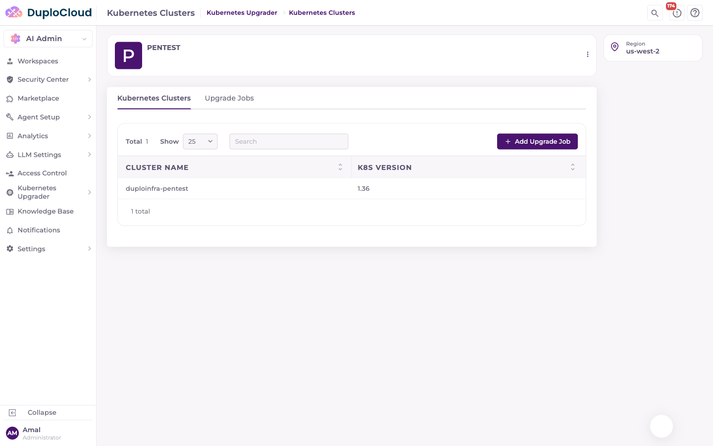
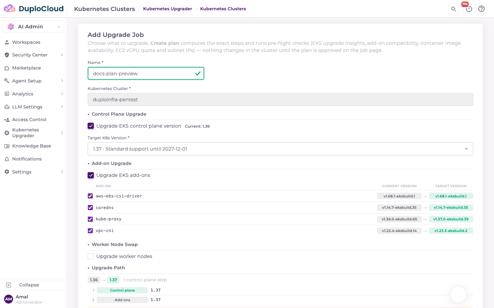
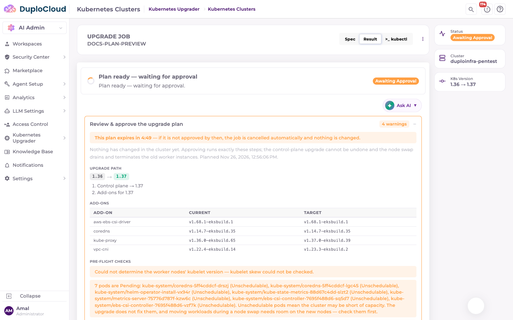
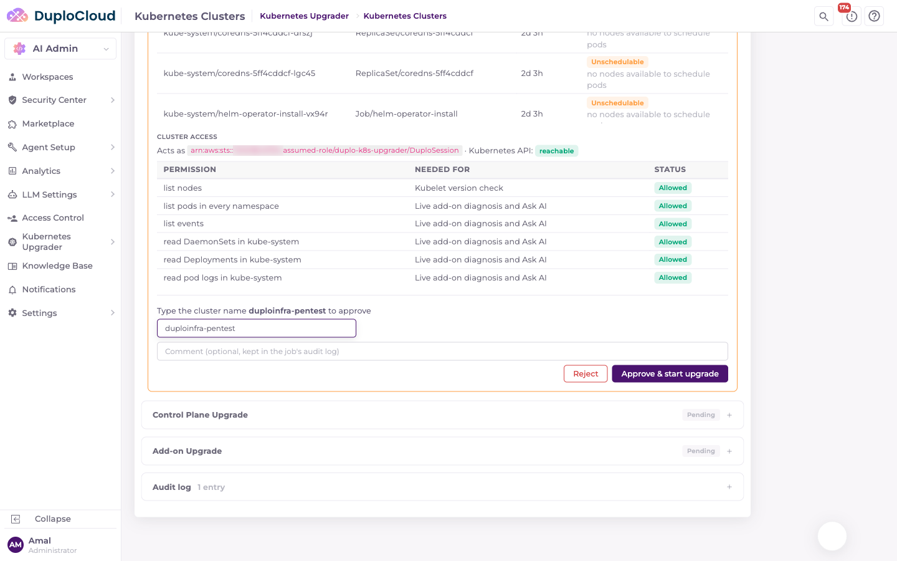

# Use

## Plan an upgrade



## Open the form

Open **AI Admin > Kubernetes Upgrader > Kubernetes Clusters**, choose the **Workspace**, open the cluster, and select **Add Upgrade Job**. Enter a **Name** for the job.

<figure><figcaption></figcaption></figure>



## Choose what to upgrade

Turn on at least one section:

- **Control Plane Upgrade:** select **Upgrade EKS control plane version** and pick the **Target K8s Version**. Each version shows whether it is in standard or extended support (extended support costs extra in AWS) and how many steps it takes.
- **Add-on Upgrade:** select **Upgrade EKS add-ons**. Each installed add-on shows its current and target version; untick any you want to leave alone.
- **Worker Node Swap:** select **Upgrade worker nodes**. Each self-managed Auto Scaling group and EKS managed node group is listed with its minimum, desired and maximum size.

<figure><figcaption></figcaption></figure>



## Check the upgrade path

The **Upgrade Path** section previews every step: one control-plane step per minor version, the add-on steps after each one, and any extra node swap needed to keep the nodes within the Kubernetes version-skew limit.



## Run the pre-flight checks

If you are swapping worker nodes, select **Run pre-flight checks**. They check the container images your workloads use and the EC2 capacity the swap needs. **Create plan** stays disabled until they have run.

If the checks find risks, such as an image that can't be pulled or too little EC2 capacity, read them and select **I understand … Accept the risk(s) and continue** to go on.



## Create the plan

Select **Create plan**. Kubernetes Upgrader builds the exact plan and opens the job page. Nothing has changed in your cluster yet.

If the plan is blocked, for example because the target is too far ahead of nodes the job does not rotate, the form explains why and no plan is created.



## Review and approve the plan

On the job page, **Review & approve the upgrade plan** shows the upgrade path, add-ons, worker groups, pre-flight results, cluster access, the EC2 capacity for the swap, workload availability while nodes rotate, and container images.

<figure><figcaption></figcaption></figure>

To approve:

1. Type the cluster name where asked, add an optional comment, and accept any risks again.
2. Select **Approve & start upgrade**. Or select **Reject** to cancel the job without changing anything.

<figure><figcaption></figcaption></figure>

A countdown shows how long the plan stays valid, 5 minutes by default. If it isn't approved in time, the job is cancelled and nothing is changed. Approving re-checks the cluster first: if anything changed since the plan was made, you're shown a fresh plan to review.

Any administrator can approve, including the person who created the plan (see [Permissions and Safety](permissions-and-safety.md)).

## Follow progress

The job page updates every few seconds while the job runs. It shows:

- a banner with the current state, for example **Upgrade queued**, **Upgrade in progress** or **Needs attention**,
- the **Upgrade Path**, with each step's status (Pending, Running, Done, Skipped, Failed or Cancelled) and duration,
- a card for each phase (**Control Plane**, **Add-ons**, **Worker Nodes**), with the step and node-swap round,
- a live table of the cluster's nodes,
- a read-only `kubectl` console.

Up to five jobs run at the same time; others wait in a queue and show their position.

## Cancel an upgrade

Select **Cancel upgrade**, give an optional reason, and confirm. The job stops at the next safe point. Nothing is rolled back: finished steps stay applied. A control-plane or add-on update that EKS is already running can't be stopped, so the job stops after it finishes.

To stop a plan that hasn't been approved yet, select **Reject** instead.

## When a job pauses or fails

**Paused, waiting for a valid token.** The scope's credential expired or was revoked during a run. The job checks again every 30 seconds and carries on by itself once you update the credential on the scope's provider. If it isn't fixed within 24 hours, the job fails and you can resume it.

**Failed.** Read the message in the banner. If the cause can be fixed in place, such as a failed add-on, a blocked drain or new nodes that didn't become ready, fix it and select **Resume**. If the cluster changed after approval, create a new job instead.

## Ask AI about a job

The **Ask AI** panel on the job page answers questions about the job and the cluster, using the workspace's AI agent. It can run read-only `kubectl` and `aws` commands by itself. Any other command waits for you to select **Approve & run** in the panel. **New chat** starts a fresh conversation.

See [Permissions and Safety](permissions-and-safety.md#ai-data-handling-ask-ai) for what is shared with the AI.

## After the upgrade

Check the job's steps and audit log on the job page. Upgrade any nodes the job doesn't rotate yourself, such as standalone EC2 nodes; the plan lists them.

To stop tracking a cluster, delete its registration from **Kubernetes Clusters**. This deletes its job records too, and changes nothing in AWS or in the cluster. A cluster with a running job can't be deleted.
