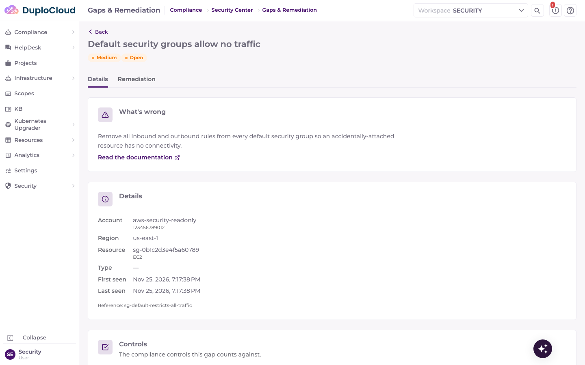
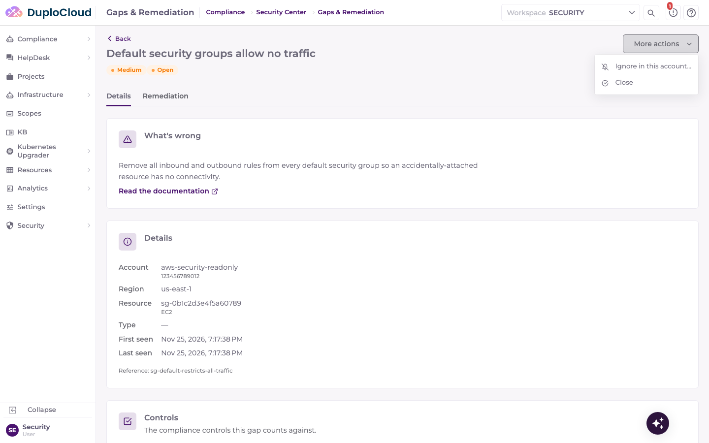
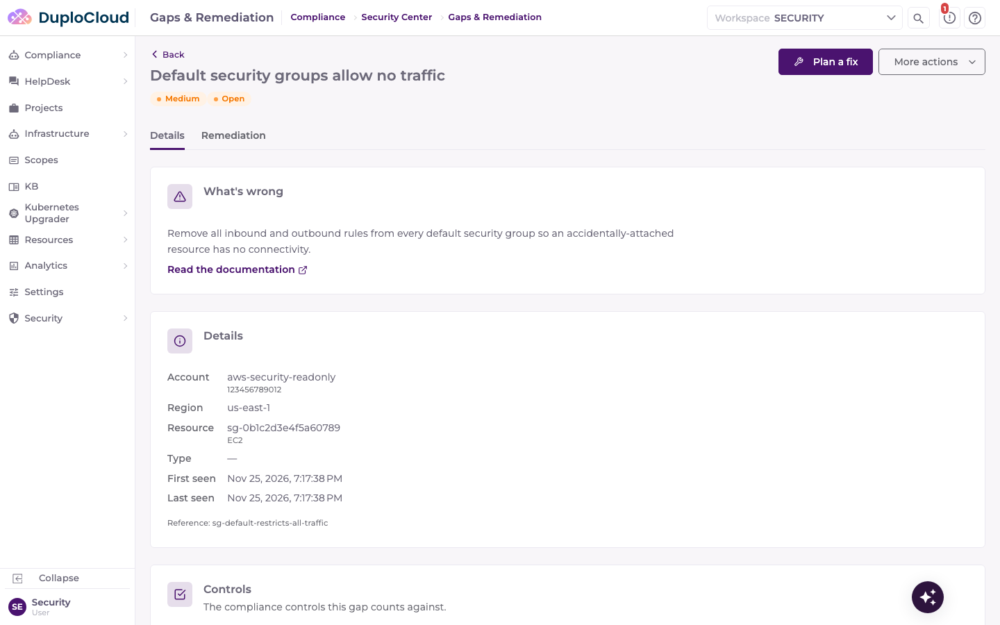
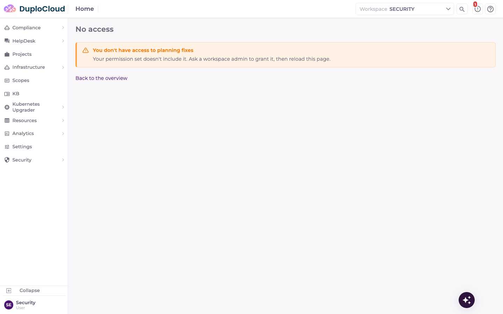

# Permissions and Safety

## What it can read and change

| | What it does |
| --- | --- |
| **Reads** | The configuration of your AWS accounts, through `describe`, `list` and `get` calls. Findings from Security Hub, AWS Config, GuardDuty and Inspector. CloudTrail logs, for impact analyses. Which CloudFormation stack or Terraform resource manages a resource that has a gap. |
| **Changes in AWS: security services** | Applying an account's security profile turns on the services an administrator chose (Security Hub, AWS Config, CloudTrail, GuardDuty, Inspector, the IAM password policy), and creates log storage and an event rule and queue in each region. Only administrators can do this. |
| **Changes in AWS: fixes** | Only the AWS CLI command a fix proposed, run once, only after someone approves it, and only with the account's write connection. |
| **Changes in AWS: containment** | Only the containment action you select and confirm on an impact analysis, with the account's write connection. Most actions can be undone; delete and terminate actions can't. |
| **Changes in GitHub** | For a Terraform or CloudFormation fix, it creates a branch and opens a pull request. It pushes the branch to the repository, and uses a fork only if that push fails. It never merges. |
| **Changes in Jira and Slack** | Creates and updates Jira tickets and posts Slack messages, when an administrator connects them and turns them on. |
| **Never** | A compliance scan or impact analysis never creates, changes or deletes anything in your account. An impact analysis doesn't read secret values, SSM parameters, Lambda environment variables or code, EC2 user data or ECS task definitions. Pull requests are never merged, and templates are never deployed. |


Scans and analyses only read. Applying a security profile, running an approved AWS CLI fix and containment change your AWS account, and each is gated separately.


## Each AWS account belongs to one workspace

An administrator assigns each AWS account to one workspace, in **AI Admin > Security Center > Cloud accounts**. Only that workspace can scan the account, plan fixes for it or investigate it. A request from another workspace is refused, even if that workspace has a connection to the account.

Everything that changes an account's settings in Security Center (turning services on or off, re-applying a profile, choosing frameworks and standards, and fix access) is **administrator-only**. People without the Administrator role are refused, whatever their permission sets say. In a workspace, the account pages are view-only.

## How permissions work

Security Center doesn't ship fixed roles. It adds a **Security Center** branch under **Workspace** in the platform's permission sets. A set holds rules that each name a resource, the verbs it allows (`GET`, `PUT`, `POST`, `DELETE`), any named actions, and whether the rule covers everything under it. A user in several groups gets everything their sets allow.

| Resource | What it covers |
| --- | --- |
| `PostureAssessment` | Compliance scans |
| `Gap` (with `PostureRemediation` and `ScopeAnalysis` under it) | Gaps, their fixes and scope analyses |
| `GapIgnore` | Ignore rules |
| `AccountSecurityProfile` | An account's security services (read-only outside AI Admin) |
| `AccountFixAccess` | An account's read and write connections (read-only outside AI Admin) |
| `SecurityCenterSettings` | The workspace's own settings: its Slack channel, Jira project key, repositories and always-attached connections |
| `ImpactAnalysis` (with `Containment` under it) | Impact analyses and containment records |
| `Cve` | CVEs |

### Named actions

Some operations are **named actions**. A verb grant never covers one, not even all verbs: a rule must list the action.

| Action | Shown as | What it allows | Grant it on |
| --- | --- | --- | --- |
| `security-center.propose-fix` | Propose a fix | Plan and create a fix, answer its follow-up question, and start a scope analysis. | `Gap` (whole subtree) |
| `security-center.execute-fix` | Execute a fix | **Approve and run** a proposed AWS CLI command. Changes your AWS account. | `Gap` (whole subtree) |
| `security-center.grant-write` | Grant write access for a fix | **Attach write access** to a fix so its command can run. | `Gap` (whole subtree) |
| `security-center.contain` | Contain a resource | Apply or undo a containment action. Changes your AWS account. | `ImpactAnalysis` (whole subtree) |
| `security-center.create-tickets` | Create Jira tickets for gaps | **Create N Jira tickets**. | The **Workspace** node itself, with whole subtree off |
| `security-center.run-impact-analysis` | Run an impact analysis | Start an impact analysis, widen its window, or compare it against more history. Each uses AI credits. | The **Workspace** node itself, with whole subtree off |

Proposing a fix and running it are separate permissions, so one person can prepare a fix and another can approve it. Security Center doesn't force them to be different people: someone who holds both can do both.

There's no separate permission for ignoring or closing a gap: anyone who can edit (`PUT`) gaps can do it. Running a compliance scan again is also an edit of the scan.

The platform checks every request. The pages also hide or disable controls you can't use, with a message saying why, but that is a convenience, not the protection.


A rule whose Actions field holds the wildcard `*` grants every named action under it, whatever its verbs. A set whose rules allow only `GET` but carry the wildcard is not read-only: its users can create and run fixes and contain resources. For a read-only or limited set, leave each rule's Actions field empty and add only the actions the set should have.


## Who can do what

What a user can do depends on the permission sets you give them. These are suggested sets:

| Set | Grant | What they can do |
| --- | --- | --- |
| **Read-only** | `GET` on `PostureAssessment`, `Gap` (whole subtree), `ImpactAnalysis` and `Cve`. No actions. | View every page and filter what they see. They can't run a scan, ignore or close a gap, plan or run a fix, start an impact analysis, contain anything, create Jira tickets or change settings. |
| **Triage** | Read-only, plus `PUT` and `POST` on `Gap`, `PUT` on `PostureAssessment` and on `ImpactAnalysis`. Optionally `create-tickets` and `run-impact-analysis` on the Workspace node. | Also ignore, close and reopen gaps, run scans again, narrow an analysis window and mark nodes as expected; with the optional actions, create Jira tickets and run impact analyses. |
| **Remediator** | Triage, plus `propose-fix`, `execute-fix` and `grant-write` on `Gap` (whole subtree) and `contain` on `ImpactAnalysis` (whole subtree). | Also plan fixes, attach write access, approve and run commands, and contain resources. |
| **Settings manager** | `GET`, `PUT` and `POST` on `SecurityCenterSettings`. No actions. | Change the workspace's Slack channel, Jira project key, repositories and always-attached connections. |
| **Administrator** | The platform's Administrator role. | Everything, without any set: administrators bypass every grant, named actions included. Only administrators can assign accounts, change account settings and fix access, and set the platform policy in AI Admin. |

A simple read-only base for any of these sets is one rule on the **Workspace** node with `GET`, whole subtree on, and the Actions field empty. Add the other rules on top of it.

### What each user sees

Controls a user can't use are hidden. A read-only user sees a gap with no **Plan a fix** and no **More actions**:

A Triage user also gets **More actions**, with **Ignore in this account…** and **Close**, but still no **Plan a fix**:

A user with **Propose a fix** also gets **Plan a fix**. Without **Execute a fix** and **Grant write access for a fix**, they can prepare a fix but not attach write access or run it:

Someone who opens a page they don't have access to, for example a Plan a fix link without **Propose a fix**, sees why:

## What needs approval

- **AWS CLI fixes.** A fix is created first. Running it needs **Attach write access** and then **Approve and run**, each its own permission. You approve the exact command on screen: if the stored command changed after you loaded the page, the run is refused. Security Center records who approved and which command, and runs only a command that matches. Each command runs once. **Approve and run** has no second confirmation.
- **Security profiles.** Only administrators can apply, change or remove one, and saving an account's frameworks and standards applies its profile again.
- **Containment.** Every action and every undo asks you to confirm and lists what will change. Actions that can't be undone say so. Security Center refuses to contain the identity of its own read or write connection.
- **Pull requests.** You review and merge them yourself.

## Safety checks

- **Scans can only read.** The scan refuses any AWS call that isn't a `describe`, `list` or `get` call, generating the credential report, or Inspector's account status check.
- **A failed read is never a pass.** Access denied, an unsupported operation, an opted-out region or throttling all show as **Error**, still count in the score, and appear first on the Coverage tab.
- **Drafted commands are restricted.** A command the agent wrote itself must be a single `aws ...` call, with no operators, redirects, substitutions or wildcards. It is checked when it's drafted and again just before it runs. Commands written by DuploCloud can have more than one step.
- **The approved command is the one that runs.** The page checks the command before running it, which needs a secure (HTTPS) connection to DuploCloud.
- **Connections must belong to the workspace.** A scan, fix or manual gap can only use connections attached to its own workspace, for an account assigned to that workspace.
- **Read and write connections are separate**, and every fix starts with the read-only one.
- **Turning services off is narrow.** Security Center turns off only what it turned on itself, and only an administrator can do it.
- **Impact analysis has limits:** the agent may make at most 40 follow-up AWS queries in 15 minutes, and a result holds at most 5,000 events.
- **Scan scope is fixed.** An assessment's accounts, regions, criteria and tag filter can't change after it's created.

## Limits you should know

- A clean result is clean against Security Center's checks. It is not SOC 2 compliance, and it covers the Security criteria only. It reads AWS only, so source control rules, identity provider MFA and endpoint controls are outside it. Some areas have no check yet, such as Organizations service control policies, network ACLs, API Gateway, CloudFront and OpenSearch.
- Compliance history keeps counts and scores only. Findings from older runs aren't kept.
- Not every failing check has an automated fix. Some can only be reported.
- An impact analysis needs a CloudTrail trail whose bucket it can read. There is no fallback to CloudTrail event history. GovCloud and China partitions aren't supported.
- Deleting a user or role through containment takes several AWS calls. If one fails part-way, the action is reported as failed even though some parts were removed.
- Deleting a plan or fix removes the record only. It doesn't close its pull request or undo a command that already ran.

## AI data handling

- **What the agent does:** AI agents run the compliance scan, plan fixes, run scope analyses and review impact analyses. An agent can draft a fix command or an infrastructure-as-code edit; these are marked as drafted. In an impact analysis, fixed rules build the attack graph first; the agent can add to it but never removes what the rules found.
- **What stays in the run:** raw AWS configuration and collected CloudTrail files stay in the run's working directory and aren't written to the results.
- **What is kept in results:** findings with trimmed evidence, resource identifiers and account IDs. Request and response data of each CloudTrail event in an impact analysis is trimmed to 2 KB.
- **IP locations** come from a bundled offline database. There are no live threat-intelligence lookups.
