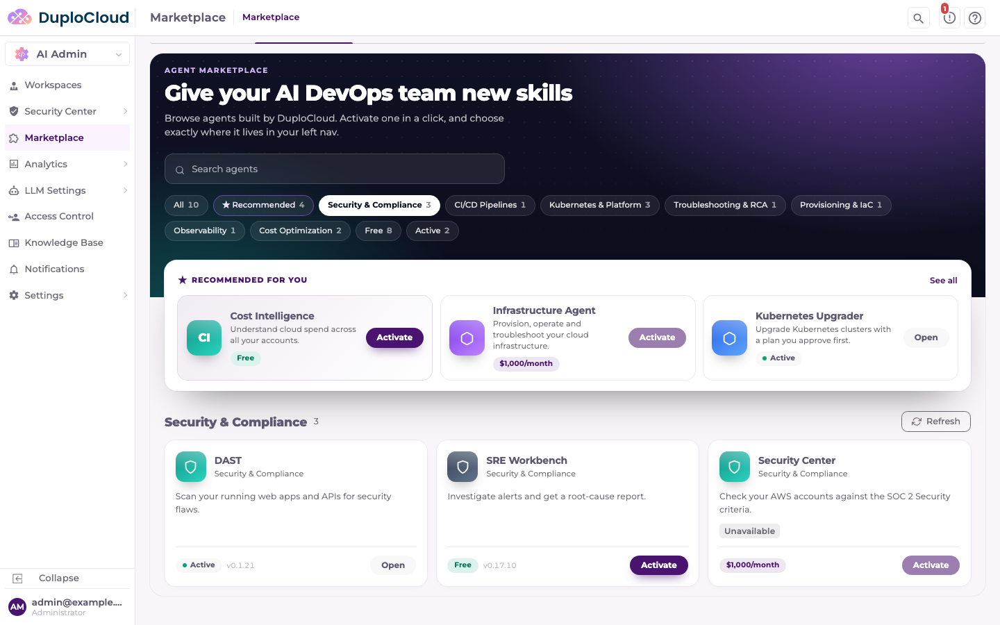
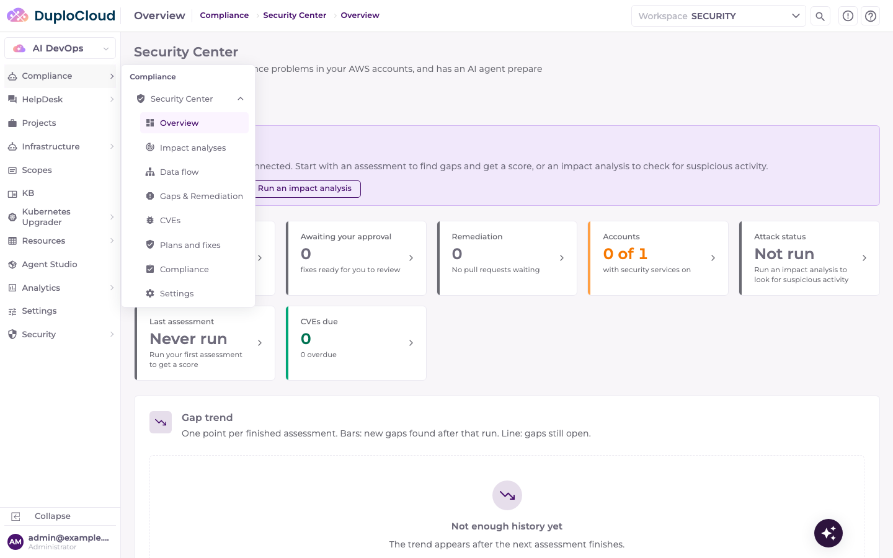
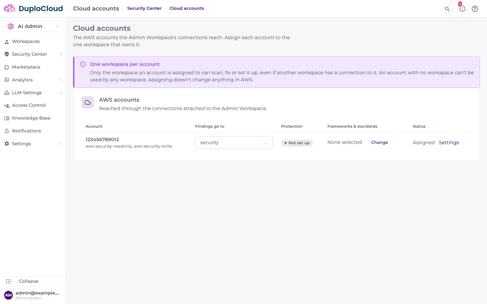
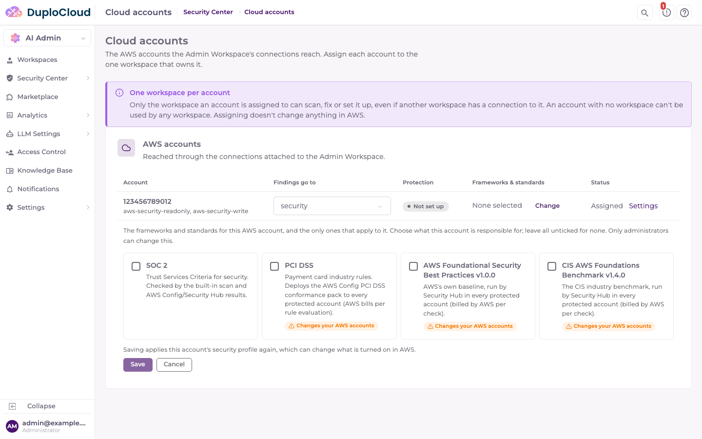
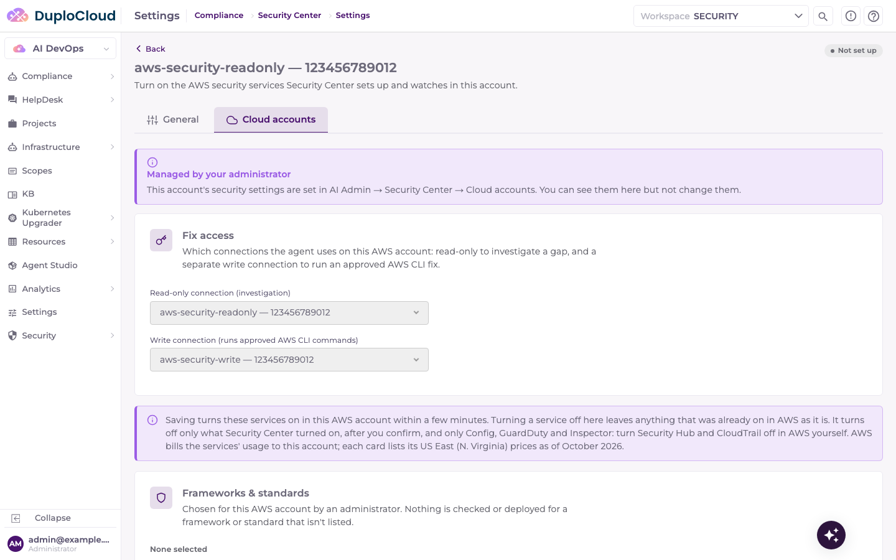
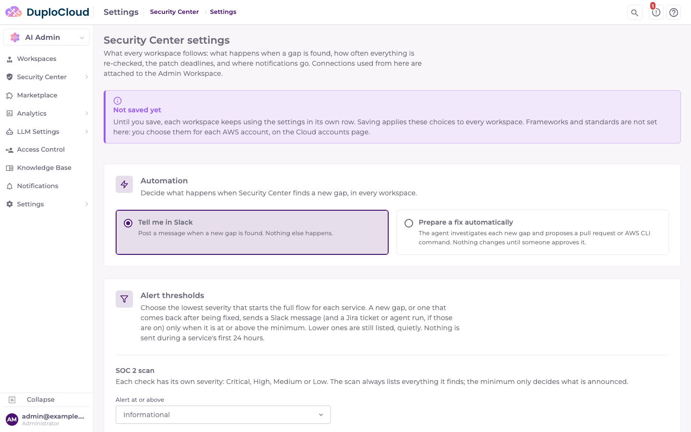
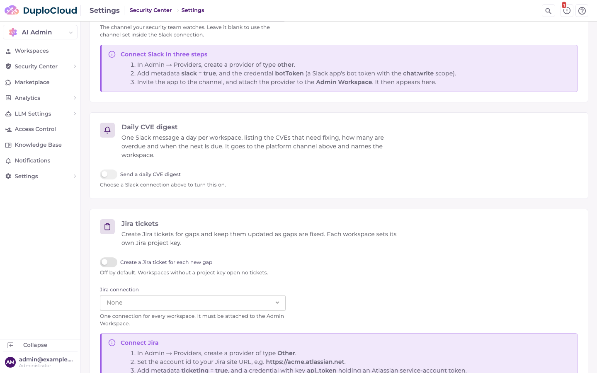

# Set Up

Setting up Security Center is a job for a DuploCloud administrator. Administrators decide which AWS accounts it works on and what it does there. People in a workspace then use it on the accounts assigned to their workspace.

## Before you start

- **An AWS connection for each account** you want to cover: an AWS provider, a credential and a scope, as described in [Amazon Web Services (AWS)](../../getting-started/integrating-providers/amazon-web-services-aws.md). The scope must be attached to the **Admin Workspace** and to the workspace that will use the account.
- **Read access in AWS** on that connection. The AWS managed policies `ReadOnlyAccess` and `SecurityAudit` together cover what Security Center reads. A missing read permission does not stop a scan: the check that needs it shows as **Error** and counts against the score.
- **Optional:** a second AWS connection to the same account, used only to run AWS CLI fixes that someone has approved (see [Fix access](#fix-access)).
- **Optional:** connections for GitHub (fix pull requests), Slack (alerts) and Jira (tickets). See [Connect GitHub, Slack and Jira](#connect-github-slack-and-jira-optional).

## Activate Security Center

1. Open **Marketplace > Agent Marketplace** and find **Security Center**. The **Security & Compliance** filter shows it, or search for `Security`.
2. Select **Activate**. See [Agent Marketplace and Buying Agents](../../getting-started/marketplace.md) for what happens next.

   
3. When it finishes, the workspace menu has a **Compliance** entry. Under it, **Security Center** has **Overview**, **Impact analyses**, **Data flow**, **Gaps & Remediation**, **CVEs**, **Plans and fixes**, **Compliance** and **Settings**. In **AI Admin**, a **Security Center** entry has **Settings** and **Cloud accounts**.

   

## Assign each AWS account to a workspace

Security Center works on an AWS account only from the one workspace the account is assigned to. Another workspace that has a connection to the same account cannot scan it, fix it or set it up, and an account with no workspace cannot be used at all. This stops two workspaces scanning and fixing the same account.

1. Open **AI Admin > Security Center > Cloud accounts**. It lists every AWS account that the Admin Workspace's connections reach, one row per account, even if several connections reach it.
2. For each account, choose the workspace in **Findings go to**. Assigning does not change anything in AWS.
3. The workspace also needs a connection to the account attached to it. The row tells you when it has none.

You can't move an account to another workspace while its current workspace still has security services set up for it.

### Choose frameworks and standards

Frameworks and standards are chosen for each account, here and nowhere else. An account nobody has chosen for gets none, not even SOC 2. Workspaces see the choice but can't change it.

1. On the account's row, under **Frameworks & standards**, select **Change**. The button appears once the account is assigned to a workspace.
2. Tick what the account is responsible for: **SOC 2**, **PCI DSS**, **AWS Foundational Security Best Practices v1.0.0** or **CIS AWS Foundations Benchmark v1.4.0**. Leave all unticked for none.
3. Select **Save**.

SOC 2 is checked by the built-in scan and by AWS Config and Security Hub results. The other three are marked **Changes your AWS accounts**: PCI DSS deploys the AWS Config PCI DSS conformance pack, and the other two are run by Security Hub. AWS bills for each of them.


Saving applies the account's security profile again. That can change what is turned on in AWS, for example a PCI DSS conformance pack or Security Hub standards.


## Turn on security services in an account

Continuous monitoring and CVE tracking need AWS security services turned on in the account. Security Center can turn them on for you.

1. Open **Cloud accounts** and select the account's **Settings** link. You can also reach it from a workspace, in **Security Center > Settings > Cloud accounts**, where it is view-only.
2. Choose the regions, and turn on the services you want. There is one card per service: **Security Hub**, **AWS Config**, **CloudTrail**, **GuardDuty**, **Inspector**, **IAM password policy** and **Continuous monitoring**. Turning on Security Hub turns on AWS Config as well, because Security Hub needs it.
3. Confirm **I understand this changes live security services in this AWS account**, and save.

The account list shows each account's status: **Protected**, **Not set up**, **Problem** or **Applying**.


Applying a profile changes the AWS account. It turns services on and creates resources there, such as a CloudTrail trail, an encrypted S3 bucket for its logs, a KMS key, and EventBridge rules with SQS queues that carry events to Security Center. These services cost money in AWS. Only an administrator can create, change, re-apply or remove a profile.


Turning a service off in Security Center only touches what Security Center turned on. Anything that was already on in AWS stays on, and only an administrator can turn services off.

### AWS permissions to turn on services

The connection that applies the profile needs these AWS actions, for the services you turn on.

| Service | AWS actions |
| --- | --- |
| Security Hub | `securityhub:EnableSecurityHub`, `securityhub:DescribeHub`, `securityhub:BatchEnableStandards`, `securityhub:GetEnabledStandards`, and for an administrator account with members `securityhub:CreateMembers`, `securityhub:InviteMembers`, `securityhub:ListMembers`, `securityhub:ListInvitations`, `securityhub:AcceptAdministratorInvitation`, `securityhub:GetAdministratorAccount` |
| AWS Config | `config:PutConfigurationRecorder`, `config:StartConfigurationRecorder`, `config:StopConfigurationRecorder`, `config:PutDeliveryChannel`, `config:PutConformancePack`, `config:DescribeConfigurationRecorders`, `config:DescribeConfigurationRecorderStatus`, `config:DescribeDeliveryChannels` |
| CloudTrail | `cloudtrail:CreateTrail`, `cloudtrail:StartLogging`, `cloudtrail:DescribeTrails`, `cloudtrail:GetTrailStatus` |
| GuardDuty | `guardduty:CreateDetector`, `guardduty:UpdateDetector`, `guardduty:GetDetector`, `guardduty:ListDetectors` |
| Inspector | `inspector2:Enable`, `inspector2:Disable`, `inspector2:BatchGetAccountStatus` |
| IAM password policy | `iam:GetAccountPasswordPolicy`, `iam:UpdateAccountPasswordPolicy` |
| Service-linked roles | `iam:CreateServiceLinkedRole` |
| Log storage | `s3:CreateBucket`, `s3:PutBucketPolicy`, `s3:PutEncryptionConfiguration`, `s3:PutBucketPublicAccessBlock`, `kms:CreateKey`, `kms:CreateAlias`, `kms:DescribeKey`, `kms:EnableKeyRotation`, `kms:PutKeyPolicy`, `kms:ListAliases` |
| Event delivery | `events:PutRule`, `events:PutTargets`, `events:RemoveTargets`, `events:DeleteRule`, `sqs:CreateQueue`, `sqs:GetQueueUrl`, `sqs:SetQueueAttributes`, `sqs:DeleteQueue`, `ec2:DescribeRegions` |

## Fix access

Each account's page has a **Fix access** card with two connections:

- **Read-only connection (investigation)**: every fix starts by investigating with it, and impact analyses read with it.
- **Write connection (runs approved AWS CLI commands)**: used only to run an AWS CLI fix after someone approves it, and for containment actions. It is never offered when someone asks for a fix.

The two must be different connections, both to that account. Fixes delivered as pull requests need no write connection. Only an administrator can change fix access.

## Set the policy every workspace follows

Open **AI Admin > Security Center > Settings**. What you save here applies to every workspace. Until you save, each workspace keeps the settings in its own row.

| Card | What you set |
| --- | --- |
| **Automation** | What happens when a new gap is found: **Tell me in Slack**, or **Prepare a fix automatically** (the agent proposes a pull request or AWS CLI command; nothing changes until someone approves it). |
| **Alert thresholds** | For each source (SOC 2 scan, Security Hub, AWS Config, GuardDuty), the lowest severity that sends an alert, a ticket or an agent run. Lower findings are still listed. Nothing is sent during a source's first 24 hours. |
| **Scanning** | **Run the SOC 2 scan on a schedule** (runs as an agent task and uses AI credits) and **Full re-check every (hours)**. |
| **Remediation SLAs** | How many days you have to patch a CVE of each severity once a fix is released, or **No SLA**. |
| **Notifications** | The **Slack connection** and the **Channel**. |
| **Daily CVE digest** | One Slack message a day per workspace listing the CVEs that need fixing. |
| **Jira tickets** | **Create a Jira ticket for each new gap**, and the **Jira connection**. |
| **Code repositories** | The **GitHub connection** and the Terraform and CloudFormation repositories every workspace searches first, in order. |

Saving these settings does not change anything in AWS.

## Connect GitHub, Slack and Jira (optional)

Each connection is one for the whole platform. Add it as a provider, attach it to the **Admin Workspace**, and then pick it on **AI Admin > Security Center > Settings**. Each card shows the steps.

- **GitHub**, for fixes delivered as pull requests: create a GitHub App for your organization, install it on your Terraform and CloudFormation repositories, and add it as a source control provider (see [GitHub](../../getting-started/integrating-providers/github.md)). Also attach it to each workspace that uses repositories. A workspace can add its own repositories after the platform's.
- **Slack**, for alerts and the CVE digest: create a provider of type **Other** with metadata `slack` = `true` and a credential `botToken` holding a Slack app's bot token with the `chat:write` scope. Invite the app to the channel. A workspace can add a channel of its own; messages go to both.
- **Jira**, for tickets: create a provider of type **Other** with your Jira site URL as the account ID (for example `https://acme.atlassian.net`), metadata `ticketing` = `true`, and a credential `api_token` holding an Atlassian service-account token. See [Jira](../../getting-started/integrating-providers/jira.md) for adding the provider. Turn on **Create a Jira ticket for each new gap**. Each workspace sets its own Jira project key in **Security Center > Settings > Jira tickets**; a workspace without one opens no tickets.

## Grant access

Give the people who will use Security Center permission sets that cover it. See [Permissions and Safety](permissions-and-safety.md) for what to grant.

Next: [Use](use.md).
