# Use

Everything on this page happens in a workspace, under **Compliance > Security Center** in the left menu, and covers only the AWS accounts an administrator assigned to that workspace. Until one is assigned, each page shows **Security Center isn't set up yet**. See [Set Up](set-up.md).

## Start from the Overview

**Overview** is the home page. Its tiles show **Unresolved gaps**, fixes **Awaiting your approval**, **Remediation** (pull requests still waiting), **Accounts** with security services on, the **Attack status** from your newest impact analysis, the **Last assessment** score, and **CVEs due**. Select a tile to open the page behind it. The **Gap trend** chart adds a point for each finished assessment: bars for new gaps found, and a line for gaps still open.

When nothing has run yet, a callout offers **Run an assessment** and **Run an impact analysis**.

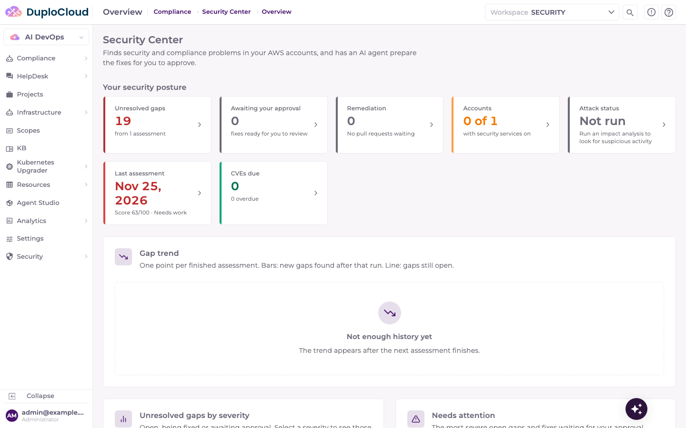

## Run a compliance scan

A compliance scan, called an **assessment**, is a one-time SOC 2 scan of the AWS accounts and regions you choose. It only reads your accounts.

1. Open **Compliance** and select **New assessment**.
2. Under **What to scan**:
   - Enter a **Name**: letters, numbers and dashes, starting and ending with a letter or number.
   - Choose 1 to 5 **AWS accounts** and 1 to 6 **Regions**. Each region adds scan time. Account-wide settings are checked once.
   - Optional: select **＋ Only scan resources with a tag** and enter a key and value. The tag narrows S3 buckets, RDS instances, security groups, load balancers and IAM users. Account-wide checks, such as root MFA and the password policy, always run.
3. Under **What to check**, **Security (CC-series)** is always in scope. Availability, Confidentiality, Processing Integrity and Privacy are marked **Coming soon**. In **Record findings at or above**, choose which findings to keep. Every check still runs and counts toward the score.
4. Optional: under **Keep it up to date**, turn on **Run on a schedule** to re-run the scan at the full re-check interval your administrators set.
5. Optional: under **Reporting**, add **Notes** for auditors.
6. Select **Run assessment**.

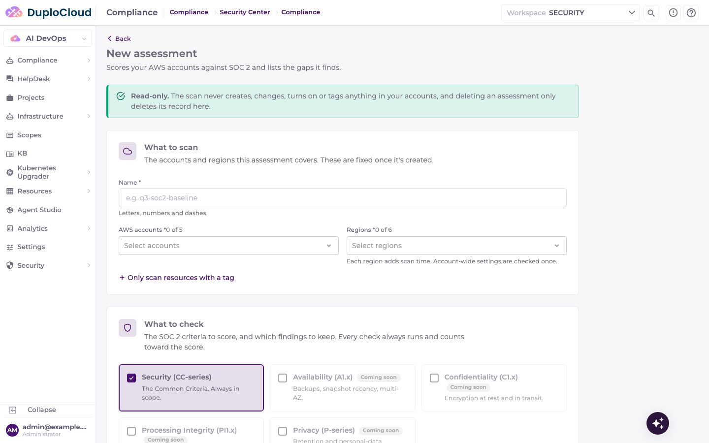

The name, accounts, regions, criteria and tag filter can't be changed after you create the assessment, so its history always compares like with like. **More actions > Edit** changes only the findings threshold, the notes and **Run on a schedule**. For a different set of accounts or regions, create a new assessment.

### Read the results

The assessment page shows the **Score**, the number of **Failing controls** and the **Last run**.

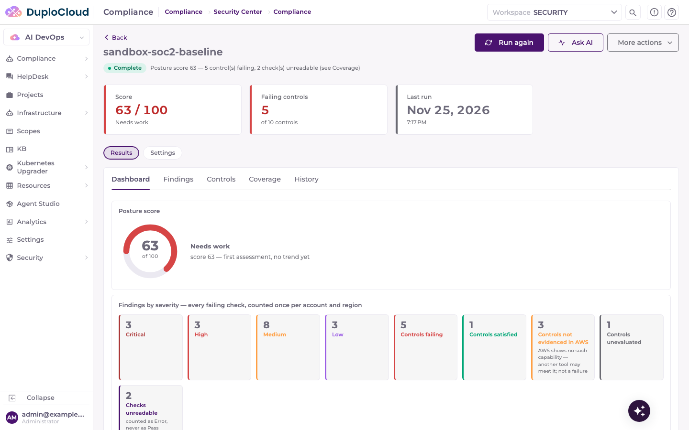

Under **Results** there are five tabs:

| Tab | What it shows |
| --- | --- |
| **Dashboard** | The posture score, severity tiles, a bar for each criterion, the services with the most failures, and the score history. |
| **Findings** | One row per check, account and region. Filter by severity, status, criteria, control, service, account, region and evidence. Open a row for the evidence, the remediation text, a documentation link and every affected resource. **Resolve** opens the gaps for that check and account. |
| **Controls** | One row per SOC 2 control: **Satisfied**, **Failing**, **Not evidenced in AWS** or **Unevaluated**. Expand a row to see its checks. |
| **Coverage** | Reads that failed or were skipped come first, then every account, region and service. Read this before trusting a high score. |
| **History** | The score over the last 20 runs, and the checks that are new or resolved since the previous run. |

Each failing finding is labelled **Problem found** (a resource is misconfigured, whatever other tools you use) or **Not detected in AWS** (an AWS-native capability wasn't found, and another tool may cover it). A control shows as **Failing** only when there is a problem.

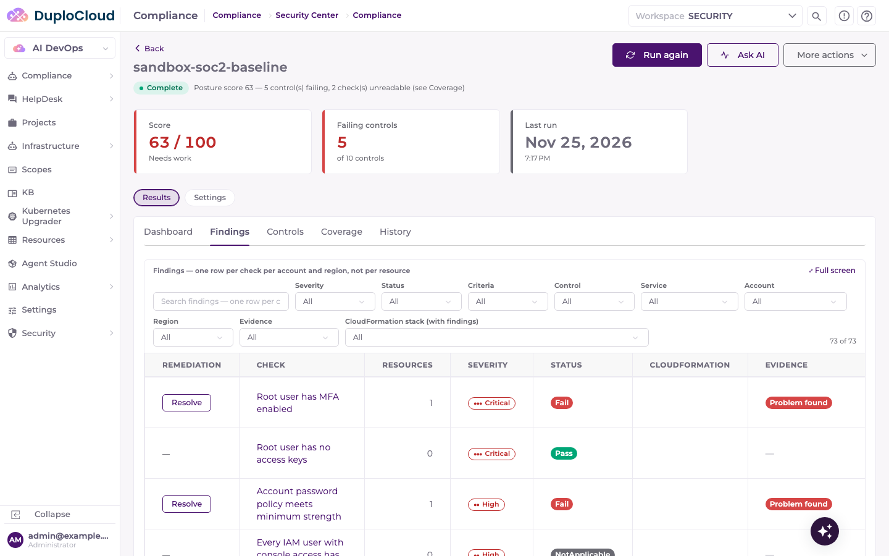

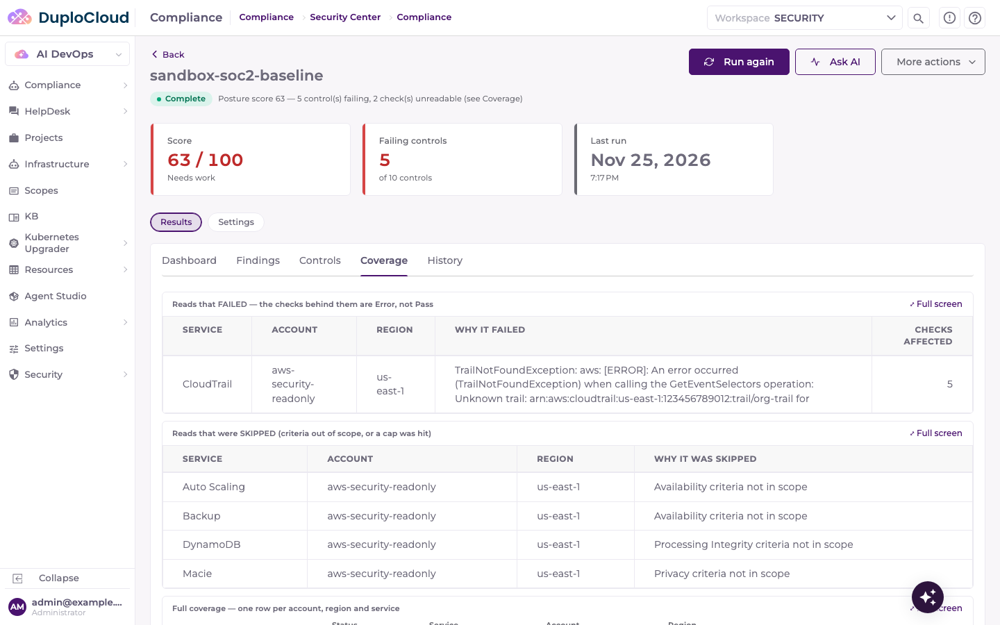

The score is weighted by severity: Critical 10, High 6, Medium 3, Low 1, over the checks that ran. A check that couldn't read its data counts against the score, never for it. A clean result means clean against these checks. It does not mean your organization is SOC 2 compliant.

### Run it again

Select **Run again** to repeat the scan with the same settings. It adds a history entry. You can't start a run while one is still going.

History keeps summary counts and scores only, so it isn't evidence of controls operating over a period of time.

## Work with gaps

A **gap** is one security or compliance problem in one of your accounts. Gaps come from compliance scans, from continuous monitoring, and from impact analyses.

Open **Gaps & Remediation**. Each gap has a severity and a status: **Open**, **Fix in progress**, **Awaiting approval**, **Resolved** or **Ignored**. Resolved and ignored gaps are hidden until you select **Show resolved and ignored**.

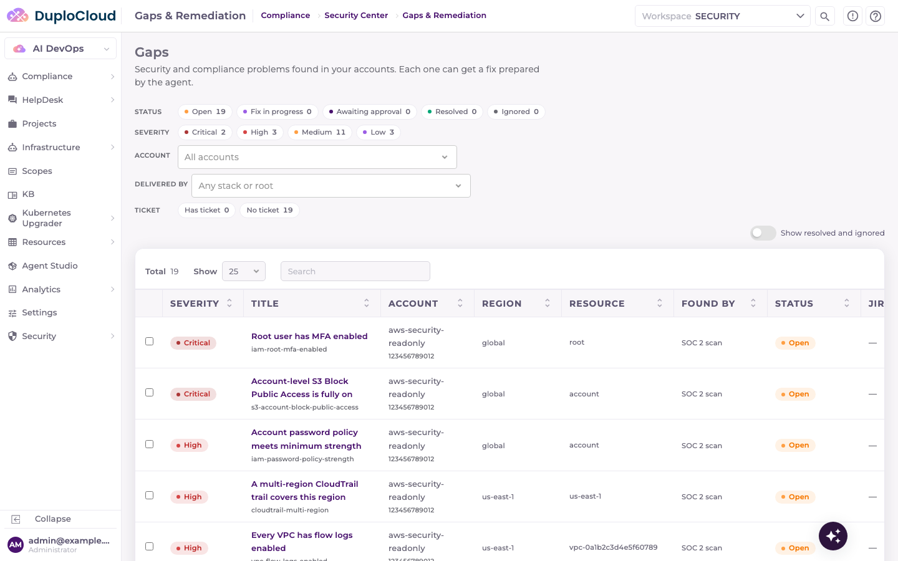

Open a gap to see what's wrong, the facts (account, region, resource, when it was first and last seen), the controls it counts against, and what found it. The gap page has a **Details** tab and a **Remediation** tab.

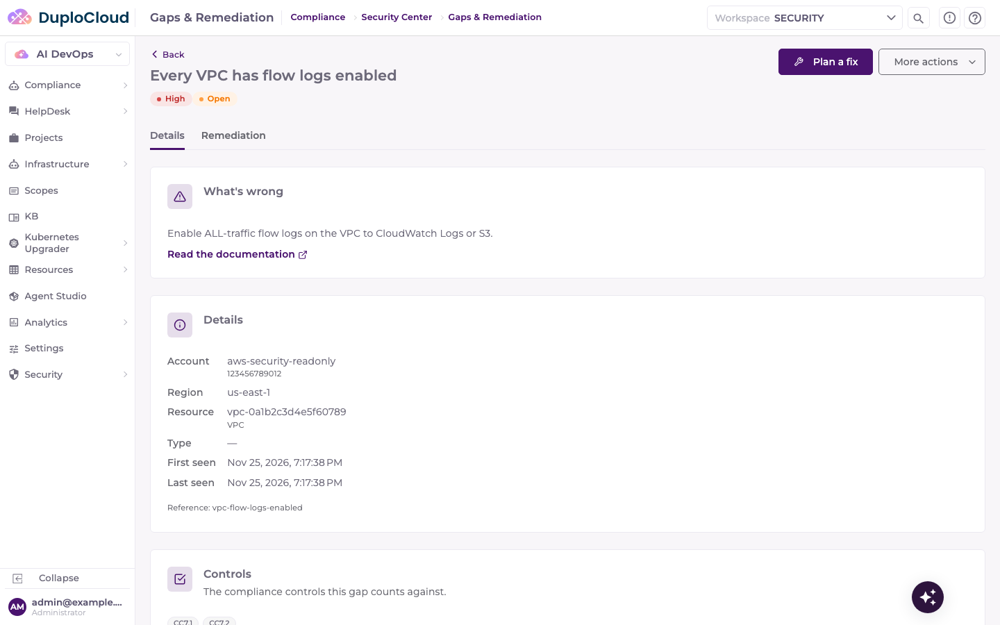

From a gap you can:

- **Plan a fix**, or **View fix** if it already has one. See [Fix a gap](#fix-a-gap).
- Under **More actions**, **Ignore in this account…**: give a reason and, optionally, a **Stop ignoring on** date. This ignores the issue for every resource in that AWS account that has it. Undo it with **Stop ignoring**.
- Under **More actions**, **Close** the gap.

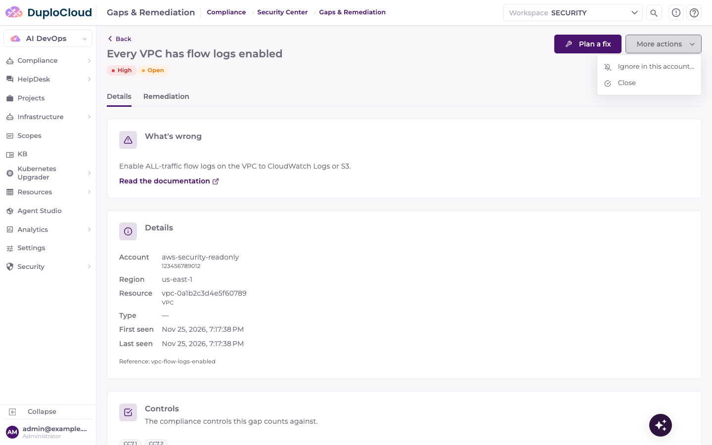

### Create Jira tickets

If your administrators connected Jira and your workspace has a Jira project key, you can open tickets for gaps. Tick open gaps on the list, select **Create N Jira tickets**, and confirm. Gaps that already have a ticket are skipped. The **Jira** column shows each gap's ticket, and Security Center keeps the ticket updated as the gap is fixed. Closing or ignoring a gap in Security Center doesn't change its Jira ticket.

## Fix a gap

1. On a gap, select **Plan a fix**. To fix several gaps together, tick them on the **Gaps** list and select **Plan a fix** there.
2. On the **Plan a fix** page, under **Where it runs**, check the **AWS account** and, if you use Terraform or CloudFormation, the **Repository** and **GitHub connection**. The account is only read: nothing runs in it.
3. Select **Analyse**. The agent works out where each resource is managed: it asks CloudFormation which stack owns the resource, and reads the Terraform state in each configured repository, in order. If the fix needs a value only you know, such as a destination bucket, the analysis asks for it; enter it and select **Continue**.

   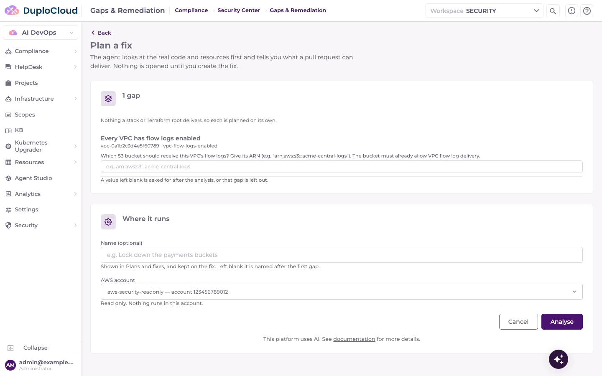
4. Under **What the plan found**, each gap shows one of:
   - **Ready for a pull request**: the resource is managed by your Terraform or CloudFormation, and the fix will be a pull request.
   - **The agent drafts it**: nothing manages the resource, so the agent drafts a single AWS CLI command.
   - **Needs more planning**: see [Fixes that need more than a code change](#fixes-that-need-more-than-a-code-change).
5. Untick or **Remove from plan** any gap you don't want, then select **Create the fix for N gaps**. Nothing is opened or changed until you do.

   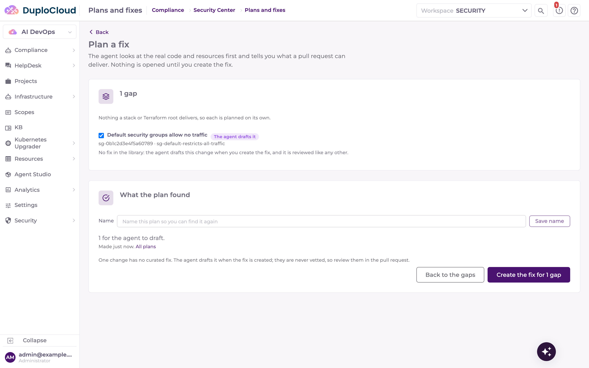

The fix page shows what was made:

- **A pull request** against your Terraform or CloudFormation, with the **Proposed diff** and a **View pull request** link. Merge it and deploy through your own pipeline.
- **An AWS CLI command** with an explanation. Nothing runs until someone approves it. A command the agent wrote itself, rather than one written by DuploCloud, is marked **Drafted by the assistant**.

The gap closes when the next scan confirms it is fixed.

### Approve and run an AWS CLI fix

A command fix runs only after two steps on the fix page. Each needs its own permission.

1. **Attach write access** attaches the account's write connection to the fix. If the account has no write connection, the page says the command can't run; ask an administrator to set one in [Fix access](set-up.md#fix-access).
2. **Approve and run** runs the command once in the AWS account shown. The button then shows **Already run**.

You approve the exact command on screen. If the stored command changes after you loaded the page, the run is refused, and you must reload and approve again. Security Center records who approved and which command, and runs nothing that doesn't match.


**Approve and run** changes your AWS account straight away, with no second confirmation. Read the command, the explanation and the warnings first.


A fix that failed can't be retried. Go back to the gap and select **Plan a new fix**.

### Fixes that need more than a code change

Some fixes, such as encrypting an existing database, volume or file system, can't be done by editing one setting. These show **Needs more planning** and an **Analyze scope** button. It starts a read-only run that reports what depends on the resource, the decisions only you can make, and a draft plan that is never run. Select **Open the report** to read it.

### Plans and fixes

**Plans and fixes** lists plans the agent analysed but you haven't acted on yet (**Plans**), and fixes (**Fixes**). Filter by status, approach and account. A plan changes nothing and holds no gaps. **Delete** on a row removes it straight away, with no confirmation. A pull request that Security Center opened stays open on GitHub until you close it there.

## Track CVEs

Open **CVEs** to see package vulnerabilities that Amazon Inspector found, each with a patch deadline. Use the **Severity** and **Deadline** chips (**Overdue**, **Due soon**, **On track**, **No fix yet**, **No SLA**), the search box, and **Show** (**Open**, **Suppressed**, **Closed** or **All**).

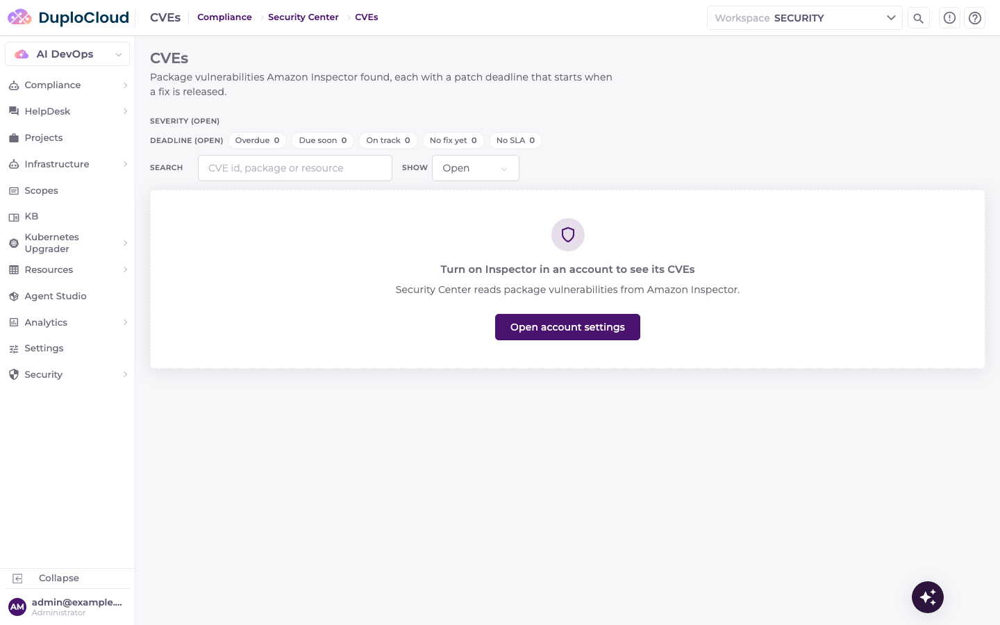

| Column | What it shows |
| --- | --- |
| **CVE** | The CVE ID, linked to the advisory, with its title. |
| **Severity** | Critical, High, Medium, Low, Informational or Untriaged. |
| **Resource** | The affected instance, image or function. |
| **Package** | The installed version and the fixed version. |
| **Fix released** | When a fix was published. |
| **First seen** | When Inspector first found the CVE. |
| **Due** | For example **In 12 days**, **Due today**, **3 days overdue**, **No fix yet** or **No SLA**. |
| **Status** | Open, suppressed or closed. |

The deadline is the later of the date Inspector first found the CVE and the date a fix was released, plus the SLA days for its severity. The defaults are 15 days for Critical, 30 for High, 90 for Medium and 180 for Low. Administrators change them, or choose **No SLA**, in **AI Admin > Security Center > Settings > Remediation SLAs**. A change applies to every CVE at once. Informational and untriaged CVEs, and CVEs with no fix yet, never have a deadline.

CVEs need Inspector turned on for the account. See [Turn on security services in an account](set-up.md#turn-on-security-services-in-an-account).

If an administrator turned on the **Daily CVE digest**, Slack gets one message a day for your workspace. For each severity from the chosen minimum up, it gives how many CVEs have a fix, how many are overdue and when the next is due, then lists the five most urgent.

## Investigate a suspected compromise

An **impact analysis** starts from something you already suspect, such as a stolen laptop, a leaked key or an unexpected resource, and shows what an attacker could have reached. It reads CloudTrail and your account's configuration, builds a graph of what was touched, and proposes ways to contain it. It only reads: nothing is contained until you approve it.

1. Open **Impact analyses** and select **New impact analysis**.
2. Enter a **Name** and a **Description** of what happened, and choose the **AWS account**.
3. Under **CloudTrail trail**, Security Center lists the account's trails and pre-selects the **Recommended** one. It then checks that it can read a log file from the trail's bucket, and shows **Can read a log file from this bucket** when it can. If the bucket is in another AWS account, choose a connection that can read it under **Read it with**.

   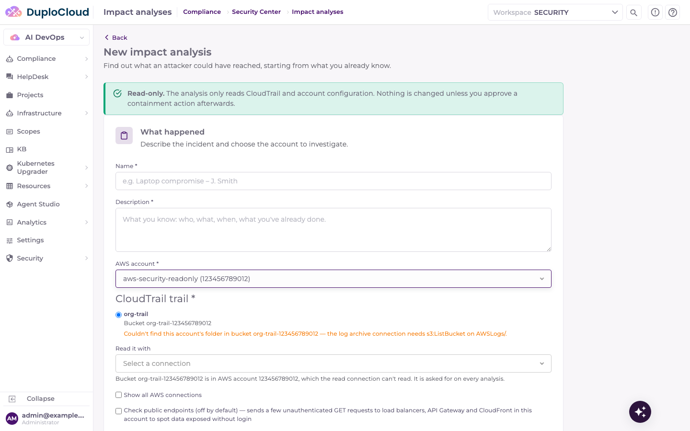
4. Optional: set the **Window** to investigate. It defaults to the last 7 days, up to 90.
5. Optional: add **Starting points**, up to 25: IAM users, IAM roles and SSO users under **Identities**, or resources (EC2 instance, Lambda function, S3 bucket, security group, EBS snapshot, AMI, KMS key or Secrets Manager secret) under **Resources**. They tell the analysis where to look first. They aren't a filter: it follows the attacker wherever they go.
6. Optional: turn on **Check public endpoints**. It sends a few unauthenticated GET requests to load balancers, API Gateway and CloudFront in the account to spot data exposed without login.
7. Select **Start analysis**. The page shows live progress.

If **Start analysis** is disabled, the reason appears above it, for example **This account has no CloudTrail trail** or **Choose the connection that can read bucket …**. See [Troubleshooting](troubleshooting.md).

### Read the result

The result shows a **verdict** (**Compromise confirmed**, **Suspicious**, **No evidence found** or **Inconclusive**) with the blast radius, what's contained, the attacker's API calls and the dwell time. Below it are the attack status, a coverage strip for each data source, and the likely entry point. The tabs are **Timeline**, **Containment**, **Filed as gaps**, **Attack chain**, **Coverage**, and **Public endpoints** if you turned that check on.

A clean first pass says **No attack found in the selected window** and **Window only · Not yet compared against this account's history**. It never says the account is clean. For a deeper look, select **Compare against history (3 days)**, then **Extend to 7 days** and **Extend to 14 days**.

Other actions: **Edit window**, **Export PDF** and **Ask AI**. Select a node in the graph to **Mark as expected** something you know is legitimate, with an optional reason. It hides the node and files no gap. **Show N expected** brings hidden nodes back.

### Contain

The **Containment** tab lists actions for the affected identities and resources. Containment runs with the account's write connection. Without one, the controls are disabled; select **Set up a write connection**.

| Target | Actions |
| --- | --- |
| Access key | Deactivate access key, Delete access key |
| IAM user | Quarantine user (a deny-all policy), Delete user |
| IAM role | Quarantine role, Revoke active sessions, Delete role |
| EC2 instance | Isolate instance (moves it to a security group with no rules and detaches its instance profile, then takes a snapshot), Stop instance, Terminate instance |
| Lambda function | Disable function, Delete function |

The suggested action depends on the target. For a role that was the entry point or was compromised, it is **Revoke active sessions**. Select **Quarantine N selected** to contain several at once; delete and terminate actions are never included in a batch.

Every action asks you to confirm, and lists what will change. Actions that can't be undone, such as delete and terminate, say so. Each other action has its own **Undo**, which restores the recorded prior state.


Containment changes your AWS account. Isolating an EC2 instance has not yet been verified against a real account. Test it on a non-production instance first.

