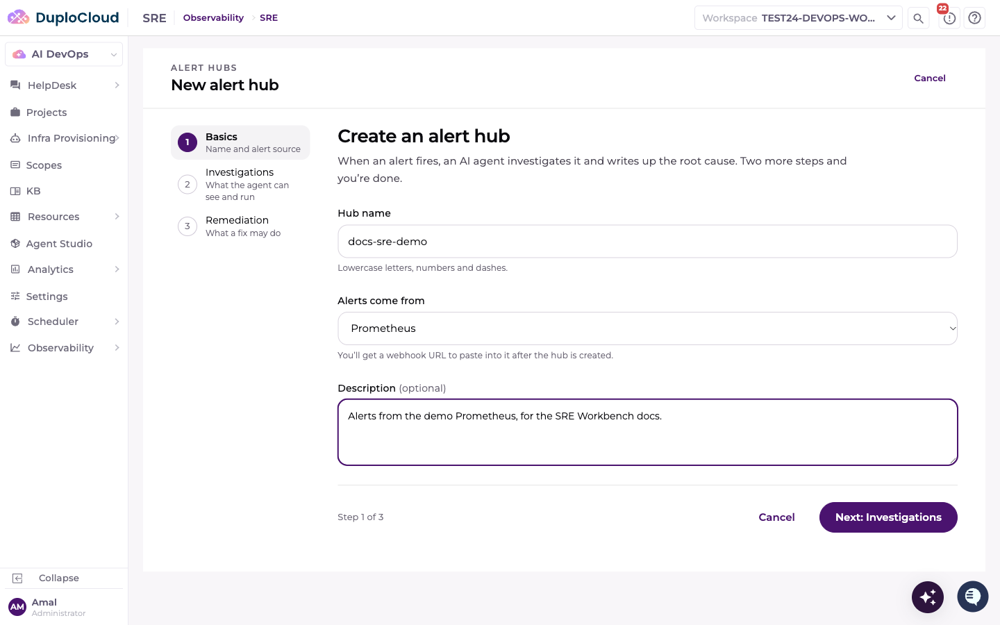
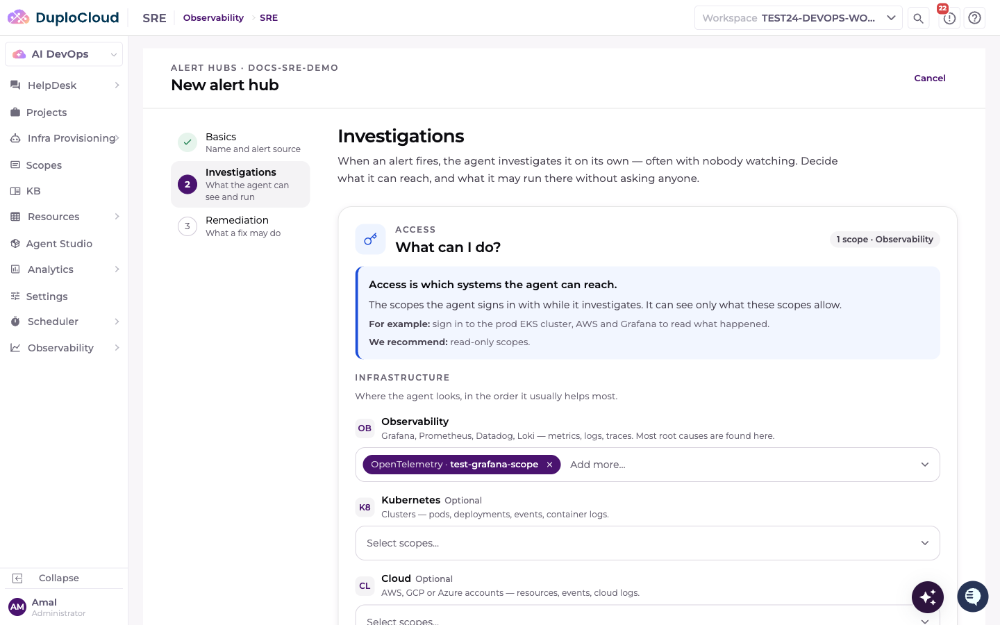
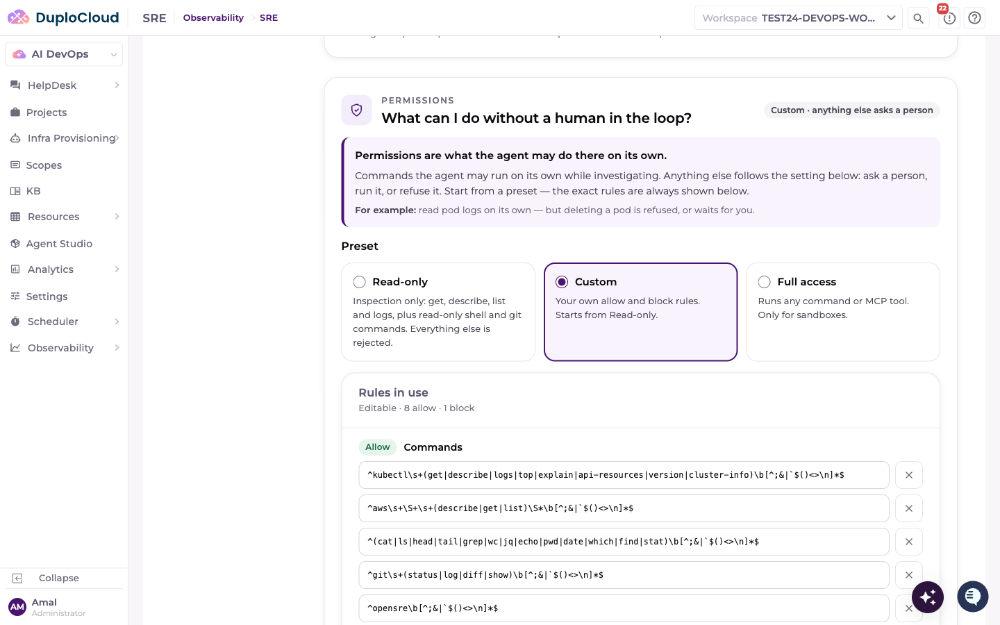
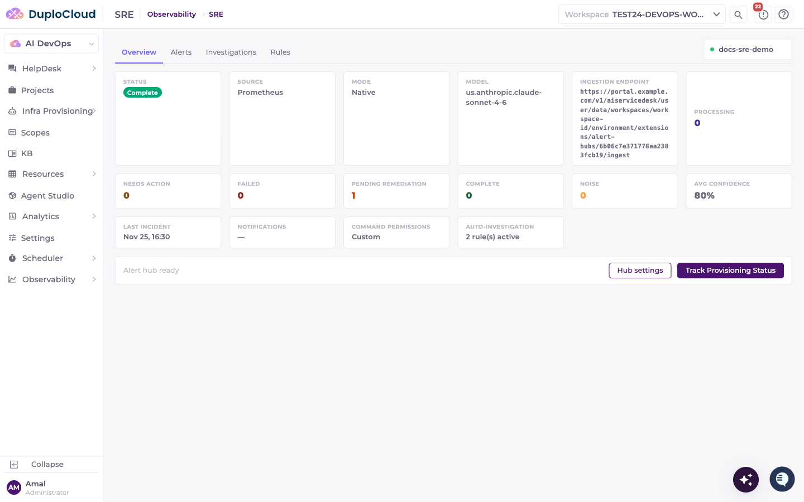

# Set Up

Setting up is a job for a DuploCloud administrator.

## Before you start

- **At least one observability scope** in your workspace, for example Datadog, New Relic, Sentry, Grafana or Prometheus. A hub cannot be created without one, because investigations start from metrics, logs and traces.
- **Optional scopes** for the other places the agent should look: a Kubernetes cluster, a cloud account (AWS, GCP or Azure), and source-control scopes (GitHub, GitLab or Bitbucket) that reach your infrastructure-as-code and application repositories. See [Integrating Providers](../../getting-started/integrating-providers/README.md) for each provider's fields.
- **An alert source** that can send a JSON webhook, such as Prometheus Alertmanager, Grafana or Amazon CloudWatch.
- **Optional:** a Slack app and channel for notifications, and a place where your runbooks live (a GitHub repository, Confluence space, Google Drive folder, Notion workspace or web pages).


The agent acts with the access of the scopes you attach to the hub, and can see only what those scopes allow. Start with read-only credentials, and add write access only to the scopes used for fixes.


## Activate SRE Workbench

1. Open **Marketplace > Agent Marketplace** and find **SRE Workbench**.
2. Select **Activate**. See [Agent Marketplace and Buying Agents](../../getting-started/marketplace.md) for what happens next.
3. When it finishes, the **Observability** section of the menu shows **SRE**.

## Grant access

Give the people who will use SRE Workbench the permissions in [Permissions and Safety](permissions-and-safety.md). Starting investigations, skipping alerts, running fixes, editing the root cause, managing rules, splitting, and drafting, saving or scanning runbooks are each granted separately. Ordinary read and write access does not include them.

## Create an alert hub

1. Open **Observability > SRE**. The first time, select **Create your first alert hub**. After that, open the hub list next to the current hub's name and select **+ New alert hub**. You can also select **Manage alert hubs** there, then **Add Hub**.
2. **Basics.** Enter a **Hub name** (2 to 60 characters: lowercase letters, numbers and dashes, starting and ending with a letter or number). Choose where **Alerts come from**: Prometheus, Datadog, CloudWatch, Grafana, PagerDuty or Other (webhook). A description is optional. Select **Next: Investigations**.
3. **Investigations.** Pick the scopes the agent signs in with while it investigates. **Observability** is required. **Kubernetes**, **Cloud**, **Infrastructure as code** and **Application code** are optional. Then choose what the agent may run without asking anyone. New hubs start on **Read-only**, which is the safest choice for unattended runs. See [Command rules](permissions-and-safety.md#command-rules). Select **Next: Remediation**.
4. **Remediation.** Choose what a recommended fix may do when someone runs it. By default **Same access as investigations** is on, so fixes sign in with the same scopes. Turn it off to give fixes their own scopes, for example a scope that can restart deployments. Fixes start on **Custom** rules, where anything not on the allow list asks a person first.
5. Select **Create hub**. The hub's **Overview** tab opens. Setting the hub up takes a moment. When it is done, the status shows **Complete** and the message reads **Alert hub ready**.

## Connect your alert source

1. On the hub's **Overview** tab, copy the **Ingestion Endpoint** and add it as a webhook receiver in your alert source.
2. The endpoint accepts only authenticated DuploCloud calls. Have your alert source send a DuploCloud API token for a user whose only SRE Workbench permission is **Ingest alerts into a hub** (`sreworkbench.ingest`) on this hub. See [User Tokens](../../armor/access-control/user-tokens.md).
3. To try the hub before your alert source is connected, send it an alert by hand with **Ingest Alert**, then investigate it. See [Send an alert by hand](use.md#send-an-alert-by-hand). The investigation runs the AI agent with the hub's scopes.


Use a token that can only ingest alerts. Anyone who holds it can post alerts into the hub, and with matching [rules](use.md#start-investigations-automatically) those alerts start investigations.


## Optional settings

Select **Hub settings** on the hub's **Overview** tab. The optional settings are under **Advanced options**:

- **Skills.** Notes about your architecture and its known failure modes. Every investigation from this hub reads the skills you pick. Skills are written under **Admin > Skills**.
- **Runbooks.** Where your runbooks live and how the agent should use them. See [Runbooks](#runbooks).
- **Notifications.** A Slack channel for results. See [Slack](#slack).

Changes to hub settings apply to new investigations, not ones already running.

### Runbooks

1. Under **Where do your runbooks live?**, choose **GitHub**, **Confluence**, **Google Docs**, **Notion** or **Web links**. Choose **I don't have any yet** to let the agent start them.
2. Enter the location (for GitHub, a repository as `owner/repo`, plus an optional folder and branch) and choose the scope the agent signs in with.
3. Under **How should the agent learn your runbooks?**, either write the answers yourself, or select **Scan runbooks** to have the agent read your runbooks and draft the answers for you to check. Scanning changes nothing, takes about a minute, and needs the **Scan runbooks with the agent** permission.
4. Answer **How should the agent find the runbook for an alert?** and **How should new runbooks be added?** (for example, by pull request).
5. Select **Save changes**.

The location fields are checked when you save. A GitHub repository must be written as `owner/repo` or pasted as a GitHub link, a folder must be a relative path, and Confluence, Google Drive and Notion locations must be a single link.

### Slack

Notifications are posted by a Slack bot to one channel.

1. Create a Slack app with the `chat:write` bot scope, install it to your Slack workspace, and invite it to the channel. For a public channel you can add `chat:write.public` instead of inviting it.
2. In DuploCloud, add a provider of type `slack` whose credential holds the bot token (it starts with `xoxb-`) and the channel ID (it starts with `C`), and create a scope for it.
3. On the hub's **Notifications** settings, choose that scope as the **Notification scope** and select **Save changes**.


The Notifications settings page still describes a Slack incoming-webhook URL. SRE Workbench posts with a bot token and channel ID, so set up the credential as described above.


The token stays in the scope's credential. It is not shown on the hub, not returned by the API, and never reaches the investigating agent.

Next: [Use](use.md).
