# Use

Open **Observability > SRE**. The page opens on the **Alerts** tab of the hub you used last. To switch hubs, open the list next to the hub's name.

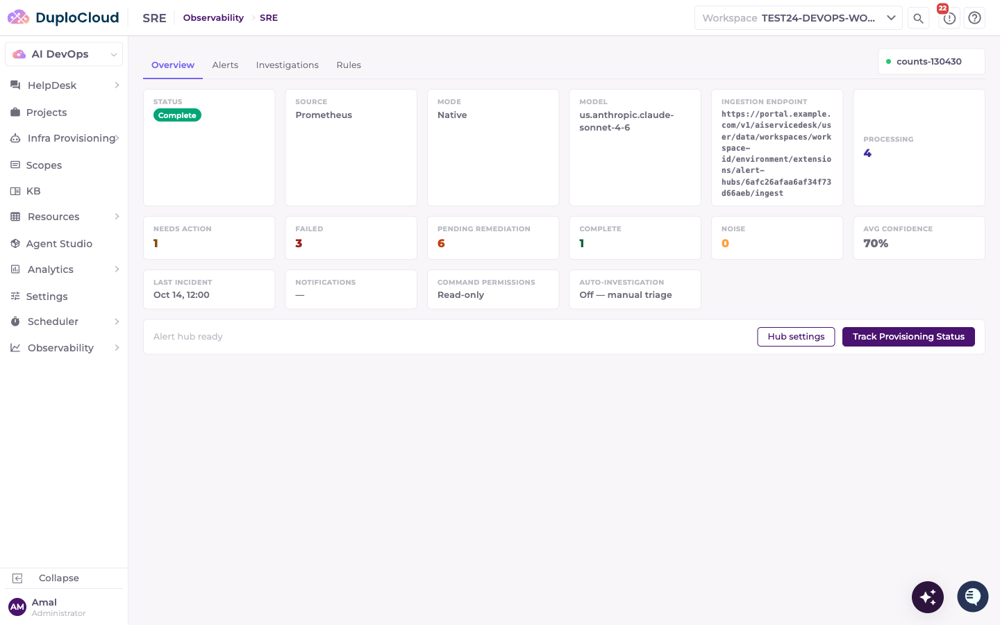

## Triage and investigate alerts

1. Open the **Alerts** tab. Filter by investigation status, severity, or state (**Firing** or **Resolved**).
2. Select one or more alerts.
3. To investigate, select **Investigate alert**. If you selected several related alerts, the button reads **Investigate together**, and they share one investigation.
4. To skip alerts, enter a reason in **Reason (required to skip)** and select **Skip**. The reason is kept, so the decision can be reviewed later.

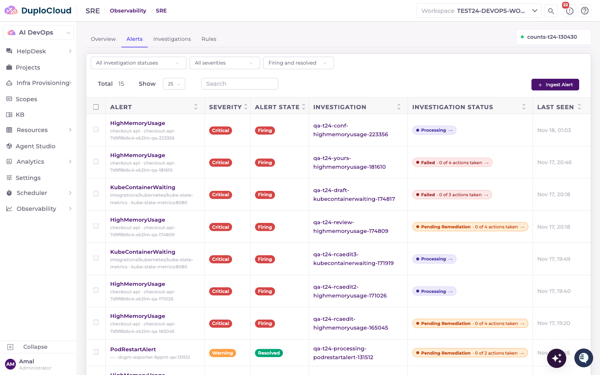

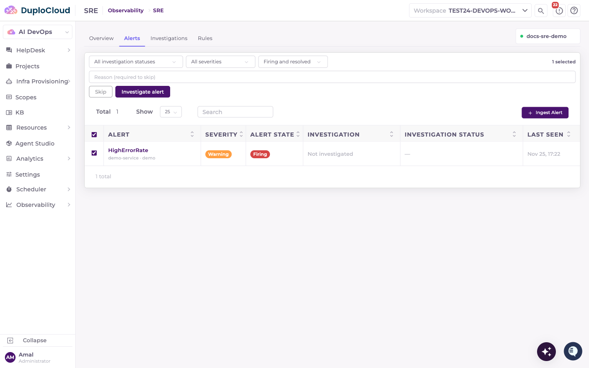

You can select alerts that were never investigated, were skipped, or whose investigation failed. An alert already investigated by another investigation cannot be selected. Split that investigation instead. Open an alert to see its details, its labels, the raw payload and its investigation. **Occurrences** counts how many times the same alert was delivered.

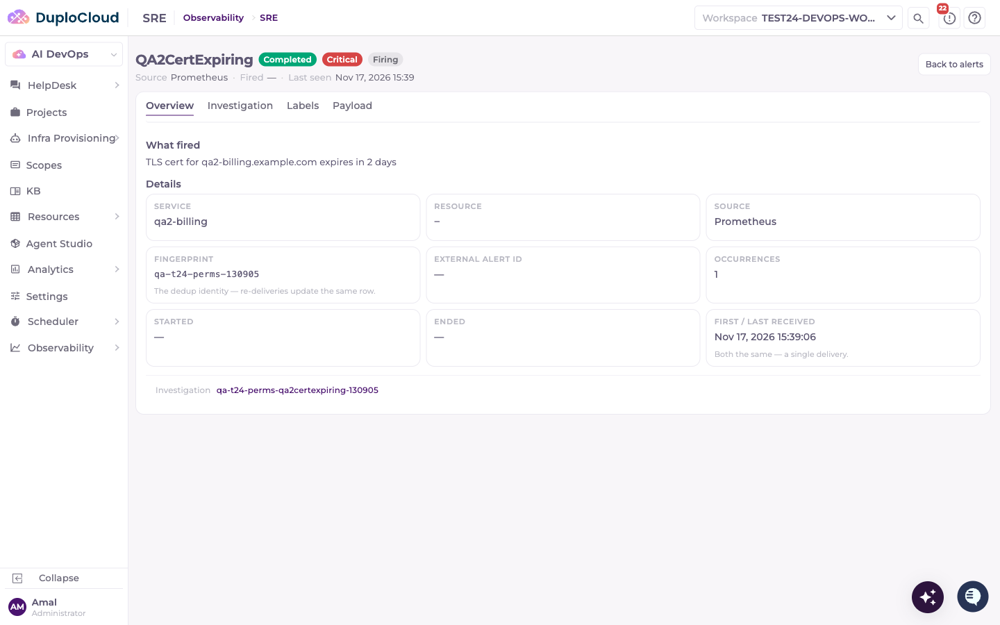

### Very large alerts

An alert larger than 64 KB is shortened when it arrives, and the alert page says so and by how much. Up to 500 alerts are accepted per request. If an investigation's alerts are too large to hand to the agent in full, the investigation page shows **Large investigation** and how many were cut. The agent can still read each alert in full by its ID. The complete alert stays in your alert source.

## Send an alert by hand

On the **Alerts** tab select **Ingest Alert**, paste an Alertmanager or Grafana style JSON body, and select **Ingest**. Then select the alert on the **Alerts** tab and investigate it.

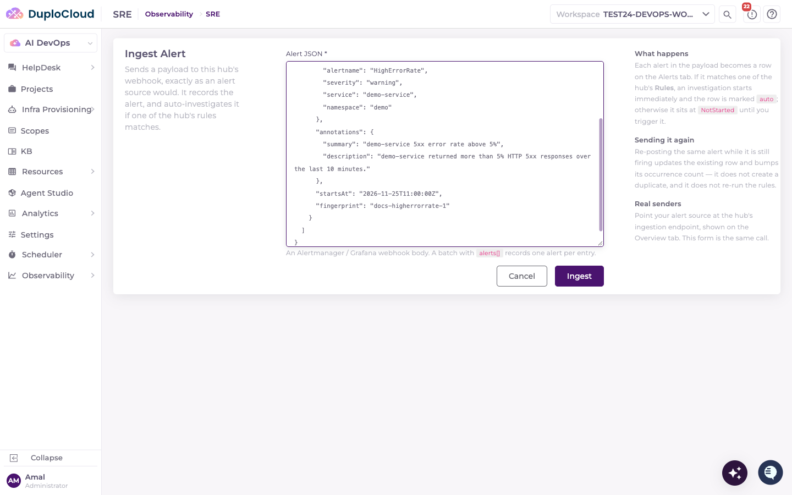

 This is the same call your alert source makes. A body with an `alerts[]` list records one alert per entry. If one of the hub's rules matches, an investigation starts immediately.

Sending the same alert again while it is still firing updates the existing alert and increases its occurrence count. It does not create a duplicate and does not run the rules again. If the alert resolves and then fires again, that is a new alert.

## Follow an investigation

Open an investigation from the **Investigations** tab, or from its alert. While it runs, the page shows its progress: **Initializing**, **Reading alert**, **Checking runbooks**, **Investigating**, **Generating RCA** and **Notifying**. If the agent wants to run a command that needs a person's approval, the run stops at **Approval needed** until someone answers.

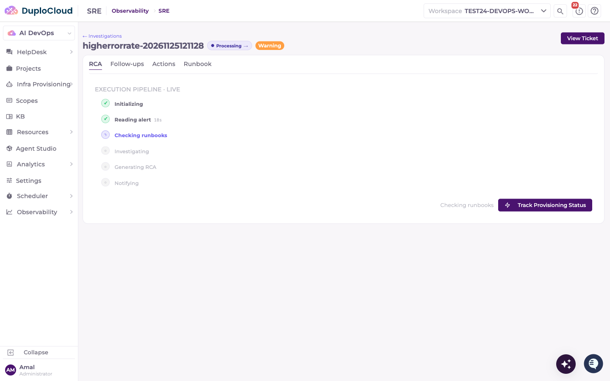

When a command needs approval, the investigation shows **Needs Action** and the run pauses at **Approval needed**. Select **View Ticket**, or **Open the ticket to approve**, to open the agent's conversation. There, choose **Approve**, **Reject** or **Ignore** for the command, then select **Submit**. Leave **Remember for this ticket** off unless you want the same answer for every later request in that ticket.

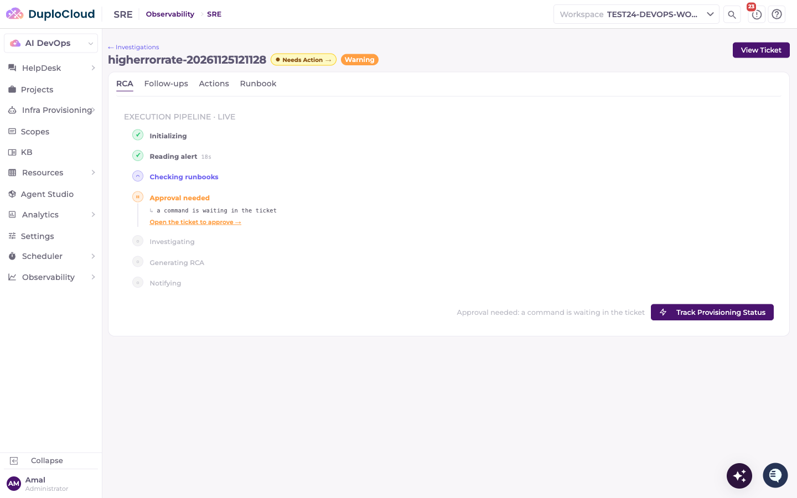

If you reject a command, the agent carries on without it and records what it could not check under **Still Unknown**.

| Status | What it means |
| --- | --- |
| **Processing** | The agent is working. |
| **Needs Action** | The run is waiting for a person, for example to approve a command, or it is blocked by missing access. |
| **Failed** | The run failed. The ticket has the details. |
| **Pending Remediation** | The root cause is written and recommended actions are waiting. The list shows how many have been taken, for example **1 of 4 actions taken**. |
| **Complete** | Finished, with nothing left to do. |

## Read the result

The **RCA** tab shows:

- the **Problem statement**,
- one or more **Root causes**, each saying which alerts it explains,
- **Findings** that support each cause. Each finding links to its **Evidence**: the command or query the agent ran and its raw output. A finding with no evidence is marked **inferred**.
- a runbook card that says whether a runbook was used, none matched, no runbook source is set up, or the runbook source could not be reached.

The header shows the agent's **Confidence**, and who or what started the investigation.

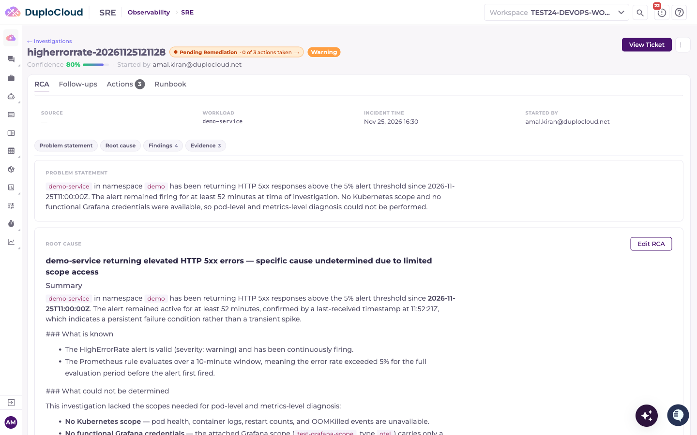

The other tabs:

| Tab | What it shows |
| --- | --- |
| **Follow-ups** | **Still Unknown**: checks the agent could not conclude, and why. **Follow-up Questions**: questions only a person can answer, for example about intent or ownership. |
| **Actions** | Recommended fixes, each with its commands and the findings it is based on. |
| **Runbook** | A runbook draft written from this investigation, if one has been drafted. |

## Answer a follow-up question

On **Follow-ups**, select **Answer** under a question, type your answer and send it. Your answer is saved as you wrote it. The agent then updates the RCA with what your answer settles, for example closing an unknown or adding a finding, as a new RCA version.

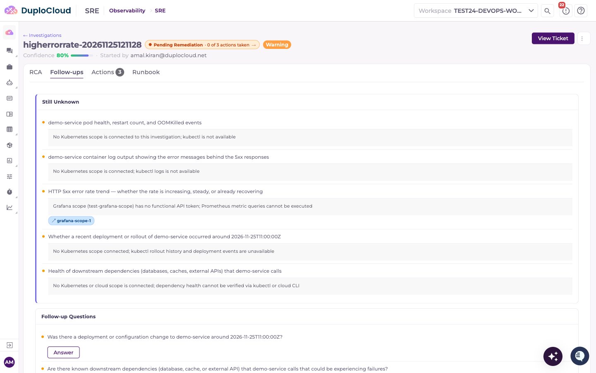

## Correct the root cause

- Select **Edit RCA** on the **Root cause** or **Findings** card to edit the problem, root causes, findings and recommended actions yourself, then select **Save RCA**.
- Or select **Edit RCA with Agent** from the **⋮** menu to correct it in a conversation with the agent.

Every change is saved as a new version, labelled with who made it. Up to 20 versions are kept, always including the original. Select an earlier version to view it, and **Back to current** to return.

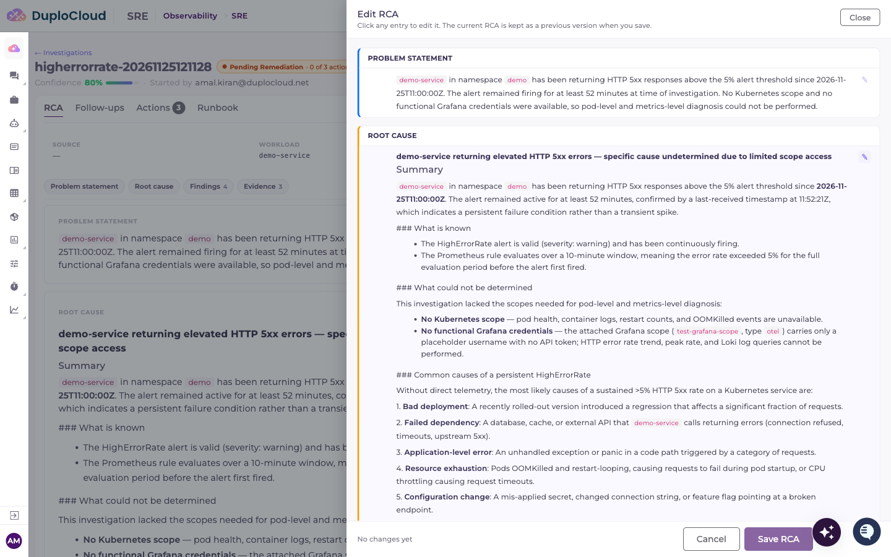

## Run a recommended action

1. Open the **Actions** tab. Each step lists its commands and the findings it is based on (**Because**).
2. Select **Execute in Ticket**, then **Run**. If an earlier attempt failed, the button reads **Retry Execution in Ticket**.
3. You are taken to the ticket to watch it run. A command that the hub's remediation rules do not allow on their own waits there for a person to approve it.

**Details** under a step shows what was done and each command that ran, with its result. Every attempt is kept.

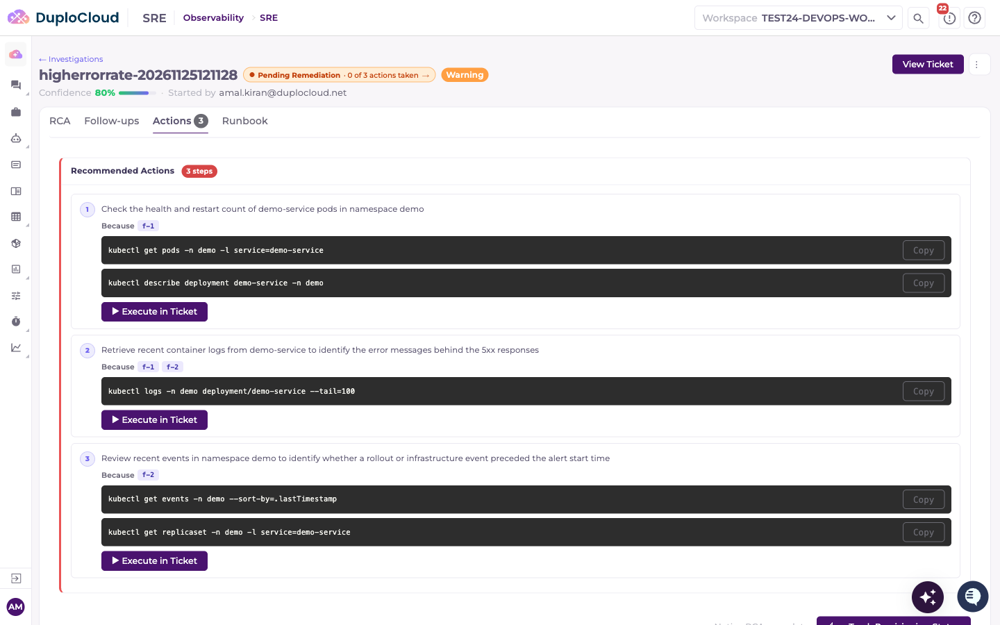

The fix runs exactly the step you reviewed. If someone changes the step after you opened the page, it is refused with **Action changed**. Reload the page and review it again.


A recommended action can change live infrastructure, and there is no undo. Read its commands before you run it. See [Permissions and Safety](permissions-and-safety.md).


## Split an investigation

If an investigation covers alerts that turned out to have different root causes, use the **Split Investigation** card on the **RCA** tab. A preview shows what moves to the new investigation and what stays. Select **Split into new investigation** to confirm. A split cannot be undone.

## Draft or save a runbook

- **Draft Runbook** (in the **⋮** menu) has the agent write a runbook from what the investigation established. The draft appears on the **Runbook** tab. Nothing is written to your runbook source.
- **Create Runbook** appears once there is a draft. It has the agent save the runbook where your runbooks live. The agent first shows you the exact destination and how it will be delivered (for example a pull request), writes only after you approve, and then writes exactly the runbook you approved. After a runbook has been saved, the button reads **Update Runbook**.

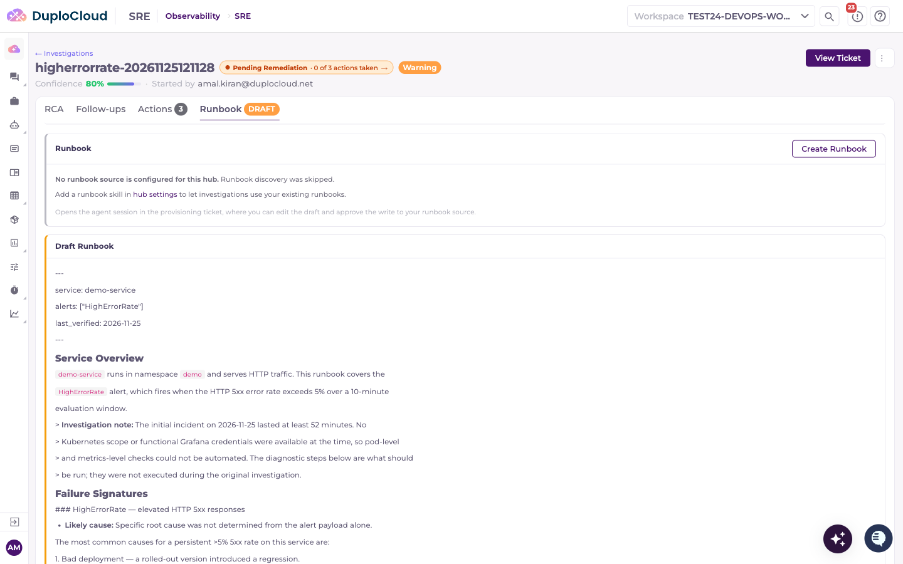

## Start investigations automatically

1. Open the **Rules** tab. Select **Add the first rule**, or **+ Add Rule** if the hub already has rules.
2. Give the rule a name and add one or more conditions on the alert's labels, for example `severity` equals `critical`. A condition can use equals, not equals, contains, starts with, exists, does not exist, is one of, or a regular expression. Matching ignores upper and lower case. All of a rule's conditions must hold.
3. Order the rules with the arrows. Rules are checked top to bottom, and the first rule that matches starts the investigation.
4. Select **Test against recent alerts** to see which of the hub's recent alerts each rule would match. It changes nothing.
5. Select **Save Rules**.

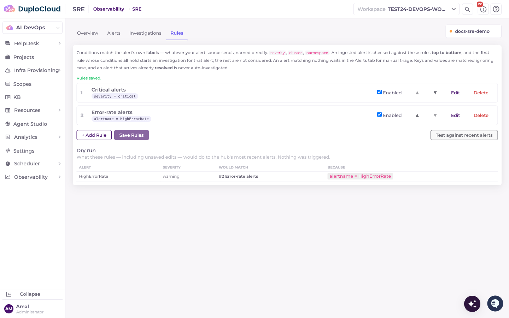

Only newly received alerts are checked against rules. An investigation started by a rule is marked **auto** and records which rule started it. With no rules, every alert waits for someone to triage it.


An automatic investigation usually has nobody watching it. If the hub's command rules ask a person to approve a command, the run waits until someone answers. Choose command rules that suit unattended runs, such as **Read-only**. See [Permissions and Safety](permissions-and-safety.md).


## Change a hub's settings

On the hub's **Overview** tab, select **Hub settings**. **Investigations** and **Remediation** hold the scopes and command rules. **Skills**, **Runbooks** and **Notifications** are under **Advanced options**. Each page is saved on its own, and changes apply to new investigations.

## Notifications

With a notification scope set on the hub, SRE Workbench posts to Slack when an investigation completes (the root cause, its confidence and a link to the report), when it fails, and when a command needs approval. A failed Slack message never fails the investigation.
