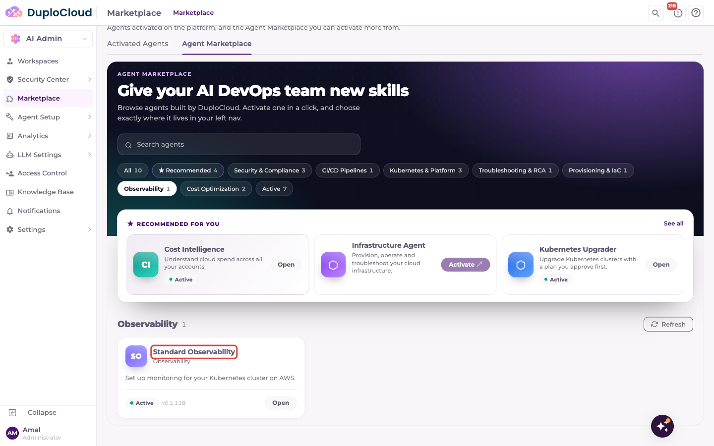
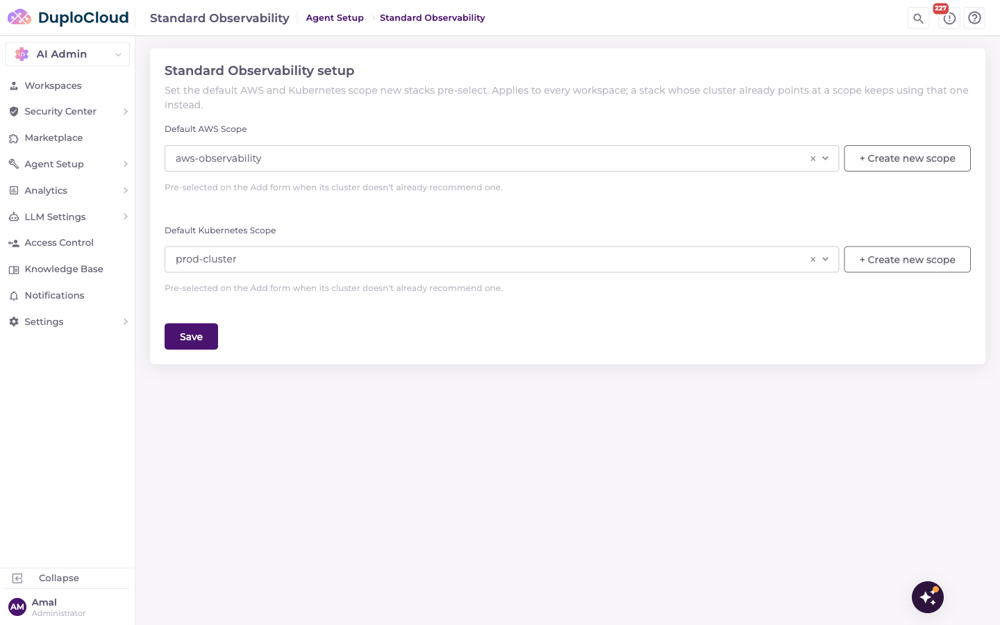

# Set Up

Setting up is a job for a DuploCloud administrator. Once it is done, workspace users can create stacks themselves.

## Before you start

You need:

- An **EKS cluster** with these add-ons running. The stack does not install them, because every workload on the cluster shares them.

  | Add-on | Needed? | Why |
  | --- | --- | --- |
  | FluxCD | **Required** | Every part of the stack is installed as a Flux Helm release. |
  | AWS Load Balancer Controller | **Required** | Gives Grafana (and the optional internal endpoints) a load balancer. |
  | Cluster autoscaler | Optional | Without it the node pool stays at its desired size. |
  | external-dns | Optional | Only needed if you want the Grafana DNS record created for you. |

- An **ACM certificate** in the cluster's region that covers the Grafana hostname you will use, for example `*.example.com`.
- A **DNS zone** you control for that hostname.
- A **default StorageClass** on the cluster for the Loki, Grafana and Prometheus volumes. If none is marked default, the stack picks EBS gp3 or gp2 itself.
- An **IAM role** that DuploCloud can assume, registered as an **AWS scope** and a **Kubernetes scope** for the cluster. The next section shows how to create it.

## Create the IAM role

One IAM role can serve as both the AWS scope and the Kubernetes scope. Standard Observability provides a CloudFormation template that creates a role with only the permissions the stack needs. The easiest way to run it is from the setup page (see [Choose the default scopes](#choose-the-default-scopes)): **Create the IAM role in AWS (CloudFormation)** opens the AWS console's quick-create page with the template loaded and DuploCloud's account filled in. You can also download the template and upload it yourself under **CloudFormation > Create stack > With new resources**.

1. Sign in to the AWS console in the account the stack will use, and open the template as described above.
2. Check the parameters:

   | Parameter | What to enter |
   | --- | --- |
   | **HelpdeskAccountId** | Filled in by the setup page link. The AWS account DuploCloud runs in, if it isn't this one. Leave it blank if DuploCloud runs in this same account. |
   | **ExternalId** | Optional. The external ID DuploCloud uses when it assumes the role, if any. |
   | **RoleName** | Defaults to `duplocloud-standard-observability`. |
   | **LogBucketNamePattern** | Defaults to `*-logs-*`, which matches the buckets the stack creates. If a stack will use an existing log bucket with another name, enter that name. |
   | **EksClusterName** | The cluster's name, so the same role can reach the Kubernetes API. Leave it blank to set up Kubernetes access another way. |

3. When the stack shows `CREATE_COMPLETE`, copy the **RoleArn** output.


With **EksClusterName** set, the template adds the role to the cluster's EKS access entries with **cluster-admin** access (`AmazonEKSClusterAdminPolicy`). If you want narrower access, leave **EksClusterName** blank and apply the scoped Kubernetes RBAC manifest that ships with the agent (`standard-observability-rbac.yaml`) to each stack's namespace instead. The cluster's authentication mode must be `API` or `API_AND_CONFIG_MAP` for an access entry to work.


What the role can do in AWS is listed in [Permissions and Safety](permissions-and-safety.md#aws-permissions).

## Activate Standard Observability

1. Open **Marketplace > Agent Marketplace** and find **Standard Observability**. The **Observability** filter shows it, or search for `Observability`.
2. Select **Activate**. See [Agent Marketplace and Buying Agents](../../getting-started/marketplace.md) for what happens next.
3. When it finishes, **Observability > Standard Observability** appears in the workspace menu.

## Choose the default scopes

The setup page sets which AWS scope and Kubernetes scope new stacks start with, across every workspace. A user can still pick another scope in the wizard. If a stack's cluster already points at a scope, that scope is used instead.

1. In the Administrator area, open **Agent Setup > Standard Observability**.
2. Under **Default AWS Scope**, choose an existing scope, or select **+ Create new scope**:
   1. Optionally enter the **EKS cluster name**, so the role also covers the Kubernetes scope. Then select **Create the IAM role in AWS (CloudFormation)**, or **or download the template**, and run it as described in [Create the IAM role](#create-the-iam-role).
   2. Choose the **Workspace** the scope belongs to, and enter a **Scope name** and the **IAM Role ARN** (the stack's **RoleArn** output). **AWS Account Id** and **Region** are optional.
   3. Select **Create scope**. The scope is created and attached to that workspace.
3. Under **Default Kubernetes Scope**, choose an existing scope, or select **+ Create new scope** and enter the **same IAM Role ARN** with a **Workspace** and **Scope name**. You don't need to run anything new, because the template already gave the role access to the cluster.
4. Select **Save**. If you just created a scope, DuploCloud opens that workspace's **Create Stack** wizard with the scope already selected.

You can also create the scopes by hand. Register the role as an IAM Role credential, then create a scope for it, as described in [Amazon Web Services (AWS)](../../getting-started/integrating-providers/amazon-web-services-aws.md) and [Amazon Elastic Kubernetes Service (EKS)](../../getting-started/integrating-providers/amazon-elastic-kubernetes-service-eks.md). Then attach both scopes to the workspace.

## Grant access

Workspace users who should create and manage stacks need access to the scopes they will use. A user who is not an administrator can only pick a scope that is attached to the workspace and granted to them by their permission sets. See [Permissions and Safety](permissions-and-safety.md#who-can-do-what).

## Next

[Create your first stack](use.md#create-a-stack).
