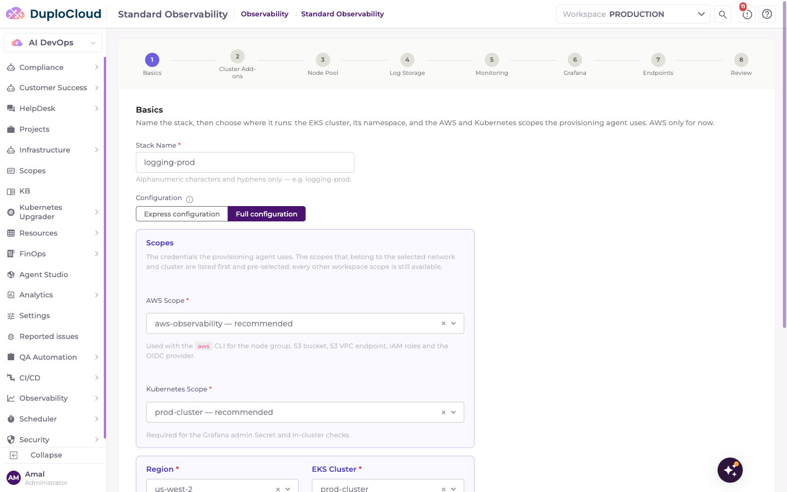
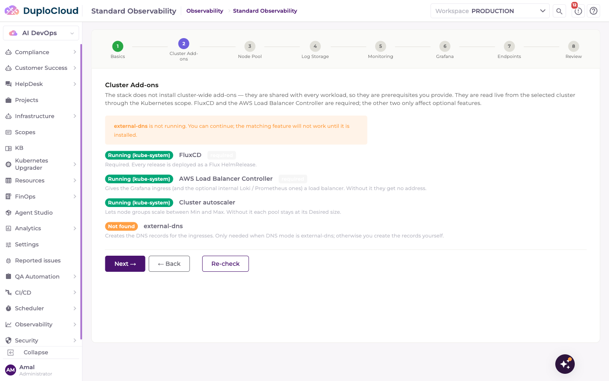
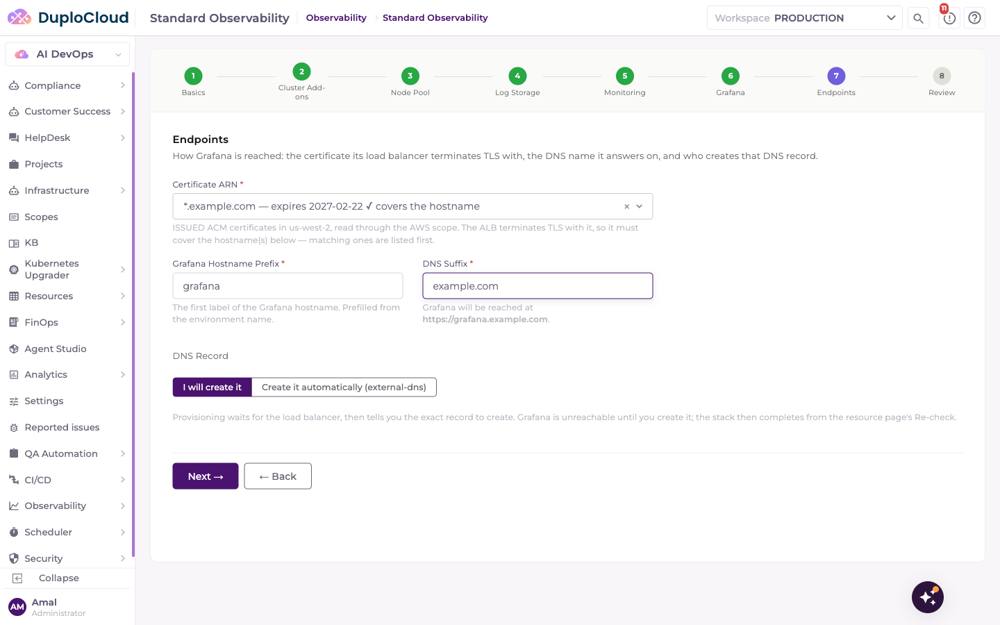
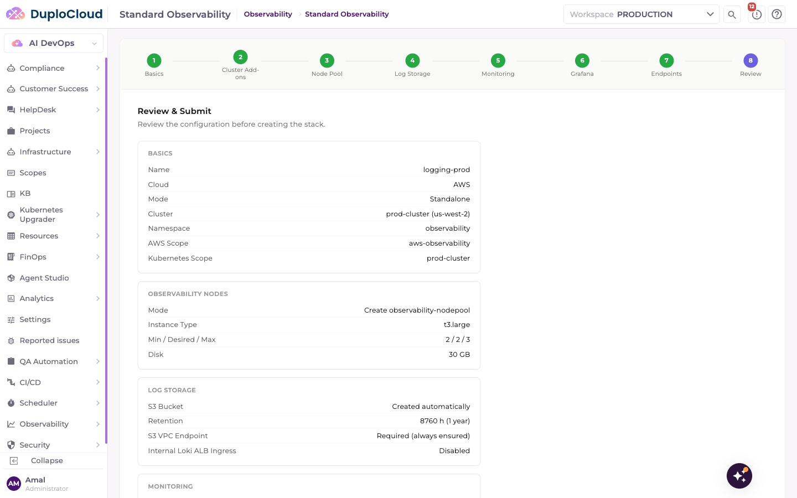
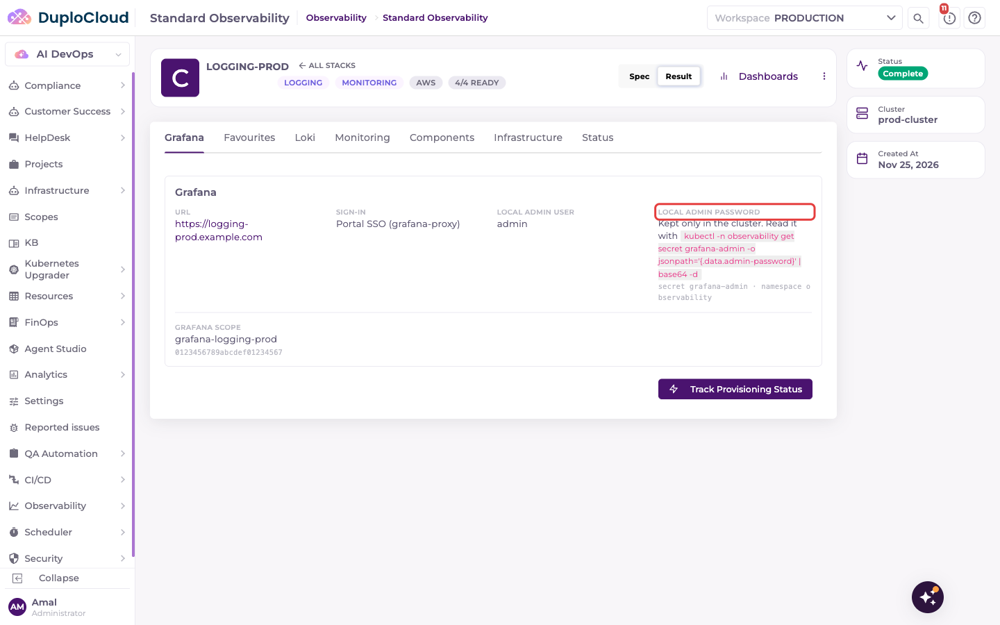
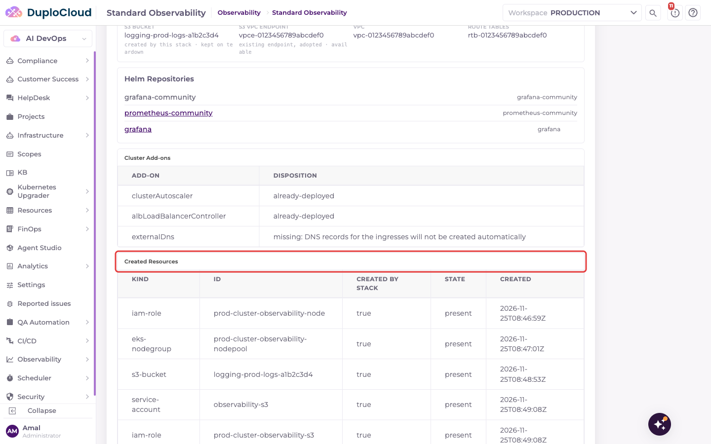
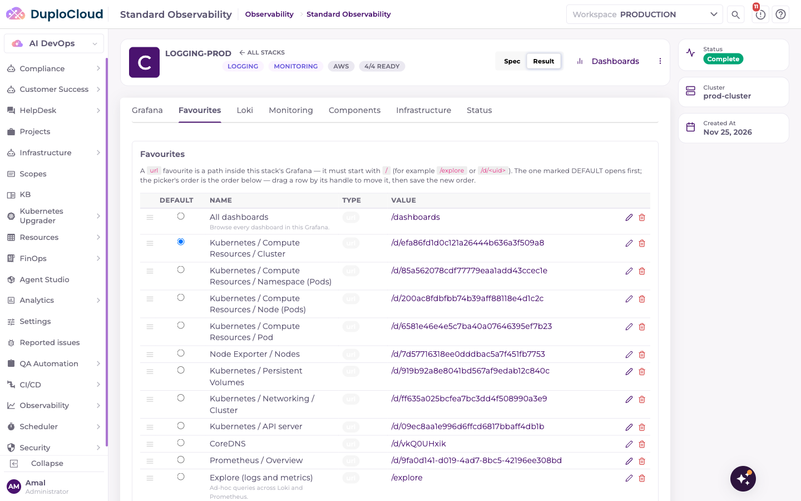

# Use

## Create a stack

1. Open **Observability > Standard Observability**. In a workspace with no stack, select the create button. Otherwise open **All Stacks** from a stack's page and select **Create Standard Observability Stack**.
2. Work through the wizard. The steps are described below. Nothing is created until you submit on the last step.

The wizard has two configurations, chosen on the first step:

- **Express configuration** (the default) shows only what can't be defaulted: **Basics**, **Grafana**, **Endpoints** and **Review**. **Cluster Add-ons** appears too if a required add-on is missing. Every other step keeps its default values.
- **Full configuration** shows all eight steps.

### 1. Basics



- **Stack Name**: letters, numbers and hyphens, for example `logging-prod`. You can't change it later.
- **Provisioning Mode**, offered only where the DevOps extension is available:
  - **Use the DevOps extension**: the stack belongs to a DevOps environment and resource group, which you choose or create here.
  - **Standalone (AWS and Kubernetes scopes only)**: the stack uses only the two scopes. Where the DevOps extension isn't available, this is the only mode.
- **AWS Scope** and **Kubernetes Scope**: the credentials the agent uses. Scopes that match the cluster are listed first and marked **recommended**. If no scope matches, the administrator's default is selected.
- **Region** and **EKS Cluster**: the cluster the stack runs on. The list shows the clusters in that region that the Kubernetes scope can reach.
- **Namespace**: an existing namespace, or a new one. Leave it blank to use `observability`. If the namespace already exists, the stack uses it as it is and never deletes it.

You can't change the mode, cluster or namespace after the stack is created.

### 2. Cluster Add-ons



The wizard reads the cluster live and shows which add-ons are running. You can't continue until **FluxCD** and the **AWS Load Balancer Controller** are running. A missing cluster autoscaler or external-dns only shows a warning. Install anything missing, then select **Re-check**.

### 3. Node Pool

- **Create New Node Pool** creates an EKS node group named `observability-nodepool`, labelled `allocationtags=duplo-observability`. Choose the **Instance Type** (default `t3.large`). Under **Advanced: size and disk** you can set **Min**, **Desired** and **Max** (default 2, 2 and 3) and the disk size (default 30 GB). The stack picks the image, on-demand capacity and the cluster's private subnets.
- **Use Existing Nodes** schedules the stack onto nodes you already have, chosen by their labels.

### 4. Log Storage

- **S3 Bucket**: **Create Automatically** makes a bucket named `<stack name>-logs-<random>`. **Use Existing Bucket** uses one you already have. The bucket is never deleted when you tear the stack down.
- **Retention (hours)**: how long Loki keeps logs. The default is 8760 hours (one year).
- **S3 gateway VPC endpoint**: always set up, and reuses an existing one on the VPC. This keeps log traffic off your NAT gateway.
- **Expose Loki on an internal ALB ingress**: optional. Lets collectors in other clusters in the same VPC or a peered network send logs in.

### 5. Monitoring

- **Deploy monitoring (Prometheus)**: on by default. Turn it off for logs only. You can turn it on later by editing the stack.
- **Retention (days)**, **Disk size (GB)** and **Retention size (GB)**: defaults 90, 100 and 90. Prometheus removes data older than the retention, or its oldest data once it passes the retention size, whichever comes first, so the disk never fills.
- **Expose Prometheus on an internal ALB ingress**: optional. Lets metrics agents in other clusters write into this Prometheus.

### 6. Grafana

People sign in to Grafana through your DuploCloud portal. The local admin account set here is a fallback.

- **Admin Password** and **Confirm Password**: at least 8 characters, with an upper-case letter, a lower-case letter, a digit and a special character.
- **Portal URL for SSO**: prefilled with the portal you are using. The cluster must be able to reach it.

### 7. Endpoints



- **Certificate ARN**: an issued ACM certificate in the cluster's region. Certificates that cover your hostname are listed first. A warning appears if the certificate you chose doesn't cover it.
- **Grafana Hostname Prefix** and **DNS Suffix**: Grafana's address is `https://<prefix>.<suffix>`. The wizard shows the full address, and the internal Loki and Prometheus addresses if you turned those on.
- **DNS Record**:
  - **I will create it**: provisioning waits for the load balancer, then shows the exact record for you to create. See [Create the DNS record](#create-the-dns-record).
  - **Create it automatically (external-dns)**: external-dns on the cluster creates the record in Route 53. The cluster's external-dns needs permission on the zone.

### 8. Review & Submit



The summary lists every setting, and any step that still has a problem, with a link back to it. Select the submit button to create the stack. Provisioning starts straight away.

## Follow provisioning

Open the stack from **All Stacks**, or open **Observability > Standard Observability**, which takes you to the newest unfinished stack. **Track Provisioning Status** opens the agent's ticket with its full log.

The **Status** tab lists each phase with its state. A full run can take up to 45 minutes.

## Create the DNS record

If you chose **I will create it**, the stack's status becomes **Blocked** once the load balancer is ready, and its page shows **Action required — create this DNS record** with the exact record.

1. Select **Copy** and create the record in your DNS zone.
2. Select **I've created it — re-check**. The stack finishes once the record resolves and Grafana answers.
3. If the record resolves but Grafana doesn't answer yet, the load balancer may still be starting. Wait a minute and select **Re-check** again.

## Grafana sign-in and scope

When Grafana answers, the agent sets up two more things for you:

- It **allows sign-in** from your portal to this Grafana by adding a workspace setting named `<stack name>-grafana`, labelled `sso-proxy`, under **Settings > Workspace Settings**. If it can't, the run logs a warning, and an administrator can add the same setting by hand.
- It **registers Grafana as a provider and scope** named `grafana-<stack name>`, attached to the workspace, so other agents can use this Grafana. If that doesn't go through, the stack stays **Blocked** with **Action required — the Grafana scope is not registered**. Select **Re-check** to try again, or ask an administrator to check provider and scope permissions.

## Read a stack's page



The top of the page shows the stack's status and which parts are ready (logging, monitoring and AWS). The tabs:

| Tab | What it shows |
| --- | --- |
| **Grafana** | Grafana's address, how sign-in works, the local admin user, and the registered Grafana scope. The local admin password isn't shown. The tab gives the `kubectl` command that reads it from the cluster. See [Read the local admin password](#read-the-local-admin-password). |
| **Favourites** | What the dashboard picker offers. See [Tailor the dashboard picker](#tailor-the-dashboard-picker). |
| **Loki** | Loki's in-cluster address, the log bucket and retention, and the internal push address if you turned it on. |
| **Monitoring** | Prometheus's in-cluster address, the metric volume and retention, and the internal remote-write address if you turned it on. |
| **Components** | Each Helm release with its chart version and state. |
| **Infrastructure** | The node pool, log bucket, S3 VPC endpoint, cluster add-on states, and **Created Resources**: every AWS and Kubernetes resource this stack created. Each entry says whether teardown removes or keeps it. |
| **Status** | Provisioning phases, and the Grafana DNS record (hostname, type and target). |



**Ask AI** and **HelpDesk** open an AI chat about the stack.

### Read the local admin password

You normally sign in to Grafana through your portal. If you need the local `admin` account, its password is kept only in the cluster, in the `grafana-admin` Secret in the stack's namespace. DuploCloud doesn't show it. Anyone with access to that Secret can read it:

```bash
kubectl -n <namespace> get secret grafana-admin -o jsonpath='{.data.admin-password}' | base64 -d
```

## Open your dashboards

Open **Observability > Standard Observability**. Once a stack has finished, you land on the dashboards page. Pick a stack and a dashboard, and Grafana opens inside DuploCloud. Kiosk mode is on by default, and a button opens Grafana in its own tab.

The default dashboards are Kubernetes compute resources (cluster, namespace, node and pod), persistent volumes, networking, the API server, CoreDNS and the Prometheus overview. **Explore** queries logs (Loki) and metrics (Prometheus), and **All dashboards** lists everything in Grafana. A stack without monitoring offers only Explore and the dashboard list.

To have Prometheus scrape your own applications, add a `ServiceMonitor` or `PodMonitor` for them in any namespace.

## Tailor the dashboard picker

On the stack page's **Favourites** tab:

- **Add** an entry with a name and a path inside Grafana. The path must start with `/`, for example `/explore` or `/d/<dashboard uid>`.
- Mark one entry **default** so it opens first.
- **Edit** or remove entries.
- **Drag** rows by their handle to reorder them, then save the new order.

Changing favourites doesn't re-run provisioning.



## Send logs and metrics from other clusters

If you turned on the internal Loki or Prometheus endpoint, the **Loki** and **Monitoring** tabs show the push addresses:

- Loki: `https://<host>/loki/api/v1/push`
- Prometheus remote write: `https://<host>/api/v1/write`

These load balancers are internal, so only clients inside the VPC or a peered network can reach them. You install and configure the collectors in the other clusters yourself.

## Edit a stack

Select **Edit** on the stack page, or from the stack's menu in **All Stacks**. The wizard opens in **Full configuration** with the stack's current settings. Saving runs provisioning again with the new settings.

You can't change the name, mode, cluster or namespace. Editing is also how you run provisioning again after you fix the cause of a failure.

## Tear down a stack

1. Select **Deprovision** on the stack page, or from the stack's menu in **All Stacks**. A summary lists what will be removed and what will be kept. Confirm it.
2. The agent runs a **preview** of the teardown in the stack's ticket and waits. Reply in the ticket, in your own words, to confirm. Teardown starts only after you confirm in a new message.

| Removed | Kept |
| --- | --- |
| Helm releases and Helm repositories | The log bucket (your logs) |
| The Grafana ingress and its load balancer, and the internal ingresses | The Prometheus volume (metric history). The preview prints the command to delete it. |
| The Grafana admin Secret and the sign-in proxy | The S3 VPC endpoint and the security group rules the stack added |
| The node pool and its IAM role, if this stack created them | The namespace, and the cluster's OIDC provider |
| The log-access IAM role and its service account | Cluster add-ons, and anything you supplied yourself |

DNS records created by external-dns are removed with the ingress. Records you created yourself stay, so delete them in your DNS zone.

If a teardown stops part-way, its status names what is left. Selecting **Deprovision** again picks up where it stopped.

## Delete a stack record

**Delete**, in the stack's menu in **All Stacks**, removes the stack record from DuploCloud. It doesn't remove anything in AWS or the cluster. It appears for stacks that are **New**, **Failed** or **DeProvisioned**.


A **Failed** stack may still have resources in AWS and the cluster. Run **Deprovision** first, or the resources stay behind with no record pointing at them.

